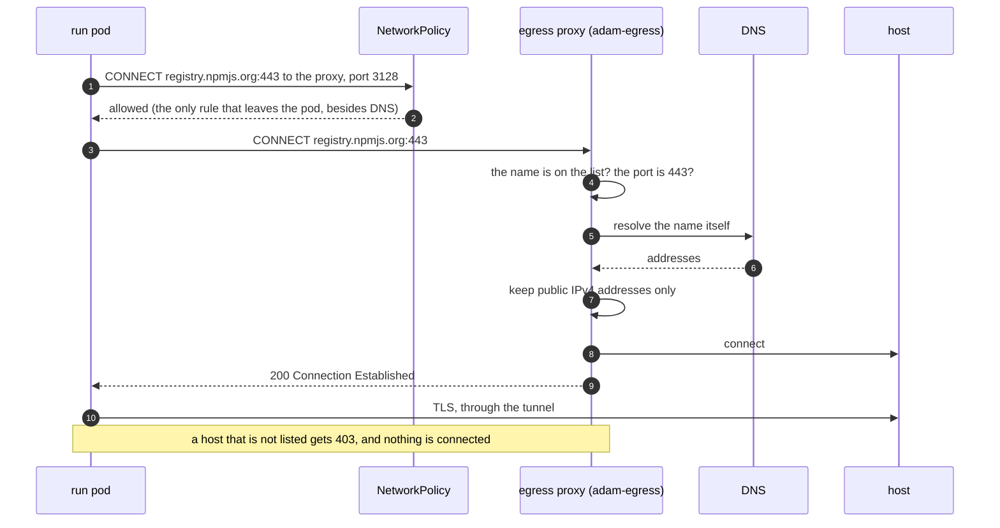
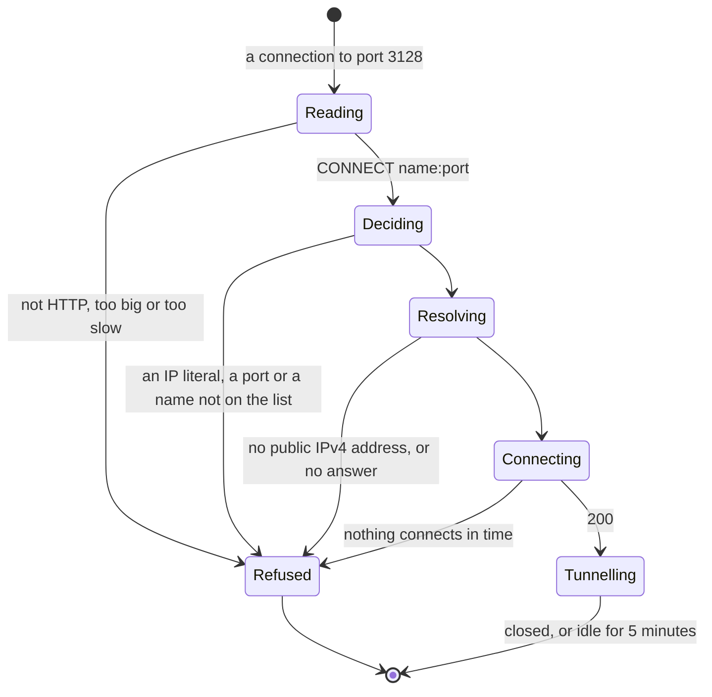

# The egress proxy and the network of run pods

For agents: [the evidence and the commands](../../.agents/docs/guides/egress-and-run-pod-network.md)

A run pod can reach **one thing on the internet: the egress proxy.** This page is for the person who runs the coder with
`runPods.enabled: true` and has to let a build reach one more host, or find out why a build cannot. The values are in
[the chart README](../../deploy/coder/README.md#the-egress-proxy); the decision is
[ADR 0042](../decisions/0042-run-pods-reach-the-internet-through-an-egress-proxy.md). Without run pods nothing here
applies: commands run in the coder's own container, which has the coder's network.

## What a run pod can reach

| To | Through | Allowed by |
|---|---|---|
| DNS | directly | the run pods' `NetworkPolicy` |
| the egress proxy, TCP 3128 | directly | the same policy |
| a host of the allow-list, HTTPS | the proxy: `CONNECT host:443` | the proxy's allow-list |
| an in-cluster target (a model gateway) | directly | `runPods.networkPolicy.extraEgress`, and the host in `runPods.egressProxy.extraNoProxy` |
| anything else | nothing | there is no rule for it |

The pod's template sets `HTTPS_PROXY`, `HTTP_PROXY` and their lower-case twins to the proxy's Service, and `NO_PROXY` to `localhost,127.0.0.1`. The
commands of a run inherit them. **A tool that ignores the variables gets no connection**: the policy denies a direct one, so the failure is
a timeout and never a leak.

The proxy sees a host name and a port and never a path, a query or a header. It does not open the TLS, and it holds no credential.

## Let a build reach one more host

1. Say which host. Read the proxy's log first (below): it names the refused host.
2. Add it to `runPods.egressProxy.extraAllow` in your values. `example.com` is that host; `.example.com` is every subdomain and **not**
   the apex, so list both when you want both. Do not add a suffix such as `.github.io`: it is every site under it. The chart refuses a
   wildcard, a URL, a port, an IP address and a bare `.com`.
3. `helm upgrade`. The allow-list is read at start, so the proxy rolls (a checksum annotation does it). Run pods need not be made again.
4. Run the build again.

`extraAllow` survives a change of the chart's defaults; `allow` replaces them. The defaults are the registries and git hosts of npm, PyPI,
crates.io, Go, GitHub and pub.dev ([the list](../../deploy/coder/README.md#the-egress-proxy)).

**A target inside the cluster** (a model gateway, a mirror) is not for the proxy. Add an egress rule to `runPods.networkPolicy.extraEgress` and its host
name to `runPods.egressProxy.extraNoProxy`, so the tools go straight to it. **A registry that speaks plain HTTP** is the same: the proxy answers
`403` to anything but `CONNECT`.

## When a connection fails

| What the run sees | What it means | What to do |
|---|---|---|
| a timeout, no answer | the tool ignored `HTTPS_PROXY` and tried directly, or the cluster's network plugin drops the proxy's traffic | check the tool reads the variables; check the proxy pods are Ready |
| `403` from the proxy, `host not allowed` | the host is not on the list | [add it](#let-a-build-reach-one-more-host) |
| `403`, `only HTTPS through CONNECT` | the tool used plain HTTP through the proxy | use an `https://` address, or an in-cluster rule |
| `403`, `no public address` | the name resolves to a private, loopback or IPv6-only address | not fixable by the list: the proxy refuses it on purpose |
| `502` or `504` | the name does not resolve, or nothing connected in 10 seconds | the host is down, or the cluster cannot reach it: it is not a list problem |
| `503` | the proxy serves its limit of connections at once | wait, or raise the proxy's replicas |
| a `403` quota message when the pod is made | not the proxy: the quota of run pods is full | [stuck runs](read-a-stuck-run.md) |

The proxy logs one JSON line per decision, with the decision, the reason, the host and the port, and never a path, a query or a header. Read the logs of
the pods of the proxy's Deployment (the chart's full name and `-egress`: `coder-egress` for a release named `coder`): a refusal is `egress request refused` with the reason.

## Upgrading

A deployment that already has run pods rolls the coder once. Run pods made before the proxy have no proxy variables, and so no way out, until the idle
sweep (`runPods.idleSecs`, 900 seconds) or the end of their run replaces them. If your builds fetched from a host outside the list, add it to
`extraAllow` first; if they called an in-cluster gateway, add its host to `extraNoProxy`. `runPods.networkPolicy.enabled` is removed, and `false` is refused.
The rest of the upgrade is [Upgrade an adam deployment](upgrade-an-adam-deployment.md).

## What it does not do

* **It is inert where the cluster's network plugin does not enforce `NetworkPolicy`**: the proxy runs and nothing forces a pod through it. Kind's does; yours is
  *unverified* until you try a direct connection from a run pod.
* **It limits where a run can send bytes, not what.** A hostile prompt can bring its own credential for an allowed host. Do not put a secret in a run.
* **Domain fronting and DNS** are not seen.
* **Only run pods are closed.** The coder pod's own egress (the model gateway, GitHub, MCP servers) is not.
* **IPv6 is denied.** No rule names an IPv6 range, and the proxy connects over IPv4 only.
* **curl and npm** are tried to read the variables; git, cargo, pip and go are documented to (*unverified* here).

The rest of the run pod's isolation (what it mounts, the git sandbox) is in [Deploy the coder](deploy-the-coder.md#run-pods).
