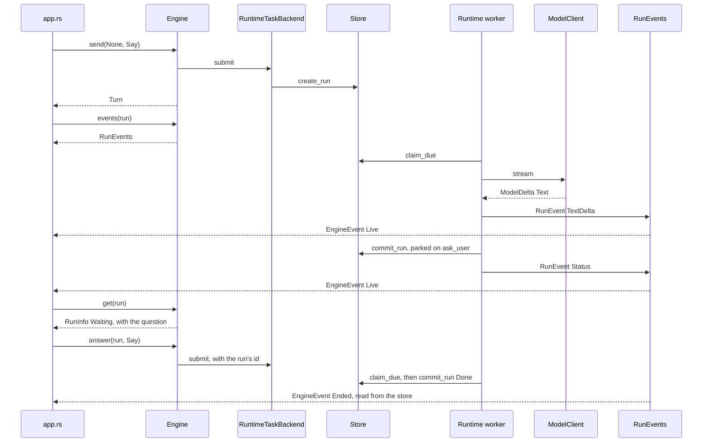

# Embed adam in an application

`adam-engine` runs adam-rs inside an application (a desktop or a phone app): no server, no protocol, nothing on the
network of its own ([ADR 0047](../decisions/0047-adam-rs-can-be-embedded-in-an-application.md)). To host agents in a
server program that serves A2A, read [Embed adam](embed-adam.md) instead.

## What the engine is

A typed Rust API over adam's runtime, on the host's tokio runtime: `Engine::builder(store, agent, model, alias)`,
`start`, then `send`, `steer`, `answer`, `cancel`, `list`, `get`, `events` and `shutdown`. No A2A type is in a
signature. Inside, every call is the code the A2A server calls, so follow-ups, steering and answers behave the same.
The calls, their refusals and their defaults: the [crate README](../../crates/adam-engine/README.md).

## What the host gives

| The host gives | As | Today |
|---|---|---|
| the store | `DynStore` | `adam_core::MemoryStore` (a restart forgets every run); the SQLite store of slice 3 when it lands |
| the agent | `AgentDef` | a folder read at startup (`AgentFolder::load`), or one compiled in (`include_agent!`) |
| the model | `DynModel`, with its credentials | any `ModelClient`: the engine links no model client and reads no key |
| secrets the agent's files name | `SecretSource` (`EngineBuilder::secrets`) | none: `default_secrets()` refuses every name |
| a tokio runtime | the current one at `start` | the worker runs on it |

The engine reads no environment variable and no file it was not given.

## The example

`crates/adam-engine/examples/chat` is a terminal chat: `main.rs` builds the engine, `app.rs` is the loop (a test drives
it, `tests/example.rs`). Its model client, `adam-model-openai`, is a dev-dependency: the engine's own tree has none.

```rust
let model: DynModel = Arc::new(OpenAiCompatible::new(OpenAiConfig::new(base_url, key))?);
let folder = AgentFolder::load(Path::new(env!("CARGO_MANIFEST_DIR")).join("examples/chat"))?;
let store: DynStore = Arc::new(MemoryStore::new());
let engine = Engine::builder(store, folder.def, model, alias).start().await?;
app::run(engine, BufReader::new(tokio::io::stdin()), std::io::stdout()).await?;
```

```sh
MODEL_BASE_URL=https://gateway.example.com/v1 MODEL_API_KEY=... MODEL=my-model \
  cargo run -p adam-engine --example chat
```

A plain line is `send` to the conversation; `/steer <text>`, `/answer <text>`, `/cancel`, `/list` and `/quit` are the
other calls. A send while the run waits is its answer, and one while it works steers it (`Turn::delivered` says which).

## How events work

`events(run)` is a stream of `EngineEvent`: `Live(RunEvent)` (a step, a piece of text, a status), `Behind { skipped }`
(the reader lost events), `Snapshot(RunInfo)` (the run read from the store, after `Behind`) and `Ended(RunInfo)`, the
last item. A live event is a prompt and the store is the truth: on a `Status`, the example calls `get(run)` to learn
whether the run waits, and on what question. The stream is bounded however slowly it is read, and a file's bytes are
withheld from it.



## Not there yet

* **A durable store**: the SQLite store is slice 3 ([ADR
  0053](../decisions/0053-sqlite-a-store-service-a-database-per-agent-and-a-static-coder.md)). Until it lands, a killed
  application loses its runs; its proof, `tests/resume_process.rs`, is written and ignored.
* **Approvals** (slice 5): a run waits only on a question today.
* **The person's directory and the file and command tools** (slices 6 and 7): the embedded agent has the screen's tools
  only (`ask_user`, `show`, `plan_*`).
* **Reading a file an agent made**: `RunInfo` carries no artifacts yet, and an event withholds a file's bytes.
* MCP servers and remote (`a2a:`) subagents: `start` refuses an agent that names them.

For an AI assistant doing this, use the `adam-embed` skill (`npx skills add vymalo/another-adam-rs --skill adam-embed`).
