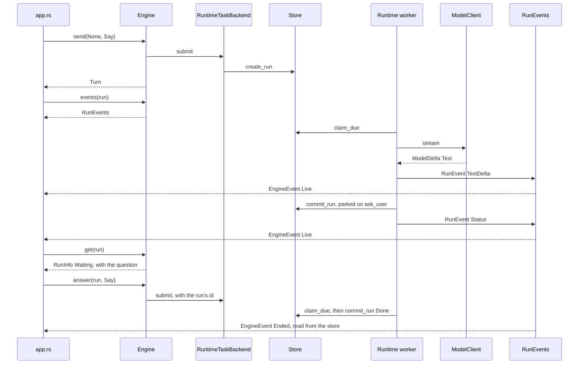
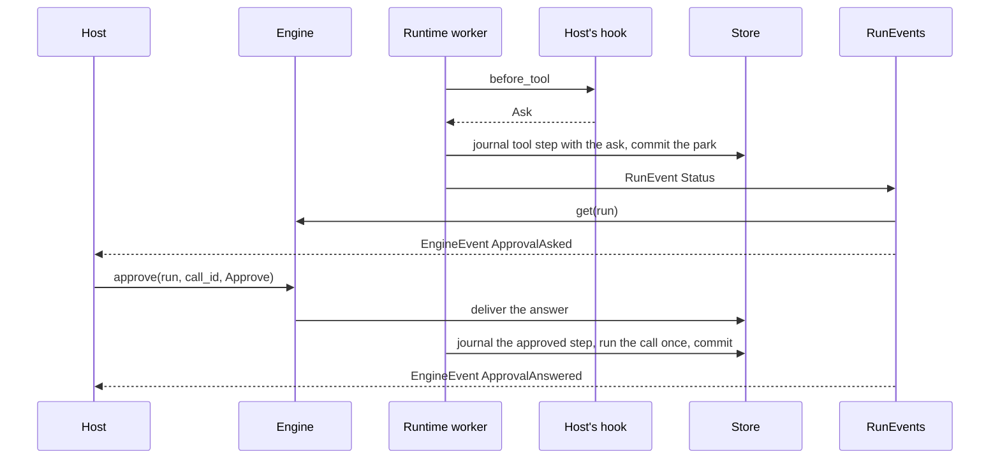
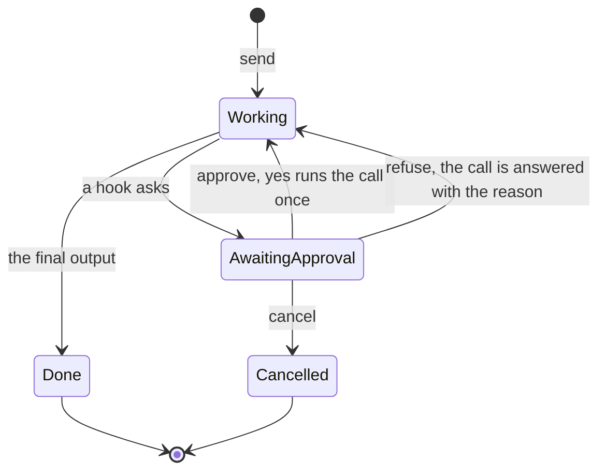

# Embed adam in an application

`adam-engine` runs adam-rs inside an application (a desktop or a phone app): no server, no protocol, nothing on the
network of its own ([ADR 0047](../decisions/0047-adam-rs-can-be-embedded-in-an-application.md)). To host agents in a
server program that serves A2A, read [Embed adam](embed-adam.md) instead.

The generated API of every library crate is on the site: [Rust API](../rust/adam/index.html){target="_self"}.
For agents: [the evidence and the proofs](../../.agents/docs/guides/embed-in-an-app.md).

## What the engine is

A typed Rust API over adam's runtime, on the host's tokio runtime: `Engine::builder(store, agent, model, alias)`,
`start`, then `send`, `steer`, `answer`, `approve`, `cancel`, `list`, `get`, `events` and `shutdown`. No A2A type is in a
signature. Inside, every call is the code the A2A server calls, so follow-ups, steering and answers behave the same.
The calls, their refusals and their defaults: the [crate README](../../crates/adam-engine/README.md).

## What the host gives

| The host gives | As | Today |
|---|---|---|
| the store | `DynStore` | `adam_store_sqlite::SqliteStore::open(path)`, a file of the application's own that outlives the process (a killed process's runs are finished by the next one); `adam_core::MemoryStore` (a restart forgets every run) |
| the agent | `AgentDef` | a folder read at startup (`AgentFolder::load`), or one compiled in (`include_agent!`); its `schedules/` run, each firing a run of the agent in the store (not in `list`, as nobody sent it: `Engine::firings` lists them, and `get`, `events` and `cancel` reach one); its `commands/` are expanded from `/name args`, and `Engine::commands()` lists them for a `/` menu |
| the model | `DynModel`, with its credentials | any `ModelClient`: the engine links no model client and reads no key |
| the deployment's model profiles | `ModelProfiles` (`EngineBuilder::models`) | none: no model has a profile, so an agent whose file sets `reasoning_effort` or `model_preset` is refused at `start` (fail closed); with them the folder's keys, the preset and the profile resolve each agent's effort and output cap per model ([ADR 0063](../decisions/0063-a-reasoning-effort-is-one-setting.md), [ADR 0064](../decisions/0064-model-profiles-reasoning-effort-and-output-cap-follow-the-model.md)) |
| the root's reasoning level | `ReasoningEffort` (`EngineBuilder::reasoning_effort`) | none: nothing is sent unless the folder, the preset or the profile sets a level; the folder's own `reasoning_effort` wins over the builder's, and the builder's wins over the agent's `model_preset` and the profile; a level the root model's profile does not take is refused at `start` (`Agent`, `Invalid`) when it applies — when the root's file sets none (a file's own level is validated instead) |
| its own tools | `ToolSet` (`EngineBuilder::tools`): an `FnTool`, or `#[tool]` functions with `adam = { default-features = false, features = ["macros"] }` | none: the catalog is the screen's tools (`ask_user`, `show`, `ui_catalog`, the plan tools); the files' `tools:` selects from it; a file a tool returns is read with `Engine::files` and `Engine::file` |
| hooks around the agent loop | `HookSet` or one `Plugin` at a time (`EngineBuilder::hooks`, `plugin`), and what a step shows of a call (`EngineBuilder::step_io`) | none: no hook runs. The host's hooks run in every agent, before any its files name; a hook that asks parks the run for the person's approval ([Approvals](#approvals)) |
| a local agent over the person's directory | `EngineBuilder::local_agent(dir)` ([ADR 0047] slice 7 part 2) | none: the agent has the screen's tools only. With one, the file and command tools (`read_file`, `read_files`, `write_file`, `edit_file`, `apply_patch`, `run_command`, `run`) run over the directory, with a hook that asks before every write or command. The directory is **never owned, cleaned or restored**: a write stays, a command's changes stay, and the run's listing tells the model what changed. See [A local agent over the person's directory](#a-local-agent-over-the-persons-directory) |
| secrets the agent's files name | `SecretSource` (`EngineBuilder::secrets`) | none: `default_secrets()` refuses every name |
| a tokio runtime | the current one at `start` | the worker runs on it |
| the process's pools | `DynAdmission` (`EngineBuilder::admission`) | none: nothing is admitted, so every model call and tool call runs. With one ([`adam-admission-local`](../../crates/adam-admission-local/README.md), or your own), every model call takes a seat of `Pool::ModelCalls` and every tool call one of `Pool::ToolCalls` ([ADR 0065](../decisions/0065-resource-governance-admission-pools-and-os-limits.md)): a model call waits five seconds and then parks the run at the refusal's `retry_after`, a tool call waits a minute and then runs anyway with a warning |
| limits | `Limits` (`EngineBuilder::limits`) | `Limits::default()`; among them `retry`, the runtime's retry policy (5 attempts, 1 s to 60 s), and `sessions`, the child sessions' limits (16 open, 4 working, 20 rounds) |

The engine reads no environment variable and no file it was not given.

**A restart that claims its runs at once is opt-in.** By default (`Limits::worker_id: None`) every start has a random
worker id and releases nothing, so a restarted application waits up to `lease_ttl` for the runs it was stepping, on
a store that keeps the leases (the SQLite store does not: its lock allows one process per file, and `start` clears
every lease the file holds; so run one engine per SQLite file, or a second one would take the first one's runs). Set `Some(id)` only for a store no other engine shares (a store per install): the host promises that no other live engine uses that id on the store, and `start` releases the
leases the id holds. In one process `start` refuses a second live engine with the same id on the same store
(`WorkerIdInUse`); it cannot see other processes, and a broken promise steps a run twice. Restarting in the same process,
call `shutdown` first.

## The example

`crates/adam-engine/examples/chat` is a terminal chat: `main.rs` builds the engine, `app.rs` is the loop (a test drives
it, `tests/example.rs`). Its model client, `adam-model-openai`, is a dev-dependency: the engine's own tree has none.

```rust
let model: DynModel = Arc::new(OpenAiCompatible::new(OpenAiConfig::new(base_url, key))?);
let folder = AgentFolder::load(Path::new(env!("CARGO_MANIFEST_DIR")).join("examples/chat"))?;
let store: DynStore = Arc::new(MemoryStore::new());
let engine = Engine::builder(store, folder.def, model, alias).start().await?;
app::run(engine, BufReader::new(tokio::io::stdin()), std::io::stdout()).await?;
```

**Ship the agent inside the application.** The example reads its folder from disk, which is the development path:
`CARGO_MANIFEST_DIR` is the build machine's path, compiled into the binary. An application compiles the folder in:

```rust
// build.rs: adam_agent_fs::build("agent").emit()?;
adam::include_agent!(); // AGENT, the folder's agent
let engine = Engine::builder(store, AgentDef::from_manifest(AGENT)?, model, alias).start().await?;
```

```sh
MODEL_BASE_URL=https://gateway.example.com/v1 MODEL_API_KEY=... MODEL=my-model \
  cargo run -p adam-engine --example chat
# With the local agent over a directory (ADR 0047 slice 7 part 2):
... cargo run -p adam-engine --example chat -- --dir /path/to/dir
```

A plain line is `send` to the conversation; `/steer <text>`, `/answer <text>`, `/approve`, `/deny [reason]`, `/cancel`,
`/list` and `/quit` are the other calls. The example's host gives a tool of its own, `save_note`, and a hook that asks
before every call of it, so "remember to buy milk" prints an approval to answer. With `--dir <path>`, the chat is also
a local agent over `<path>`: writes (`write_file`, `edit_file`, `apply_patch`) and commands (`run_command`, `run`) print
an approval to answer; reads pass without asking. A send while the run waits is its answer, and one while it works steers it (`Turn::delivered` says which).
When the input ends (`printf 'hi\n' | ...`), the example follows the run to its end or its question, then shuts down.

::: in-depth How events work, in full

## How events work

`events(run)` is a stream of `EngineEvent`: `Live(RunEvent)` (a step, a piece of text, a status), `Behind { skipped }`
(the reader lost events), `Snapshot(RunInfo)` (the run read from the store, after `Behind`) and `Ended(RunInfo)`, the
last item. A live event is a prompt and the store is the truth: on a `Status`, the example calls `get(run)` to learn
whether the run waits, and on what question. The stream is bounded however slowly it is read, and a file's bytes are
withheld from it.



:::

## Approvals

A tool call can wait for the person's yes ([ADR 0047](../decisions/0047-adam-rs-can-be-embedded-in-an-application.md)
slice 5). The host installs a hook that asks, renders what it asks, and answers with a button.

1. **Install the hook.** A `Plugin` whose `before_tool` answers `Verdict::Ask(question)` for the calls the person must
   approve, given with `EngineBuilder::plugin`. It runs in every agent the engine runs.
2. **Render the approval.** The run is `RunState::AwaitingApproval`, not `Waiting`, and its stream says
   `EngineEvent::ApprovalAsked`. Both carry an `ApprovalRequest`: the call's id, the tool, the hook's question and the
   arguments the call runs with. They show no more than the call's step does: with a redactor
   (`EngineBuilder::step_io`), what it hides stays hidden.
3. **Answer it.** `approve(run, call_id, Decision::Approve)` runs the call, once; `Decision::Refuse(reason)` does not,
   and the model reads the person's words. The stream then says `ApprovalAnswered`. An answer for another call, or
   for a run that awaits none, is refused (`Rejected`). Typed text reaches an approval too, through `answer` or `send`,
   but only a clear yes (`yes`, `ok`) runs the call, which is why a host shows buttons.

```rust
let engine = Engine::builder(store, agent, model, alias).plugin(AsksBeforeWriting).start().await?;
// ... `EngineEvent::ApprovalAsked(request)` on the run's stream:
engine.approve(run, &request.call_id, Decision::Approve).await?;
```





The ask is recorded in the call's step, so neither a restart of the application nor a replay asks again, and an
approved call never runs twice. A run nobody can answer, a schedule's firing or a child run, reads the ask as a refusal.
Approvals do not reach A2A clients yet: that is a new extension, not built.

## A local agent over the person's directory

[ADR 0047](../decisions/0047-adam-rs-can-be-embedded-in-an-application.md) slice 7 part 2: the engine can give the
agent the file and command tools over a person's own directory, with a hook that asks before every write or command
and the host answers with the same `approve` as for any other hook.

```rust
let engine = Engine::builder(store, agent, model, alias)
    .local_agent("/path/to/persons/dir")   // opens the directory once at start
    .start()
    .await?;
```

[`EngineBuilder::local_agent`](../../crates/adam-engine/README.md#the-api) opens the directory at `start` (with
`PersonDir::new(&path, std::iter::empty::<&str>())`, no `&[]`) and refuses an unreadable one with
`EngineError::Invalid` (a missing path, a file or a symlink). The directory is **never owned, cleaned or restored**:
a write stays, a command's changes stay, and the run's listing tells the model what a command changed (the listing is
the same one `PersonDir` keeps for every command; nothing is undone). Reads pass without asking; writes
(`write_file`, `edit_file`, `apply_patch`) and commands (`run_command`, `run`) park the run in
`RunState::AwaitingApproval` always — a missing or empty argument still asks, so the run never bypasses the
approval. The hook's question names the tool, the path (or the patch's paths — `+++ <component>/<path>` or
`+++ <path>`, the first component dropped as `git apply -p1` does — up to 8 then "and N more"), or the shell line
(and, when set, the `cwd`).

The seven tools are the same `adam-code-tools` bodies the coder uses (`read_file`, `read_files`, `write_file`,
`edit_file`, `apply_patch`, `run_command`, `run`), with the coder's `repo` (slot/repo) argument dropped: a
`PersonDir` is one place, so the model never picks one. Their schemas and doc comments are the coder's (the tool
contract the model sees), so the model sees the same tool description here as on a coder run.

A host that wants its own composition registers the pieces by hand:
[`adam_engine::local_agent::tool_set`](../../crates/adam-engine/src/local_agent.rs) is the `ToolSet`, and
[`adam_engine::local_agent::plugin`](../../crates/adam-engine/src/local_agent.rs) is the asking hook. Add them to
the builder the same way you would any host tool or hook.

The example (`crates/adam-engine/examples/chat`) takes the directory as `--dir <path>`. With it, `remember to buy
milk` writes `notes.txt` (after the host's `/approve`), and `ls` runs (after the host's `/approve`); without it,
the example is the chat-only one. The embedded tree now carries `adam-code-tools`, `adam-macros` and
`adam-llm-agent`'s `schema` feature; `tools/embedded-deps/check.sh` is the gate (no binary refers to
`adam_llm_agent::__private::schemars`).

## Not there yet

* **Reading a file an agent made**: `RunInfo` carries no artifacts yet, and an event withholds a file's bytes.
* MCP servers and remote (`a2a:`) subagents: `start` refuses an agent that names them.

For an AI assistant doing this, use the `adam-embed` skill (`npx skills add vymalo/another-adam-rs --skill adam-embed`).
