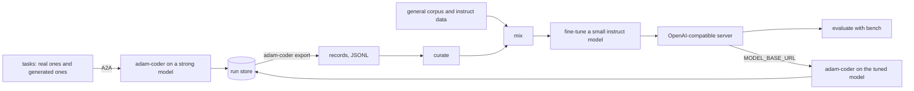

# Export runs for training

For agents: [the invariants, the gates and the evidence](../../.agents/docs/guides/export-runs-for-training.md)

`adam-coder export` and `adam-agent export` write the runs in the store as training records, one JSON line per run, in
the chat shape most fine-tuning tools read. Use them to train a small model on what a strong model did with adam as
its harness: for example an instruct model that knows Rust and CrateStack and drives adam's tools well. The decision is
[ADR 0085](../decisions/0085-runs-are-exported-as-training-records.md).

## Export

Run the binary with the environment its server runs with (`DATABASE_URL` and the rest), and the `export` subcommand.
It starts no server and no worker: it reads the store, writes the records and exits. With SQLite, stop the server
first: one process holds the file.

```sh
EXPORT_PSEUDONYM_KEY=... adam-coder export --require lang=rust --require dep=cratestack --out coder-runs.jsonl
```

| Flag | Default | What it does |
|---|---|---|
| `--agent NAME` | the binary's agents | export this agent's runs; repeat it for several |
| `--status done\|failed\|all` | `done` | which runs to keep: finished, failed, or every run, unfinished ones included |
| `--require KIND=VALUE` | none | keep a run only if it has this facet; repeat it: `lang=rust` and `dep=cratestack` are both required |
| `--since`, `--until` | none | keep runs last updated in this window (RFC 3339) |
| `--include-compacted` | off | keep runs whose history was summarised: their messages are not what the model saw at every turn |
| `--include-reasoning` | off | keep the model's reasoning text, when the run kept it |
| `--out PATH` | standard output | write to a file, readable by its owner only |

A wrong command line is exit 64, an unknown `--agent` or an empty key exit 78. The summary (runs seen, written, filtered, not a conversation, unreadable) goes to the log on standard error.
`EXPORT_PSEUDONYM_KEY` is the key of the pseudonymous ids: keep the same one to link two exports; leave it unset and
each export gets a random key ([environment variables](../reference/environment.md)).

The record, every field and the facets are described in [the crate's README](../../crates/adam-export/README.md).

## What leaves the store, and what does not

| Exported | Never exported |
|---|---|
| the messages: what the person wrote, what the model wrote, its tool calls and the tools' results | the store's run and conversation ids: they become pseudonyms |
| the agent, status, times, turns, tool calls, tokens, model aliases | the conversation's context, the caller, the prompt statement, the session header |
| the facets (`lang`, `dep`) and the outcome (error, artifact names) | image bytes: an image becomes `[image]` |
| reasoning, only when asked | secrets: every string is scrubbed of the deployment's secrets and of well-known token shapes |
| the system prompt and tools the run's last model call was sent, when the run recorded them (`tools_source: "recorded"`) | |

The messages a person wrote are exported. Export only threads you may train on: that is your call, not the code's. An
export is always a command someone runs; no worker or schedule exports anything.

A run's model calls record their system prompt and tools from this version on. A run from before has no system
message and no tools (`tools_source: "none"`); keep it out of a tool-use dataset.

**A subagent's run is not exported yet** unless it has a conversation (a child session has one, a plain subagent run
does not): the exporter lists runs by conversation.

## The pipeline



1. **Collect.** Run `adam-coder` ([locally](run-locally.md) or [in a cluster](deploy-the-coder.md)) on a strong
   teacher model, with a store that keeps its runs, on tasks in the target stack. Use real tasks, and tasks another
   model writes for you, sent to the coder over [A2A](../reference/a2a-server.md) a batch at a time. Each run that ends in a pull
   request is a worked example.
2. **Export** the finished runs of that stack: `--status done --require lang=rust --require dep=cratestack`. Facets are
   guessed from the files and manifests a run touched, so read a sample before you trust a filter.
3. **Curate.** Drop duplicates (the same task twice), compacted runs (left out by default) and runs longer than your
   trainer's context. A judge model may score runs so you keep the best. **Never let a model rewrite a trajectory**:
   the tool results are what the tools really returned, and a rewritten one teaches the model a world that does not
   exist.
4. **Mix and fine-tune.** adam's runs teach the harness, not the language: mix them with a general corpus for the
   language and the framework (code, docs) and some general instruct data, then fine-tune (SFT) a small instruct model
   with its own chat template. The records use the OpenAI chat shape (`messages` with `tool_calls`, and `tools`),
   which the chat templates of models such as Qwen and common SFT tools accept (*unverified*: from memory, not checked
   against each trainer's current documentation).
5. **Evaluate.** Serve the tuned model on an OpenAI-compatible server and run [the benchmark harness](../../bench/README.md)
   against it: its configuration's `endpoint` is the model's address, and the harness hands the coder its own meter
   as `MODEL_BASE_URL`. Outside the harness, point the coder's `MODEL_BASE_URL` and `MODEL` at the tuned model.
6. **Iterate.** The tuned model's own verified runs become more data. Later, a failed run and a successful one on the
   same task can make a preference pair.

The benchmark harness resets its database before each run, so its runs are not kept for export: collect with a coder
of your own.

## Not built yet

| What | Until then |
|---|---|
| The coder's outcome: the pull request, whether its head was verified, the checks (slice E4) | the outcome is the run's status, its error and its artifact names (the coder's `pull_request` among them) |
| One sample per assistant turn, with its exact prefix and tools (slice E5) | one record per run |
