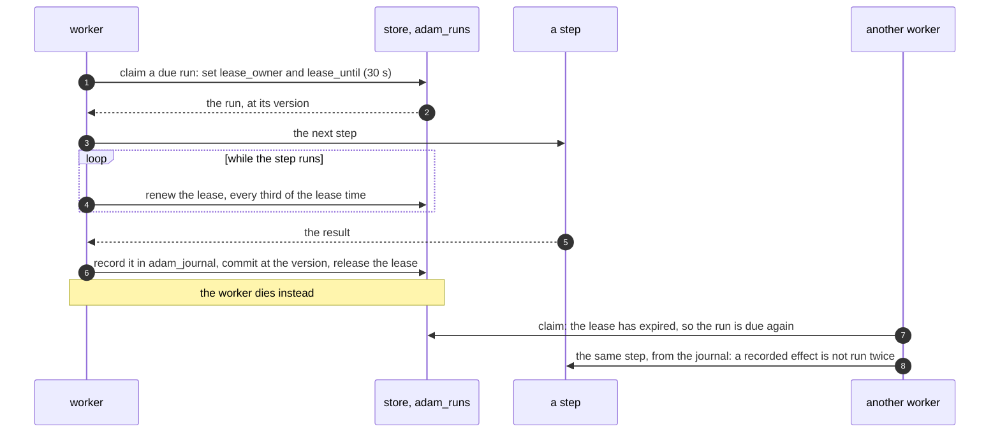
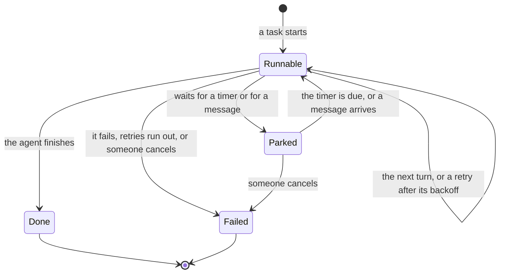

# Read a run's state when it is stuck

For agents: [the queries and the evidence](../../.agents/docs/guides/read-a-stuck-run.md)

A task that does not finish is almost always one of five things, and the store says which. This page is for the person who runs a deployment and
asks "is it stuck, or is it waiting?". It tells you what to look at and why; it never asks you to change a row. Most waits are not faults.

## Look in this order

1. **What the client sees.** The task's state is a view of the run's row, so start there. [The A2A server](../reference/a2a-server.md) says how to ask for it.
2. **The run's row** in the store: its status, its timer, its lease, its owner and how old it is.
3. **The run's journal**: the last step it recorded, and when.
4. **The logs** of the worker that holds the lease, if there is one.

| The client sees | The row is | So |
|---|---|---|
| `submitted` | runnable, version 1, no worker has a lease | nobody has taken it yet |
| `working` | runnable, or parked with a timer | a worker has it, or it waits for a time |
| `input-required` | parked and waiting (the run's wake bookkeeping says no timer will wake it; usually no `wake_at`, *unverified* as a rule of thumb) | it waits for a person's message or an approval: **not stuck** |
| `auth-required` | parked on the model after a refusal of HTTP 401 or 403 | **the model key or the gateway credential is refused:** check it. Waiting will not help |
| `completed` | done | finished |
| `failed` | failed | finished with an error; the error text is in the run |
| `canceled` | failed, with an error that starts `cancelled:` | someone cancelled it |

A front (`ROLE=control-plane`) only starts, delivers and cancels runs. A task it holds stays `submitted` until a worker claims it.

## The tables

The store keeps its tables with the prefix `adam_` (PostgreSQL and SQLite; MongoDB keeps collections of the same names). They are described in
[Data: the run store](../architecture.md#data-the-run-store).

| Table | One row is | You read it for |
|---|---|---|
| `adam_runs` | a run | `status`, `wake_at`, `sched_at`, `lease_owner`, `lease_until`, `owner`, `version`, `updated_at`; the run's head holds the error and the output |
| `adam_journal` | one recorded step of a run | the last `name` and `recorded_at`, and whether it was `ok` |
| `adam_push` | a webhook of a task | `state` and `last_error`, when a client says it was never told |
| `adam_body` | one message of a run's transcript | rarely: how long the history is |
| `adam_meta` | the schema version | after an upgrade |

Read them, never write them: a hand-edited row skips the version check that keeps two workers from both winning. To end a run, cancel the task; to
send it on, deliver a message.

## A run's life

`Runnable` with a lease in the future is a run being worked; with no lease, or an expired one, it is waiting for a worker. A `Parked` run with no timer waits for
a message and never becomes due by itself.

## What the row says

| In `adam_runs` | It means | What to do |
|---|---|---|
| `parked`, no `wake_at` | waiting for a person's answer or an approval | answer it. Nothing is wrong |
| `parked`, `wake_at` ahead | a timer, a wait for a child or a remote task, or a model refusal the run waits out. A refusal with 401 or 403 shows the client `auth-required` | wait, unless the client sees `auth-required`: then check the model key or the gateway credential. A model that keeps refusing fails the run when `MODEL_PARK_LIMIT` is up ([environment](../reference/environment.md)) |
| `runnable`, `wake_at` ahead | a transient failure, retrying after its backoff | wait; read the last journal entry and the logs for the cause. The run fails when the retries are used up |
| `runnable`, `wake_at` empty or past, no lease or an expired one, for long | no worker is taking it | see [nobody takes it](#nobody-takes-it) |
| `runnable`, lease ahead, `lease_owner` is a pod that is gone | the worker died holding it | wait for the lease (30 seconds by default): any worker then takes the step over |
| `runnable`, lease ahead and renewed, `version` and the journal not moving | one step is long | see [a long step](#a-long-step) |
| `failed` | it ended with an error | read the error in the run's head; [troubleshoot by error class](troubleshoot-by-error-class.md) |

## Nobody takes it

* **No worker for the agent.** A deployment with `topology: split` has a front and a worker; check the worker pod runs and serves its health check. A task of
  an agent no worker serves is never claimed.
* **A pinned run whose owner is gone.** With `workspace.placement: affinity` or `isolated`, a run is bound to the worker that first took it (`owner`). If
  that pod was scaled in, or its worker id changed, **nothing adopts the run and nothing reports it**. Bring the worker back with the same id and the same
  volume. Do not scale such workers in ([placement](../reference/workspace-and-environments.md#placement-which-worker-holds-a-runs-files)).
* **Every worker is busy.** A worker steps four runs at once by default. A long queue is slow, and not stuck.
* **Clocks.** A lease ends by the time a worker passes in, so a worker whose clock is far off sees leases end early or late. Keep NTP on.

## A long step

A lease that keeps renewing while nothing is committed means a worker is inside one step. Which step is the last journal entry. The usual ones:

* **A command** that has not ended. A tool has a time limit (300 seconds unless it says otherwise), and a cancel kills the command.
* **A run pod that is not there yet.** With run pods, a command waits for a slot of the quota, up to `RUN_POD_WAIT_SECS` (1020 seconds in the chart; the binary's own default is 600), or for a node to pull the
  image on first use. [Run pods](deploy-the-coder.md#run-pods) says what is rendered. A pod that is refused in words in the log is the deployment's mistake, not the run's.
* **The git sandbox** that cannot be reached: the step is retried, never run in the coder's own container.
* **A model that is slow.** The coder waits for the gateway; a gateway that refuses parks the run on a timer instead.
* **The network of a run pod.** A build that waits for a host the proxy refuses: [the egress proxy](egress-and-run-pod-network.md).

## What not to do

* **Do not delete a run's row** to unstick it: its journal, push configs and blobs go with it (cascade), and the pull request it opened does not.
* **Do not clear a lease by hand** unless no worker is alive: a second worker would run a step beside the first. The commit is a compare-and-swap on the version,
  so the later commit loses, but the effects of both steps happen.
* **Do not expect a finished run to stay for ever.** Finished runs are deleted after `RUN_RETENTION_DAYS` (90 by default), with their journal.
