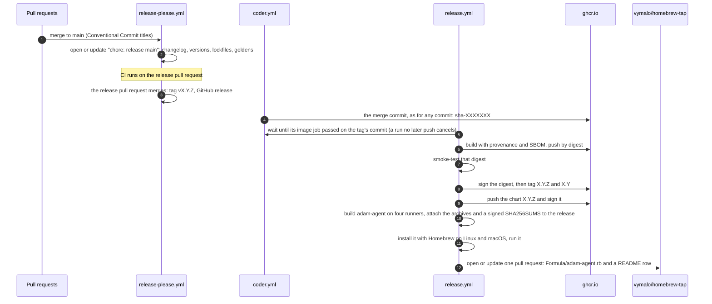
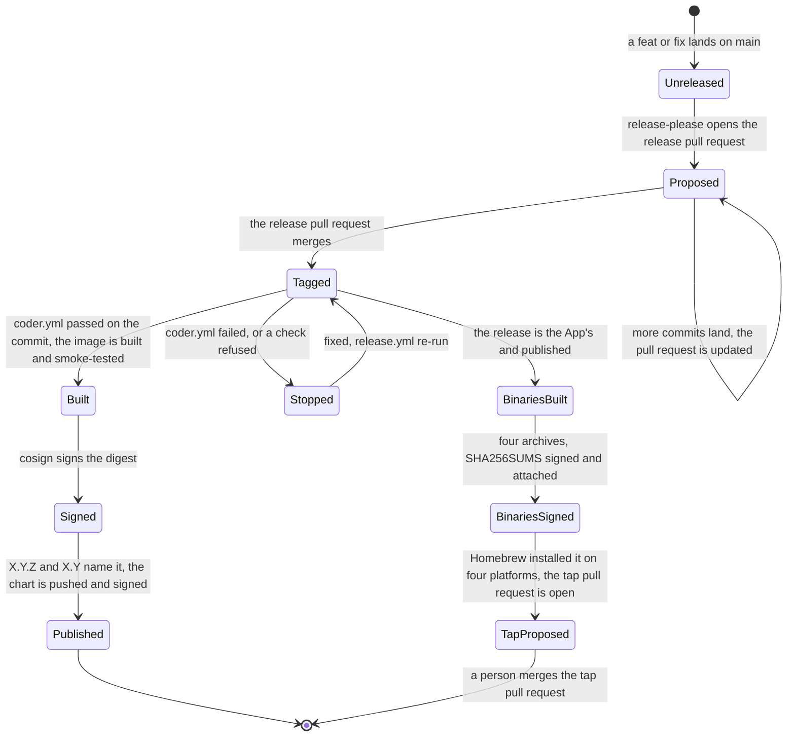

# Releases

For agents: [the procedure, the files and the evidence](../../.agents/docs/guides/releases.md)

adam-rs releases the way vaam-apps/vpay does ([ADR 0084](../decisions/0084-releases-are-cut-by-release-please-and-production-pins-a-version.md)).
Every merge to `main` still builds a `sha-<7>` image for development. A release is a version, `X.Y.Z`, cut on
purpose: one number for every crate, the image and the chart. Production deploys releases only.

## What a release is

| Artifact | Name | Signed |
|---|---|---|
| Image | `ghcr.io/vymalo/another-adam-rs/coder:X.Y.Z`, and `:X.Y` for the newest patch of a minor | cosign, keyless; provenance and an SBOM in the image |
| Chart | `oci://ghcr.io/vymalo/another-adam-rs/charts/coder`, version `X.Y.Z`, whose `image.tag` is `X.Y.Z` | cosign, keyless |
| `adam-agent` | `adam-agent_X.Y.Z_<os>_<arch>.tar.gz` on the GitHub release, for linux and darwin, amd64 and arm64, and `brew install vymalo/tap/adam-agent` | the `SHA256SUMS` file, cosign keyless |
| Notes | the GitHub release `vX.Y.Z` and `CHANGELOG.md`, from the commits since the last release | no |

There is no `latest`. A published `X.Y.Z` never moves.

## How a release happens





A release pull request is never written by hand: merge it when you want the version it names. The title of every pull
request is a Conventional Commit, because it is the commit `main` keeps and the type picks the number: before 1.0, a
`feat` moves the minor (`0.6.0`), a `fix` or anything else the patch (`0.5.1`), and a breaking change (`feat!:`) the
minor too. A `Release-As: X.Y.Z` footer in a commit picks another number.

## Which tag to deploy

| You run | Pin | Moves when |
|---|---|---|
| production | the image `X.Y.Z@sha256:<digest>`, the chart version `X.Y.Z` | you change the pin |
| a development cluster that follows `main` | `sha-<7>`, or the chart from `main` | the bump commit lands ([upgrade](upgrade-an-adam-deployment.md#how-the-tag-moves)) |

Install a release from the registry:

```sh
helm install coder oci://ghcr.io/vymalo/another-adam-rs/charts/coder --version X.Y.Z \
  -n another-agentic-system -f my-values.yaml \
  --set image.tag=X.Y.Z@sha256:<digest>
```

The digest is in the release run's summary, or read it from the registry
([the agent page](../../.agents/docs/guides/releases.md#read-a-releases-digests)). The chart's own `image.tag` is already
`X.Y.Z`; the `--set` adds the digest, so a tag moved by hand could not change what runs.

## Check a release

```sh
cosign verify ghcr.io/vymalo/another-adam-rs/coder:X.Y.Z \
  --certificate-identity "https://github.com/vymalo/another-adam-rs/.github/workflows/release.yml@refs/tags/vX.Y.Z" \
  --certificate-oidc-issuer https://token.actions.githubusercontent.com
```

The same command with `ghcr.io/vymalo/another-adam-rs/charts/coder:X.Y.Z` checks the chart. The image's provenance and
SBOM are in its index (`docker buildx imagetools inspect` with `--format '{{json .Provenance}}'` or `'{{json .SBOM}}'`).

## The `adam-agent` binary and Homebrew

A release also ships `adam-agent`, the binary that serves an agent folder, for people who do not run containers
(ANR-1203). It is built by the same workflow, on the same tag, after the same gate, so a version exists as an image, a
chart and a binary together or the run says which one is missing.

| Archive | Built on | Linked |
|---|---|---|
| `adam-agent_X.Y.Z_linux_amd64.tar.gz` | GitHub-hosted Linux, x86_64 | static (musl) |
| `adam-agent_X.Y.Z_linux_arm64.tar.gz` | GitHub-hosted Linux, arm64 | static (musl) |
| `adam-agent_X.Y.Z_darwin_arm64.tar.gz` | GitHub-hosted macOS, Apple silicon | system libraries only |
| `adam-agent_X.Y.Z_darwin_amd64.tar.gz` | GitHub-hosted macOS, Intel | system libraries only |

The macOS archives are built on macOS runners because Apple's targets cannot be linked from Linux. They are not
notarized. Each archive holds the binary and the two licence files.

Check one:

```sh
cosign verify-blob SHA256SUMS --bundle SHA256SUMS.sigstore.json \
  --certificate-identity "https://github.com/vymalo/another-adam-rs/.github/workflows/release.yml@refs/tags/vX.Y.Z" \
  --certificate-oidc-issuer https://token.actions.githubusercontent.com
sha256sum --check --ignore-missing SHA256SUMS
```

Homebrew is never reached by a tag alone. Only a GitHub release made by the release App (so one that release-please
made when the release pull request merged; the workflow reads the App's own slug and accepts no other author) goes on: the four archives and the signed checksums are attached, the
formula is installed with Homebrew on Linux and macOS, arm64 and x86_64, and runs `adam-agent --version`, and only then
does the App open **one pull request** on [`vymalo/homebrew-tap`](https://github.com/vymalo/homebrew-tap) (branch
`bot/adam-agent`) with `Formula/adam-agent.rb` and a row of the tap's README. A person merges it; a newer release
rewrites the same branch, and a version older than the tap's is never proposed. A published archive is never replaced:
a re-run of a release whose archives and signed checksums are all on the release builds nothing and tests what is
there; a release that holds some of them stops for a person. If GitHub's immutable releases are ever switched on,
attaching assets after the release is published fails, and this path must move to a draft release first.

## Set up once (the owner)

1. Create a GitHub App with the repository permissions **Contents: read and write** and **Pull requests: read and
   write**, and install it on this repository only.
2. Add two repository secrets: `RELEASE_PLEASE_APP_CLIENT_ID` (the App's **Client ID**, `Iv23li...`, not its numeric
   App ID) and `RELEASE_PLEASE_APP_PRIVATE_KEY` (a private key of the App). These are vpay's names.
3. After the first release, make the package `another-adam-rs/charts/coder` public, and check an anonymous pull.
4. For the Homebrew formula, install the same App on `vymalo/homebrew-tap` too (Contents and Pull requests, read and
   write). Nothing else: the release must be authored by `<the App's slug>[bot]`, which the workflow reads from the
   App's token.

Until the App is set up, `release-please.yml` fails at its first step and nothing is released. The tag must come from
the App: a tag made with the workflow's own token starts no workflow.

## What is not proven yet

No tag has been pushed. The Homebrew path (the four builds, the signing of `SHA256SUMS`, the Homebrew installs and the
tap pull request) has not run either: it needs the App on the tap and a release with the new `--version`. The App, the release pull request, the build and smoke tests on a tag, the signatures and the
chart's first push have not run; the release workflow checks each as it goes and stops rather than publish half.
