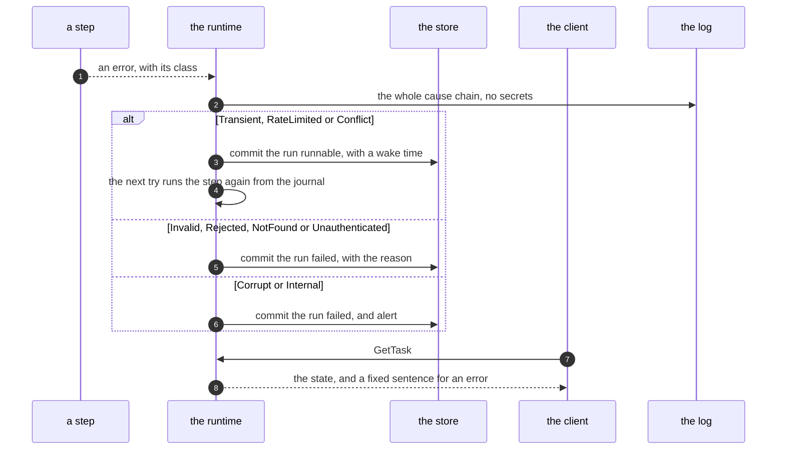
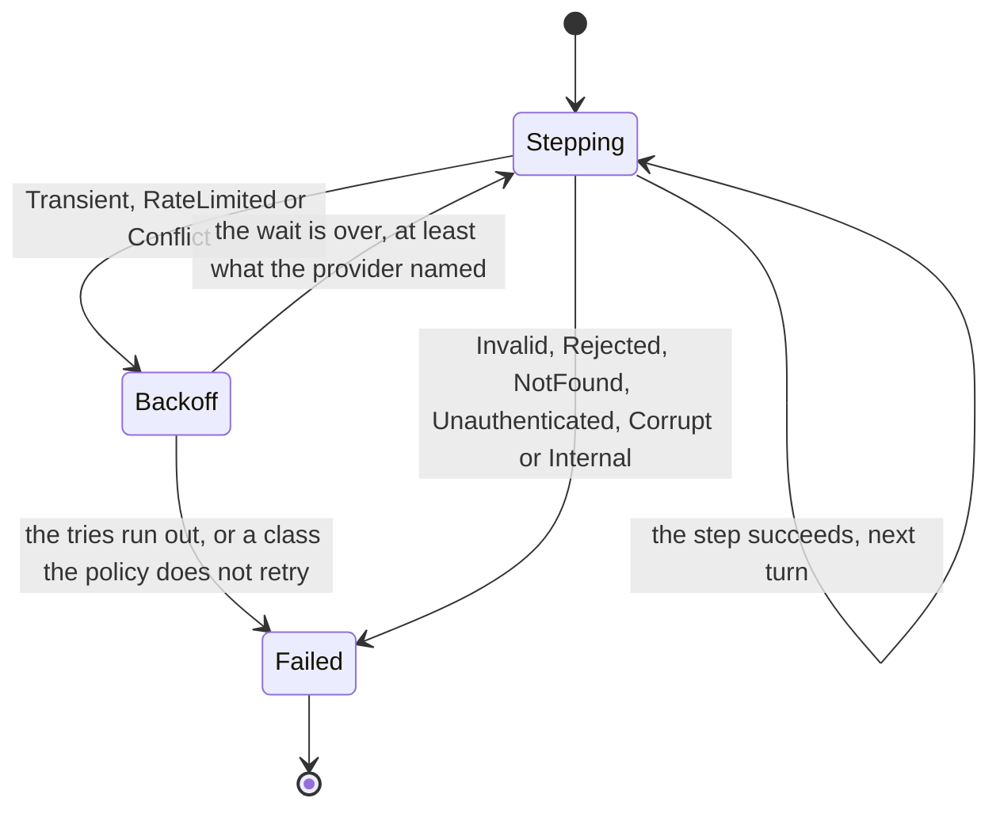

# Troubleshoot by error class

For agents: [where each row comes from](../../.agents/docs/guides/troubleshoot-by-error-class.md)

Something failed: a pod exited, a task came back `failed`, a client got an error. Every error in adam has a **class**, and the class says what to do before the
message does. This page goes from a class to an action. The full tree of variants, the A2A codes and the exit codes are in
[Errors](../reference/errors.md); this page is the one to open on a bad day.

## Find the class

| You have | The class is in |
|---|---|
| a pod that exited | the exit code ([below](#exit-codes-of-a-pod)) |
| a client error | the A2A code, which maps to one or more classes ([the table](#one-row-per-class)) |
| a run that failed | the run's error text, and the log line of the step; the journal's last entry says which step |
| a log line `adam-coder failed` (or `adam-agent failed`) | the whole cause chain, with none of the process's secrets |

A client is told a fixed sentence, never the cause: the cause chain is in the log. So when a client says "internal error", read the log of the worker.

## One row per class

| Class | What it means | The client sees | Exit | What to do |
|---|---|---|---|---|
| `Transient` | it may work later: a network error, a 5xx, a timeout, a full pool, a child process that crashed | `-32603` "backend temporarily unavailable" | 69 | **Wait.** The runtime retries with backoff. If it keeps failing, the dependency is down: the database, the model gateway, the git host. A pod that exits 69 at start cannot reach its database: check `DATABASE_URL` and the database pod |
| `RateLimited` | a provider or a resource budget said slow down | `-32603` "backend temporarily unavailable" | 69 | **Wait.** A step that meets a provider's limit is retried after at least the time the provider named, and the run fails only when its attempts run out ([retry](../reference/errors.md#retry)). An admission or budget refusal never fails a run. If it is constant, raise the quota at the gateway or lower the load: [admission refusals](../reference/errors.md#admission-refusals) |
| `Conflict` | two writers raced and this one lost | `-32603` "backend temporarily unavailable" | 69 | **Usually nothing:** the loser retries at once, up to 16 times, then drops its result with a warning. Many in a row point at contention (*unverified* as to cause): [read the run](read-a-stuck-run.md) and check the clocks and the worker ids |
| `Invalid` | the input is wrong and never will be right | `-32602` invalid params | 78 | **Fix the input.** At start it is a configuration error: the log names the variable or the file. A request that says it again fails the same way. A resource over its limit is this class too, naming the limit |
| `NotFound` | the thing is not there, or not visible to this caller | `-32001` task not found | 1 | **Check the id and the caller.** A task of another caller reads as absent. A finished run is deleted after `RUN_RETENTION_DAYS` (90 by default) |
| `Rejected` | the request is valid but the target's state forbids it: finished, busy, already exists, no room on the disk | `-32602` invalid params, and `-32002` for a cancel | 1 | **Do something else.** A finished task cannot be sent a message: start a new one that continues it. A cancel of a finished task is `-32002`. A disk that is full needs space or a higher limit |
| `Unauthenticated` | a credential is missing or refused: the model key, the git token, the GitHub App, a registry | `-32603` "internal error" | 1 | **Check the secret** the log names: [Secrets](deploy-the-coder.md#secrets). A missing `ExternalSecret` property leaves a pod in `CreateContainerConfigError`. (A caller with no bearer token for adam gets HTTP `401` before any class applies) |
| `Unsupported` | the peer does not offer this | `-32603` "internal error" | 1 | No error maps here today. If you see one, it is a defect: [report it](#when-it-is-a-bug) |
| `Corrupt` | stored or received data breaks an invariant | `-32603` "internal error" | 70 | **Do not retry; tell someone.** The run is failed on purpose, because a row that can never be read must not be leased for ever. Keep the log line, check the store and the volume, and [report it](#when-it-is-a-bug) |
| `Internal` | a bug, or an error nobody classified | `-32603` "internal error" | 70 | **Alert and collect:** the log line with its cause chain, the run id and the journal's last step: [report it](#when-it-is-a-bug) |

`Corrupt` and `Internal` are the two that alert. The three retryable classes (`Transient`, `RateLimited`, `Conflict`) all reach a client as the same
sentence, and all exit 69 at boot, so the log is how you tell them apart.

## Exit codes of a pod

| Exit | Meaning | Look at |
|---|---|---|
| 0 | clean shutdown after SIGTERM | nothing |
| 78 | configuration: a bad value, an agent folder that does not load, a store `DATABASE_URL` the process cannot serve | the log line: it names the variable. The store's reasons are in [the exit-78 table](../reference/errors.md#the-stores-exit-78-reasons) |
| 69 | a dependency was unreachable at boot (Postgres, MongoDB, SQLite) | the database pod and the network policy |
| 71 | the OS refused: a port that cannot bind, a directory that cannot be made | the pod's `LISTEN_ADDR` and its volumes |
| 70 | a half of the process stopped, a panic or an internal error | the log line `adam-coder failed` |
| 1 | anything else | the log line |

The values follow BSD `sysexits.h` (*unverified*, from memory). A pod that loops on 78 after an upgrade is the commonest case: read
[Upgrade an adam deployment](upgrade-an-adam-deployment.md#what-can-need-your-hand).

## What the runtime does with a class

A step retries five times by default, waiting one second and doubling up to a minute; a tool or a folder can set its own policy
([retry](../reference/errors.md#retry)). A store error met while stepping is decided by class too: `Corrupt` and `Invalid` fail the run, any other leaves it to its lease. In the coder a permanent **tool** failure is not a failed run: the model is told, and goes on.

## When it is a bug

For `Internal`, `Corrupt` or an `Unsupported` you cannot explain, collect: the build (the card's `version` says the commit), the `adam-coder failed` line with its cause
chain, the run id and the name of the journal's last step. Read the log first for a secret and remove it. A vulnerability is [reported privately](../../SECURITY.md).
