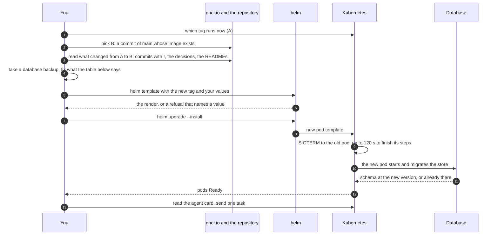
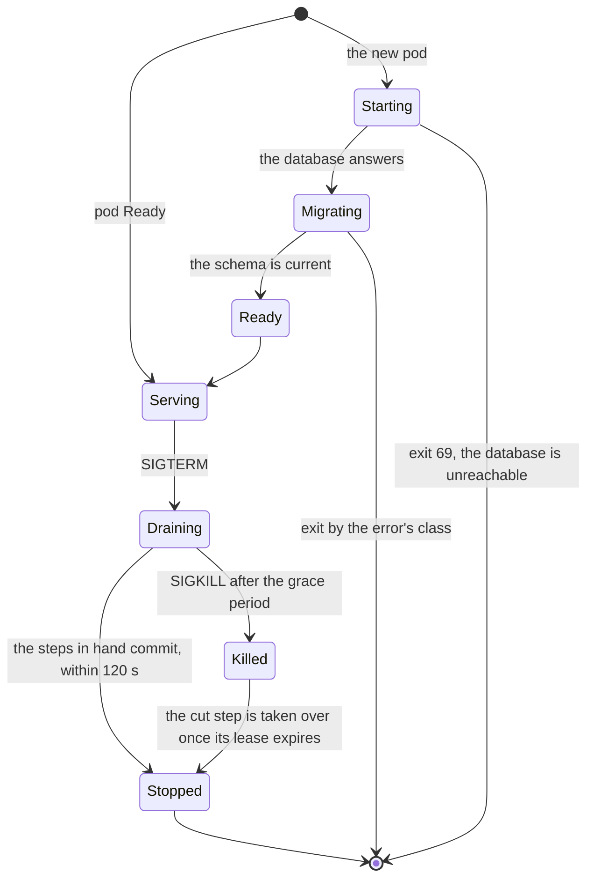

# Upgrade an adam deployment

For agents: [the evidence and the commands](../../.agents/docs/guides/upgrade-an-adam-deployment.md)

You run the coder (or a folder agent) on Kubernetes and want a newer build. This page is the path for a person:
what to read first, what can bite, how the new image reaches the pods, and how the database follows. It does not
cover moving a Rust program's git dependency on adam: that is the `adam-upgrade` skill
([`SKILL.md`](../../.agents/skills/adam-upgrade/SKILL.md)), whose steps this page follows for a deployment.

## How the tag moves

adam-rs has no semver releases and no changelog: the history, the decisions and the READMEs are the changelog. An
image is `ghcr.io/vymalo/another-adam-rs/coder:sha-<7>`, the first seven characters of a commit of `main`
([how a change reaches the chart](deploy-the-coder.md#how-a-change-reaches-the-chart)). CI pushes the image only after its
smoke tests pass, then commits `chore(deploy): bump coder to sha-<7>` to the chart's `image.tag`. A deployment moves in one of two
ways:

| You | The tag moves when |
|---|---|
| render the chart from `main` | the bump commit lands: the next `helm upgrade` takes it, so you have not chosen the moment |
| pin `image.tag` in your own values | you change that line, after you have read what is between the old and the new commit |

A deployment you care about pins. A new package on the registry is private until its owner publishes it:
check an anonymous pull before you point a deployment at it.

## The steps

1. **Name A and B.** A is the tag running now. B is a commit of `main` whose image exists: not every commit
   has one, and a commit whose subject only says `chore(deploy): bump coder` changes nothing itself.
2. **Read what changed.** Look at the commits between A and B that touch `deploy`, `docker`, `bin`, `crates` and
   `docs/decisions`. A subject with `!` says it breaks. The pages that change with the code are
   [the chart](../../deploy/coder/README.md), [Deploy the coder](deploy-the-coder.md),
   [environment variables](../reference/environment.md) and the README of the crate you touch. Runtime behaviour (leases, claims, A2A
   states) can change with no compile error, so read the decision a commit cites.
3. **Back up the database.** The chart makes none ([known risks](deploy-the-coder.md#known-risks)), and a database
   migration is not reversed by an older image (below).
4. **Render before you roll.** `helm template` on your own values fails on a combination the new chart refuses,
   where a rollout would crash-loop the pods.
5. **Roll and verify.** `helm upgrade --install`, then check [Verify](deploy-the-coder.md#verify). The agent
   card says which build answers: its `version` is `<crate version>+<first 7 of the commit>`
   ([ADR 0028](../decisions/0028-the-card-says-which-build-answers.md)). Send one task.

## What can need your hand

| Your release | Do before you move `image.tag` |
|---|---|
| `github.auth: app` without `runPods.enabled` | turn run pods on, or accept the risk for now: [Upgrading an App deployment](deploy-the-coder.md#upgrading-an-app-deployment). The render fails, and the running pods stay |
| `DEVCONTAINER_RUNTIME=podman` in `config.extraEnv` | remove it and `CONTAINER_HOST`: the coder exits 78 otherwise ([the devcontainer variables](deploy-the-coder.md#upgrading-from-the-devcontainer-variables)) |
| run pods on | the coder rolls once. Run pods made before the egress proxy have no way out until the idle sweep replaces them: [The egress proxy](egress-and-run-pod-network.md#upgrading) |
| run pods on, from a chart that gave run pods the model key | move the pod template and the coder pin together ([the git sandbox](../../deploy/coder/README.md#the-git-sandbox)) |
| a release installed with chart 0.4.x or earlier | delete the StatefulSet once, keeping its pods ([workspace placement](../../deploy/coder/README.md#workspace-placement)) |
| the expand release of the run-state change ([ADR 0055](../decisions/0055-a-runs-state-is-a-head-and-an-append-only-transcript.md)) | the contract release is a deploy boundary, not an ordinary upgrade: [the contract release](deploy-the-coder.md#the-contract-release-a-one-time-window) |
| `topology: split` | one `helm upgrade` rolls the front and the worker together. [Deploy the coder](deploy-the-coder.md) asks, for the release that added `child-sessions/v1`, for the workers before the control plane; whether one upgrade meets that is *unverified* |
| a value the chart no longer reads (`config.opencodeModel`) | left in your file it changes nothing, and `NOTES.txt` says so: delete it |

## What the database does

Every process runs the store's `migrate` at start, whatever its role, so the first new pod migrates and the others find nothing to do. A migration is
idempotent and takes a lock, so several replicas starting together are safe. It writes a `schema_version` row and **only raises
it**. If the store cannot be reached the pod exits 69; a migration that fails exits by its error's class
([exit codes](../reference/errors.md#exit-codes)).

| Store | Schema version today |
|---|---|
| PostgreSQL | 6 |
| MongoDB | 5 |
| SQLite | 1, and a file stamped newer than the binary is refused |

**A rollback is not the reverse of an upgrade.** An older image leaves the schema where it is. It may start, and it may not read what the newer
one wrote: the one case the docs spell out is that a run committed under the contract release can only be read by a binary
that knows it, and the older one fails it. Treat a rollback past a schema bump as unsafe; the backup is the way back (*unverified* beyond that case).

## The pod's life during a rollout

A rollout loses no run: a run is durable, and a step that was cut short is run again from the last commit, as its
journal says, so a tool must be safe to repeat ([the worker](../architecture.md#the-worker-claim-step-journal-commit)).
The lease is 30 seconds by default, so another worker takes a cut step within about that time.
If a run seems stuck afterwards, [read its state](read-a-stuck-run.md).
