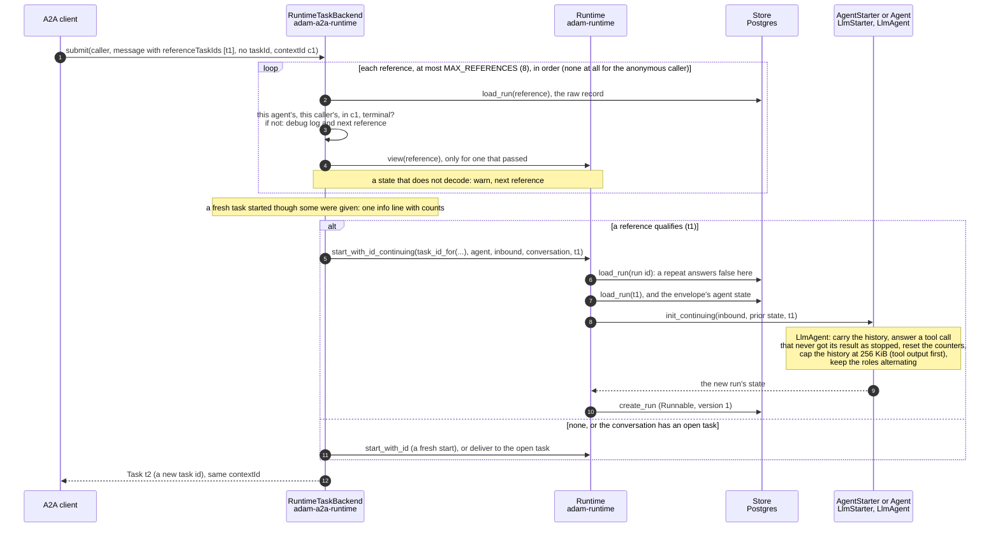
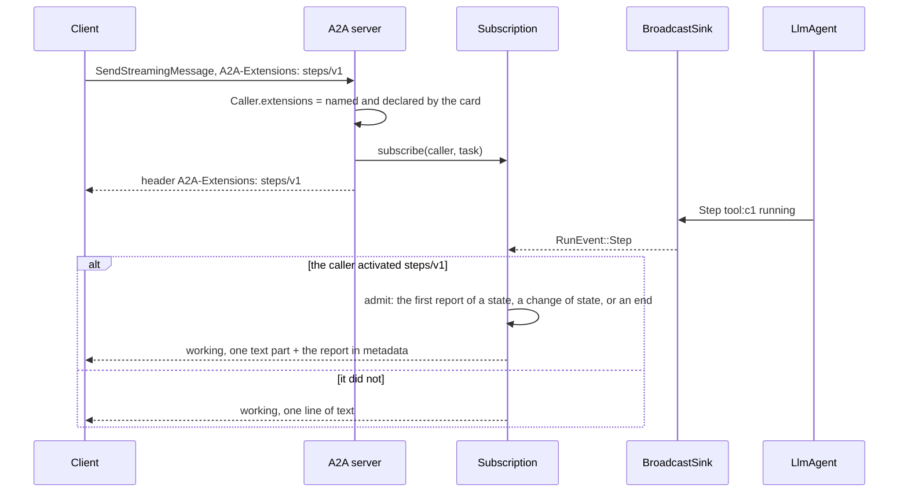
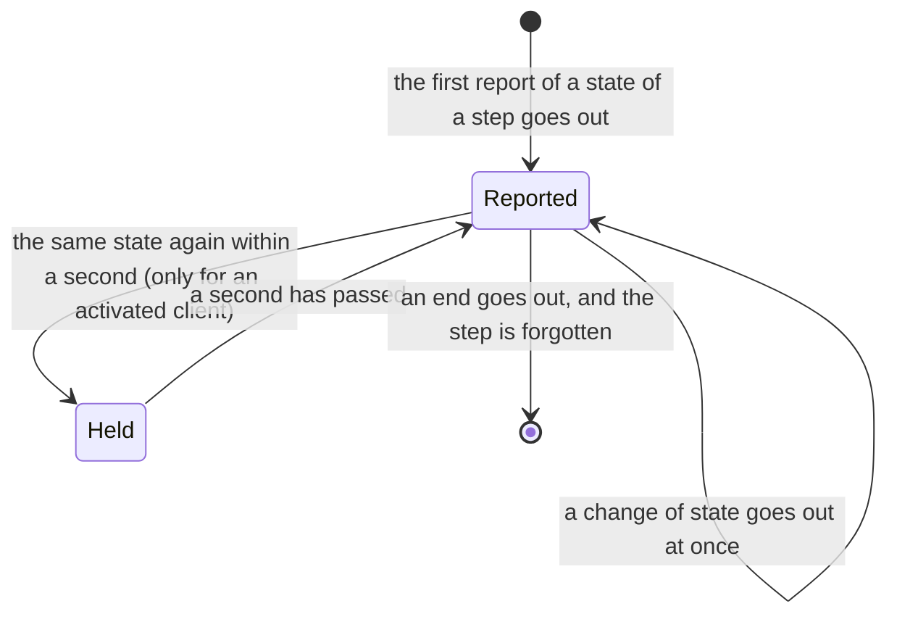
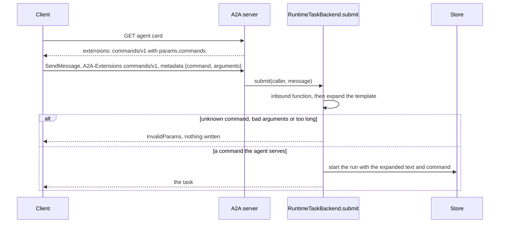
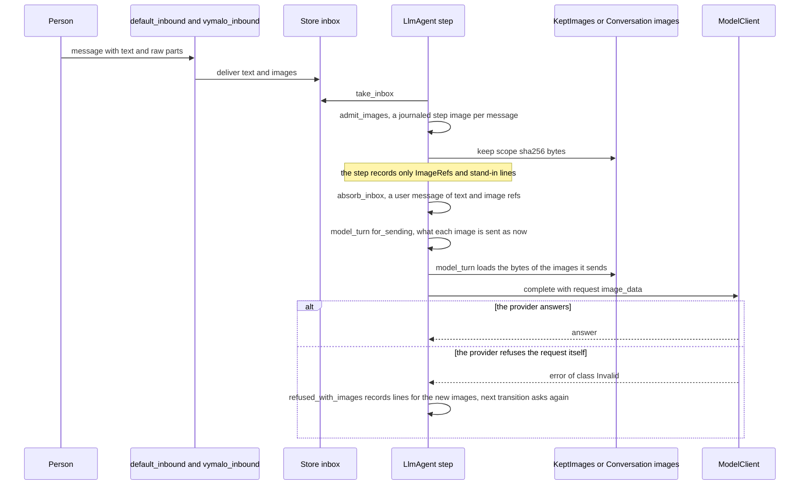
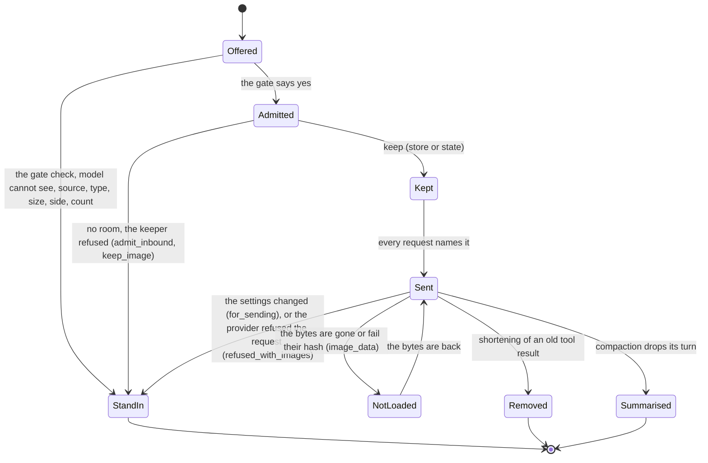
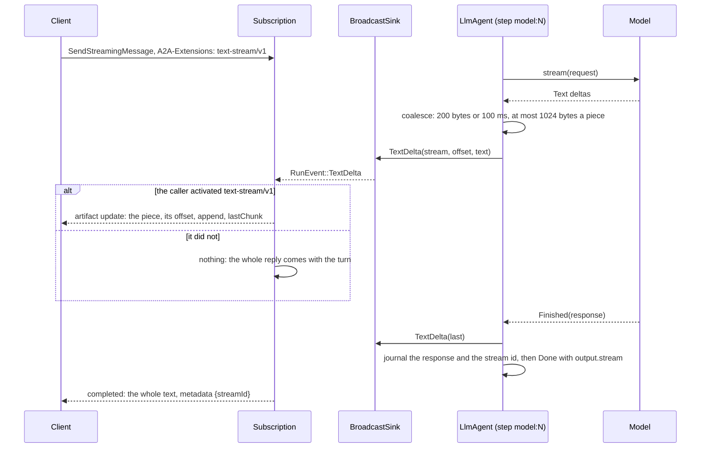
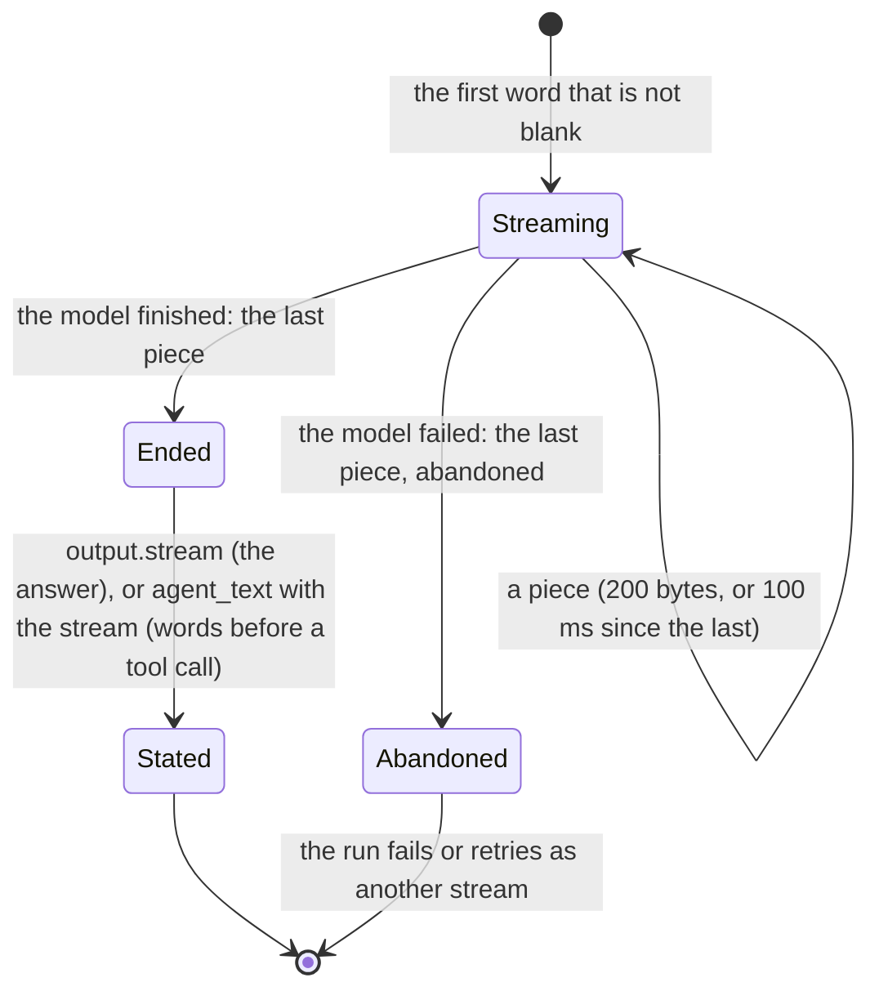

# The A2A server: what a client sees

How a task looks from outside: the methods and the two bindings, Swagger UI, follow-ups, continuing a finished task, push notifications, listing,
the extended card, the card's signature, and the three live streams (steps, text, reasoning). The request path itself is in
[Architecture](../architecture.md#request-in-events-out). Code: `crates/adam-a2a` (server),
`crates/adam-a2a-runtime` (backend over the runtime). Extensions: the `adam-a2a-extensions` skill and
[ADR 0006](../decisions/0006-a2ui-and-the-vymalo-extensions-in-adam-rs.md).

## Methods

All of A2A 1.0's JSON-RPC methods are served (`crates/adam-a2a/src/handler.rs`); what is optional is off
until a deployment turns it on, and says so in the card (*verified 2026-10-07* against
<https://a2a-protocol.org/latest/specification/>, §3.3.4: a capability that is false or absent makes its operations
answer with the matching error).

| Method | Needs | Off or missing |
|---|---|---|
| `SendMessage` (blocking), `SendStreamingMessage`, `GetTask`, `CancelTask`, `SubscribeToTask` | | |
| `ListTasks` | | |
| `CreateTaskPushNotificationConfig`, `GetTaskPushNotificationConfig`, `ListTaskPushNotificationConfigs`, `DeleteTaskPushNotificationConfig`, and `configuration.taskPushNotificationConfig` of a send | `A2A_PUSH_ALLOWED_URLS` | `PushNotificationNotSupported`; `capabilities.pushNotifications` is false |
| `GetExtendedAgentCard` | an extended card (`card.extended` of the agent folder) **and** bearer authentication | `UnsupportedOperation`; `capabilities.extendedAgentCard` is false |
| the card's `signatures` and `GET /.well-known/jwks.json` | `A2A_CARD_SIGNING_KEY_FILE` | no signature, no key set |
| Swagger UI at `GET /docs` and the OpenAPI document at `GET /openapi.json`, both public | on unless `A2A_DOCS=false` | `401` without a token, `404` with one |

## Two bindings, one handler

Every method is served over JSON-RPC (`POST /`, the method in the body) and over HTTP+JSON (A2A 1.0 §11, *verified
2026-10-07* against <https://a2a-protocol.org/latest/specification/>), by the SDK's `rest_router` over the same handler
([ADR 0031](../decisions/0031-swagger-ui-and-the-a2a-rest-binding.md)). The card lists `JSONRPC` first, then `HTTP+JSON`,
at the same URL (`PUBLIC_URL`): the REST paths are relative to it.

| Method | HTTP+JSON |
|---|---|
| `SendMessage`, `SendStreamingMessage` | `POST /message:send`, `POST /message:stream` (SSE) |
| `GetTask`, `ListTasks` | `GET /tasks/{id}?historyLength=`, `GET /tasks?contextId=&status=&pageSize=&pageToken=&...` |
| `CancelTask`, `SubscribeToTask` | `POST /tasks/{id}:cancel`, `POST /tasks/{id}:subscribe` (SSE) |
| the four push-config methods | `POST` and `GET /tasks/{id}/pushNotificationConfigs`, `GET` and `DELETE /tasks/{id}/pushNotificationConfigs/{configId}` |
| `GetExtendedAgentCard` | `GET /extendedAgentCard` |

* **Errors** are the HTTP status of the A2A error with a `google.rpc.Status` body whose `details` end with an `ErrorInfo`
  naming it (`TASK_NOT_FOUND` is 404, `TASK_NOT_CANCELABLE`, `UNSUPPORTED_OPERATION`, `PUSH_NOTIFICATION_NOT_SUPPORTED` and
  `INVALID_PARAMS` are 400, a backend failure 500). A missing token is `401` `UNAUTHENTICATED`.
* Requests may be `application/json` or `application/a2a+json`; answers are `application/json`. The SDK also answers the
  paths of earlier drafts (`/message/send`, `/tasks/{id}/cancel`, `/tasks/{id}/push-configs`, `/agent-card/extended`,
  `GET /tasks/{id}:subscribe`): Swagger UI lists them as deprecated.
* **Swagger UI** (`/docs`) documents both bindings: press **Authorize**, paste a token, then **Try it out**. For JSON-RPC,
  pick a method in the example dropdown. Swagger UI cannot show a stream as it arrives: a streaming operation's description
  gives the `curl`. The page loads nothing from another origin and the document holds no secret.

## Push notifications

A client names a webhook for a task and is told when the task changes, without holding a stream open. **A notification
is a hint; `GetTask` is the truth** (the specification itself says duplicates may occur and delivery may stop). Design and
reasons: [ADR 0030](../decisions/0030-a2a-push-notifications-list-tasks-extended-card-signatures.md); the delivery sequence and
a config's lifecycle: [Architecture](../architecture.md#push-notification-delivery).

| What | Behaviour |
|---|---|
| **Who may register what** | the deployment's allow-list (`A2A_PUSH_ALLOWED_URLS`: URL prefixes or hosts). A webhook that is not on it, is not `https`, has credentials in its URL or is a private, loopback or link-local address is `InvalidParams`. Delivery judges again and never connects to a private address or follows a redirect |
| **Whose** | a config belongs to its task and its caller: another caller's task is `TaskNotFound` for every method, as for `GetTask`. At most 16 configs per task |
| **Secrets** | `token` and `authentication.credentials` are write-only: create, get and list never return them. The server stores them as given, in clear, in its database |
| **What a webhook receives** | `POST` with `Content-Type: application/a2a+json`, `Authorization: <scheme> <credentials>` when `authentication` was given, `A2A-Notification-Token: <token>` when `token` was; the body is a `StreamResponse`: a `statusUpdate` when the task's status (state or message) changed, an `artifactUpdate` for each new artifact, artifacts first. Answer 2xx to acknowledge |
| **The header of `token`** | the specification does not name one; `A2A-Notification-Token` is what the official Rust SDK sends (*verified 2026-10-07*, `a2a-server-lf` 0.4.4 `src/push/sender.rs`) |
| **Signed notifications** | the specification does not ask for them (no JWT, no JWKS for notifications, *verified 2026-10-07*), so there are none: authenticate a notification by the credentials you chose |
| **Order and loss** | events the deliverer saw are delivered in order and a failed one is sent again before any later one. A state the task passed through between two polls (2 s) or while no replica ran is not delivered: the next event is the state the task is in. A webhook may hear one event twice |
| **Retry and give-up** | a non-2xx answer, a timeout (15 s) or a refused connection is retried with a capped exponential backoff (1 s to 5 min); after `A2A_PUSH_GIVE_UP_AFTER_SECS` (1 hour) of failures delivery to that webhook stops and the reason is recorded (`410 Gone` or a refused address stops it at once). Nothing more arrives after that: poll `GetTask` |
| **In a send** | `configuration.taskPushNotificationConfig` (the 1.0 name). The earlier drafts' `pushNotificationConfig` is refused with `InvalidParams` and starts nothing: the SDK's JSON-RPC layer would drop it silently (*observed 2026-10-07*) and the client would wait for notifications nobody registered. A config the policy refuses (or one past the cap of the task the message continues) fails the call before any task exists. If the store fails after the task was created, the call still returns the task and logs a warning (task id, error class): register the webhook again with `CreateTaskPushNotificationConfig` |
| **A new config** | starts from what the task says when it is created: only later changes are sent, and a config for a task that is already terminal receives nothing. In a `SendMessage` the baseline is the task as the message created it |
| **When it ends** | once the task is terminal and everything was sent. The config stays readable until it is deleted (delete is idempotent) or the run is purged |

```text
POST /hook HTTP/1.1
Content-Type: application/a2a+json
Authorization: Bearer <credentials>
A2A-Notification-Token: <token>

{"statusUpdate":{"taskId":"…","contextId":"…","status":{"state":"TASK_STATE_COMPLETED","timestamp":"…"}}}
```

## ListTasks

The caller's own tasks (never another's, whatever the filters say), most recently updated first, by cursor.

| Field | Behaviour |
|---|---|
| `contextId` | only that context |
| `status` | only that state. `completed` is exact in the store; `failed`/`canceled`, `submitted`/`working` and `input-required` are told apart by reading each candidate (at most 500 runs per page: a rare filter returns a short page and a token to continue) |
| `statusTimestampAfter` | the last change at or after it (inclusive) |
| `pageSize` | 50 by default, 1 to 100 (a larger value is clamped, zero and negative mean the default) |
| `pageToken` | the `nextPageToken` of a page of **the same caller and filters**; anything else, forged or not, is `InvalidParams` ("invalid page token") |
| `historyLength`, `includeArtifacts` | as in the specification: `artifacts` is omitted entirely unless asked |
| response | `tasks`, `nextPageToken` (empty on the last page), `pageSize`, `totalSize`: **exact without a status filter and for `completed`, an upper bound for the other states** (counting them exactly would read every run; the in-memory backend of `adam-a2a` counts exactly) |

The token is a cursor (the position of the last task), not an offset, and bound to the caller and the filters by a digest;
it is not signed, and a forged position can only move within the forger's own tasks.

## The extended card

`GetExtendedAgentCard` returns the public card plus what the agent adds for authenticated callers: in an agent folder,
`card.extended` with a `description` (replaces the public one) and `skills` (added; the id of a public skill replaces it);
in code, `AgentCardConfig::with_extended_card` (which can add extensions too, and an extension only the extended card declares
can be activated by an authenticated caller). Only with bearer authentication: an anonymous server has none, the card says
`extendedAgentCard: false`, and the method answers `UnsupportedOperation`. The extended card holds no secret: put nothing
in it that you would not give every holder of a token.

## The card's signature

With `A2A_CARD_SIGNING_KEY_FILE` the public and the extended card carry one JWS in `signatures` (RFC 7515 over the RFC 8785
canonical card, *verified 2026-10-07*, specification §8.4): `alg` `ES256` (a P-256 key) or `EdDSA` (Ed25519), `typ: JOSE`,
`kid` (the key's RFC 7638 thumbprint unless `A2A_CARD_SIGNING_KEY_ID`), `jku` only if `A2A_CARD_SIGNING_JKU`. The public key
set is served at `GET /.well-known/jwks.json`. To verify: take the card as you received it (either JSON form parses to the
same card), remove `signatures`, remove `null`s and empty arrays and objects except `capabilities`, `defaultInputModes`,
`defaultOutputModes`, `skills`, `supportedInterfaces` and a skill's `tags`, remove an extension's `required: false`, leave
`securityRequirements` and extension `params` as they are, canonicalize with RFC 8785, and verify
`BASE64URL(protected) + "." + BASE64URL(payload)`. In Rust: `adam_a2a::VerifyingKey::from_jwk(&jwks, kid)` and
`verify_card(&card)`. *Unverified:* that the payload equals another SDK's byte for byte (the specification has no test
vector); generate a key with `openssl genpkey -algorithm ed25519` (or `-algorithm EC -pkeyopt ec_paramgen_curve:P-256`).

## A run that ends at its limit

A run that reaches `max_turns` or `max_tool_calls` is not failed: it gets one closing model call with no tool and
ends **`completed`**, its output (and the `artifact`-less final message) carrying `limited: true` and
`limit: "max_turns" | "max_tool_calls" | "repeated_call"`. A client that must tell a finished task from a cut one reads
`output.limited`. A message sent afterwards is read by one more closing turn. The coder is stricter: see
[its rules](coder-agent.md#limits-and-cancel).

## Follow-ups

| The message | What happens |
|---|---|
| carries a `taskId`, the task is `input-required` | delivered to the run (`Runtime::deliver`) |
| carries a `taskId`, the task has finished | `-32004` (`UnsupportedOperationError`) |
| carries a `taskId`, the task is `submitted` or `working` | `-32602`, **unless the request activated `steer/v1`**: then it goes to the run's inbox, is read at its next step, and the answer is the task, still working ([ADR 0016](../decisions/0016-a-message-sent-to-a-working-task-is-steered-into-it.md)) |
| has a `contextId`, no `taskId` | delivered to the context's open task, or starts a new one |
| has `referenceTaskIds` | starts from the conversation of one of them, below |

## A new task that continues a finished one

A refinement or a rework is a new task in the same `contextId`, because a finished task accepts nothing.
`Message.referenceTaskIds` names what it builds on ([ADR 0003](../decisions/0003-a-new-task-continues-the-task-it-references.md)).



* **The reference is checked from the raw record**, before any state is decoded: this agent's, this
  caller's, in the same context, terminal. Anything else is skipped, and the client gets the fresh task it
  would for an id that never existed, so it learns nothing about other callers' tasks. At most 8 references.
  A message without a `contextId` continues nothing; the backend never guesses "the latest task".
* **"Caller" is the authenticated subject** (`token-<index>`); reordering the tokens hands a history to
  whoever holds that index next. The anonymous caller is every client at once, so it continues nothing.
* **It works on a front that holds only the starter**: the prior state is decoded as the starter's `State`.
  `init_continuing` defaults to `init`; a state that does not decode falls back to `init` with a warning.
  An agent that wraps another must forward it.
* **The history is bounded.** `Conversation::continued` shortens old tool outputs first, then drops the
  oldest whole turns beyond `MAX_CARRIED_BYTES` (256 KiB), saying so in a marker text and `omitted_turns`.
  The first user message and the newest prior turn are kept; adjacent user messages are merged so roles alternate.
* **The new run is an ordinary run**: new id, own journal, limits and worktree.
* **The coder carries the work on**: a rework can check out the branch an earlier task pushed, and
  `open_pull_request` then updates the same pull request ([coder](coder-agent.md#continuing-a-task)).

## Steps

A tool call, the work it hands to another agent and the commands that agent runs are **steps**
(`RunEvent::Step`, [ADR 0007](../decisions/0007-progress-as-steps-and-streamed-text.md)). The agent
reports `tool:<call id>` before and after every call; a tool says more with `ToolCtx::emit_progress` and
`report_step`. A client that **activated `steps/v1`** gets each as a `working` status whose metadata
carries the report; any other client reads a line of text. A tool call's report carries its `input` and
`output`, redacted by the agent and cut to 4 KiB and 8 KiB ([ADR 0011](../decisions/0011-a-tool-calls-step-carries-its-input-and-output.md));
a step too big for a `NOTIFY` crosses between processes without them.

A step's **label** is a title a person reads ("Edit a file", "Run the checks"), never the tool's name: the tool says it with
`Tool::step_style` (`#[tool(label = "...")]`), an MCP tool with its `title`, a tool of a source with `ToolNote::label`, a subagent
with its own name capitalised. The model keeps calling the tool by its name. A client that did not activate `steps/v1` reads
the same label in its plain line (`Edit a file: done`) ([ADR 0027](../decisions/0027-every-tool-has-a-title-for-its-step.md)).





Events are live and best effort. A streaming send submits the run and subscribes afterwards, so
`BroadcastSink` keeps a small replay of each run's recent events (the newest 64, none older than 30 s, no
`Status` or `Artifact`, dropped at every status change) and `subscribe_run` delivers it before the live ones,
with no gap and no duplicate: a step that started before the subscriber attached keeps its `input`. A
resubscribe within 30 s may repeat a step (a snapshot by id) or a text piece (it carries its `offset`). A
process with no event sink replays nothing and sees only the durable record
([ADR 0007](../decisions/0007-progress-as-steps-and-streamed-text.md), `crates/adam-runtime/src/events.rs`).

## Which build answers

The card says which build of the agent answers, so that a thread export can be tied to a commit and to the agent's files
([ADR 0028](../decisions/0028-the-card-says-which-build-answers.md)):

* `version` is `<crate version>+<first 7 characters of the commit>` (`0.1.0+6478fbc`, `0.1.0+unknown` for a build that was
  given no revision): semver build metadata, which does not take part in precedence. The commit is the build argument
  `ADAM_BUILD_REVISION` of `docker/coder/Dockerfile` (CI passes `github.sha`), read with `option_env!` by `adam-coder` and
  `adam-agent`.
* `capabilities.extensions` lists `https://agents.vymalo.com/a2a/extensions/build/v1` with `params`
  `{"revision": <the commit, whole, or "unknown">, "folderDigest": "sha256:..."}`. The digest is
  `adam-agent-fs`'s over the agent's files (the one the `agent files` line of the startup log shows), so a prompt mounted
  over the embedded copy changes it. The extension is optional and informational: `required: false`, nothing to
  activate, ignored by a client that does not know it. `adam_a2a::ExtensionConfig::build(revision, folder_digest)` declares it,
  `adam_agent::card_of_folder` and `adam_coder::agent_card_from` add it.

## The access tier

An agent whose card lists `https://agents.vymalo.com/a2a/extensions/access-tier/v1` (the coder: `params`
`{"tiers": ["plan", "edits", "auto"], "default": "auto"}`, with `bypass` too under `MAX_ACCESS_TIER=bypass`; the contract is the orchestration layer's
`docs/api/access-tier-v1.md`, [ADR 0036](../decisions/0036-the-coder-keeps-to-the-access-tier-the-person-picks.md)) works under the
tier the person picks **for each message**. A request that **activates** it must carry
`metadata[URI] = {"tier": "plan" | "edits" | "auto" | "bypass"}` on the message, or it is `InvalidParams` (`-32602`) and nothing is
written: that includes a tier that is missing, written in another case, or not one the card lists. A message that does not
activate it carries no tier, whatever its metadata says. The newest message that names a tier sets it from the agent's next
step (the tier is kept even when the rest of a message's context is too large and dropped). **The backend carries no tier from
one task to the next**: a new task in the same context gets the context of the one before, and it is the agent that decides what
that means. The coder starts it at its `default` and drops the earlier key (`CoderStarter::init_continuing`); a rework of a task
is the orchestrator's to send with a tier. To a caller that activated it, a
task says `metadata[URI] = {"tier": ..}`: on the answer of `SendMessage`, on `GetTask`, on the first frame of a stream, and in a
status update when it changes. `RuntimeTaskBackend::with_access_tiers` is the backend side; what the coder does with each tier is
its README, *Access tiers*.

## Commands (`commands/v1`)

An agent that has prompt templates ([`commands/<name>.md`](agent-files.md#commands-commandsnamemd)) lists
`https://agents.vymalo.com/a2a/extensions/commands/v1` on its card, and **only then**: an agent with no commands
lists no such extension. The contract page for clients, `docs/api/commands-v1.md` of `vymalo/another-agentic-system`
([ADR 0044](../decisions/0044-paged-tools-a-stable-prompt-prefix-a-plan-skills-commands-and-project-context.md), decision 9),
is not written yet; this is the agent's side.

The card's `params`, sorted by `name` (`argumentHint` only when the file has one):

```json
{"commands": [
  {"name": "explain", "description": "Explain a file, a function or a change in plain words, with no edits.",
   "argumentHint": "<repository> <file, function or change>"},
  {"name": "review", "description": "Review the open pull request of a repository you name, and say what to change."}
]}
```

A message invokes one in either of two forms, and both give the same stored text:

| Form | When it is read | Shape |
|---|---|---|
| metadata | only when the request **activated** the extension | `metadata[URI] = {"command": "review", "arguments": "acme/app 12"}` (`arguments` optional, a string). The message still carries a text part, which the member replaces: send `/review acme/app 12` there, so an agent that does not know the extension reads the same words |
| text | always | the text starts with `/review`, then the end of the text or whitespace, and the rest (trimmed) is the arguments |

* **An unknown command in the metadata** is `InvalidParams` (`-32602`), like a `command` that is not a string, `arguments` that
  are not text, arguments over 4 KiB or an expansion over 32 KiB or empty: nothing is written.
* **A `/word` that is not a command is plain text**: `/tmp is full` reaches the agent as written. To send text that starts with a
  command's name, double the slash: `//review` is the literal `/review`.
* **A form's answer is never a command.** A message with an A2UI `action` part (the person's click on a form) is stored as it is:
  its text is not read as `/name`, even when the inbound function joins the parts into one text. A command named in the
  metadata of such a message is `InvalidParams` and nothing is written. A NUL character in the metadata `arguments` is
  `InvalidParams` too (the store cannot hold it), and an unknown name in an error is cut at 64 characters and escaped.
* **Both forms agree.** The arguments are trimmed in what is stored (`command.arguments`) as in what is substituted; when a
  message carries both forms the metadata wins and its text is not read; an expansion that is only whitespace is refused.
* **Expansion** is plain substitution, once, with this grammar (tests: `crates/adam-a2a-runtime/src/commands.rs`):

  | Template | Result |
  |---|---|
  | `$ARGUMENTS` | the trimmed argument string (`$ARGUMENTSX` is the arguments, then `X`) |
  | `$1` to `$9` | that argument, split on whitespace with double quotes respected; a missing one is empty. One digit only: `$10` is `$1` then `0` |
  | `$$` | one literal `$`, so `$$1` is the text `$1` (the way to write a literal placeholder) |
  | any other `$` | itself (`$0`, `$a`, a `$` at the end) |

  What is substituted is never read again, and nothing is executed. Every line of the whole result that begins as a form's
  answer is marked `(typed) `, as in any message; that includes a template's own line that begins with that phrase.
* **The expansion is what is stored.** It is the text of the run's first message, with `command = {name, arguments}` beside it.
  A replay, or a restart with an edited folder, never expands again, and a message sent again with the same `messageId` joins the
  run it made. The same holds for a follow-up and for a steering message, and a typed reply to a pending question that starts with
  `/name` is expanded too (tests: `crates/adam-a2a-runtime/tests/commands_flow.rs`); `//name` is the escape.
* **Some commands are asked of an MCP server.** A prompt of an MCP server of the agent is a command named
  `<server>__<prompt>`, listed on the card like any other once the servers are connected
  ([`mcp.json`](agent-files.md#prompts-as-commands)); the text is asked of the server with `prompts/get` when the message
  arrives and stored like a template's expansion, behind one line that says which prompt of which server it is. What
  the person types after the name is the prompt's arguments: the last one the prompt declares takes the rest of the
  line. A prompt the server refuses, or that is not text of the user, is `InvalidParams`; a server that cannot be asked
  is an `unavailable` error (nothing is written either way). The message a client sends is the same as for any command,
  but the **card differs by process**: only a process that connects the MCP servers (`role: all`) lists their prompts. The front of `topology: split` is a control plane, connects none,
  lists none, and refuses a message that names `/<server>__<prompt>` for a server of the folder's `mcp.json` with
  `InvalidParams` (it is never sent to the model as plain text).
* Commands change **no system prompt and no tool list**: the model sees the expanded text as the person's message.



Backend side: `RuntimeTaskBackend::with_commands` and `Commands` in `crates/adam-a2a-runtime/src/commands.rs`; the card entry is
`ExtensionConfig::commands`; the coder and `adam-agent` read the folder's `commands/` for both.

## Tokens of each model call

Every agent's card lists `https://agents.vymalo.com/a2a/extensions/usage/v1` (optional, no `params`; the contract is the
orchestration layer's `docs/api/usage-v1.md`, [ADR 0032](../decisions/0032-usage-per-model-call.md)). A request that
**activates it** gets, after each completed model call, a `working` status update with **no message** and the call's report
in the event's `metadata` under the URI: `call` (unique within the task, the same on a resubscribe), `stepId` for a subagent's
call (the `tool:<call id>` of the call that started it), `provider` (`openai`), `model` (the alias), `inputTokens`,
`outputTokens`, `totalTokens`, and, when known, `reasoningTokens`, `cachedInputTokens`, `cacheWriteInputTokens` and
`contextWindow` (`MODEL_CONTEXT_WINDOW`). Any other request gets nothing of it. A task that ended (`completed`, `failed`,
`canceled`, `rejected`) or waits (`input-required`, `auth-required`) carries `metadata[URI] = {"totals": [...]}`, one entry
per provider and model, the subagents' calls included, **whoever reads it** (`GetTask`, `ListTasks`, a stream's snapshot); a
working task carries none. Counts are at most 2^53 - 1 and written as whole numbers (the SDK writes them as floats:
`41250.0`); labels at most 128 bytes. Details: `adam-a2a-runtime`'s README, *Usage*.

The same object has a `sandbox` member beside `totals` ([ADR 0043](../decisions/0043-sandbox-time-as-usage.md)) when a tool reported the
time its commands ran in a run pod: `{"environment": "kubernetes", "usage": [{"cpuMillis": 250, "memoryBytes": 536870912, "commands": 12,
"milliseconds": 81234}]}`, one entry per pod shape (the template's requests), at most 8, written under the same rules as the totals (when the
task ends or waits, cumulative, whoever reads it, `totals` always present, `[]` for a run that made no model call). `{"environment": "local"}`
and `{"environment": "devcontainer"}` have no `usage`: the commands were not measured, which is not zero. A run that never asked for an
environment has no `sandbox`.

## Images in

A message may carry pictures as standard A2A file parts. **Off by default**: with no `MODEL_INPUT_MODALITIES=text,image` a model gets one line of text in an image's place and the task goes on ([environment](environment.md), [what the model is told](errors.md#an-image-the-model-is-not-sent)). Nothing here is specific to a client.

| Part | Becomes |
|---|---|
| `raw` whose bytes are a PNG, JPEG, GIF or WebP (sniffed, whatever `mediaType` says) | an entry of the inbound payload's `images` (`{name, mediaType, data}`, base64); at most 4 images and 2 MiB a message (`MAX_INBOUND_IMAGES`, `MAX_INBOUND_IMAGE_BYTES`: the inbox is in the run's durable state until the message is read) |
| the same, past either bound | the line `[image not shown: shot.png (png, 3.0 MiB) is over what one message may carry (4 images and 2 MiB)]` in the text |
| any other `raw` part (a PDF; an SVG is text) | the line `[attached: report.pdf (pdf, 84.0 KiB); only images are read]` |
| a `url` part | the line `[linked: <url>]`: **a link is never fetched** |

A message that is only a picture is accepted. **A message whose only part is a file that is not a picture** (a PDF) used to be `invalid params` (no text); it is now a message of one line, `[attached: ...; only images are read]`, so the person is told and the task goes on. This holds for every host that reads messages with `default_inbound` or `vymalo_inbound`.

A file name and a media type are untrusted. A name the system prints is a file name and nothing else: letters, digits, `.`, `_` and `-`, every other character replaced by `_`, at most 64 characters (`adam_runtime::safe_file_name`), so a sentence, a path or a command a sender wrote as a "name" is not one. A type is cut to a `type/subtype` token.

**These lines are the framework's words**, built by `adam_runtime::SystemLine` and recognised by `adam_runtime::is_system_line`. A reader of the person's words skips them: they name no repository, are no command and answer no form, whatever a sender put in a name or a link. The agent may still show or open a link with its own tools.





The states that are lines: `StandIn` is written once into the history (the record says why); a change of the **settings** (`for_sending`) is said in every request and recorded nowhere, and `NotLoaded` is the client's line `could not be loaded; read it again`, for bytes that are gone or fail their hash and for nothing else.

* **Admitted once, recorded.** The decision is a journaled step per message (`image:start` for the start message, `image:<message id>` for a later one) and lives in the history as an `ImageRef` (SHA-256, type, size, dimensions, origin), so a replay, another worker and every later turn send the same images and each request's prompt starts with the one before it. A message with no picture is read as it always was.
* **The size is read from the header** (`adam_runtime::image_size`: PNG, JPEG, GIF, WebP; a hand-written reader with bounded loops). An image is never decoded or resized.
* **Where the bytes are, for how long, under which bound.** Never in the history. Per agent:

  | Agent | The bytes are in | Until | Bound |
  |---|---|---|---|
  | any | the inbound message in the inbox, and `Conversation::pending_images` for the start message | the first step that reads it | 4 images and 2 MiB a message |
  | the coder (it has an `ImageStore`) | files on its volume, per conversation | the janitor removes the scope ([the coder](coder-agent.md#images)) | 4 MiB an image, 64 MiB a scope; **nothing in the journal and nothing in the state** after the first step |
  | a folder agent (no store) | the run's state, base64, and the journal of the tool step that kept them (as a kept output) | the state: until no message names the image; the journal: for good | the state: the 4 MiB it shares with kept outputs; the journal: `MAX_RUN_JOURNALED_IMAGE_BYTES` (6 MiB, a run's budget of file bytes) over the whole run, never freed by a shortening or a compaction, then an image is a line that says the run has kept as many image bytes as it may |
  | a tool's image with `files: true` (MCP) | also a file artifact, journaled as every artifact is, with the same SHA-256 | as an artifact | the artifact bounds |

  A request resends every image the history holds, so `MODEL_IMAGE_MAX_BYTES` times `MODEL_IMAGE_MAX_COUNT` may be at most 32 MiB (over it is exit 78).
* **What is sent follows the settings now.** Whether an image is sent is decided each time a request is built, from the reference and the deployment's settings, and nothing about it is recorded: an image whose source is no longer in `MODEL_IMAGE_SOURCES`, that is over the byte limit now, or for a model that no longer sees, is a line that says the true reason (`this deployment no longer sends images from mcp`, `it is over the 1.0 MiB this deployment sends`, `this model cannot see images`). While the settings stay every request says the same, so the prefix holds; **a change of settings changes the prompt once**.
* **A request the provider refuses.** When a model request fails for itself (the class `Invalid`: not its length, its credentials or a limit) and it carries images no earlier request carried, those images are recorded as lines (`the model's service refused the request that carried it`) and the request is sent again. An image an earlier request carried successfully is never touched, and with no new image the failure is what it was. The prompt changes once, and it is recorded.
* **An answer to a question** (`ask_user`) may carry pictures: they are the images of the tool result.
* **On the wire** an image is a `data:` URL part of a user message (`{"type":"image_url","image_url":{"url":"data:image/png;base64,..."}}`, no `detail`); a message with no picture is still a string. A tool's pictures follow the run of tool messages in one user message, `Images from tool results: <call id> <name>; ...`. Both shapes are *unverified* on every provider, the platform's own OpenAI-compatible gateway (the first provider the owner named, 2026-11-16) included, until tried against it ([ADR 0044](../decisions/0044-paged-tools-a-stable-prompt-prefix-a-plan-skills-commands-and-project-context.md)).

Code: `crates/adam-a2a-runtime/src/files_in.rs`, `crates/adam-llm-agent/src/images.rs`, `crates/adam-model-openai/src/wire.rs`.

## Streamed text

A model turn streams by default (`LlmAgentBuilder::stream_text`): the journaled step `model:<turn>` calls
`ModelClient::stream` and sends what the model has written as `RunEvent::TextDelta` pieces. A client that
**activated `text-stream/v1`** gets each as an artifact chunk with its byte offset. The whole text is stated
once, by a `working` status for words before a tool call or by the status that ends the turn (`completed`
with `output.stream`, or `input-required` for a reply turned into a question).





* Pieces are live and meant to be lost; a replay of a recorded step sends none and states the same
  words whole under the recorded stream id.
* A failure in the middle is the call's failure (`ModelFailure`): the same retry, the same failed run.
* A chunk is at most 1024 bytes so the event fits a `NOTIFY` payload.
* A client that did not activate the extension, and a blocking `message/send`, get the whole reply
  with the turn.

## Reasoning

A model in thinking mode writes its reasoning before its answer, on the same streamed step
([ADR 0020](../decisions/0020-reasoning-is-streamed-beside-the-answer-and-never-stored.md)).
`ModelDelta::Reasoning` (read from `reasoning_content` or `reasoning`, `crates/adam-model-openai/src/wire.rs`)
becomes `RunEvent::ReasoningDelta` in a stream of its own that ends before the words begin, and a
`text-stream/v1` chunk marked `"kind": "reasoning"`.

It is **never stored**: dropped before the journal, in no output, `turn_output` or step, and a replay
sends none. The model is sent its earlier reasoning only if its client is set to
(`MODEL_ECHO_REASONING`, which DeepSeek's thinking mode with tools needs). `MODEL_EXTRA_BODY` is how a
deployment asks a model that needs a flag to think. `MODEL_PROMPT_CACHE_KEY=conversation` sends a
`prompt_cache_key` made from the conversation id (a member of `MODEL_EXTRA_BODY` of the same name wins).
