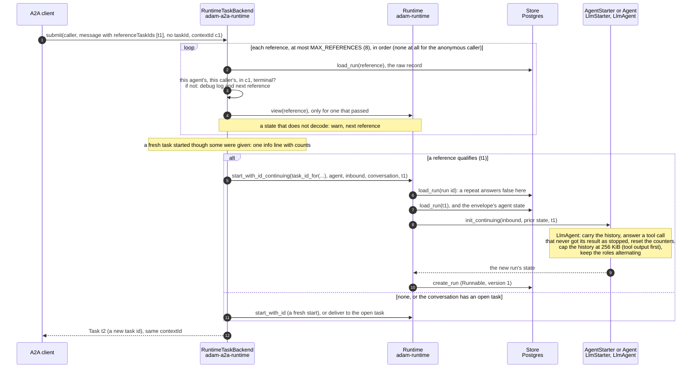
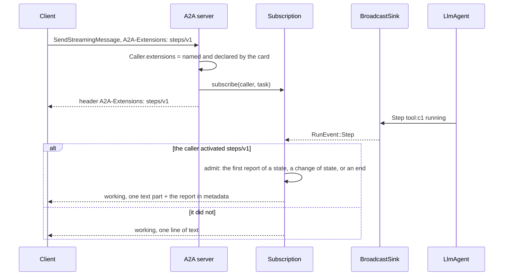
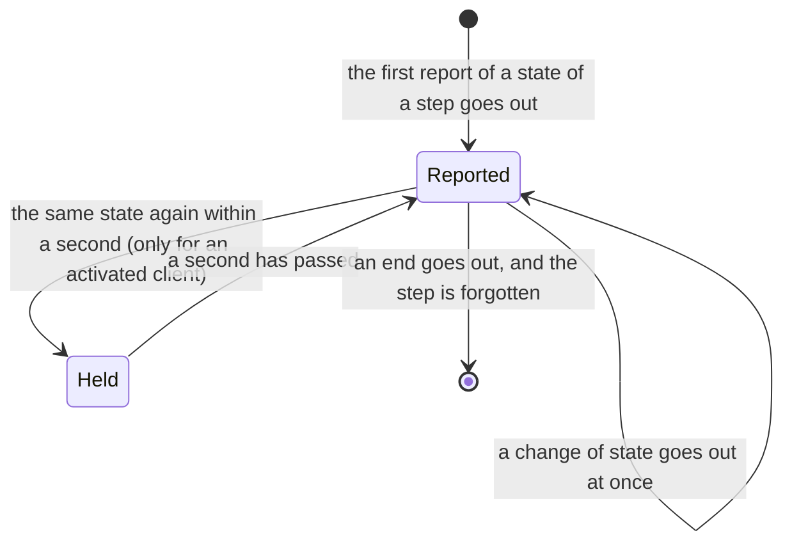
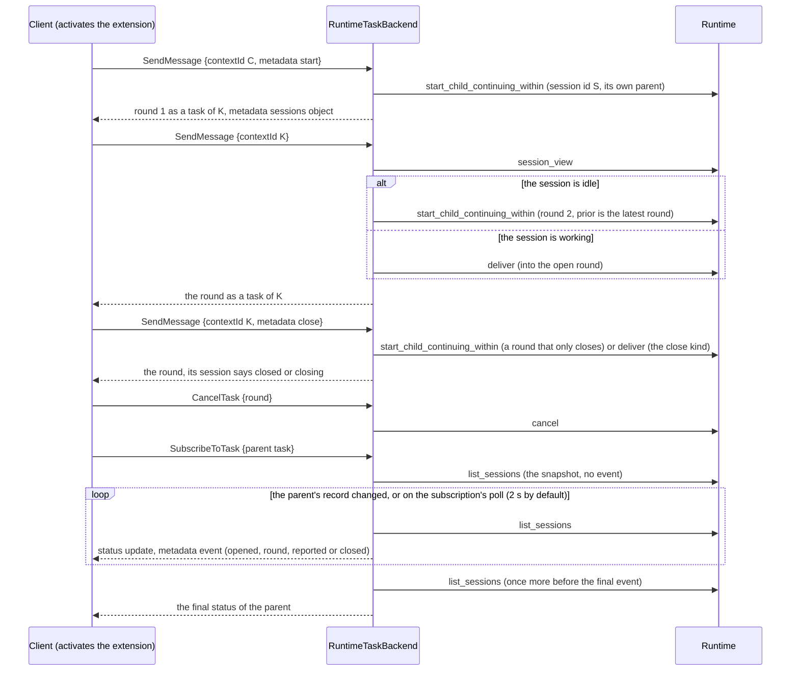
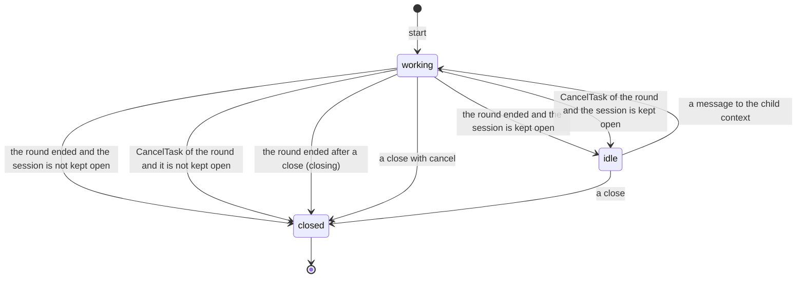
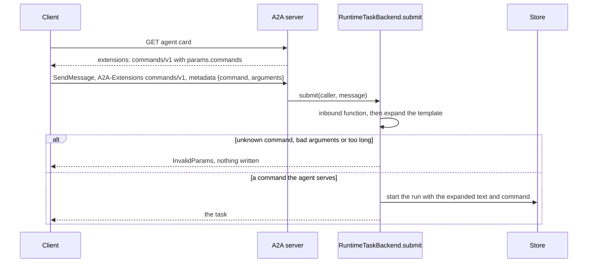
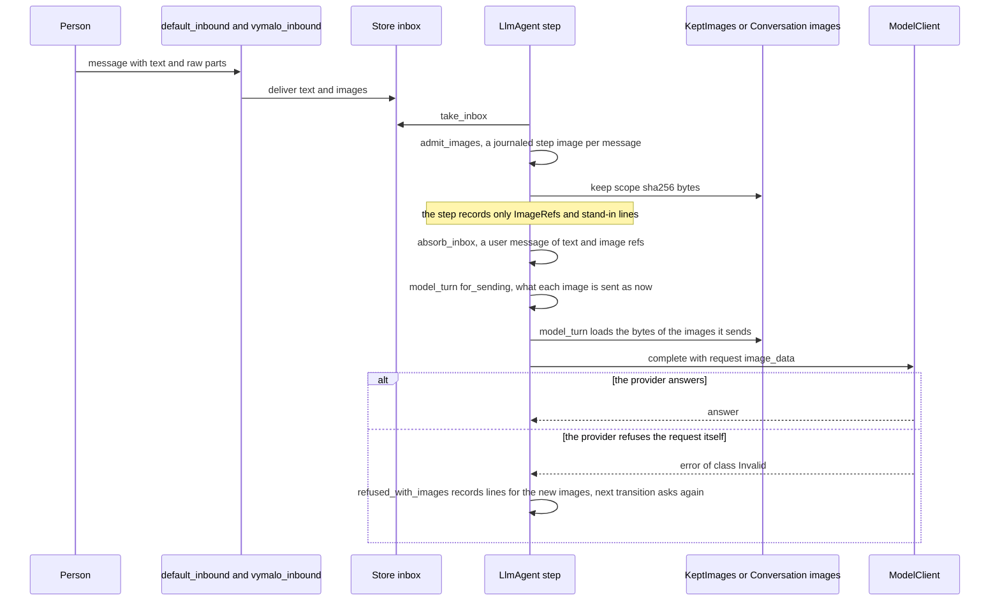
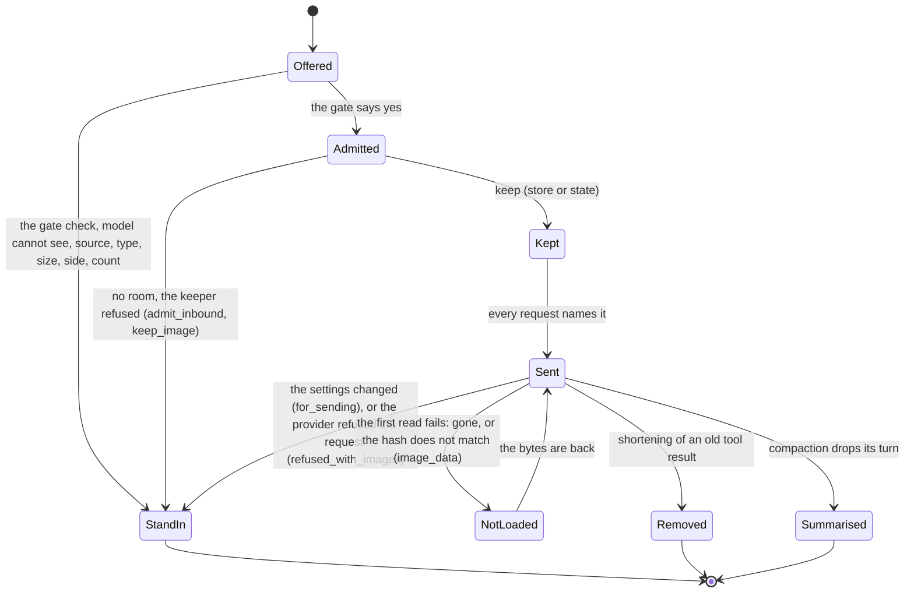
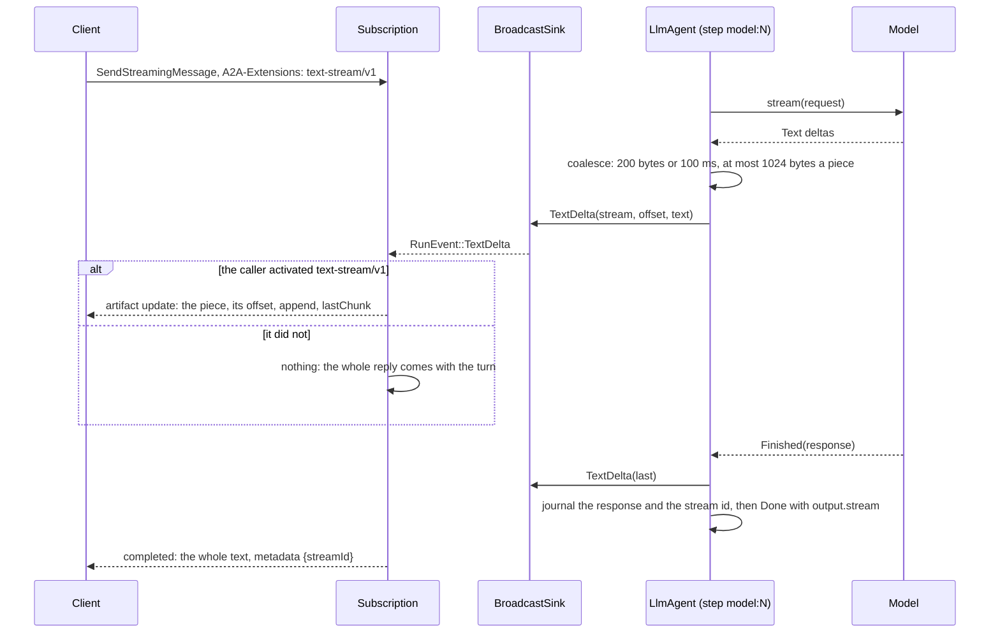
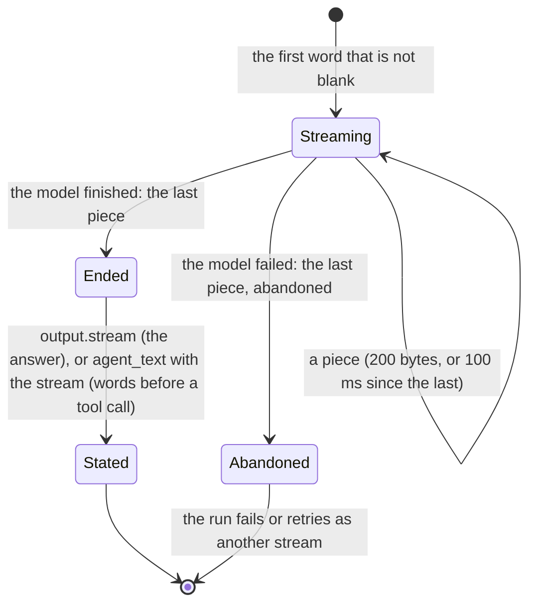

# The A2A server: what a client sees

How a task looks from outside: the methods and the two bindings, Swagger UI, follow-ups, continuing a finished task, push notifications, listing,
the extended card, the card's signature, and the three live streams (steps, text, reasoning). The request path itself is in
[Architecture](../architecture.md#request-in-events-out). Code: `crates/adam-a2a` (server),
`crates/adam-a2a-runtime` (backend over the runtime). Extensions: the `adam-a2a-extensions` skill and
[ADR 0006](../decisions/0006-a2ui-and-the-vymalo-extensions-in-adam-rs.md).

## Methods

All of A2A 1.0's JSON-RPC methods are served (`crates/adam-a2a/src/handler.rs`); what is optional is off
until a deployment turns it on, and says so in the card (*verified 2026-10-07* against
<https://a2a-protocol.org/latest/specification/>, §3.3.4: a capability that is false or absent makes its operations
answer with the matching error).

| Method | Needs | Off or missing |
|---|---|---|
| `SendMessage` (blocking), `SendStreamingMessage`, `GetTask`, `CancelTask`, `SubscribeToTask` | | |
| `ListTasks` | | |
| `CreateTaskPushNotificationConfig`, `GetTaskPushNotificationConfig`, `ListTaskPushNotificationConfigs`, `DeleteTaskPushNotificationConfig`, and `configuration.taskPushNotificationConfig` of a send | `A2A_PUSH_ALLOWED_URLS` | `PushNotificationNotSupported`; `capabilities.pushNotifications` is false |
| `GetExtendedAgentCard` | an extended card (`card.extended` of the agent folder) **and** bearer authentication | `UnsupportedOperation`; `capabilities.extendedAgentCard` is false |
| the card's `signatures` and `GET /.well-known/jwks.json` | `A2A_CARD_SIGNING_KEY_FILE` | no signature, no key set |
| Swagger UI at `GET /docs` and the OpenAPI document at `GET /openapi.json`, both public | on unless `A2A_DOCS=false` | `401` without a token, `404` with one |

## Two bindings, one handler

Every method is served over JSON-RPC (`POST /`, the method in the body) and over HTTP+JSON (A2A 1.0 §11, *verified
2026-10-07* against <https://a2a-protocol.org/latest/specification/>), by the SDK's `rest_router` over the same handler
([ADR 0031](../decisions/0031-swagger-ui-and-the-a2a-rest-binding.md)). The card lists `JSONRPC` first, then `HTTP+JSON`,
at the same URL (`PUBLIC_URL`): the REST paths are relative to it.

| Method | HTTP+JSON |
|---|---|
| `SendMessage`, `SendStreamingMessage` | `POST /message:send`, `POST /message:stream` (SSE) |
| `GetTask`, `ListTasks` | `GET /tasks/{id}?historyLength=`, `GET /tasks?contextId=&status=&pageSize=&pageToken=&...` |
| `CancelTask`, `SubscribeToTask` | `POST /tasks/{id}:cancel`, `POST /tasks/{id}:subscribe` (SSE) |
| the four push-config methods | `POST` and `GET /tasks/{id}/pushNotificationConfigs`, `GET` and `DELETE /tasks/{id}/pushNotificationConfigs/{configId}` |
| `GetExtendedAgentCard` | `GET /extendedAgentCard` |

* **Errors** are the HTTP status of the A2A error with a `google.rpc.Status` body whose `details` end with an `ErrorInfo`
  naming it (`TASK_NOT_FOUND` is 404, `TASK_NOT_CANCELABLE`, `UNSUPPORTED_OPERATION`, `PUSH_NOTIFICATION_NOT_SUPPORTED` and
  `INVALID_PARAMS` are 400, a backend failure 500). A missing token is `401` `UNAUTHENTICATED`.
* Requests may be `application/json` or `application/a2a+json`; answers are `application/json`. The SDK also answers the
  paths of earlier drafts (`/message/send`, `/tasks/{id}/cancel`, `/tasks/{id}/push-configs`, `/agent-card/extended`,
  `GET /tasks/{id}:subscribe`): Swagger UI lists them as deprecated.
* **Swagger UI** (`/docs`) documents both bindings: press **Authorize**, paste a token, then **Try it out**. For JSON-RPC,
  pick a method in the example dropdown. Swagger UI cannot show a stream as it arrives: a streaming operation's description
  gives the `curl`. The page loads nothing from another origin and the document holds no secret.

## Push notifications

A client names a webhook for a task and is told when the task changes, without holding a stream open. **A notification
is a hint; `GetTask` is the truth** (the specification itself says duplicates may occur and delivery may stop). Design and
reasons: [ADR 0030](../decisions/0030-a2a-push-notifications-list-tasks-extended-card-signatures.md); the delivery sequence and
a config's lifecycle: [Architecture](../architecture.md#push-notification-delivery).

| What | Behaviour |
|---|---|
| **Who may register what** | the deployment's allow-list (`A2A_PUSH_ALLOWED_URLS`: URL prefixes or hosts). A webhook that is not on it, is not `https`, has credentials in its URL or is a private, loopback or link-local address is `InvalidParams`. Delivery judges again and never connects to a private address or follows a redirect |
| **Whose** | a config belongs to its task and its caller: another caller's task is `TaskNotFound` for every method, as for `GetTask`. At most 16 configs per task |
| **Secrets** | `token` and `authentication.credentials` are write-only: create, get and list never return them. The server stores them as given, in clear, in its database |
| **What a webhook receives** | `POST` with `Content-Type: application/a2a+json`, `Authorization: <scheme> <credentials>` when `authentication` was given, `A2A-Notification-Token: <token>` when `token` was; the body is a `StreamResponse`: a `statusUpdate` when the task's status (state or message) changed, an `artifactUpdate` for each new artifact, artifacts first. Answer 2xx to acknowledge |
| **The header of `token`** | the specification does not name one; `A2A-Notification-Token` is what the official Rust SDK sends (*verified 2026-10-07*, `a2a-server-lf` 0.4.4 `src/push/sender.rs`) |
| **Signed notifications** | the specification does not ask for them (no JWT, no JWKS for notifications, *verified 2026-10-07*), so there are none: authenticate a notification by the credentials you chose |
| **Order and loss** | events the deliverer saw are delivered in order and a failed one is sent again before any later one. A state the task passed through between two polls (2 s) or while no replica ran is not delivered: the next event is the state the task is in. A webhook may hear one event twice |
| **Retry and give-up** | a non-2xx answer, a timeout (15 s) or a refused connection is retried with a capped exponential backoff (1 s to 5 min); after `A2A_PUSH_GIVE_UP_AFTER_SECS` (1 hour) of failures delivery to that webhook stops and the reason is recorded (`410 Gone` or a refused address stops it at once). Nothing more arrives after that: poll `GetTask` |
| **In a send** | `configuration.taskPushNotificationConfig` (the 1.0 name). The earlier drafts' `pushNotificationConfig` is refused with `InvalidParams` and starts nothing: the SDK's JSON-RPC layer would drop it silently (*observed 2026-10-07*) and the client would wait for notifications nobody registered. A config the policy refuses (or one past the cap of the task the message continues) fails the call before any task exists. If the store fails after the task was created, the call still returns the task and logs a warning (task id, error class): register the webhook again with `CreateTaskPushNotificationConfig` |
| **A new config** | starts from what the task says when it is created: only later changes are sent, and a config for a task that is already terminal receives nothing. In a `SendMessage` the baseline is the task as the message created it |
| **When it ends** | once the task is terminal and everything was sent. The config stays readable until it is deleted (delete is idempotent) or the run is purged |

```text
POST /hook HTTP/1.1
Content-Type: application/a2a+json
Authorization: Bearer <credentials>
A2A-Notification-Token: <token>

{"statusUpdate":{"taskId":"…","contextId":"…","status":{"state":"TASK_STATE_COMPLETED","timestamp":"…"}}}
```

## ListTasks

The caller's own tasks (never another's, whatever the filters say), most recently updated first, by cursor.

| Field | Behaviour |
|---|---|
| `contextId` | only that context |
| `status` | only that state. `completed` is exact in the store; `failed`/`canceled`, `submitted`/`working`, `input-required` and `auth-required` are told apart by reading each candidate (at most 500 runs per page: a rare filter returns a short page and a token to continue) |
| `statusTimestampAfter` | the last change at or after it (inclusive) |
| `pageSize` | 50 by default, 1 to 100 (a larger value is clamped, zero and negative mean the default) |
| `pageToken` | the `nextPageToken` of a page of **the same caller and filters**; anything else, forged or not, is `InvalidParams` ("invalid page token") |
| `historyLength`, `includeArtifacts` | as in the specification: `artifacts` is omitted entirely unless asked |
| response | `tasks`, `nextPageToken` (empty on the last page), `pageSize`, `totalSize`: **exact without a status filter and for `completed`, an upper bound for the other states** (counting them exactly would read every run; the in-memory backend of `adam-a2a` counts exactly) |

The token is a cursor (the position of the last task), not an offset, and bound to the caller and the filters by a digest;
it is not signed, and a forged position can only move within the forger's own tasks.

Each candidate is built from the record the page returned (`adam_runtime::view_from_record`), not read a second time: a
runnable run at version 1 — the only row whose state can still turn from `submitted` to `working` because a worker claimed it —
also costs one lease read. A 50-task page is one count, one page and one lease read per runnable run at version 1 (submitted,
or claimed and still at version 1).

## The extended card

`GetExtendedAgentCard` returns the public card plus what the agent adds for authenticated callers: in an agent folder,
`card.extended` with a `description` (replaces the public one) and `skills` (added; the id of a public skill replaces it);
in code, `AgentCardConfig::with_extended_card` (which can add extensions too, and an extension only the extended card declares
can be activated by an authenticated caller). Only with bearer authentication: an anonymous server has none, the card says
`extendedAgentCard: false`, and the method answers `UnsupportedOperation`. The extended card holds no secret: put nothing
in it that you would not give every holder of a token.

## The card's signature

With `A2A_CARD_SIGNING_KEY_FILE` the public and the extended card carry one JWS in `signatures` (RFC 7515 over the RFC 8785
canonical card, *verified 2026-10-07*, specification §8.4): `alg` `ES256` (a P-256 key) or `EdDSA` (Ed25519), `typ: JOSE`,
`kid` (the key's RFC 7638 thumbprint unless `A2A_CARD_SIGNING_KEY_ID`), `jku` only if `A2A_CARD_SIGNING_JKU`. The public key
set is served at `GET /.well-known/jwks.json`. To verify: take the card as you received it (either JSON form parses to the
same card), remove `signatures`, remove `null`s and empty arrays and objects except `capabilities`, `defaultInputModes`,
`defaultOutputModes`, `skills`, `supportedInterfaces` and a skill's `tags`, remove an extension's `required: false`, leave
`securityRequirements` and extension `params` as they are, canonicalize with RFC 8785, and verify
`BASE64URL(protected) + "." + BASE64URL(payload)`. In Rust: `adam_a2a::VerifyingKey::from_jwk(&jwks, kid)` and
`verify_card(&card)`. *Unverified:* that the payload equals another SDK's byte for byte (the specification has no test
vector); generate a key with `openssl genpkey -algorithm ed25519` (or `-algorithm EC -pkeyopt ec_paramgen_curve:P-256`).

## A run that ends at its limit

A run that reaches `max_turns` or `max_tool_calls` is not failed: it gets one closing model call with no tool and
ends **`completed`**, its output (and the `artifact`-less final message) carrying `limited: true` and
`limit: "max_turns" | "max_tool_calls" | "repeated_call"`. A client that must tell a finished task from a cut one reads
`output.limited`. A message sent afterwards is read by one more closing turn. The coder is stricter: see
[its rules](coder-agent.md#limits-and-cancel).

## Follow-ups

| The message | What happens |
|---|---|
| carries a `taskId`, the task is `input-required` | delivered to the run (`Runtime::deliver`) |
| carries a `taskId`, the run is parked on the model (`auth-required`, or `working` on a timer), or waits on a parked child | delivered to the run: see [A run parked on the model](#a-run-parked-on-the-model) |
| has `adam.resume: true` in its metadata | a resume: see [A run parked on the model](#a-run-parked-on-the-model) |
| carries a `taskId`, the task has finished | `-32004` (`UnsupportedOperationError`) |
| carries a `taskId`, the task is `submitted` or `working` | `-32602`, **unless the request activated `steer/v1`**: then it goes to the run's inbox, is read at its next step, and the answer is the task, still working ([ADR 0016](../decisions/0016-a-message-sent-to-a-working-task-is-steered-into-it.md)) |
| has a `contextId`, no `taskId` | delivered to the context's open task, or starts a new one |
| has `referenceTaskIds` | starts from the conversation of one of them, below |

A message with `adam.resume: true` is read as a resume whatever the task's state (the third row): it is accepted
only by a task parked on the model, or waiting on a parked child. Otherwise the rows are read in order: a `working`
task whose run is parked on the model, or waits on a parked child, is delivered (the second row); any other `working`
task takes the fifth row, and is refused unless the request activated `steer/v1`.

## A run parked on the model

**This section is a contract** ([ADR 0067](../decisions/0067-a-model-call-through-an-injector-names-its-run-and-a-refusal-parks-the-run.md),
decisions 4 and 5). An orchestrator resumes a run with it after it binds the run at the gateway, or after the person raised
their limit.

Behind a model gateway that refuses a call until the run is bound or the person has usage left (`MODEL_AUTH=injector`),
a refused call does not fail the run. The run keeps its conversation and waits to make **the same call** again. Its task
shows the wait, with the reason as the status message ("the model gateway has not bound this run yet", "the model
gateway's limit is reached", "the model gateway is busy", "the model gateway cannot be reached"). The reason is all a
client is told: never a header, a body or a credential.

| The refusal | Task state | Wakes |
|---|---|---|
| status 401 or 403 (not authenticated, the run not bound yet, its lease ended) | `auth-required` | on a timer, or a message, or a resume |
| a usage limit reached (402) | `input-required` | a message or a resume only; never on its own |
| a rate limit (429), a busy gateway (503), a gateway that cannot be reached | `working`, with the reason as a status message | on a timer, or a message, or a resume |

`ListTasks` with `status` `auth-required` or `input-required` returns these tasks. A stream ends at `auth-required` and
`input-required`, as at any interrupted state; subscribe again after the resume.

| The message | Answer |
|---|---|
| with the `taskId` of a parked task, timer or not | delivered: its text is the person's turn, added before the call is made again (for a run parked on its history's summary, after the summary is made); the answer is the task, `working` |
| with `adam.resume: true` in its `metadata` and the `taskId` of a parked task | a **resume**: it wakes the run and adds **nothing** to the conversation. It may have no text and no part. The answer is the task, `working` |
| a resume to any other task: one that asks a question, works (a run a message or a resume just woke, making its call again, included), waits on a child that is not parked on the model, has finished or was canceled | `-32602` (`InvalidParams`), "the task is not parked on the model"; nothing is written. A resume never answers a question |
| a resume with no `taskId`, in a root context or a session's | `-32602`, "a resume names the task it resumes (taskId)" |
| `CancelTask` | ends the park, as it ends any wait |

A resume is authenticated as any message and cures nothing by itself: the call it repeats goes through the gateway, and a
run still refused parks again.

**A child's park is the root's** (decision 5). A local subagent's refusal parks the child the same way, and the run that
waits on it learns of it by a notice (`adam.child.parked`), reads what the child waits on, and shows it:

| The child | The root's task | Wakes |
|---|---|---|
| waits until woken | `input-required` with the child's reason | a message or a resume to the root |
| waits on a timer | `working`, with the child's reason as a status message | its own look at the child every 60 s, a message, or a resume |

A refusal of status 401 or 403 is the child's: the root's task is `working` with the reason when the child is on a timer,
never `auth-required` (the gateway refused the child's call, not the root's). A message to the root is accepted; its text
is the root's turn, added behind the call the child answers, and the root sends the child **one resume** with an id
derived from the waking message's id, so a replayed step writes the same one; the child drops a copy it has read, so a
replayed forward is no second call. A resume to the root is accepted as for a
parked run, and goes down the same way, one level at a time: a child that waits on its own parked child forwards one to
it. A resume to a root that has **settled** its child — the child finished and the root answered its call — is
`NOT_PARKED`, as for any run that is not parked on the model; between the child's end and the root's next step the
copy is still there, so a resume is accepted and consumed as the root settles the wait, which is harmless (the child
is finished and nothing is woken). A client that binds runs learns of a **descendant's** refusal of status 401 or 403
from the status message — the root shows `working` with the child's reason, not `auth-required` — and sends its
resume to the **root**, which forwards it; otherwise a `ListTasks` with `status=auth-required` never returns the
root.

**Time.** A park on a timer waits 30 s, then twice as long at each park in a row, at most 15 minutes, and never less than
the gateway asked (`Retry-After`). Parks on a timer in a row last at most `MODEL_PARK_LIMIT` (24 hours by default, from
the first): past it the task **fails** with the last reason. A timer park counts against a child run's time limit. A park
until woken never fails on its own and **pauses the run's deadline**, as a question does. A schedule's firing has nobody
to wake it: a refusal that would wait until woken fails it, and so does a refusal of status 401 or 403, since nothing binds a
firing at the gateway yet. A local subagent's park until woken waits for its parent's resume: the parent shows it and
wakes it through the task, and its deadline is paused while it waits. A subagent's park on a timer stays, bounded by
`MODEL_PARK_LIMIT` and its time limit, and the root's task names its reason. A wait longer than what is left of
`MODEL_PARK_LIMIT` ends at the limit.

## A new task that continues a finished one

A refinement or a rework is a new task in the same `contextId`, because a finished task accepts nothing.
`Message.referenceTaskIds` names what it builds on ([ADR 0003](../decisions/0003-a-new-task-continues-the-task-it-references.md)).



* **The reference is checked from the raw record**, before any state is decoded: this agent's, this
  caller's, in the same context, terminal. Anything else is skipped, and the client gets the fresh task it
  would for an id that never existed, so it learns nothing about other callers' tasks. At most 8 references.
  A message without a `contextId` continues nothing; the backend never guesses "the latest task".
* **"Caller" is the authenticated subject** (`token-<index>`); reordering the tokens hands a history to
  whoever holds that index next. The anonymous caller is every client at once, so it continues nothing.
* **It works on a front that holds only the starter**: the prior state is decoded as the starter's `State`.
  `init_continuing` defaults to `init`; a state that does not decode falls back to `init` with a warning.
  An agent that wraps another must forward it.
* **The history is bounded.** `Conversation::continued` shortens old tool outputs first, then drops the
  oldest whole turns beyond `MAX_CARRIED_BYTES` (256 KiB), saying so in a marker text and `omitted_turns`.
  The first user message and the newest prior turn are kept; adjacent user messages are merged so roles alternate.
* **The new run is an ordinary run**: new id, own journal, limits and worktree.
* **The coder carries the work on**: a rework can check out the branch an earlier task pushed, and
  `open_pull_request` then updates the same pull request ([coder](coder-agent.md#continuing-a-task)).

## Steps

A tool call, the work it hands to another agent and the commands that agent runs are **steps**
(`RunEvent::Step`, [ADR 0007](../decisions/0007-progress-as-steps-and-streamed-text.md)). The agent
reports `tool:<call id>` before and after every call; a tool says more with `ToolCtx::emit_progress` and
`report_step`. A client that **activated `steps/v1`** gets each as a `working` status whose metadata
carries the report; any other client reads a line of text. A tool call's report carries its `input` and
`output`, redacted by the agent and cut to 4 KiB and 8 KiB ([ADR 0011](../decisions/0011-a-tool-calls-step-carries-its-input-and-output.md));
a step too big for a `NOTIFY` crosses between processes without them.

A step's **label** is a title a person reads ("Edit a file", "Run the checks"), never the tool's name: the tool says it with
`Tool::step_style` (`#[tool(label = "...")]`), an MCP tool with its `title`, a tool of a source with `ToolNote::label`, a subagent
with its own name capitalised. The model keeps calling the tool by its name. A client that did not activate `steps/v1` reads
the same label in its plain line (`Edit a file: done`) ([ADR 0027](../decisions/0027-every-tool-has-a-title-for-its-step.md)).





Events are live and best effort. A streaming send submits the run and subscribes afterwards, so
`BroadcastSink` keeps a small replay of each run's recent events (the newest 64, none older than 30 s, no
`Status` or `Artifact`, dropped at every status change, and at most 16 MiB across every run, the oldest
events going first) and `subscribe_run` delivers it before the live ones,
with no gap and no duplicate: a step that started before the subscriber attached keeps its `input`. A
resubscribe within 30 s may repeat a step (a snapshot by id) or a text piece (it carries its `offset`). A
process with no event sink replays nothing and sees only the durable record
([ADR 0007](../decisions/0007-progress-as-steps-and-streamed-text.md), `crates/adam-runtime/src/events.rs`).

## Which build answers

The card says which build of the agent answers, so that a thread export can be tied to a commit and to the agent's files
([ADR 0028](../decisions/0028-the-card-says-which-build-answers.md)):

* `version` is `<crate version>+<first 7 characters of the commit>` (`0.1.0+6478fbc`, `0.1.0+unknown` for a build that was
  given no revision): semver build metadata, which does not take part in precedence. The commit is the build argument
  `ADAM_BUILD_REVISION` of `docker/coder/Dockerfile` (CI passes `github.sha`), read with `option_env!` by `adam-coder` and
  `adam-agent`.
* `capabilities.extensions` lists `https://agents.vymalo.com/a2a/extensions/build/v1` with `params`
  `{"revision": <the commit, whole, or "unknown">, "folderDigest": "sha256:..."}`. The digest is
  `adam-agent-fs`'s over the agent's files (the one the `agent files` line of the startup log shows), so a prompt mounted
  over the embedded copy changes it. The extension is optional and informational: `required: false`, nothing to
  activate, ignored by a client that does not know it. `adam_a2a::ExtensionConfig::build(revision, folder_digest)` declares it,
  `adam_agent::card_of_folder` and `adam_coder::agent_card_from` add it.

## The access tier

An agent whose card lists `https://agents.vymalo.com/a2a/extensions/access-tier/v1` (the coder: `params`
`{"tiers": ["plan", "edits", "auto"], "default": "auto"}`, with `bypass` too under `MAX_ACCESS_TIER=bypass`; the contract is the orchestration layer's
`docs/api/access-tier-v1.md`, [ADR 0036](../decisions/0036-the-coder-keeps-to-the-access-tier-the-person-picks.md)) works under the
tier the person picks **for each message**. A request that **activates** it must carry
`metadata[URI] = {"tier": "plan" | "edits" | "auto" | "bypass"}` on the message, or it is `InvalidParams` (`-32602`) and nothing is
written: that includes a tier that is missing, written in another case, or not one the card lists. A message that does not
activate it carries no tier, whatever its metadata says. The newest message that names a tier sets it from the agent's next
step (the tier is kept even when the rest of a message's context is too large and dropped). **The backend carries no tier from
one task to the next**: a new task in the same context gets the context of the one before, and it is the agent that decides what
that means. The coder starts it at its `default` and drops the earlier key (`CoderStarter::init_continuing`); a rework of a task
is the orchestrator's to send with a tier. To a caller that activated it, a
task says `metadata[URI] = {"tier": ..}`: on the answer of `SendMessage`, on `GetTask`, on the first frame of a stream, and in a
status update when it changes. `RuntimeTaskBackend::with_access_tiers` is the backend side; what the coder does with each tier is
its README, *Access tiers*.

## The interface language (`locale/v1`)

An agent whose card lists `https://agents.vymalo.com/a2a/extensions/locale/v1` takes the person's interface language
**for each message** ([ADR 0069](../decisions/0069-the-interface-language-is-a-hint-and-a-hint-is-all-it-is.md)). The
card's `params` are `{"locale": "<tag>"}`, one tag: the agent's default language, the one it answers in when a
message names none. It is the deployment's configuration — this repository names no language — and a deployment that
offers none lists no extension. `adam_a2a::ExtensionConfig::locale` declares the entry and `adam_a2a::Locale` is a
validated tag.

A request that **activates** the extension may carry `metadata[URI] = {"locale": "<BCP 47 tag>"}`, the shape of
`access-tier/v1`'s `{"tier": ..}`. `adam_a2a::Locale::of_request` reads it, and only then:

* a tag is read only when the request activated the extension: a message whose request did not name it carries no
  hint, whatever its metadata says;
* a malformed tag is refused, never passed on, and the message goes on **with no hint** — fail closed is no language
  rather than a guessed one. The tag is well formed per RFC 5646's `langtag` and at most 64 bytes;
* a message that names no locale leaves no hint at all, never an empty string.

The hint is an instruction for the agent's **own words**, never a translation layer: nothing is translated, and a
string a person must trust (a consent, a payment, a confirmation) is the deployment's reviewed text, in a language it
was reviewed in, never the model's. It is a default and not a constraint: the hint belongs to its message (the
orchestration layer keeps it with the message, so a redelivery, a fork and a resumed run carry the same one), and a
person who writes in another language is followed, whatever the card or the hint says.

**In the run.** The backend reads the hint in `submit`, beside the tier: the tag is the run's inbound context key
`vymalo.locale` (`CONTEXT_LOCALE` in `crates/adam-a2a-runtime/src/vymalo.rs`, a bare string), the newest activated
message wins, and an activated message that names none — or names a malformed tag — sets it to `null`, which deletes
it. The key is one of `adam_llm_agent::PROTECTED_CONTEXT_KEYS`, so a message whose context is over the limit and
dropped keeps the language the person is speaking. What an agent does with it is its own prompt: the coder's carries
the two rules (`bin/adam-coder/agent/instructions.md`, "Language" and "Never write a trusted string").

**No card lists it yet.** `ExtensionConfig::locale` and the runtime half are built; the cards of `adam-coder` and
`adam-agent` and the deployment's own tag are ADR 0069's slice 3, and the client's half is slice 4. Until a card lists
it, no request can activate it, so no agent reads a hint and each follows the person's language — which the same rule
says.

## The prompt statement (`prompt-statement/v1`)

An agent whose card lists `https://agents.vymalo.com/a2a/extensions/prompt-statement/v1` (no `params`) carries a
message's prompt statement and the person's envelope to the gateway in front of the model
([ADR 0077](../decisions/0077-a-model-call-carries-the-prompt-statement-and-the-persons-envelope.md)). The card lists
it only with `MODEL_AUTH=injector`, the one provider that sends them.

A request that **activates** it may carry `metadata[URI] = {"statement": "<JWS>", "user": "<JWS>"}` (`user` may be
absent). Each must be a compact JWS of at most 8 KiB; anything else refuses the message with `InvalidParams`, which
names the member and never its value. A request that did not activate it carries nothing.

| Message | The run's values |
|---|---|
| the first, with values | set |
| a later one of the task (a steer, an answer), with values | replaced |
| a later one without values | kept |
| a later task of the conversation | its own message's, none otherwise |

Every model call of the run carries `Prompt-Statement` and, when there is an envelope, `Prompt-User-Signature`, byte
for byte, beside `X-Run-Id`: the root's calls, a local subagent's (started with its parent's values) and a session
round's. The values live in the run's state, not its context, and are in no log line.

## The reasoning effort (`reasoning/v1`)

An agent whose card lists `https://agents.vymalo.com/a2a/extensions/reasoning/v1` takes a reasoning effort
**for each message** ([ADR 0063](../decisions/0063-a-reasoning-effort-is-one-setting.md), decision 5). The card
describes the **root** agent's model: its `params` are
`{"efforts": [<the model's levels, lowest first>], "default"?: <the level>}`, where `default` is present only
when the folder, the agent's preset or the model's profile resolved one **and it is one of the levels**. The vocabulary is
`adam_model::ReasoningEffort`, one closed list of seven words — `none`, `minimal`, `low`, `medium`, `high`,
`xhigh`, `max` — and `none` is a real level, not an absence. A model whose profile takes no level (no profile,
or `reasoningEfforts: []`) lists no extension: `adam_a2a::ExtensionConfig::reasoning` returns `None`.

A request that **activates** the extension **must** carry `metadata[URI] = {"effort": "<one of the model's
levels>"}` on the message. `adam_a2a::ReasoningEfforts::requested` reads it and returns the refusal sentence
for every other shape; the runtime turns that into `InvalidParams` (`-32602`) before anything is written
(`crates/adam-a2a-runtime/src/backend.rs`, `with_reasoning_efforts`):

* a missing entry;
* an entry that is not an object;
* a missing or non-string `effort`;
* a word outside the seven (`"High"`, `"ultra"`, `""`);
* a level the agent's model does not take.

The sentence names the agent and its levels, so a client can offer what the card lists. Other members of the
entry are ignored. A message that does not activate the extension carries no effort, whatever its metadata
says: activation is the caller's check (`Caller::has_extension`), as for every extension, and a backend given
no levels (a card that lists none) never reads one.

**In the run.** An accepted level becomes `vymalo.reasoningEffort` (`{"effort": ..}`,
`adam_a2a_runtime::CONTEXT_REASONING_EFFORT`; it is `adam_llm_agent::REASONING_EFFORT_CONTEXT_KEY`, one of
`PROTECTED_CONTEXT_KEYS`), which the loop reads on every model turn
(`crates/adam-llm-agent/src/agent.rs`), so a message whose context is too large and dropped keeps it; it
carries into a continuing task of the same thread and into a child run, and a new thread starts at the
resolved default. The newest message wins, from the agent's next call. The extension can only set: no member
clears an effort. A subagent's `subagent_start` value and a helper's `child-sessions/v1` `config` bounds are
later slices, as is the echo of the effort on the task (the access tier's shape).

**The cards.** `adam-coder` and `adam-agent` list the entry when the deployment profiles their model with at
least one level (`MODEL_ALIASES_FILE`, `config.modelProfiles`): `agents()` and `Coder::new` build the set from
each agent's `model_alias` and its resolved level (`adam_a2a::ReasoningEfforts::from_models`), the backend
refuses an effort the model does not take, and `serve` adds the entry to the card it serves
(`adam_service::card_with_reasoning`). A model with no profile, or with `reasoningEfforts: []`, lists nothing.
A split control plane knows no model, so it lists no entry (as it lists no `model-pick/v1` choice).

## The model a message picks (`model-pick/v1`)

An agent whose card lists `https://agents.vymalo.com/a2a/extensions/model-pick/v1` takes a model
**for each message** ([ADR 0064](../decisions/0064-model-profiles-reasoning-effort-and-output-cap-follow-the-model.md),
amended 2026-11-23). The card's `params` are
`{"choices": [{"id": "<alias>", "endpoint"?: "<label>"}, ..]}`, the aliases the deployment offers
this agent — the profiles of `MODEL_ALIASES_FILE` minus the agent's own model — each once. An agent
the deployment gives one model offers nothing and lists no extension:
`adam_a2a::ExtensionConfig::model_pick` returns `None`, and `adam_service::serve` adds the entry
only when the backend serves a non-empty list.

`endpoint` is the deployment's own **name for the model's endpoint**, a label only — never a
provider, a host, a URL or a key. It comes from the alias's profile in `MODEL_ALIASES_FILE`
(`endpoint`, ANR-623): a choice whose profile names one lists it, a choice whose profile names none
lists no `endpoint`, and a malformed label (blank, not a string, or longer than 128 bytes) is
omitted from that choice, never guessed and never a reason to refuse the file. `label` is left out:
the alias is the name a person reads, and a client falls back to the `id`.

A request that **activates** the extension **must** carry `metadata[URI] = {"model": "<alias>"}`
on the message. `adam_a2a::ModelChoices::requested` reads it and returns the refusal sentence for
every other shape; the runtime turns that into `InvalidParams` (`-32602`) before anything is
written:

* a missing entry;
* an entry that is not an object;
* a missing, blank or non-string `model`;
* an alias the card does not offer.

The sentence begins with the code `model_not_offered` and names the choices, so a client can tell
it from any other refusal and offer what the card lists. Other members of the entry are ignored. A
message that does not activate the extension carries no pick, whatever its metadata says:
activation is the caller's check (`Caller::has_extension`), as for every extension.

**In the run.** The backend reads the pick in `submit`, beside the tier: the alias is the run's
inbound context key `vymalo.model` (`CONTEXT_MODEL` in `crates/adam-a2a-runtime/src/model_pick.rs`),
`{"model": ..}`, and the newest message that names one wins. The agent loop already reads that key
on every model turn (`crates/adam-llm-agent/src/agent.rs`), and honours it only for a model it was
given a binding for: the assembly gives a served agent its choices (`BoundDef::allow_model_choice`,
which `adam-agent` and the coder call). The pick is **not** an authorisation: the call goes through
the deployment's gateway as any other, so `model_locked` still refuses it there (ADR 0067) and the
run switches to its fallback if it has one. **Caller identity is unchanged**: a pick is read from an
authenticated message like every other extension, and the card is what bounds it.

**Which processes list it.** A process that both serves A2A and runs workers (`ROLE=all`, the
default): it assembles the agent, and the choices it advertises are the root's bindings. A
`control-plane` process of the split topology lists nothing yet — it assembles no agent and reads no
profiles file — so a deployment that wants a pick runs `ROLE=all` for now.

## Child sessions (`child-sessions/v1`)

A session ([ADR 0045](../decisions/0045-a-subagent-can-run-in-the-background-as-a-session.md)) is a chain of runs of a helper agent
that share one conversation. A client that **activates** `https://agents.vymalo.com/a2a/extensions/child-sessions/v1` (the
contract is the orchestration layer's `docs/api/child-sessions-v1.md`) sees the sessions of a parent context on the parent task,
follows each round as an ordinary task of a **child context**, and starts, talks to, stops and closes a session.
`RuntimeTaskBackend::with_child_sessions` is the backend side (`crates/adam-a2a-runtime/src/child_sessions.rs`); the card entry is
`ExtensionConfig::child_sessions`. The parent stream's events are `crates/adam-a2a-runtime/src/session_events.rs`. **Who lists it.** An agent whose root has a subagent, local or remote (the rule that gives the root the five session tools): `adam-agent` and `adam-coder`. `AgentDef::child_sessions` of `adam-assembly` computes the helpers and the limits from the files alone, so the same on every role; `adam_service::serve` hands them to the backend and adds the card entry **only when the backend accepted them** (a helper nobody registered is exit 78). The `worker` role serves no A2A and lists nothing. A root with no subagent lists nothing and refuses every request of the extension. There is no deployment switch.

**A round may ask the person** (ADR 0045 decision 9): the round's task is `input-required` with the question, the session's round event reports `blocked`, and the person answers with a plain message in the child context (or a follow-up to the round's task), which the parked round reads as the asking tool's result. Only a round of a **kept-open** session a client shows may ask: the front writes `visible` into the header of a round it starts, and a request that did not activate the extension clears the run's `vymalo.childSessions` context key, so a session the model starts for a client that does not show sessions is one whose rounds are told `NOT_ASKABLE`. `docs/reference/child-runs.md` has the sequence.





* **Ids.** The client says `K = <C escaped>/s/<S>` for the child context of session `S`. The store keeps the caller's subject in
  the stored parent part, so ownership needs no side table: a context of another caller is as an unknown one. `K` is reserved: a
  message to a root context with that shape is `InvalidParams`, and a session cannot hold a session.
* **Requests.** Without activation every request about `K` or a round is `InvalidParams` (`TaskNotFound` for another caller's
  round) before anything is written. Activated: a `start` on a message to `C` (no `taskId`) makes round 1 and no turn of the
  parent; a message to `K` is delivered into a working round, starts the next round of an idle session, or is
  `UnsupportedOperation` for a closed one (a session idle for `SESSION_IDLE_DAYS` reads closed, and the words say so); a `close` closes an idle session by a round that calls no model and a working one when
  its round ends (`cancel` stops the round first); `taskId` of a round follows the rules of any task (`steer/v1`);
  `ListTasks {contextId: K}` lists the rounds, an unknown or foreign `K` is an empty page.
  **Limits.** `ChildSessions::with_limits(SessionLimits)` sets the card's `maxOpen`, `max_working` and `max_rounds`; without it the front uses the tools' defaults (16, 4, 20, `max_working` at most `max_open`). `AgentDef::child_sessions` calls it with the root's *effective* limits (`SESSION_MAX_OPEN`, `SESSION_MAX_WORKING`, `SESSION_MAX_ROUNDS`, which the root's `limits.max_open_sessions`, `max_working_sessions` and `max_session_rounds` may lower, never raise), the same value the session tools enforce, so the card's `maxOpen` is what a worker lets open. Each round's time limit is the tool's `within` (a local helper's `limits.max_minutes`, a remote one's `remote_timeout`). In a `control-plane` process the helpers are registered as start-only agents (`AgentDef::session_starters`) and a worker steps the rounds. A control plane holds no endpoint of a remote helper, so it cannot send the `CancelTask` of a remote round it cancels. Instead, whoever reads a session on a remote helper whose latest round was cancelled, or which expired idle (`SESSION_IDLE_DAYS`), starts a closing round (`ChildSessionAgent::remote`), which a worker steps and which cancels the remote task, including one that waits for an answer. In a session that is closed or expired the round closes it; in a kept-open session it only cancels and the session stays `idle`. The expiry does not wait for a reader: a round of such a session that ends leaves a timer run, parked until `SESSION_IDLE_DAYS` after it (the same value on every process), which a worker wakes to start the closing round if nobody wrote to the session meanwhile, and a cleanup round does not count toward `SESSION_MAX_ROUNDS` ([ADR 0045](../decisions/0045-a-subagent-can-run-in-the-background-as-a-session.md))). A person's `start`, and a message to an idle session that would start a round, past `SESSION_MAX_WORKING` working rounds is `UnsupportedOperation` with words ("N rounds are already working in this context"), as a start past `maxOpen` is; a round that only closes a session is not counted, and a steer into a working round and a close are never refused by it. *This adds a refusal case to the `child-sessions/v1` contract that the clients must handle.*
* **A person's round is its own parent**, so no run's end cancels it and no run waits for it; its tasks say `by: person`.
* **What a task says.** The parent's tasks: `metadata[URI].sessions`, open first then the 16 most recently closed. A round:
  `{session, parentContextId, agent, description, keepOpen, round, by, state, closing}`. The snapshot of a stream, `GetTask`, `ListTasks` and the answers carry them. **Events.** On the stream of a parent task, an
  activated subscriber is sent one status update per change of a session (the task's state, no message), in the order `opened`,
  `round`, `reported` (`done`, `failed`, `canceled`, `blocked`), `closed`, with `session`, `contextId`, `agent`, `description`,
  `keepOpen`, `by` and, except for `closed`, `round {number, taskId, state}` (the A2A JSON state, `TASK_STATE_COMPLETED`).
  Sessions that existed at the start say nothing (one that starts in between may be told twice); the listing is read at most every
  200 ms when the parent's record changes, on the subscription's next poll once a second has passed (`SESSIONS_POLL`), and once
  more before the final event. **The real bound is `max(SESSIONS_POLL, poll)` — 2 s with the default 2 s fallback poll** —
  because the tracker is evaluated only when the subscription polls. A session whose listing
  row did not change is not read again (its `view` is skipped), so an unchanged open session costs the listing, not a state
  read. `opened` carries the latest
  round, which is not round 1 for a session first seen late, and a session a shifting page hid may be told `opened` late. Only the
  round immediately before a new one is settled, so a round skipped between two listings is not reported: the sessions object is
  the truth. A person's start on a running parent is `opened` with `by: person`. The stream of a round carries the session object
  on the update that ends or pauses the round (not when it ends in an error) and on one where `closing` turns true. A task whose sessions cannot be listed carries no sessions object.
* **Limits.** `maxOpen` (the card's), checked before the start: two concurrent starts may exceed it by the number racing, as the model's start tool may. 20 rounds a session (a close is always allowed, even at the limit), a description of at most 80 characters on one line. A round a person
  starts runs under the tier its message names, else the agent's default; commands are not expanded in a child context.

## Commands (`commands/v1`)

An agent that has prompt templates ([`commands/<name>.md`](agent-files.md#commands-commandsnamemd)) lists
`https://agents.vymalo.com/a2a/extensions/commands/v1` on its card, and **only then**: an agent with no commands
lists no such extension. The contract page for clients, `docs/api/commands-v1.md` of `vymalo/another-agentic-system`
([ADR 0044](../decisions/0044-paged-tools-a-stable-prompt-prefix-a-plan-skills-commands-and-project-context.md), decision 9),
is not written yet; this is the agent's side.

The card's `params`, sorted by `name` (`argumentHint` only when the file has one):

```json
{"commands": [
  {"name": "explain", "description": "Explain a file, a function or a change in plain words, with no edits.",
   "argumentHint": "<repository> <file, function or change>"},
  {"name": "review", "description": "Review the open pull request of a repository you name, and say what to change."}
]}
```

A message invokes one in either of two forms, and both give the same stored text:

| Form | When it is read | Shape |
|---|---|---|
| metadata | only when the request **activated** the extension | `metadata[URI] = {"command": "review", "arguments": "acme/app 12"}` (`arguments` optional, a string). The message still carries a text part, which the member replaces: send `/review acme/app 12` there, so an agent that does not know the extension reads the same words |
| text | always | the text starts with `/review`, then the end of the text or whitespace, and the rest (trimmed) is the arguments |

* **An unknown command in the metadata** is `InvalidParams` (`-32602`), like a `command` that is not a string, `arguments` that
  are not text, arguments over 4 KiB or an expansion over 32 KiB or empty: nothing is written.
* **A `/word` that is not a command is plain text**: `/tmp is full` reaches the agent as written. To send text that starts with a
  command's name, double the slash: `//review` is the literal `/review`.
* **A2UI is v1.0 only.** The card lists `https://a2ui.org/a2a-extension/a2ui/v1.0` and
  `https://agents.vymalo.com/a2a/extensions/ui-catalog/v2` (`adam_ui::card_extensions`). An A2UI data part is read as an action only
  when its message says `"version": "1.0"` (a part none of whose messages says `"1.0"` is read as any other data part, its JSON as text, never as a form's answer); the renderer's capabilities are read only under `a2uiRendererCapabilities["1.0"]`. Tests:
  `crates/adam-a2a-runtime/src/vymalo.rs`, `crates/adam-ui/tests/a2ui_schemas.rs`. [ADR 0056](../decisions/0056-a2ui-v1-0-only-a-hard-cutover.md).
* **A form's answer is never a command.** A message with an A2UI `action` part (the person's click on a form) is stored as it is:
  its text is not read as `/name`, even when the inbound function joins the parts into one text. A command named in the
  metadata of such a message is `InvalidParams` and nothing is written. A NUL character in the metadata `arguments` is
  `InvalidParams` too (a NUL is not text a command can carry; a tool's own output may hold one, and the store keeps it
  as U+FFFD), and an unknown name in an error is cut at 64 characters and escaped.
* **Both forms agree.** The arguments are trimmed in what is stored (`command.arguments`) as in what is substituted; when a
  message carries both forms the metadata wins and its text is not read; an expansion that is only whitespace is refused.
* **Expansion** is plain substitution, once, with this grammar (tests: `crates/adam-a2a-runtime/src/commands.rs`):

  | Template | Result |
  |---|---|
  | `$ARGUMENTS` | the trimmed argument string (`$ARGUMENTSX` is the arguments, then `X`) |
  | `$1` to `$9` | that argument, split on whitespace with double quotes respected; a missing one is empty. One digit only: `$10` is `$1` then `0` |
  | `$$` | one literal `$`, so `$$1` is the text `$1` (the way to write a literal placeholder) |
  | any other `$` | itself (`$0`, `$a`, a `$` at the end) |

  What is substituted is never read again, and nothing is executed. Every line of the whole result that begins as a form's
  answer is marked `(typed) `, as in any message; that includes a template's own line that begins with that phrase.
* **The expansion is what is stored.** It is the text of the run's first message, with `command = {name, arguments}` beside it.
  A replay, or a restart with an edited folder, never expands again, and a message sent again with the same `messageId` joins the
  run it made. The same holds for a follow-up and for a steering message, and a typed reply to a pending question that starts with
  `/name` is expanded too (tests: `crates/adam-a2a-runtime/tests/commands_flow.rs`); `//name` is the escape.
* **Some commands are asked of an MCP server.** A prompt of an MCP server of the agent is a command named
  `<server>__<prompt>`, listed on the card like any other once the servers are connected
  ([`mcp.json`](agent-files.md#prompts-as-commands)); the text is asked of the server with `prompts/get` when the message
  arrives and stored like a template's expansion, behind one line that says which prompt of which server it is. What
  the person types after the name is the prompt's arguments: the last one the prompt declares takes the rest of the
  line. A prompt the server refuses, or that is not text of the user, is `InvalidParams`; a server that cannot be asked
  is an `unavailable` error (nothing is written either way). The message a client sends is the same as for any command,
  but the **card differs by process**: only a process that connects the MCP servers (`role: all`) lists their prompts. The front of `topology: split` is a control plane, connects none,
  lists none, and refuses a message that names `/<server>__<prompt>` for a server of the folder's `mcp.json` with
  `InvalidParams` (it is never sent to the model as plain text).
* Commands change **no system prompt and no tool list**: the model sees the expanded text as the person's message.



Backend side: `RuntimeTaskBackend::with_commands` and `Commands` in `crates/adam-a2a-runtime/src/commands.rs`; the card entry is
`ExtensionConfig::commands`; the coder and `adam-agent` read the folder's `commands/` for both.

## Tokens of each model call

Every agent's card lists `https://agents.vymalo.com/a2a/extensions/usage/v1` (optional, no `params`; the contract is the
orchestration layer's `docs/api/usage-v1.md`, [ADR 0032](../decisions/0032-usage-per-model-call.md)). A request that
**activates it** gets, after each completed model call, a `working` status update with **no message** and the call's report
in the event's `metadata` under the URI: `call` (unique within the task, the same on a resubscribe), `stepId` for a subagent's
call (the `tool:<call id>` of the call that started it), `provider` (`openai`), `model` (the alias), `inputTokens`,
`outputTokens`, `totalTokens`, and, when known, `reasoningTokens`, `cachedInputTokens`, `cacheWriteInputTokens`,
`contextWindow` (`MODEL_CONTEXT_WINDOW`) and `effort`, the reasoning level the call named (`none`, `minimal`, `low`,
`medium`, `high`, `xhigh`, `max`: what the folder, the profile or the run's context asked for, [ADR 0063](../decisions/0063-a-reasoning-effort-is-one-setting.md) decision 7). A call that named no level
has no `effort`, which is not `none`: `none` is a level of its own. Any other request gets nothing of it. A task that ended (`completed`, `failed`,
`canceled`, `rejected`) or waits (`input-required`, `auth-required`) carries `metadata[URI] = {"totals": [...]}`, one entry
per provider and model, the subagents' calls included, **whoever reads it** (`GetTask`, `ListTasks`, a stream's snapshot); a
working task carries none. Counts are at most 2^53 - 1 and written as whole numbers (the SDK writes them as floats:
`41250.0`); labels at most 128 bytes. Details: `adam-a2a-runtime`'s README, *Usage*.

The same object has a `sandbox` member beside `totals` ([ADR 0043](../decisions/0043-sandbox-time-as-usage.md)) when a tool reported the
time its commands ran in a run pod: `{"environment": "kubernetes", "usage": [{"cpuMillis": 250, "memoryBytes": 536870912, "commands": 12,
"milliseconds": 81234}]}`, one entry per pod shape (the template's requests), at most 8, written under the same rules as the totals (when the
task ends or waits, cumulative, whoever reads it, `totals` always present, `[]` for a run that made no model call). `{"environment": "local"}`
has no `usage`: the commands were not measured, which is not zero. A report of an older coder may say
`{"environment": "devcontainer"}` (ADR 0052 removed it): readers keep the word, and this coder never writes it. A run that never asked for an
environment has no `sandbox`.

## Images in

A message may carry pictures as standard A2A file parts. **Off by default**: with no `MODEL_INPUT_MODALITIES=text,image` a model gets one line of text in an image's place and the task goes on ([environment](environment.md), [what the model is told](errors.md#an-image-the-model-is-not-sent)). Nothing here is specific to a client.

| Part | Becomes |
|---|---|
| `raw` whose bytes are a PNG, JPEG, GIF or WebP (sniffed, whatever `mediaType` says) | an entry of the inbound payload's `images` (`{name, mediaType, data}`, base64); at most 4 images and 2 MiB a message (`MAX_INBOUND_IMAGES`, `MAX_INBOUND_IMAGE_BYTES`: the inbox is in the run's durable state until the message is read) |
| the same, past either bound | the line `[image not shown: shot.png (png, 3.0 MiB) is over what one message may carry (4 images and 2 MiB)]` in the text |
| any other `raw` part (a PDF; an SVG is text) | the line `[attached: report.pdf (pdf, 84.0 KiB); only images are read]` |
| a `url` part | the line `[linked: <url>]`: **a link is never fetched** |

A message that is only a picture is accepted. **A message whose only part is a file that is not a picture** (a PDF) used to be `invalid params` (no text); it is now a message of one line, `[attached: ...; only images are read]`, so the person is told and the task goes on. This holds for every host that reads messages with `default_inbound` or `vymalo_inbound`.

A file name and a media type are untrusted. A name the system prints is a file name and nothing else: letters, digits, `.`, `_` and `-`, every other character replaced by `_`, at most 64 characters (`adam_runtime::safe_file_name`), so a sentence, a path or a command a sender wrote as a "name" is not one. A type is cut to a `type/subtype` token.

**These lines are the framework's words**, built by `adam_runtime::SystemLine` and recognised by `adam_runtime::is_system_line`. A reader of the person's words skips them: they name no repository, are no command and answer no form, whatever a sender put in a name or a link. The agent may still show or open a link with its own tools.





The states that are lines: `StandIn` is written once into the history (the record says why); a change of the **settings** (`for_sending`) is said in every request and recorded nowhere, and `NotLoaded` is the client's line `could not be loaded; read it again`, for bytes that are gone or fail their hash on the first read of a process and for nothing else.

* **Admitted once, recorded.** The decision is a journaled step per message (`image:start` for the start message, `image:<message id>` for a later one) and lives in the history as an `ImageRef` (SHA-256, type, size, dimensions, origin), so a replay, another worker and every later turn send the same images and each request's prompt starts with the one before it. A message with no picture is read as it always was.
* **The size is read from the header** (`adam_runtime::image_size`: PNG, JPEG, GIF, WebP; a hand-written reader with bounded loops). An image is never decoded or resized.
* **Where the bytes are, for how long, under which bound.** Never in the history. Per agent:

  | Agent | The bytes are in | Until | Bound |
  |---|---|---|---|
  | any | the inbound message in the inbox, and `Conversation::pending_images` for the start message | the first step that reads it | 4 images and 2 MiB a message |
  | any (what a request read) | the process's memory, by scope and SHA-256 (`ImageCache`) | the life of the process; the oldest entry goes first | 64 MiB per agent (one per process in the coder) |
  | the coder (it has an `ImageStore`) | files on its volume, per conversation | the janitor removes the scope ([the coder](coder-agent.md#images)) | 4 MiB an image, 64 MiB a scope; **nothing in the journal and nothing in the state** after the first step |
  | a folder agent (no store) | the run's state, base64, and the journal of the tool step that kept them (as a kept output) | the state: until no message names the image; the journal: for good | the state: the 4 MiB it shares with kept outputs; the journal: `MAX_RUN_JOURNALED_IMAGE_BYTES` (6 MiB, a run's budget of file bytes) over the whole run, never freed by a shortening or a compaction, then an image is a line that says the run has kept as many image bytes as it may |
  | a tool's image with `files: true` (MCP) | also a file artifact, journaled as every artifact is, with the same SHA-256 | as an artifact | the artifact bounds |

  The **first read of a `(scope, SHA-256)` in a process** reads the bytes and checks the hash (a keeper checks its own too); the checked bytes are the row above, and later requests of the same scope send them without reading the file again. A file changed after that first read is not re-read.

  A request resends every image the history holds, so `MODEL_IMAGE_MAX_BYTES` times `MODEL_IMAGE_MAX_COUNT` may be at most 32 MiB (over it is exit 78).
* **What is sent follows the settings now.** Whether an image is sent is decided each time a request is built, from the reference and the deployment's settings, and nothing about it is recorded: an image whose source is no longer in `MODEL_IMAGE_SOURCES`, that is over the byte limit now, or for a model that no longer sees, is a line that says the true reason (`this deployment no longer sends images from mcp`, `it is over the 1.0 MiB this deployment sends`, `this model cannot see images`). While the settings stay every request says the same, so the prefix holds; **a change of settings changes the prompt once**.
* **A request the provider refuses.** When a model request fails for itself (the class `Invalid`: not its length, its credentials or a limit) and it carries images no earlier request carried, those images are recorded as lines (`the model's service refused the request that carried it`) and the request is sent again. An image an earlier request carried successfully is never touched, and with no new image the failure is what it was. The prompt changes once, and it is recorded.
* **An answer to a question** (`ask_user`) may carry pictures: they are the images of the tool result.
* **On the wire** an image is a `data:` URL part of a user message (`{"type":"image_url","image_url":{"url":"data:image/png;base64,..."}}`, no `detail`); a message with no picture is still a string. A tool's pictures follow the run of tool messages in one user message, `Images from tool results: <call id> <name>; ...`. Both shapes are *unverified* on every provider, the platform's own OpenAI-compatible gateway (the first provider the owner named, 2026-11-16) included, until tried against it ([ADR 0044](../decisions/0044-paged-tools-a-stable-prompt-prefix-a-plan-skills-commands-and-project-context.md)).

Code: `crates/adam-a2a-runtime/src/files_in.rs`, `crates/adam-llm-agent/src/images.rs`, `crates/adam-model-openai/src/wire.rs`.

## The artifacts of a run

A task's `artifacts` are the run's committed artifacts (`RunView::artifacts`), read from the head. A
file is a `FileRef`: a v4 run carries its bytes inline, a v5 run names a blob by content address and
size. The backend fetches a blob with `Runtime::artifact_bytes` once per address and caches it in the
runtime (32 MiB, least recently used first), so ten `GetTask` polls, a subscription's snapshot and an
artifact event transfer the head and no file after the first read; the queue charges a file
event's raw part, whose length is the `FileRef.size` the head declared (the fetch happens first,
so the queue is not charged from the ref). A blob that is gone (purged once no run referenced
it) leaves that artifact out of the task, and the run is intact. A JSON artifact carries its data; an
artifact with an id is listed once, holding the newest.

## Streamed text

A model turn streams by default (`LlmAgentBuilder::stream_text`): the journaled step `model:<turn>` calls
`ModelClient::stream` and sends what the model has written as `RunEvent::TextDelta` pieces. A client that
**activated `text-stream/v1`** gets each as an artifact chunk with its byte offset. The whole text is stated
once, by a `working` status for words before a tool call or by the status that ends the turn (`completed`
with `output.stream`, or `input-required` for a reply turned into a question). A stream has a bounded queue:
a reader slower than the run emits may miss a **durable** artifact event, which `GetTask` and a
resubscription's snapshot still have; a streamed chunk is never dropped.





* Pieces are live and meant to be lost; a replay of a recorded step sends none and states the same
  words whole under the recorded stream id.
* A failure in the middle is the call's failure (`ModelFailure`): the same retry, the same failed run.
* A chunk is at most 1024 bytes so the event fits a `NOTIFY` payload.
* A client that did not activate the extension, and a blocking `message/send`, get the whole reply
  with the turn.

## Reasoning

A model in thinking mode writes its reasoning before its answer, on the same streamed step
([ADR 0020](../decisions/0020-reasoning-is-streamed-beside-the-answer-and-never-stored.md)).
`ModelDelta::Reasoning` (read from `reasoning_content` or `reasoning`, `crates/adam-model-openai/src/wire.rs`)
becomes `RunEvent::ReasoningDelta` in a stream of its own that ends before the words begin, and a
`text-stream/v1` chunk marked `"kind": "reasoning"`.

It is **never stored**: dropped before the journal, in no output, `turn_output` or step, and a replay
sends none. The model is sent its earlier reasoning only if its client is set to
(`MODEL_ECHO_REASONING`, which DeepSeek's thinking mode with tools needs). `MODEL_EXTRA_BODY` is how a
deployment asks a model that needs a flag to think. `MODEL_PROMPT_CACHE_KEY=conversation` sends a
`prompt_cache_key` made from the conversation id (a member of `MODEL_EXTRA_BODY` of the same name wins).
