# Agent files and `#[tool]`

The reference for agents authored as Markdown folders plus `#[tool]` functions: layout, formats, what is
validated, and how each piece behaves at run time. The task-oriented version is
[Write an agent](../guides/write-an-agent.md). Decisions D1 to D6 (accepted 2026-09-29) are at the end.
Facts about third parties are marked *verified* (date and source) or *unverified*.

The goal, in the owner's words: agents, skills and more configured through plain Markdown files, and tools
configured in code, very easily, through macros. Where a standard exists, adam-rs follows the standard.

## The idea in six lines

1. **Markdown for what the model reads, Rust for what runs.** `agent/` holds Markdown and JSON only:
   instructions, skills, subagents, `mcp.json`. Tools are Rust functions annotated `#[tool]`, in
   `src/`, so `cargo fmt`, clippy and rust-analyzer work on them.
2. **The layout is [eve](https://eve.dev)'s.** `agent/instructions.md`, `agent/subagents/`,
   `agent/skills/`, and `agents/<name>/` for several agents in one package.
3. **The file format of an agent, and of a subagent, is the Claude Code / GitHub Copilot custom-agent
   format:** Markdown with YAML frontmatter (`name`, `description`, `tools`, `model`, ...), body = system
   prompt. A file copied from `.claude/agents/x.md` or `.github/agents/x.agent.md` parses unchanged.
4. **Skills are the [Agent Skills](https://agentskills.io/specification) format, unchanged.**
5. **`build.rs` compiles the directory into a static manifest;** the same directory can be read at run
   time instead (`ADAM_AGENT_DIR`, once, at startup, with no feature) and a `dev` feature watches it and
   reloads. One parser and one validator serve all three.
6. **Skills and subagents add no durability mechanism.** They run inside the existing journaled
   `tool:CALL_ID` step; a subagent is a durable child run.

## Layout

```text
my-agent/                       # a normal Cargo package
├── Cargo.toml                  # adam = { features = ["macros"] }; [build-dependencies] adam-agent-fs
├── build.rs                    # adam_agent_fs::build("agent").emit()?;
├── agent/
│   ├── instructions.md         # optional YAML frontmatter + the system prompt
│   ├── instructions/           # optional: more .md files, appended in filename order
│   ├── skills/
│   │   ├── release-notes/SKILL.md      # Agent Skills spec (+ scripts/ references/ assets/)
│   │   └── triage.md                    # flat skill (eve convenience), name = file stem
│   ├── subagents/
│   │   ├── reviewer.md                  # or reviewer.agent.md: a Claude Code / Copilot agent file
│   │   ├── researcher/instructions.md   # directory form: own skills/, mcp.json, subagents/
│   │   └── billing.md                   # `a2a: <agent-card URL>` makes it a remote subagent
│   ├── commands/review.md      # a prompt template a message invokes by name (`/review ...`)
│   ├── mcp.json                # {"mcpServers": {...}}; secrets only as ${VAR}
│   └── schedules/daily.md      # frontmatter `cron:`, `at:` or `after:`; body = prompt (ADR 0060)
└── src/
    ├── main.rs                 # adam::include_agent!(); compose store + model + tools + serve
    └── tools/weather.rs        # #[tool] async fn get_weather(...)
```

Several agents in one package: `agents/<name>/...` with the same slots and no nested `agent/`. Having
both `agent/` and `agents/` is a **build error** (eve silently prefers `agent/`).

### Discovery rules

* `agent/` exists: one agent, named by frontmatter `name`, else `CARGO_PKG_NAME`.
* Else `agents/<name>/` for each direct child that holds `instructions.md`, named by its directory (it
  must match `name` when one is given).
* Neither: a build error, unless `build()` was given `.optional()`.
* Ignored: dotfiles, `*.test.md`, `__tests__/`, and a directory under `skills/` without `SKILL.md`.
* Names come from paths: `skills/<name>/SKILL.md` or `skills/<name>.md` is skill `<name>`;
  `subagents/<name>.md`, `subagents/<name>.agent.md` or `subagents/<name>/instructions.md` is subagent
  `<name>`; `schedules/a/b.md` is schedule `a/b`; `commands/<name>.md` is command `<name>`. For a subagent file, the name is the file name minus
  `.md` or `.agent.md` (as Copilot does), unless the frontmatter sets `name`.
* Subagents nest through `subagents/<name>/subagents/...`. Cycles are impossible by construction.

## File formats

YAML 1.2, so `no` is a string and not `false`. Frontmatter is optional in `instructions.md`; without it
the whole file is the prompt. A file whose first line is `---` must have a closing `---`, or it is an
error.

### Agent and subagent files (`instructions.md`, `subagents/*.md`, `*.agent.md`)

One schema for the root agent, for every directory subagent and for every flat subagent file. It is a
superset of the two custom-agent formats below.

```markdown
---
name: coder                    # default: CARGO_PKG_NAME (root), file name (subagents)
description: Turns a coding task into a verified pull request.   # required on subagents
model: coder-large             # a gateway alias; `inherit` = the parent's (default for subagents)
reasoning_effort: low          # the level the model calls ask for by default; one the model's profile declares (ADR 0063)
model_preset: quick            # a named preset of MODEL_ALIASES_FILE the calls start from (ADR 0064)
model_fallback: coder-lite     # overrides the preset's and the profile's `fallback`: the alias the run continues on, once, if the endpoint refuses `model` as locked (ADR 0064)
tools: [prepare_workspace, run_checks, ask_user]     # or "a, b, c"; "*" = all; MCP: "linear__*"
tools_loading: eager           # `eager`: every tool in every request, as before the key existed; `lazy` (default): a run loads them in groups (ADR 0066)
skills: all                    # or a list; default: every skill in this agent's skills/
limits:                        # LlmAgent Limits; Claude's `maxTurns` is read as limits.max_turns
  max_turns: 200               # model calls that may be followed by tools, plus one closing turn in which it may call none (0: one call with no tools)
  max_tool_calls: 400          # over it, the turn's calls are answered "not run" and the closing turn follows
  max_output_tokens: 64000     # the output cap this agent asks for, at least 1; absent: its preset's, the model profile's, then 128,000, clamped to the model's limit and window (ADR 0064)
  max_minutes: 30              # subagent only: the longest one run may take; 0 = no limit, at most 1440
  max_parallel: 4              # tool calls of one turn that run at once, 1 to 32: lowers MAX_PARALLEL_TOOL_CALLS for this agent, never raises it
  max_processes: 2             # processes (commands) of the worker at once, 1 to 256: lowers MAX_PROCESSES, never raises it (read by adam-coder; ADR 0065)
  command_memory: 1GB          # the memory one command may use (`2GB`, `512MiB`, bytes), at least 64 MiB: lowers COMMAND_MEMORY_MAX, never raises it
  command_cpu: 500m            # the CPU one command may use (`2`, `1.5` cores or `500m`), at least 100m: lowers COMMAND_CPU_MAX, never raises it
  max_open_sessions: 8         # root only: most sessions open at once, 1 to 100; lowers SESSION_MAX_OPEN, never raises it (a larger value is lowered with a warning)
  max_working_sessions: 2      # root only: most rounds working at once, 1 to 32 and at most max_open_sessions; lowers SESSION_MAX_WORKING
  max_session_rounds: 10       # root only: most rounds one session may have, 2 to 200; lowers SESSION_MAX_ROUNDS (a subagent's value is ignored, with a warning)
retry:                         # a retry policy per tool (below); this agent's own, none inherits
  web_search: { attempts: 5, backoff: 2s, max_backoff: 5m, on: [rate-limited] }
vars: { max_check_cycles: 3 }  # defaults for {{placeholders}} in the body; code may override
references:                    # root only: repositories the coder reads and never writes (below)
  - { name: design-system, url: "https://github.com/acme/design-system", description: Tokens and components the UI follows. }
card:                          # root only: becomes adam_a2a::AgentCardConfig
  name: adam-coder
  skills:
    - { id: coding-task, name: Coding task to pull request, description: "...", tags: [code] }
  extended:                    # optional: what an authenticated caller sees on top (GetExtendedAgentCard)
    description: A longer description, for callers that signed in.
    skills:
      - { id: audit, name: Audit, description: "Only for authenticated callers" }
metadata: { owner: platform-team }
---
You are the coder agent. Stop after at most {{max_check_cycles}} failed check cycles ...
```

* **Secrets and endpoints never live in files.** `model` is an alias; the endpoint and key come from
  the composition root (environment). The validator rejects the keys `api_key`, `apiKey`, `token`,
  `secret`, `password` and `base_url`. There is no `${VAR}` in agent frontmatter.
* `{{name}}` placeholders are logic-free substitution. An unknown placeholder, or a var that is never
  used, is a bind-time error. `{{{{` writes a literal `{{`.
* **Unknown keys: accepted with a warning** (`cargo:warning=`). Keys of Claude Code or Copilot that adam
  knows and ignores (`color`, `permissionMode`, `temperature`, `target`, `user-invocable`,
  `disable-model-invocation`, ...) get a softer "ignored by adam" warning. `build("agent").strict()`
  turns warnings into errors.
* **Reasoning effort is per model.** `reasoning_effort` names a level the model's profile declares
  (`none`, `minimal`, `low`, `medium`, `high`, `xhigh`, `max`; ADR 0063), and `model_preset` names a
  preset of the deployment's `MODEL_ALIASES_FILE` (ADR 0064). The assembly resolves the default —
  the folder's value, else the preset's, else the profile's, else the profile's base preset — and
  refuses a level the model does not take, naming the agent and the value. The client sends the
  resolved level through the model's `reasoningWire` (ADR 0063 decision 6), so a model whose profile
  declares no wire sends nothing. An embedded engine's host
  gives the root's level (`EngineBuilder::reasoning_effort`) when the file sets none: the file's key
  wins. Claude Code's `effort` is still ignored with a warning.
* **A locked model switches once.** `model_fallback` names the alias a run continues on when the endpoint refuses
  its model as not allowed (`model_locked`, ADR 0067). The run says it as a step (`Switched model`), reports
  its later calls under the fallback, takes the fallback's cap and its profile's own reasoning level, and never goes back;
  a second refusal fails it naming both models. The alias is the file's `model_fallback`, else the `fallback` of its
  `model_preset`, else of its model's profile in `MODEL_ALIASES_FILE`; it is checked like `model:` and may not be the
  agent's own (exit 78). A subagent resolves its own: an `inherit` subagent takes its model's profile fallback, and
  nothing is inherited from the parent's file (ADR 0064, amended 2026-11-23).
* **The output cap is per model.** `limits.max_output_tokens` is what this agent's calls ask for;
  without it the cap is its `model_preset`'s, else the model profile's `maxOutputTokens`, else the
  profile's base preset, else 128,000 (ADR 0064). The result is clamped to the model's
  `maxOutputTokensLimit` and, when the context window is known, to what the window leaves after
  20,000 tokens and the history the agent keeps (`max_history_tokens`, or half the window when it
  is `0`; an omitted key keeps the 100,000 default). A **preset** above the model's limit is refused at startup, and a profile's own
  `maxOutputTokens` above its limit is refused when the profiles file is read; the folder's own
  value is clamped. `0` is refused: leave the key out to take the profile and the fallback.
* **The tools a root agent has without writing any** are the person's screen and a plan: `ask_user`, `show`,
  `ui_catalog`, `plan_work`, `plan_check`, `plan_add` (`adam-ui`), in that order. `tools:` narrows them by name like
  any other, so **a folder with `tools:` must list `plan_*` (or `"*"`) to keep the plan**. A subagent has none of them
  unless it lists them, and even then `plan_*` answers that a subagent keeps no plan: the plan belongs to the
  conversation's root run.
* **`tools_loading:` chooses how a run sees the tools** ([ADR 0066](../decisions/0066-a-first-request-is-lean-and-tools-load-in-groups.md)):
  `lazy` (the default) starts lean, and a run loads tools in groups; `eager` puts every tool in every request, as
  before the key existed, and **a server whose `mcp.json` entry has a `when` is offered too** (nothing is withheld).
  `searchable` is accepted and behaves as `lazy` until searchable groups land.
* **`retry:` is a retry policy per tool** ([ADR 0061](../decisions/0061-a-step-names-its-retry-policy.md)): a map from
  one of the agent's tool names (its own, an MCP server's `<server>__<tool>`, a skill or subagent tool) to `attempts`
  (required, 1 to 20, the tries in all), `backoff` and `max_backoff` (`500ms`, `1s`, `30m`, `1h`; at most `1h`, and
  `max_backoff` not under `backoff`, whose default is `1s`), `multiplier` (a positive number) and `on` (the classes
  retried, a list or one name: `transient`, `rate-limited`, `conflict`; default all three). What is left out is the
  runtime's default policy (`1s`, `60s`, `2.0`); a `backoff` over `60s` with no `max_backoff` is its own bound, so
  the delay does not grow. A name is what the model is shown (`A-Z`, `a-z`, `0-9`, `_`, `-`), and a key of an entry
  that is none of these five is an error: a misspelt one would leave the policy weaker than written. The tool's failures then count under `tool:<name>`, apart from the run's other steps,
  and are retried under this policy, which wins over the tool's own (`#[tool(retry(...))]`) and the deployment's.
  The loader checks the shape and the bounds; `bind` checks each name against the agent's tools, the MCP servers'
  included (they are connected before binding), and refuses an unknown one with a "did you mean"; an entry for a
  declared server that gave no tools (an `optional` one that is down) is skipped with a warning. Ignored, with a
  warning, on a remote subagent. A policy only applies to failures the tool reports as retryable: an MCP tool's
  call that fails is an error result for the model, so its `retry:` covers little more than a refused bearer.
* **A subagent inherits nothing** from its parent (eve's isolation boundary), and omitting `tools:`
  gives it **no tools** (decision D3). Claude Code inherits everything; adam does not.
* **A copied file parses unchanged, but its `tools` must name adam tools.** A Claude Code file listing
  `Read, Grep` fails at bind time with a "did you mean" hint, because adam fails closed on an unknown
  tool name. Drop the key or list adam's tool names.

Remote subagent (A2A; the body, if any, only extends the tool description):

```markdown
---
description: Handles billing questions for a customer account.
a2a: https://billing.example.com/.well-known/agent-card.json
auth: bearer:BILLING_AGENT_TOKEN     # names an environment variable, resolved at startup, fail closed
files: true                          # optional: the file parts of its answer are shared, not described
---
```

How it behaves is under [Remote subagents](#remote-subagents-a2a).

#### The formats it accepts

| Format | Location | Keys | Status |
|---|---|---|---|
| Claude Code subagent | `.claude/agents/<file>.md` | `name` and `description` required; optional `tools` (comma string or YAML list; inherits all if omitted), `disallowedTools`, `model`, `permissionMode`, `maxTurns`, `skills`, `mcpServers`, `hooks`, `memory`, `background`, `effort`, `isolation`, `color`, `initialPrompt` | *verified 2026-09-29*, <https://code.claude.com/docs/en/sub-agents.md> |
| GitHub Copilot custom agent | `.github/agents/<name>.agent.md` (repository), `.github` or `.github-private` repository (organization) | `description` required; optional `name` (defaults to the file name), `target` (`vscode` or `github-copilot`), `tools` ("Supports both a comma separated string and yaml string array"; `["*"]` all, `[]` none), `model` ("If unset, inherits the default model"), `disable-model-invocation`, `user-invocable`, `mcp-servers`, `metadata`; the prompt is at most 30,000 characters; a file name may contain only `.`, `-`, `_`, `a-z`, `A-Z`, `0-9`; the name minus `.md` or `.agent.md` is what deduplicates | *verified 2026-09-29*, <https://docs.github.com/en/copilot/reference/custom-agents-configuration> and <https://docs.github.com/en/copilot/how-tos/copilot-on-github/customize-copilot/customize-cloud-agent/create-custom-agents> |
| OpenCode agent | `.opencode/agents/<name>.md` | `description`, `mode`, `model`, `temperature`, `permission`; the file name is the agent name | *verified 2026-09-29*, <https://opencode.ai/docs/agents/> |
| eve | `agent/`, `agents/<name>/agent/`, config in `agent.ts` | see the [mapping](#mapping-eve-to-adam-rs-to-standard) | *verified 2026-09-29*, <https://eve.dev/docs/reference/agent-files.md> and <https://eve.dev/docs/subagents.md> |

Where they disagree, adam-rs reads both spellings: `tools` takes a comma string or a list, as both do,
and `mcpServers` (Claude) and `mcp-servers` (Copilot) are recognised and warned about (`mcp.json` is the
place for MCP servers, see below). The Claude `model` values `sonnet`, `haiku` and so on
are not aliases of anything in adam-rs: `model` is a gateway alias, so a Claude file's `model` must be
changed or removed (`inherit` works).

### Skills (`skills/<name>/SKILL.md`): the Agent Skills spec, unchanged

Frontmatter: `name` (required, 1 to 64 characters, `a-z0-9-`, no leading, trailing or double hyphen,
and it must match the directory name), `description` (required, 1 to 1024 characters), `license`,
`compatibility`, `metadata`, `allowed-tools` (experimental). The body is free Markdown; `scripts/`,
`references/` and `assets/` are optional. *Verified 2026-09-29*, <https://agentskills.io/specification.md>.

Validation follows the spec's client guide (*verified 2026-09-29*,
<https://agentskills.io/client-implementation/adding-skills-support.md>): a name that does not match its
directory is a warning (the directory wins); a missing `description` or unparseable YAML skips the
skill and is a **build error**, because these files are our own source and not a third-party install.
A flat `skills/<name>.md` is an eve convenience and may omit frontmatter (the description is then the
first non-empty line, with a warning). `allowed-tools` is parsed and ignored in v1. Resources are
embedded up to 1 MiB per skill. What the model sees of a skill at run time is
[described below](#skills-at-run-time).

The repository's own `.agents/skills/` is a corpus of 75 vendored `SKILL.md` files. The parser must read
all of them with no error; that is a conformance test.

### References (`references:`)

A reference is a repository the **coder** may read beside the one it works on and can never write to: a design system, an
API's source, a sibling service. The key is a list in the frontmatter of the root `instructions.md`. It is root-agent
only (on a subagent it is a warning and ignored), and an agent that does not run in a workspace, such as
`adam-agent`, has nothing to read them with. How a reference is read, and who else declares one, is in
[Workspace and environments](workspace-and-environments.md#references).

| Key | |
|---|---|
| `name` | the name the model passes as `repo` to read it: lowercase letters, digits, `.`, `_` and `-`, starting with a letter or digit, at most 64 characters, not ending in `.git` |
| `url` | `https://host/owner/repo`, at most 500 characters, no whitespace, **no credentials, no query string and no fragment** (an error at load) |
| `branch` | optional: the branch it is read at; absent, the repository's default branch |
| `description` | required, one line of at most 200 characters: what it holds and when to read it. The model reads it |

At most 16 references, a name once. A mistake is an error at load, which is exit 78 for a process that reads the folder.
The coder also checks each address against its workspaces' policy at startup (an allowed host, an owner a GitHub App
acts for): one it could never read is exit 78 naming the reference. **`adam-agent` does not serve references**: it
reads them, logs one warning at start that only `adam-coder` reads them, and the agent never sees them.
The deployment adds more with `ADAM_REFERENCES_FILE` ([Environment](environment.md)), and a repository declares its own in
`.agents/references.json`, which the person must agree to. A folder without `references:` has the digest it had before
references existed.

### Commands (`commands/<name>.md`)

A command is a prompt template the **agent serves**: a client lists it from the card (`commands/v1`,
[the A2A server](a2a-server.md#commands-commandsv1)) and a message that names it is expanded by the agent
before it is stored. It is root-agent only: `subagents/<n>/commands/` is a warning and ignored, and each
`agents/<name>/` has its own.

```markdown
---
description: Review the open pull request of a repository you name.   # required, at most 200 characters
argument-hint: "<repository> [pull request number]"                   # optional, at most 100; quote it
---
Review an open pull request. Do not change anything.

What to review: $ARGUMENTS
First word: $1
```

| | |
|---|---|
| Name | the file stem, the agent-name rule (`a-z0-9_-`, 1 to 64, not starting with `_` or `-`) |
| `$ARGUMENTS` | what the person typed after the name, trimmed |
| `$1` to `$9` | that text split on whitespace, double quotes respected (`"a b" c` is `a b` and `c`); a missing one is empty; `$10` is `$1` and a `0` |
| `$$` | one literal `$`: `$$1` is the text `$1` |
| Any other `$` | itself (`$ARGUMENTSX` is the arguments and an `X`) |
| One file, one name | the name is the file name minus **one** `.md`, so `foo.md.md` is the invalid name `foo.md`; two files that give one command name are a load error naming both |
| Files read | a file of `commands/` must be a regular file (a link is followed) of at most 40 KiB, checked before it is read: a FIFO, a device or a larger file is a load error naming it. A file that is not `*.md` (`notes.txt`, `X.MD`) is skipped with a warning |
| Limits | 50 commands per agent; a template at most 32 KiB; at expansion, arguments at most 4 KiB and the text at most 32 KiB, and not empty |
| Refused at load | the shell form: **any `!` immediately followed by a backtick, anywhere in the body, code fences and prose included** (a template never runs a command, and a lookalike is refused too). To write a literal `!` before a backtick, put a space between them (a `!`, a space, then the backtick). A missing `description`, a template with no body, and a name or size over the limits are errors too |
| Digest | a folder without `commands/` has the digest it had before commands existed |

Commands are not in the prompt and not in the tool list: they change nothing the model is sent except the
message that invokes one. [The coder's](../../bin/adam-coder/agent/commands) are `review`, `fix-checks` and
`explain`.

The prompts of an agent's MCP servers are commands too, named `<server>__<prompt>`
([below](#prompts-as-commands)); a folder's own command of that name wins.

### `mcp.json`

```json
{
  "mcpServers": {
    "linear": { "type": "http", "url": "https://mcp.linear.app/mcp",
                "headers": { "Authorization": "Bearer ${LINEAR_API_TOKEN}" },
                "tools": ["list_issues", "create_issue"] },
    "fs": { "command": "mcp-server-filesystem", "args": ["/work"],
            "env": { "LOG_LEVEL": "${MCP_LOG_LEVEL:-info}" } }
  }
}
```

* **A long result is kept and paged, not cut.** A text answer over 64 KiB is kept and the model is shown its first
  page and an output id; the agent gets a `read_output` tool (added when its tools include an MCP tool) that reads the rest by
  lines. A folder agent has no volume, so it keeps the text **in the run's state, at most 4 MiB for the run** (as the tools gave it: a host that sets `ToolCtx::with_scrub` has it scrubbed before it is folded and at every read; the shipped `adam-agent` sets none and has no secrets registry, so it does not); a
  result that would go over is shown as its first page and `[not kept: ...]`. An error result is still cut at
  64 KiB, and images and blobs are not paged. See [`adam-mcp`](../../crates/adam-mcp/README.md).
* Field names follow Claude Code's `.mcp.json` (*verified 2026-09-29*,
  <https://code.claude.com/docs/en/mcp.md>) and the draft SEP-2633 (*verified draft status 2026-09-29*,
  <https://github.com/modelcontextprotocol/modelcontextprotocol/pull/2633>; the field details are
  *unverified* until the PR is read in full). There is no ratified standard yet.
* A `url` without `type` is an error, as in Claude Code. `tools` (an adam extension) is an allow-list.
  The model-facing name is `<server>__<tool>`. `optional: true` (an adam extension) lets a server be missing at
  startup: if it cannot be reached or listed, or its `${VAR}` has no value, it is skipped with a warning.
  `files: true` (an adam extension, a boolean, default `false`) shares the images, audio clips and blobs of the
  server's results as files of the run ([below](#files-from-a-server-files-true)). `timeoutSecs` and
  `connectTimeoutSecs`, `instructions` and `prompts` (adam extensions) are [below](#timeouts-instructions-and-prompts).
* `when: { "keywords": ["…"] }` (an adam extension) makes the server one **group** of tools, loaded by the
  generated tool `load__group__<server>`; its tools are **withheld** from a run whose task mentions none of its
  keywords, ignoring case, and a server without `when` is loaded for every run. The test is made from the words
  of the run's first message, before its first model call; a run that needs the group loads it with its loader,
  which **appends** the group's tools to the next request and never inserts them
  ([below](#a-server-loaded-only-when-the-task-asks-when)). A `when` server's **name becomes its group's name**,
  so it is lowercase letters and digits with single underscores between them, at most 40 characters: a name such
  as `my-linear` or `MyLinear` is refused at load, naming the server, and nothing is renamed (a rename would
  change its tools' `<server>__<tool>` names).
  `paths` is **not** supported in this version and is ignored with a warning: the coder has no checkout before
  its first model call (`prepare_workspace` is a tool), so a path glob would have nothing to match. A `when`
  still needs `keywords`; one without is a load error and the server is left out.
* `${VAR}` and `${VAR:-default}` are expanded **at startup only**. A missing variable without a default
  fails startup (fail closed). `build.rs` records the names and never the values.
* stdio servers spawn processes: allowed only when the composition root opts in (`McpPolicy::allow_stdio`).
* At run time ( [below](#mcp-tools-at-run-time-feature-mcp)): `type: http` and `streamable-http` are the
  streamable HTTP transport, `type: sse` is refused (the specification deprecates HTTP+SSE), a stdio server's
  child gets a clean environment plus the file's `env`, a URL is https or local and carries no credentials and
  no `${VAR}` (the SDK logs URLs; `McpPolicy::allow_url_secrets` is the opt-in), secrets belong in `headers`, and
  `tools` is the allow-list that is the mitigation for a server's description text. A server name has no `__` and
  does not end in `_`, a tool name does not start with `_` (so `<server>__<tool>` names one server).

### Tools

Tools are Rust (next section). The files only say **which** tools an agent gets (`tools:`). Tool names
match `^[a-z][a-z0-9_]{0,63}$`.

## Parsing and validation

[`adam-agent-fs`](../../crates/adam-agent-fs/README.md) reads a directory into an `AgentManifest` and
reports every problem as a `Diagnostic { severity, path, line, message }` (`Error` or `Warning`). It is the
one parser and the one validator: the `build.rs` codegen, the run-time `Dir` loader and the dev reload all
call it, so they cannot disagree. No async, no runtime dependency; nothing in it expands `${VAR}`.

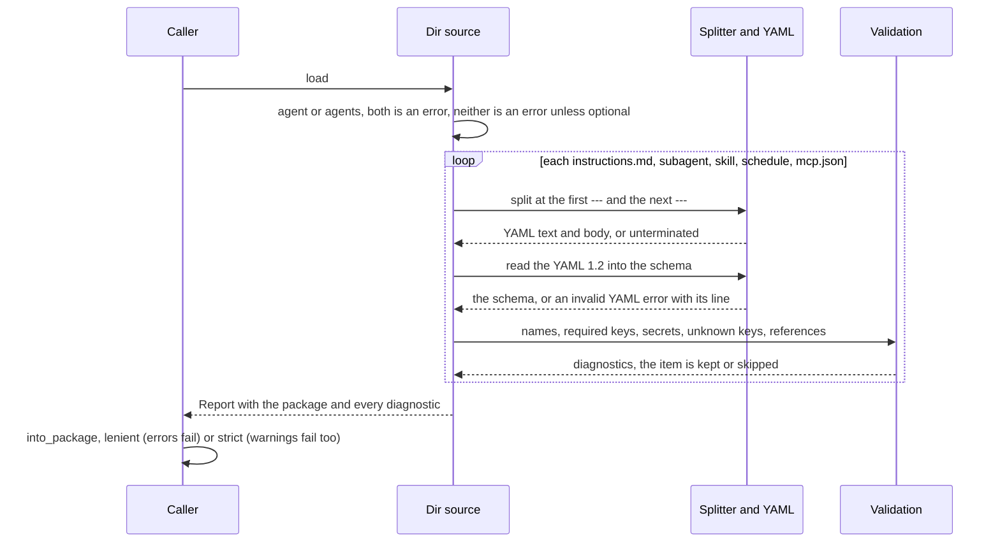

* **Splitter.** Frontmatter exists only when the first line is `---`; the next `---` closes it. An unclosed
  block is an error, never "no frontmatter". BOM and CRLF are handled; bodies are kept with LF and trimmed.
* **YAML 1.2** (`serde-saphyr` 1.3.0, *verified 2026-09-29*, MIT or Apache-2.0), with `strict_booleans`, so `no`
  is a string. Unknown keys are read into `serde_json::Value` and become warnings.
* **Agent files.** One schema, `AgentFrontmatter`, for the root agent, a directory subagent and a flat
  subagent file: `name`, `description`, `tools`, `model`, `skills`, `preload_skills`, `limits`, `vars`,
  `card` (root only), `a2a` and `auth` (remote subagent), `metadata`. A subagent needs a `description`. The
  keys `api_key`, `apiKey`, `token`, `secret`, `password` and `base_url` are errors (compared without case,
  `_` and `-`), and so is a `model` that is a URL. Claude Code, Copilot and OpenCode keys adam does not act on
  warn "ignored"; any other unknown key warns "unknown".
* **Names** match `^[a-z0-9][a-z0-9_-]{0,63}$`. A valid frontmatter `name` wins; otherwise the path gives the
  name (file name without `.md` or `.agent.md`, or the directory) with a warning. Copilot's capitals are
  lower-cased with a warning. In `agents/<name>/` the directory is the name and a different `name:` is an
  error. Two subagents or skills with one name are an error.
* **Skills** follow the Agent Skills rules above; the effective name is the directory name. `resources` lists
  the other files of a skill directory without reading them.
* **`mcp.json`**: `mcpServers` with `type` `stdio` (the default when there is a `command`), `http`,
  `streamable-http` or `sse` (refused at run time). A `url` without `type` is an error; `ws` is unsupported.
  The server name and each allow-listed tool must fit `<server>__<tool>` in 64 characters. A literal
  credential in a header, env value or URL is a warning (an error under `.strict()`).
* **Schedules** ([ADR 0060](../decisions/0060-schedules-are-parked-runs.md)): exactly one of three keys, a
  non-empty body (the prompt of each run), and `timezone` (default `UTC`); they belong to the root agent. Read and
  checked here; `adam-agent`, the coder and `adam-engine` run them (their READMEs, "schedules/"). A firing is the prompt as a person's message,
  sent to the agent directly: a `/command` in it is not expanded, and nobody answers it: a tool that asks the person
  (`ask_user`) is answered that nothing can be asked, and the model goes on, in the firing and in its subagents (the coder
  ends a firing that would wait, `Failed`). Write the prompt so that the agent need not ask.
  * `cron`: five fields, minute, hour, day of month, month, day of week, evaluated. `*`, lists, ranges, steps
    (`*/15`, `1-30/2`, and `5/15` for `5-59/15`), `JAN`-`DEC`, `SUN`-`SAT` (any case), `0` and `7` for Sunday, `?` as
    `*`. When both day fields are restricted (neither starts with `*` or `?`), a day matches either. A field out of
    range, a backwards range, a step of 0 or beyond the field, and a day of the month that none of the listed months has
    (`0 9 30 2 *`) are errors; `L`, `W` and `#` are not cron here.
  * `at`: one time, `YYYY-MM-DDTHH:MM`, optionally `:SS`, then nothing (read in `timezone`), `Z` or `±HH:MM`. A bare
    date, a lower-case `t` or `z`, fractions of a second, the second 60, a `[zone]` annotation, an offset beyond a day,
    `-00:00` (RFC 3339's unknown offset: write `Z`), a year after 9998 and a date that does not exist are errors. With an
    offset, `timezone` is ignored, with a warning.
  * `after`: one duration from when the schedule starts, whole numbers with units largest first, each once: `90s`,
    `30m`, `2h`, `1h30m`, `1d 12h` (a day is 24 hours). Zero and more than 366 days are errors; `timezone` is ignored,
    with a warning.
  * `timezone` must name a zone of the IANA database that adam bundles (jiff's copy), never the host's
    `/usr/share/zoneinfo`; `Mars/Olympus` is an error.
  * Fields are separated by ASCII spaces and tabs only: a no-break space is not a separator.
  * A `cron` schedule's part of the digest is what it was before `at` and `after` existed.
* **Other**: a prompt over 30,000 characters warns (Copilot's limit, *verified 2026-09-29*); an entry that is
  not a slot (`tools/`, `channels/`) warns and points at `#[tool]`; dotfiles, `*.test.md`, `__tests__/` and
  `README.md` are never read; non-UTF-8 is an error.

The test suite is the specification: one fixture directory per rule, each producing exactly one diagnostic;
all vendored `.agents/skills/*/SKILL.md` parse with no error; a Claude Code agent and two Copilot agents
parse unchanged as subagents.

## Build time: `build.rs` and `include_agent!`

`adam_agent_fs::build("agent").emit()` in `build.rs` and `adam::include_agent!()` in the crate are the
default way to ship an agent: the directory is parsed, validated and embedded at build time, so a mistake
stops the build before rustc runs and nothing is parsed at startup. The same `Dir` source reads the same
files at run time; both give a `Package`, and tests assert the embedded one equals the directory's.

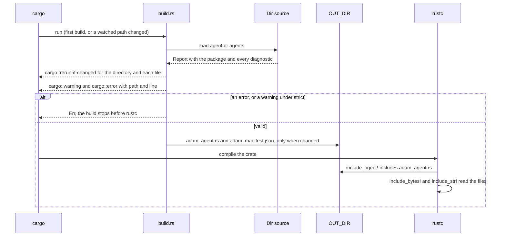

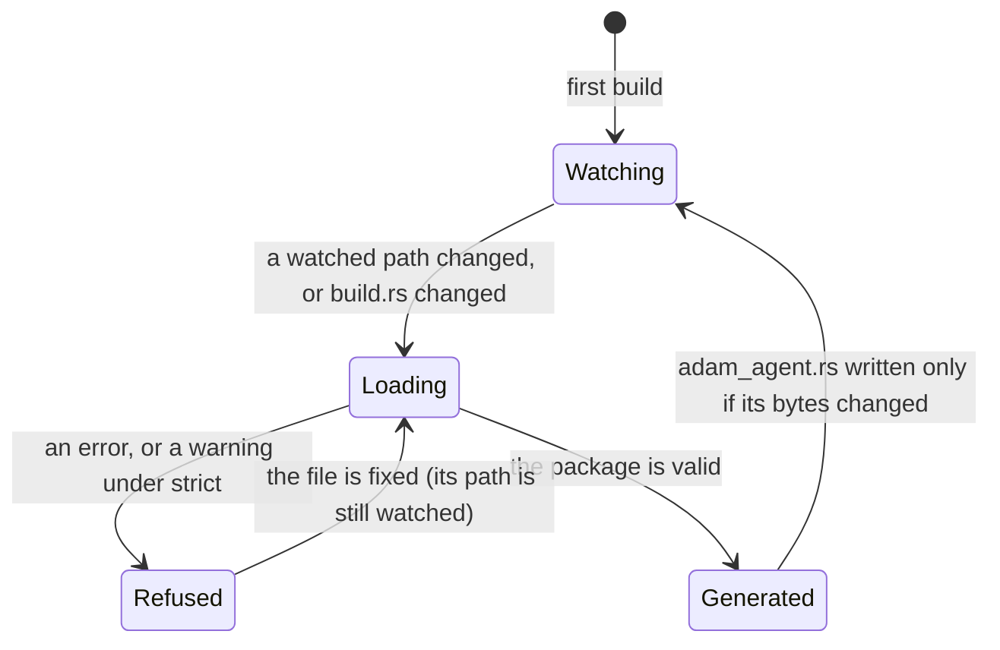

* **Diagnostics are build errors**: `cargo::error=path:line: message` (or `cargo::warning=`); a warning fails
  the build under `.strict()`. Nothing is written for a refused directory, and the watch list is printed anyway
  so that fixing the file rebuilds.
* **Rerun tracking**: `cargo::rerun-if-changed` for the directory and every file in it. `OUT_DIR/adam_agent.rs`
  is rewritten only when its bytes change. *Verified 2026-09-29* with cargo 1.94.1.
* **The generated file** defines `AGENTS`, `AGENT` (the single agent of an `agent/` package) and `PACKAGE`:
  `'static` data. `mcp.json` is `include_str!` and stays unexpanded, so no secret passes through the build;
  skill resources are `include_bytes!` (at most 1 MiB per skill). Every agent carries a SHA-256 `digest`, the
  same for a directory (`Dir::digest`) and its embedded copy (`EmbeddedAgent::verify`).
* **Versions must match**: the crate that runs `build()` and the one that runs the binary must use the same
  `adam-agent-fs`.

Details: [`adam-agent-fs` README](../../crates/adam-agent-fs/README.md#embedding-at-build-time).

## The `#[tool]` contract

[`adam-macros`](../../crates/adam-macros/README.md) is the macro, and
[`adam`](../../crates/adam/README.md) is the facade you depend on.

```rust
use adam::prelude::*;

/// Ask the person who gave you the task a question and wait for the answer.
#[tool]
pub async fn ask_user(
    /// What you need to know
    question: String,
) -> Result<ToolOutput, ToolError> { /* ... */ }

let tools = tools![AskUser, RunChecks];
let agent = LlmAgent::builder("coder", model, alias).state(env.clone()).tools(tools).try_build()?;
```

`#[tool]` keeps the function (so a unit test can call it), and generates a unit struct (`AskUser`,
the function name in `UpperCamelCase`, with the function's visibility) that implements the `Tool` trait
of `adam-llm-agent`.

* **Description and schema:** the doc comment of the function is the tool description (required: a
  tool without one does not compile); the doc comment of each parameter is the property description.
  Lines of one paragraph are joined with a space and a blank line keeps a paragraph break, so the
  hard wrapping of a doc comment does not reach the model; list items, headings, quotes, table rows
  and fenced code keep their lines. The arguments become one struct that derives `Deserialize` and
  `JsonSchema` (schemars 1.x, draft 2020-12, subschemas inlined, no `$schema`, no `title`); the spec
  is computed once per tool (`OnceLock`).
* **Parameter kinds:** `&ToolCtx` (at most one, any position); `State<T>` (shared state, resolved
  with `ToolCtx::require_state`); every other parameter is a field of the arguments struct, and its
  `#[serde(..)]` and `#[schemars(..)]` attributes are copied to the field. `#[args] a: MyArgs` uses an
  existing struct as the whole argument object and must be the only model argument.
* **Return:** `Result<T, E>` or a bare `T`, with `T: IntoToolOutput` and `E: Into<ToolError>`.
* **Options:** `name = "..."`, `type = Ident`, `strict` (`deny_unknown_fields`, which also closes the
  schema), `classify` (the error is `adam_error::Classify`: retryable becomes `ToolError::Transient`, or
  `ToolError::Retryable` with its class for a rate limit or a conflict, the rest `Permanent`),
  `retry(attempts = 3, backoff = "1s", max_backoff = "30s", multiplier = 2.0, on = ["rate-limited"])` (the
  tool's retry policy, `Tool::retry_policy`: its failures count under `tool:<name>`; `attempts` is required;
  durations are `500ms`, `1s`, `30m`, `1h`; `on` lists `transient`, `rate-limited`, `conflict`; what is left out
  is `RetryPolicy`'s default, 1 s, 60 s, 2.0 and all three classes;
  [ADR 0061](../decisions/0061-a-step-names-its-retry-policy.md)), `asks_user` (the tool can end a call with `ToolError::NeedsInput`: the
  generated `Tool::asks_user` says `true`, and `bind` refuses it on a subagent), `step`, `label` and
  `icon` (how a call is drawn as a step, `Tool::step_style`: the kind, a label instead of the tool's name (give one: it is what the person reads), and an
  icon from the closed vocabulary of the orchestration layer's `steps/v1` (`opencode` is OpenCode's own); [ADR 0007](../decisions/0007-progress-as-steps-and-streamed-text.md)) and
  `parallel = "independent" | "read" | "write" | "exclusive"` with `path = "<argument>"`, or `access = path::to::fn`
  (what a call shares with the other calls of its turn, `Tool::access`: the calls of a turn run at the same time and
  only calls that conflict keep the model's order; a tool that declares nothing runs alone;
  [ADR 0049](../decisions/0049-the-tool-calls-of-a-turn-run-at-the-same-time.md)) and
  `crate = path` (default `::adam`; `::adam_llm_agent` for a crate that does not use the facade).
  Reserved for later: `approval` (roadmap 5).
* **Bad model input is the model's problem:** a deserialization failure becomes `ToolOutput::error`
  (as `Tool::call` already documents), so the model can correct itself; the function never sees it.
* **State is checked at build:** `Tool::required_state` names the `State<T>` types a tool needs, and
  `LlmAgentBuilder::try_build` fails at startup when one is missing.
* **Journaling is unchanged:** the call runs inside `LlmAgent`'s `tool:CALL_ID` step, so the retry
  rules of the `Tool` docs still apply, and the macro adds nothing non-deterministic.
* **No distributed slices** (`inventory`, `linkme`): `tools![...]` is an explicit list that the
  compiler checks; the agent files name tools, and binding fails at startup on an unknown name.
* **Compile errors** the macro produces itself, each pointing at the offending token: no doc comment,
  not `async`, generic or `impl Trait`, a `self` receiver, a borrowed argument (`&str`), two
  `&ToolCtx`, `#[args]` next to another model argument, a bad tool name, an unknown option, a parameter
  pattern that is not a plain name, and `#[tool]` on something that is not a function. All the mistakes
  of one function are reported in one compile. rustc reports the rest (an argument type without
  `Deserialize` or `JsonSchema`, a return type that is not a tool result) with messages from
  `#[diagnostic::on_unimplemented]`.

What runs when the model calls a generated tool (the code between the journal and your function is
what the macro writes):

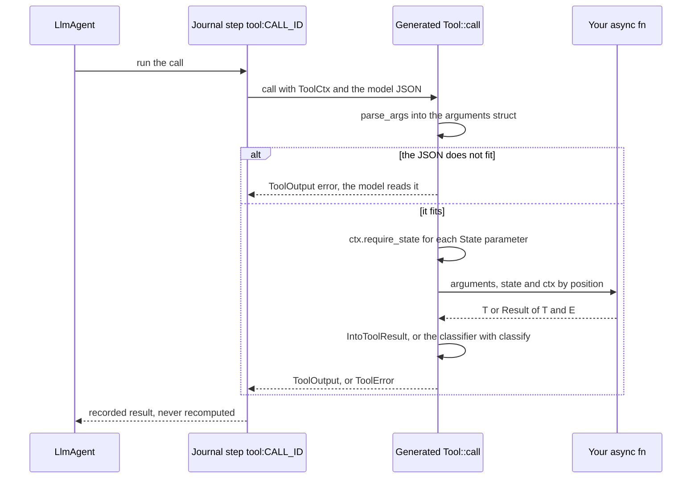

`FnTool` builds a tool at run time (an MCP tool is one). The typed helpers the macro relies on
(`spec_for`, `IntoToolOutput`, `parse_args`, `State<T>`, `ToolSet`) live in
[`adam-llm-agent`](../../crates/adam-llm-agent/README.md); the paths the generated code uses are
re-exported there as `#[doc(hidden)] __private` (feature `schema`) and again by the facade, so that a
crate using `#[tool]` needs no dependency of its own on `serde`, `schemars` or `async-trait` for the
generated code.


## Binding: manifest to agents

[`adam-assembly`](../../crates/adam-assembly/README.md) turns a manifest into `LlmAgent`s. The embedded manifest
(`AgentDef::from_manifest(AGENT)`) and one read from a directory (`AgentDef::from_source(&Dir::new(..), ..)`)
are the same type and take one code path.

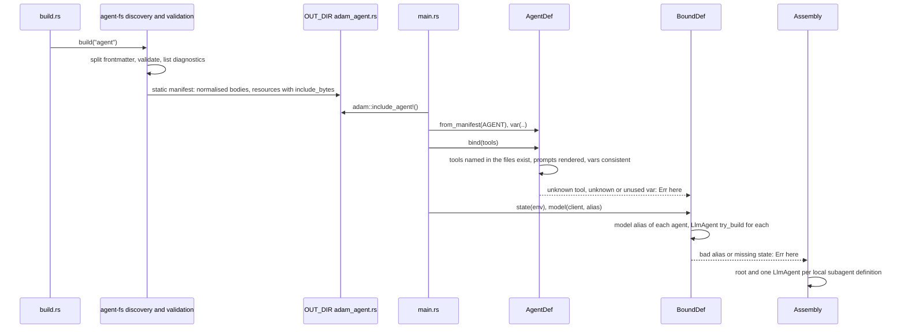

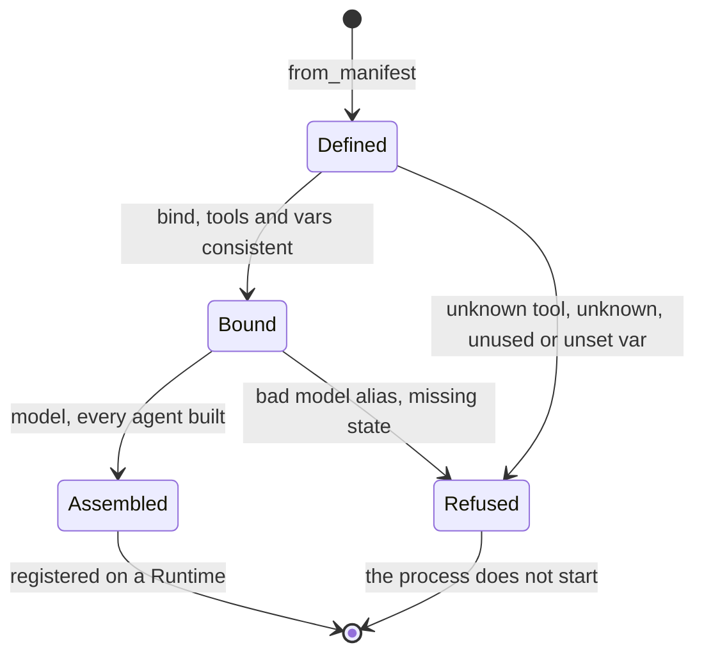

* **Tools.** `tools:` names are checked against the `ToolSet`: an unknown name is `Error::UnknownTool` with a
  "did you mean"; a `linear__*` pattern must match at least one tool. The root with no `tools:` gets every
  registered tool, a subagent with none gets none (D3); `*` is all, `[]` none. Nothing is inherited.
* **Vars.** `{{name}}` is substituted into the body and `instructions/*.md`. An unknown placeholder, a var
  declared and never used, a used var with an empty default that the code did not supply, a value for an
  undeclared var, and a `{{` that is not a placeholder are errors at `bind`, with file and line. `{{{{` writes
  a literal `{{`. Values come from `AgentDef::var` and `agent_var("a/b", ..)`.
* **Model.** One `DynModel` for every agent. An agent's alias is its `model:`, else its parent's (`inherit`),
  else the alias the code passes to `model(..)`. `model_aliases([..])` refuses the rest with a suggestion.
* **State and limits.** `state(Arc<T>)` reaches every agent's tools; a missing `required_state` fails
  `model(..)` with the agent's name. Frontmatter `limits` replace the loop's defaults key by key.
* **Subagents.** Each local subagent becomes an `LlmAgent` named `<parent>/<name>`; its parent gets a
  `SubagentTool`. `Assembly::register` registers them all on the runtime. Skills' tools, subagent tools and MCP
  tools are added while `bind` resolves an agent, so `AgentInfo::tools` is what the model is offered.
* **The card.** With feature `a2a`, `Assembly::card(url, version)` is the root's `card:` as an
  `adam_a2a::AgentCardConfig`; `AgentDef::card` gives it before anything is bound, for a control plane.
  `card.extended` (`description`, `skills`) becomes the config's extended card: the public card with the description
  replaced and the skills added (a public id is replaced). It is served only to authenticated callers and only when the
  server authenticates ([the A2A server](a2a-server.md#the-extended-card)); an empty `extended: {}` declares nothing, and a
  file holds no secret, so put nothing in it that you would not give every holder of a token.

## Skills at run time

Progressive disclosure, the three tiers of the Agent Skills client guide (*verified 2026-09-29*,
<https://agentskills.io/client-implementation/adding-skills-support.md>). Each agent has its own skills (its
own `skills/`, narrowed by `skills:`), never inherited. A folder with no `skills:` has every skill it holds;
`skills: []` turns skills off.

| Tier | The model sees | Cost |
|---|---|---|
| 1. Catalog | `name` and `description` of each selected skill, in the prompt after the instructions | about 50 to 100 tokens per skill, on every request |
| 2. `load_skill { name, offset?, limit? }` | a page of the body of `SKILL.md`, frontmatter stripped, in `<skill_content name="...">`, with bundled files listed in `<skill_resources>`; the last line says where the next page starts | once, in the tool result; it stays in the conversation |
| 3. `read_skill_file { skill, path, offset?, limit? }` | a page of one bundled file as text | once per file read |

* The catalog is pinned by a golden file (`crates/adam-assembly/tests/golden/coder-prompt.txt`). Descriptions
  are collapsed to one line and XML-escaped. **`name` of `load_skill` and `skill` of `read_skill_file` are plain
  strings, not enums**: the two tools' descriptions and schemas are the same whatever skills exist, so adding a
  skill never changes the tools a provider caches. An unknown, unselected or made-up name gets the same refusal,
  listing what is available.
* **Both tools page like `read_file`**: `offset` from 1 (negative from the end) and `limit` at most 2,000 lines, at
  most 50 KiB a page, and every result ends with `[more: N lines left; next page: offset=K]` or `[end: N lines]`.
  A body that goes on names its bundled files in one line on the first page; the `<skill_resources>` list comes
  with the last page. A line of the text that starts with `[` is shown as `\x5b`, so only the last line does.
* **`read_skill_file` is a lookup, not a file read**: the path is normalised, refused when empty, absolute, with
  `..`, a backslash or a control character, then matched **exactly** against the skill's bundled list. There is
  no filesystem access at run time. Text only (no NUL), at most 1 MiB per skill.
* **`preload_skills:`** puts the whole skill into the prompt instead of leaving it to `load_skill`; it is out of
  the catalog. With every skill preloaded there is no `load_skill`; with none bundling a file, no
  `read_skill_file`; with no skills, neither tool and no catalog.
* **Skills a run finds.** A host that finds skills while a run goes on (the coder: the skills of a repository it
  prepared) gives the root agent `AgentDef::run_skills(Arc<dyn RunSkills>)`. A name with a `/`
  (`<source>/<skill>`) goes to it and a name without never does, so it cannot shadow a skill of the folder.
  With it set the root always has both tools and one fixed sentence in its prompt ("Other skills may be listed to
  you during the run, named `<source>/<skill>`; load them with load_skill the same way."), also when the folder
  has no skill of its own: what a run finds is a **tool result**, and the system prompt and the tool list stay the
  same bytes for the whole run. `skills: []` installs neither the tools nor the sentence. Subagents get none.
  The coder's: [Repository skills](coder-agent.md#repository-skills).
* A registered tool named `load_skill` or `read_skill_file` is `Error::ReservedToolName`; `tools:` does not
  filter the skill tools, `skills: []` turns them off. Results are journaled like any tool's.
* Known limit: an old tool result may be shortened in the stored history by `limits.max_history_tokens`, a loaded skill included,
  and a compaction removes the turns that loaded it (the marker keeps the **names** of the skills loaded earlier, not their
  text: load one again to read it). Preload a skill to keep it for the whole run.

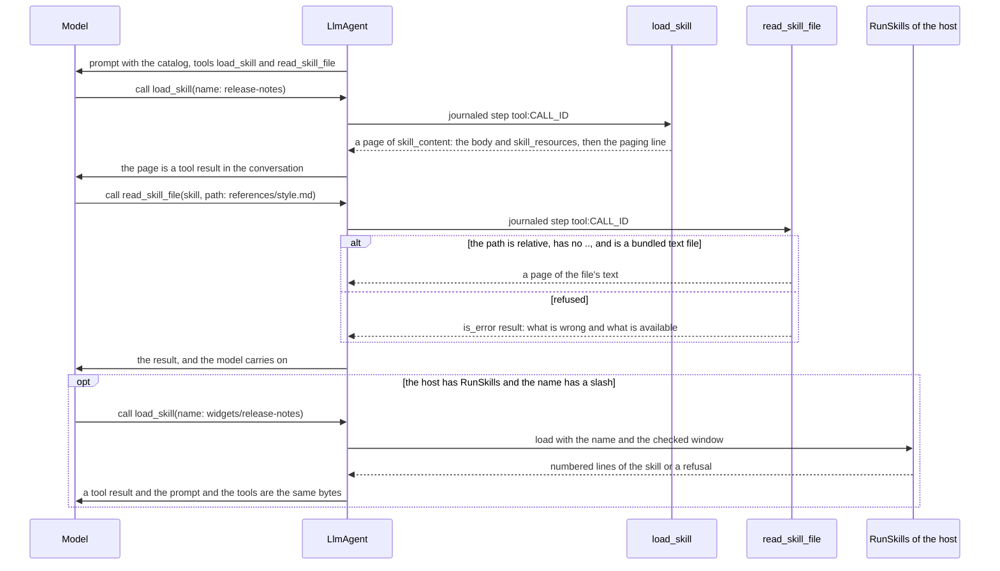

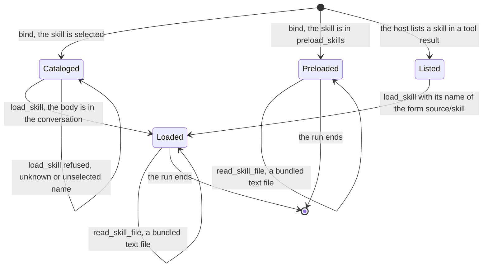

## Subagents at run time

A subagent is a child run ([child runs](child-runs.md)). Each local subagent is its own `LlmAgent` registered
as `<root>/<sub>`; the parent sees **one tool per subagent** (D5) with input `{ message }`, and the child never
sees the parent's history. The sequence and the states of the wait are in
[Architecture](../architecture.md#child-runs).

### The session tools

A root with a subagent, local or remote, also gets five tools that run a subagent **in the background** as a session
(`subagent_start`, `subagent_send`, `subagent_read`, `subagent_close`, `subagent_list`; [ADR 0045](../decisions/0045-a-subagent-can-run-in-the-background-as-a-session.md),
[child runs](child-runs.md#sessions-adr-0045-slices-1-to-4)). No file declares them: they follow the folder's subagents,
whose names are the enum of `agent`, and they are not given to a subagent. A subagent file needs nothing for them, and a remote
(`a2a:`) subagent works too ([remote sessions](#remote-sessions)). A tool or a subagent named like one of the five is refused at
bind. A root whose subagents are all remote gets the five tools as well.

**The same helpers are offered to a person.** `adam-agent` and `adam-coder` list `child-sessions/v1` on the card of a root with a subagent, so a client can open, talk to and close a session on any of them ([A2A server](a2a-server.md#child-sessions-child-sessionsv1)). The card's `maxOpen` is the effective `SESSION_MAX_OPEN`: `limits.max_open_sessions` of the root's file lowers it, never raises it. A root with no subagent lists nothing.

### The subagent tool

* **Name and shape.** Named after the subagent. Input `{ "message": string }`, required. Description: the
  subagent's `description` plus "The agent does not see this conversation; put everything it needs in `message`."
* **A call** starts the child with `message` as its first user message and returns `AwaitRun`. The parent
  parks; the child's final **text** is the tool result, or an error result (`the run failed: ...`). A blank
  `message` is an error result and starts nothing.
* **No runtime handle.** `Ctx::child_starter()` gives the step a `ChildStarter`; `LlmAgent` puts it in each
  `ToolCtx`; the tool calls `ToolCtx::start_child(agent, message)`. The child starts on the runtime that steps
  the parent. A process that does not know the child's agent gets a permanent error result naming it.
* **Least privilege.** A subagent's tools are those its own `tools:` lists, from the same registered set, and
  none when it lists none. It gets nothing of its parent's.
* **The root run.** A tool in a child run can ask `ToolCtx::root_run_id()` for the run whose work the child serves
  (the top of the chain of parents; the run itself when it is nobody's child). The id travels in the child's first
  message and its stored state, so it survives a restart. A tool that keeps something for the whole task, such as
  `adam-coder`'s workspace and its check budget, keys it by the root: its subagents then share the worktree.
* **Limits per child.** Its own `limits:` apply to its run; it does not count against the parent. A run also has a
  **time limit**, `limits.max_minutes`: 30 minutes when the file says nothing, `0` for none, an error above 1,440, a
  warning on a root agent (it has no parent to stop it). The time the child spends waiting for a person is not counted.
  Past it the runtime fails the child (`cancelled: time limit: the
  run did not finish within 30 min`) and the parent reads "the run failed: ..." as the tool result.
* **Doom loop and tool limits.** In every agent, the third call in a row with the same tool and the same arguments (key
  order does not matter) is not run when the two before gave the same result, **both were error results**, or **carried the
  same repeat key** (a failing command's text carries a duration or a path, so the coder's command tools say `exit:<code>`),
  and is answered with an error that tells
  the model to change approach; after two such refusals the run takes the closing turn with `limit: "repeated_call"`. A poll whose
  answer changes, or the same call with another call in between, runs. A call that runs past its tool's time limit
  (300 s unless the tool declares one: the coder's command tools the deployment's command limit plus 30 s, MCP tools
  their call timeout plus 10 s) is stopped and answered with an error. The texts are in
  [errors](errors.md#what-the-model-is-told).
* **Name clashes are build errors** (`Error::SubagentToolClash`): a subagent named like a tool of its parent, a
  skill tool, or another subagent.
* **No asking tools in a subagent.** Nobody could answer, and the parent would wait for ever. A tool declares
  it can ask with `#[tool(asks_user)]` or `FnTool::asking_user()`; `bind` refuses a subagent whose resolved
  tools include one (`Error::SubagentAsksUser`), also through `*` or a pattern.
* **Limits of the design.** The calls of one model turn run one after another. Only the child's text travels
  back (artifacts stay on the child's run). The child starts empty and cannot be continued. Cancelling the
  parent cancels the child (the task of a remote A2A subagent called through its tool is not cancelled; a round of a
  [remote session](#remote-sessions) cancels it).

### Remote subagents (`a2a:`)

A subagent file with `a2a: <agent-card URL>` is a tool on the parent whose work happens on another A2A agent.
Same shape, name checks and placement as a local subagent's tool; `limits`, `tools`, `model`, `skills` and
`vars` mean nothing on it and warn. The sequence and states of the wait, the poll and the failure table are in
[child runs](child-runs.md#remote-tasks-the-same-wait-without-a-message). It needs the feature `remote` of
`adam-assembly`, on by default (and in `adam-agent` and `adam-coder`); a build without it, such as an application that
embeds adam, refuses the file at `bind` with `Error::RemoteNotEnabled`, before any secret is read.

* **Send.** One journaled step: `SendMessage` with `returnImmediately`, `messageId = child_run_id(parent run,
  call id)`, so a retry reaches the same task on a server that deduplicates (`adam-a2a-runtime` does).
* **Wait.** `ToolError::AwaitRemote` parks the parent with `wait_poll` (60 s by default); each wake is a
  journaled `poll:<call id>` step (`Tool::poll_remote`). The wait ends with an error result after
  `AgentDef::remote_timeout` (default **one hour**); the remote task keeps running.
* **Terminal states.** `completed`: the artifacts' text (cut at 64 KiB), else the status message; when the artifacts
  hold files only (an adam agent's screenshots), the status message and then their lines. `failed`,
  `canceled`, `rejected`, and also `input-required` and `auth-required`: an error result (a subagent cannot ask
  the user). `submitted`, `working` are "still going".
* **Failures.** A transport or JSON-RPC internal error is `Transient` (retried with backoff); anything the
  remote answered on purpose (401, task not found) is an error result and the parent goes on.
* **Auth: `auth: bearer:VAR`.** `bind` reads the variable (`AgentDef::env(name, value)` wins), trims it and
  **fails closed** (`Error::RemoteAuth`, naming the variable, never a value). The token is a `SecretString`,
  sent as `Authorization: Bearer` on every request, never journaled or logged, and goes **only to the origin of
  the card URL you wrote**: a card that advertises another host is refused, redirects are not followed.
* **URL.** `https`, or `http` to this machine; anything else is `Error::RemoteUrl` unless
  `AgentDef::allow_insecure_remotes(true)`, which `adam-agent` sets from `A2A_ALLOW_INSECURE_REMOTES` (plain `http` to
  a service of the same cluster). **Then the messages and the bearer cross the pod network in clear text**: protect
  that network (a NetworkPolicy that admits only the caller, or mesh mTLS). A card cannot widen the switch: an `https`
  card's plain-`http` interface is refused, and plain `http` goes only to the card's own host. A card on another
  machine never points at this one (`localhost`, a loopback address). A URL with credentials is always refused.
* **What does not travel.** Only text, no `contextId` (every call of the tool is a fresh conversation; a
  [session](#remote-sessions) keeps it), and no file: a `raw` part is described in a line and dropped, a `url` part stays a
  line (it is never fetched).
* **`files: true`** (an adam extension, remote subagents only; on any other file it warns and does nothing): each
  `raw` part of the answer is shared as a file of the calling run, by the rule of a `files: true` MCP server
  ([below](#files-from-a-server-files-true)): a name made here from the sender's (`page.png` is `page-<hash>.png`, and
  the extension follows the bytes), its media type checked against the bytes, at most 4 MiB a file, 16 a result and
  what the run may still share, a line for the model in its place. A screenshot the browser agent shared reaches
  Chat's A2A client when Chat calls `browser` itself; a subagent's files stay on its run.
* **A deployment that points at one.** The URL is the file's and the token the environment's: a chart that renders the
  folder writes `a2a: http://browser.<namespace>.svc:8080/.well-known/agent-card.json`, sets
  `A2A_ALLOW_INSECURE_REMOTES=true` for in-cluster `http`, and gives `auth: bearer:BROWSER_A2A_TOKEN` its value from a
  Secret. An unset variable stops the process (exit 78) naming it. There is no `${VAR}` in `a2a:`: the file is rendered.
* **Under a local subagent.** A remote declared in a local subagent's directory
  (`subagents/researcher/subagents/browser.md`) is a tool of that subagent: its child run sends, parks on the remote
  task and polls it as a root does, and only the researcher's text reaches the root. Each declaration is its own tool
  with its own `auth` (two may name the same variable); a flat `subagents/<name>.md` has no directory, so give it one
  (`subagents/<name>/instructions.md`) to nest a remote under it. A subagent never gets a tool it does not declare or
  list, so the root's `browser` is not the researcher's.

#### Remote sessions

A remote subagent can also run as a session (`subagent_start`, `subagent_send`, ...). Each round is a run of an agent
the assembly registers as `<root>/<subagent>`: it has no model, it talks to the remote. Only the **root's** remote
subagents have one; a remote under a local subagent has no session. The sequence and the states are in
[child runs](child-runs.md#remote-sessions).

* **Context.** Round 1 names no `contextId`. The round adopts the remote's from its first answer and the next round
  sends it, with `referenceTaskIds` naming the task before. An adam remote honours `referenceTaskIds` only for a caller
  that is authenticated (`auth: bearer:VAR`); without it the remote starts a new context each round.
* **A message to a working round.** If the card lists `steer/v1` the message is sent to the working task and
  `subagent_send` says `steered`. Otherwise it waits and is sent as the next task of the same round, joined with the
  others that waited, and `subagent_send` says `queued`. A steer the remote refuses is queued.
* **The report** is the remote's answer in text. A file is described in a line, not shared (`files: true` is for the
  tool), and the remote's tokens are not counted in the parent's. A question (`input-required`) is the report, and the
  next round's message answers that task. `failed`, `canceled`, `rejected` and `auth-required` fail the round; the
  session stays usable.
* **Time and cancel.** `AgentDef::remote_timeout` (one hour by default) is the one-shot tool's wait cap and a round's time limit. A round that is
  cancelled (`subagent_close` with `cancel`, a cancelled parent, the limit) sends the remote `CancelTask`, best effort.
  Each cancel is one try, logged and not repeated. A process that registered only the starter of the round agent sends none.
* **Closing** a session is local: the closing round calls nothing and repeats the last report.

More in the [`adam-assembly` README](../../crates/adam-assembly/README.md#subagents).

## MCP tools at run time (feature `mcp`)

[`adam-mcp`](../../crates/adam-mcp/README.md) is the MCP client (the official Rust SDK `rmcp`); the wiring is
[`adam-assembly`](../../crates/adam-assembly/README.md#mcp-tools-feature-mcp) behind its feature `mcp`
(`adam::mcp` through the facade). **Off by default**: a build that does not opt in has no MCP client, cannot
start a process because a file said so, and `bind` refuses an agent whose `mcp.json` lists servers.

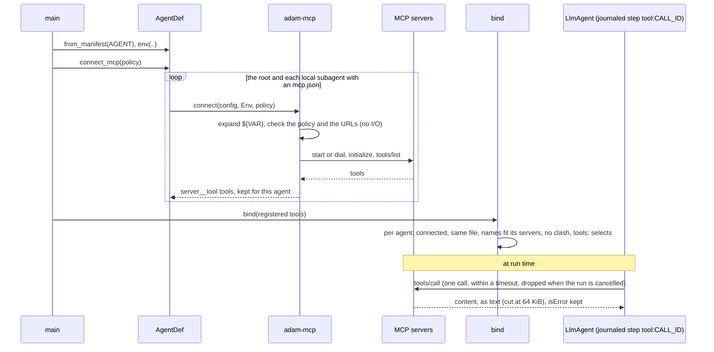

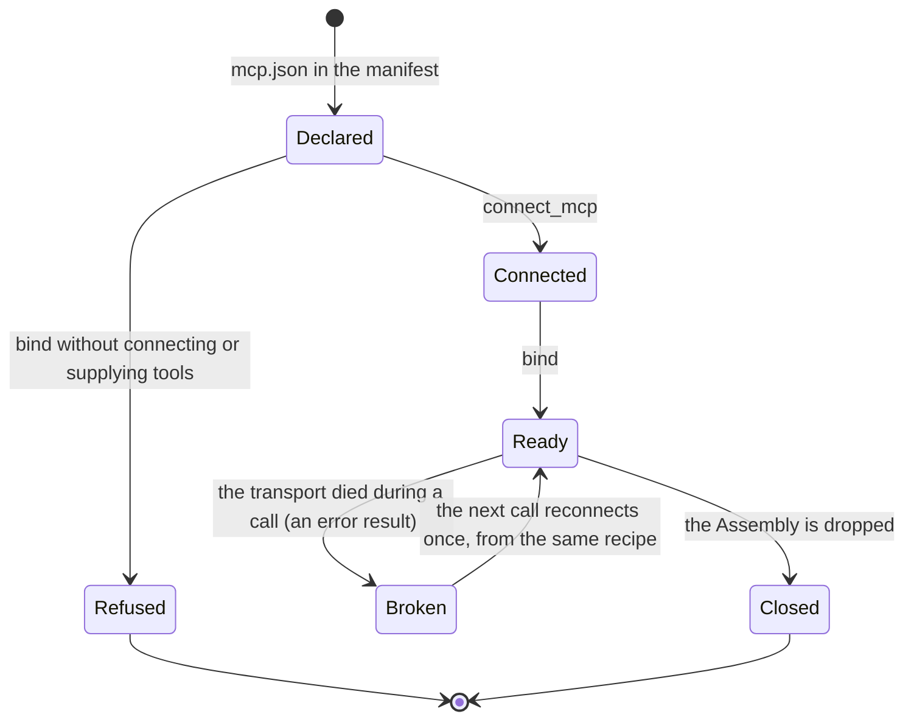

* **Per agent.** An agent's MCP tools come only from the `mcp.json` in its own directory; a subagent inherits
  none, and two directories may each name a server `linear`, connected apart.

#### A server loaded only when the task asks (`when`)

A server entry may say `"when": { "keywords": ["linear", "ticket"] }`. It becomes one **group** of
tools, named after the server, loaded by one generated tool, `load__group__<server>`
([ADR 0066](../decisions/0066-a-first-request-is-lean-and-tools-load-in-groups.md)); a server without
`when` is eager and loaded for every run, as before the key existed.

* **The task** is the first part of the run's first message: the words the person sent
  (`Conversation::task`). A run that continues another carries that first message, so it selects the same
  groups as the run before, whatever its new message says. A message with no words (an empty one, or images
  only) matches nothing: only the eager servers are loaded.
* **When it is decided.** From the task, before the run's first model call: the tools array is the same bytes at
  every request of a run that loads no group during itself, so the cached prefix holds ([ADR 0044](../decisions/0044-paged-tools-a-stable-prompt-prefix-a-plan-skills-commands-and-project-context.md),
  decision 1). The decision is **recomputed** from the run's state at each turn, not stored: the state already
  holds the task, and a stored field would be a second place where the same decision lives.
* **The loader.** An agent with at least one triggered server has one more fixed tool per group,
  `load__group__<server>`, present from its first request whatever the task. Its schema and description are
  constants (the group's name and its one-line note, never a member count), so the tool list is the same bytes
  until something is loaded. A successful call says which tools are now available, names them and says the
  group's note (the server's instructions section); the run's state records the group
  (`Conversation::loaded`), and from the **next** model call on its tools are **appended after every other
  tool** of the request, in the order the run loaded them, never inserted or reordered. The request before is
  therefore a byte prefix of the one after it, and the loop records the turn where the head grew
  (`Conversation::tools_appended`). The append costs **one full history re-prefill**, which the result says in
  words; the tool reports no number — what it cost is the next call's cached input tokens, as the provider
  reports them. A refused load changes nothing: a loader called twice, and one whose group the task already
  loaded. A group with no tool this agent was given (its `tools:` narrowed the server's list, or the server
  was not reachable and is `optional`) has **no loader**: its existence is not revealed.
* **What is withheld.** A group's tools are not shown, and a call to one (the model may name a tool it was not
  shown) is refused with a result that names the tool, the group, its keywords and its loader. A server the task
  does not load contributes no instructions to the prompt; the group's note is said in the load's result when the
  run loads it, so the prompt does not grow during a run. A group the **task** loads keeps the `when` behaviour:
  its note is in the first request's prompt. A member a **task-loaded** group loses to the access tier is
  **removed for the run** (it would otherwise appear later at its registration position, an insertion rather
  than a suffix); an explicitly loaded group's member is only hidden for that message. The eager servers'
  instructions stay in the prompt, after the agent's own text and before its skills.
* **No `paths` in this version.** The coder has no checkout before its first model call
  (`prepare_workspace` is a tool), so a path glob would have nothing to match. `when.paths` is ignored with a
  warning at load; a `when` with no `keywords` is a load error, because the server would never load.
* **Keywords.** 1 to 16, each 1 to 64 characters, no control or format character; the match is a
  case-insensitive substring, so a plural or a possessive still matches. A `when` with no keyword is a load
  error and the server is left out (it would never load: leave `when` out to load it for every run).
* **The reserved word `load`.** A server named `load` is refused at start, and a registered tool whose name
  starts with `load__` is refused at bind; an MCP or conversation tool whose full name starts with it is left
  out with a warning. An MCP tool is `<server>__<tool>`, so a server named `load` and a loader would collide.
* **Fail closed at startup.** `AgentDef::connect_mcp` finds everything that can be wrong before the first
  model call: a `${VAR}` with no value, `type: sse`, a stdio server the policy forbids, a plain-http URL to
  another machine, a URL with credentials or a `${VAR}`, a bad header, a server that is down or refuses the
  credentials, an allow-list naming a tool the server lacks.
* **Names and text.** `<server>__<tool>`; without an allow-list a tool whose name does not fit
  `^[A-Za-z0-9_-]{1,64}$` is skipped with a warning. Descriptions are cut at 8 KiB, answers at 64 KiB; images
  and blobs are described, never included (unless the server has `files: true`, below); `isError` is an error
  result.
* **At-least-once.** A call runs inside the journaled step, so a replay of a committed call does not call the
  server again, but a transition that fails before it commits calls it again. MCP has no idempotency key, so
  **no failure of an MCP call is `ToolError::Transient`**: a timeout or lost connection is an error result saying
  the call may or may not have run.
* **Secrets.** `${VAR}` reads `AgentDef::env` then the `AgentDef::secrets` source: the process environment in a server,
  nothing in an embedded engine unless its host gives it (`NoSecrets`, ADR 0047). Expanded values are
  `SecretString`s and registered (with their encoded forms) with a redactor that every server message, tool
  result and child stderr line passes through. **Secrets go in `headers`, not in the URL** (the SDK logs the
  URL): `${VAR}` in a `url` is refused unless `McpPolicy::allow_url_secrets(true)`. A secret in stdio `args`
  is visible in `ps`: use `env`. Tool text is controlled by the server: the allow-list is the mitigation.
* **In the binaries.** `adam-coder` and `adam-agent` call `connect_mcp` in every role that runs workers, with
  `MCP_ALLOW_STDIO`, `MCP_ALLOW_INSECURE` and `MCP_ALLOW_URL_VARS`. A server that is down exits 69; anything
  wrong in the files or the policy exits 78.
* **Not supported**: MCP resources, sampling, roots, elicitation, OAuth, `type: sse`, `list_changed`,
  MCP tasks, progress notifications, exporting adam's tools as an MCP server.

### Timeouts, instructions and prompts

Six optional keys of a server entry, in `mcp.json` and in the deployment's extra file
(`ADAM_EXTRA_MCP_FILE`).

| Key | Meaning | Default |
|---|---|---|
| `timeoutSecs` | how long one tool call of this server is waited for | 60 |
| `connectTimeoutSecs` | how long the server may take to start, initialize and list its tools and its prompts: one deadline for all of it | 30 |
| `instructions` | `false` leaves out the text the server returns when it initializes | on |
| `prompts` | `false` stops the server's prompts from becoming commands | on |
| `parallel` | `false` makes the calls of this server's tools run one at a time, alone in their turn; by default they run at the same time as the turn's other calls, up to `MAX_PARALLEL_TOOL_CALLS` ([ADR 0049](../decisions/0049-the-tool-calls-of-a-turn-run-at-the-same-time.md)). **Folder agents change behaviour here:** MCP tools now run at the same time by default; a server with a session (a browser, a cursor, a file being written then read) needs `"parallel": false` in mcp.json before you take this revision. | on |
| `when` | `{ "keywords": ["…"] }`: the server becomes a group, `load__group__<server>`, whose tools and note reach a run when the task mentions one of the keywords or the run loads it (see [below](#a-server-loaded-only-when-the-task-asks-when)); `paths` is not supported and is ignored with a warning | eager (no `when`) |

* **Seconds.** A whole number, at least 1. Zero, a negative or a fractional number, or text refuses that server
  when the file is loaded (`path: error: ...`).
* **The deployment caps both.** `MCP_MAX_CALL_SECS` (default 900, 1 to 86400,
  [environment](environment.md)) bounds the **effective** value, whoever asked for it: a `timeoutSecs` or
  `connectTimeoutSecs` over it is lowered to it, and so is the default of a server that says nothing (with
  `MCP_MAX_CALL_SECS=10`, no call of a server of these files waits more than 10 s, and no connection either). Each
  lowering is one warning when the servers are connected. A value the file asks for is at least 1 s. The files never decide
  alone how long a call may take. A tool's limit in the loop follows its server's values (the call, the
  connection and ten seconds), so a long call is not cut by the agent first.
* **Instructions.** What a server says when it initializes is appended to the agent's instructions **once, when the
  agent is bound**, never per turn: the prompt a model sees is the same on every call, so the cached prefix holds.
  Each server has a heading, `## Instructions of the MCP server <name> (text from the server, not the person)`, in
  the order of the server names, after the agent's own text and before its skills. The server's text follows
  **as a Markdown blockquote** (every line starts with `> `), so it cannot make a heading of its own. It is
  stripped of control and format characters, **then** scrubbed of the values `${VAR}` put into the file (a secret
  with a zero-width character inside it is still found), quoted and cut at 2 KiB, quote marks counted (a cut warns
  once, naming the server and the sizes); all together are cut at 8 KiB (the server that would pass the limit and
  the ones after it are left out, with a warning). A server that is not connected contributes nothing, so a
  worker that started while an `optional` server was down, or whose server says another text after a restart, has
  another system prompt than its siblings: nothing pins the prompt of a run (each model call takes it from the
  worker's own agent, `crates/adam-llm-agent/src/agent.rs`), so a run that another worker resumes reads that
  worker's, and only the prompt cache of the first call differs. A server with a bearer per call (the coder's `github`) has no session
  to ask and gives none; the coder's own `github` entry says `"instructions": false` anyway.
* **Prompts as commands.** [Below](#prompts-as-commands).
* The keys are left out of the manifest when they are not used, so a folder that does not use them keeps its digest.

#### Prompts as commands

A server that serves prompts (`prompts/list`) has each as a [command](#commands-commandsnamemd) of the root agent
named `<server>__<prompt>` (lower-case letters, digits, `_` and `-`, at most 64: a prompt whose name does not fit is
left out with a warning; so is every prompt of a server whose own name has an upper-case letter, because command
names are lower-case: such a server serves its tools and no prompts). They are listed once when the server is
connected and are on the card ([`commands/v1`](a2a-server.md#commands-commandsv1)); `argumentHint` is made from the
arguments the prompt declares (`<topic> [style]`: required ones in angle brackets).

| | |
|---|---|
| Expansion | when the message arrives, with `prompts/get`: the first words of the person's text (double quotes respected) are the prompt's declared arguments **in order, and the last declared argument takes the rest of the line** (`/images__scene a red dot` gives the one argument `subject` the text `a red dot`; one pair of quotes around the whole rest is dropped) |
| What the model reads | one line, `(the prompt <prompt> of the MCP server <server>, with the person's arguments)`, a blank line, then the server's text: stripped of control and format characters (bidirectional ones included), then scrubbed, so a server's text is never taken for the person's own words; the command's name stays in the stored message |
| Refused (`invalid params`) | a required argument that is missing, any text for a prompt that declares no argument, a server that refuses the prompt, and any answer that is not text messages of the user (an assistant message, an image, a resource) |
| Unavailable | the server cannot be asked (connection lost, no answer): the message is refused with the A2A `unavailable` error and nothing is stored. The whole expansion, a redial of a lost connection included, is given the smaller of `timeoutSecs` and 30 s |
| Stored | the text is stored as the message, like a template's expansion: stepping the run, a restart and a replay never ask the server again (a retry of the same `messageId` may ask once more, and the answer is dropped) |
| Limits | those of a template's expansion (arguments at most 4 KiB, text at most 32 KiB and not empty); the folder's commands and the prompts **together** are at most 50: the folder's first, then the prompts by server name and prompt name; what does not fit is left out, with one warning that gives how many |
| A name clash | a command of the folder with the name of a prompt wins; the prompt is left out of the backend and of the card, with one warning |
| Only a process with workers | the prompts are known once the servers are connected, which only a role that runs workers does. A control plane (the front of `topology: split`) lists none, and **refuses** a message that names `/<server>__<anything>` for a server of the folder's `mcp.json` that serves prompts (`invalid params`, with words that say so; one warning at its start names the servers). It never reaches the model as text. The front does not read `ADAM_EXTRA_MCP_FILE`, so a prompt of a server only that file names is not refused there |
| Opt out | `"prompts": false` on the server |

### Files from a server (`files: true`)

A headless browser answers `screenshot` with an image block and `pdf` with an embedded blob resource. A server whose
entry says `"files": true` hands these to the person: each image, audio clip and blob of a result becomes a **file
artifact of the run**, the shape the coder's `share_file` gives (one A2A `raw` part with `mediaType` and `filename`,
[ADR 0012](../decisions/0012-files-as-a2a-artifacts.md)), so an A2A client, the orchestration layer included,
stores and shows it as it does a shared file ([ADR 0033](../decisions/0033-files-from-mcp-results-are-shared-files.md)).

```json
{ "mcpServers": { "browser": { "type": "http", "url": "http://127.0.0.1:9222/mcp",
                               "tools": ["browser_navigate", "browser_screenshot", "browser_pdf"],
                               "files": true } } }
```

| | |
|---|---|
| The model reads | `Shared browser_screenshot-3fa2c19b.png (84.0 KiB, image/png). To show it in your answer, write . To use it as the picture of an `ask_user` option, pass image {sha256: "<64 hex digits>", alt}. In a `show` block, an `Image` names it: {component: "Image", artifact: "<64 hex digits>", alt}.` in place of the block (the last three sentences for an image only; the same line as the coder's `share_file`); never the bytes |
| The file's name | the tool's name on the server, a hash of the bytes (unique within the run, stable on replay), the extension of its checked type |
| Its media type | the server's, checked against the bytes (`adam_runtime::checked_media_type`): a "PNG" that is not one is `application/octet-stream` |
| Not shared | over 4 MiB, past the 16th file of a result, or over what the run may still share (checked on the base64's length, before decoding: the result is journaled before the loop's run cap), or not base64: a line says why and the result is an error result |
| Trust | none: the server's type is checked and the name made here; the bytes are untrusted content, which a client serves as an attachment or sanitizes |
| A subagent's | stays on the subagent's run, like `share_file`'s: only the subagent's text reaches the parent |
| Without the key | described in a line, no byte kept (fail closed) |

The sequence and the states are in [`adam-mcp`](../../crates/adam-mcp/README.md#files-files-true).

### Pictures for the model (`mcp` in `MODEL_IMAGE_SOURCES`)

An image block of a result is **not** put in front of the model unless the deployment says so: `MODEL_INPUT_MODALITIES=text,image` (the model sees) **and** `mcp` in `MODEL_IMAGE_SOURCES` (default `person,workspace`: an MCP server's call can carry credentials that were expanded into it, and an image is not scrubbed). A server entry has no key for it; the deployment decides, for every server. When it does:

* each image block is admitted by the run's limits (`MODEL_IMAGE_MAX_*`) and rides on the tool result; the result's text says `[image shown to you after this result: paint-1.png (png, 84.0 KiB, 800×600)]`, or why it is not (`[image not shown: ...]`);
* with `files: true` it is **also** shared as a file, as above: the two lines name the same SHA-256, and the run keeps the bytes once, by that hash;
* with neither, the text is what it always was, `[image not included: image/png]`.

An image a tool returns is shown to a model **after** the run of tool results, in one user message ([wire](a2a-server.md#images-in)); a shortening of the history takes the images of an old result out, as a line, and a compaction summarises them away with their turn.

*Verified 2026-09-29* (<https://docs.rs/rmcp/3.5.0>): `rmcp` 3.5.0 is Apache-2.0 with `rust-version` 1.88; its
SSE transport was removed in 0.11.0 and the specification calls HTTP+SSE deprecated
(<https://modelcontextprotocol.io/specification/2025-03-26/basic/transports>).

## Dev reload (feature `dev`)

With the `dev` feature of `adam-assembly` (re-exported by `adam`; **off by default**, so a release binary
cannot watch and turning it on logs a warning), a `LiveAssembly` redoes `from_source`, `bind` and `model` on
each change. Tool code needs a rebuild. Reading a folder once at startup is [below](#run-time-folders) and
needs no feature.

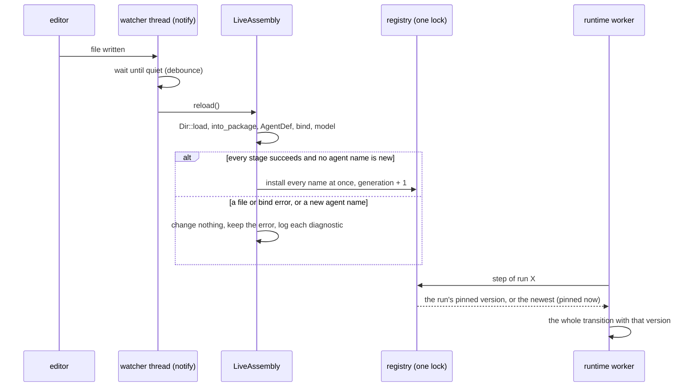

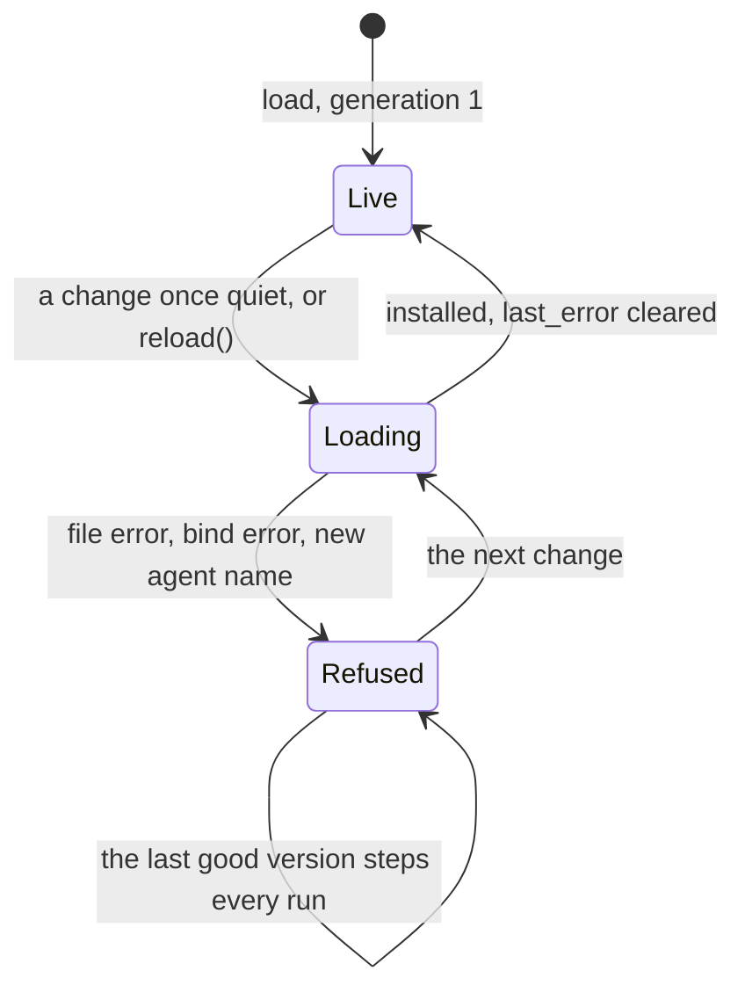

* **What a reload changes.** The prompt is not journaled and the model request is rebuilt each turn, so a new
  prompt, limits, alias, tool description, `{{var}}`, wait timer or token applies to every run **at its next
  step**, never in the middle of one. MCP connections are made once and outlive reloads; an edit of an
  `mcp.json` is refused ("restart the process").
* **The replay rule.** A journal is keyed by step names; a replayed transition that finds `tool:c1` where its
  code now says "unknown tool" fails with `NonDeterminism`. So a change to *which tools exist* must not reach a
  run that has started: an unchanged tool set is swapped for everyone; a changed one applies to **runs that
  start after the reload**; a **new agent name** is refused (`NeedsRestart`); a **removed** agent stays
  registered with its last version; a **restart is a deploy**.
* **An invalid edit** keeps the last good version and logs every diagnostic and `reload refused, keeping the
  last good version`; `last_error()` exposes it.
* The watcher is `notify` 8 (*verified 2026-09-29*, crates.io) with a debounce of our own.
  API and tests: [`adam-assembly` README](../../crates/adam-assembly/README.md#dev-reload-feature-dev).

## Run-time folders

A deployment can change what an agent says and offers (instructions, card, skills, subagents, `mcp.json`)
without a build: the binary reads a folder when it starts ([ADR 0004](../decisions/0004-agent-folders-at-run-time.md)).
`AgentFolder::load(path)` in `adam-assembly` is the mechanism (one agent; warnings returned, errors refused,
plus the digest), `agent_dir_from_env()` reads `ADAM_AGENT_DIR`, and a binary that embeds a copy falls back to
it when the variable is unset (`adam-coder`). The folder is read **once**: no watcher, so a release image stays
as it was and the next start applies an edit.

`adam-agent` ([ADR 0005](../decisions/0005-one-binary-serves-any-agent-folder.md)) serves *any* folder: a chat
assistant or a researcher on a web-search MCP server is a folder (`dev/agents/assistant/agent/`), not a crate,
and its only deployment step is mounting it.

## Mapping: eve to adam-rs to standard

| eve | adam-rs | Standard or convention |
|---|---|---|
| `agent/`, `agents/<name>/agent/` | `agent/`, `agents/<name>/` | eve (no standard exists) |
| `agent.ts` `defineAgent({ model, limits, ... })` | YAML frontmatter of `instructions.md` | Claude Code and Copilot custom-agent frontmatter |
| `instructions.md`, `instructions/` | same | plain Markdown, as AGENTS.md (no required fields) |
| `tools/<name>.ts` `defineTool` + Zod | `#[tool]` fn in `src/`, schemars, `tools![...]` | JSON Schema 2020-12 parameters (the MCP and OpenAI tool shape) |
| `skills/<name>/SKILL.md`, `skills/<name>.md`, `load_skill` | same, plus `read_skill_file` | **Agent Skills spec** |
| `subagents/<id>/agent.ts` (`description` required) | `subagents/<name>.md`, `<name>.agent.md` or `<name>/instructions.md` | Claude Code subagent file, Copilot custom agent |
| remote agent | `subagents/<name>.md` with `a2a:` | **A2A** agent card |
| built-in `agent` tool | not in v1 | none |
| `connections/*.ts` | `mcp.json` (MCP only) | `mcpServers` (Claude Code, SEP-2633 draft) |
| `channels/` | code: `adam-a2a`; `card:` frontmatter | **A2A** agent card |
| `hooks/*.ts` | `EventSink` in code | none |
| `schedules/*.md` (`cron:`) | same, plus `at:` and `after:` | five-field cron |
| `sandbox.ts` | later (roadmap 7) | none |
| `lib/` | `src/` | Cargo |
| `eve info`, `.eve/compile/*.json` | build errors and warnings, `OUT_DIR/adam_agent.rs`, `cargo adam check` | none |
| `eve dev` | the `dev` feature | none |

A2A card "skills" and Agent Skills are unrelated; they never map implicitly. The **AGENTS.md** file
(<https://agents.md/>, *verified 2026-09-29*) is not used as the agent's prompt, because coding agents
read it as instructions for editing that folder. An agent that works on repositories reads the target
repository's nearest `AGENTS.md` at run time instead.

## Decisions (accepted by the owner, 2026-09-29)

The owner accepted D1 to D6 as recommended, and added one rule: **keep the structure of eve.dev, GitHub
Copilot and Claude Code for agents and subagents.** The layout is eve's; the file format is the Claude
Code / Copilot custom agent; `.agent.md` is accepted and the name is the stem without `.agent`; unknown
Claude or Copilot keys are accepted with a warning.

| | Decision | Rejected alternative |
|---|---|---|
| D1 | Configuration is YAML frontmatter, not `agent.toml`: one schema shared with Claude Code, Copilot, OpenCode and Agent Skills | TOML: Rust-native, but no agent convention |
| D2 | Tools live in `src/` with an explicit `tools![]`, not `agent/tools/*.rs` auto-discovery | included files are invisible to `cargo fmt` |
| D3 | A subagent that omits `tools:` gets none | inherit all: Claude-compatible, surprising for a durable backend |
| D4 | Unknown frontmatter keys and Agent Skills violations warn (`.strict()` opts in to errors); a missing `description` always fails | fail the build on any |
| D5 | One tool per subagent, named after it | a single `delegate { agent, message }` tool |
| D6 | The `dev` feature ships in the facade and is off by default | on by default |

Also confirmed: adam-rs domain types are **closed enums** (no `#[non_exhaustive]` unless an existing
type already sets the pattern).

## Open questions

* Sampling and compaction: the folder's `temperature` and `top_p` are accepted and ignored with a
  warning; only the reasoning effort reaches a model request so far (ADR 0063).
* Tool approvals (`approval:`) fit roadmap 5; where the policy lives (`#[tool(...)]`, frontmatter or
  both) is open.
* An `evals/` directory; an OpenAPI connection; subagent continuation (`task_id`) and a built-in
  root-copy `agent` tool; exporting a Rust tool as an MCP server; following SEP-2633 to ratification.

