# Child runs and remote tasks

A subagent is a run started by a tool of another run. This page is the full design of the runtime half:
the local case, the remote (A2A) case, every failure interleaving and what the design does about it,
and what the design refuses. The picture is in [Architecture](../architecture.md#child-runs); how a
folder declares subagents is in [Agent files](agent-files.md#subagents-at-run-time).

Code: `crates/adam-runtime` (`start_child`, `child_status`, `child_look`, `resume_child`, the notices), `crates/adam-llm-agent`
(`pending_wait`, `AwaitRun`, `AwaitRemote`), `crates/adam-assembly` (`SubagentTool`, `RemoteSubagentTool`).

Every interleaving below has a test that makes it happen. The test of each row, and how the tests hold a step
or move the clock: [child runs, for agents](../../.agents/docs/reference/child-runs.md).

## On this page

* [A local child](#a-local-child)
* [Failure interleavings](#failure-interleavings)
* [Cancel cascades and time limits](#cancel-cascades-and-time-limits)
* [Sessions (ADR 0045, slices 1 to 4)](#sessions-adr-0045-slices-1-to-4)
* [A child that asks the person](#a-child-that-asks-the-person)
* [Remote sessions](#remote-sessions)
* [Remote tasks: the same wait without a message](#remote-tasks-the-same-wait-without-a-message)

## A local child

* **The child id is derived.** `child_run_id(parent, key)` is a UUID (version 8) from a SHA-256 over the
  parent id and the key, the same way the A2A adapter derives task ids. `ToolCtx::child_run_id()` is that
  for the current tool call. A tool that runs again, after a crash, a lost lease or a transient retry, asks
  for the same child, and `start_child` (which is `start_with_id` plus the parent) answers `false` and
  leaves the first one alone. The only side effects of the tool are that creation and reads.
* **The message is a hint, the timer is the guarantee.** The runtime sends the message after the child's
  commit, in the worker that made it. It cannot be part of that commit (the store commits one run at a
  time), so a crash or a store error in between loses it, and so does a commit whose acknowledgement is lost
  (the worker then believes the commit failed and sends nothing). The parent therefore keeps a timer for
  every wait on a child, except one parked on the model until it is woken ([below](#a-park-on-the-model)):
  `LlmAgentBuilder::wait_poll` (60 s by default) bounds how late it can be, and each wake without the
  message is one `load_run`. A failed send is logged at `warn`; a parent that is finished or gone is logged
  at `debug` and is not an error. The exception is safe because such a child cannot finish on its own — but
  it can still be **cancelled or woken from outside its parent's step** (a cancel by id, a delivery to the
  child), and then the notice is the only path to the parent: one lost leaves the root `input-required` with
  a stale reason until a message or a resume arrives, which wakes it, re-reads the child and settles it.
* **A park is a second notice.** A child that parks sends `adam.child.parked` after its own commit (never from
  the runtime's own look at a parked child, which parks it again without stepping it), with the child's run id
  as its id and no payload. The parent reads what the child waits on from its record (`Ctx::child_look`) and
  keeps it beside its pending child (`PendingRun::model_wait`); a child parked on the model **until woken**
  makes the parent wait with no timer, as a question does, and a child on a timer keeps the parent's 60 s look.
  The notice, the copy, the park and the forwarded resume are [below](#a-park-on-the-model).
* **The message is deduplicated by its id.** `Inbound::id` is the child's run id. The `LlmAgent` matches it
  to the run it waits for, uses it once (the wait is cleared in the same commit that consumes it) and drops
  every other: copies of a message already used, a message for a run it does not wait for, one that does not
  parse, one whose status is not final. Such messages are never read as user text.
* **The answer.** A finished child's `output.text` (what an `LlmAgent` child ends with), else its output as
  JSON, is the tool result. A `Failed` child, a cancelled one (`cancelled: <reason>`), one whose state cannot
  be read and one that was purged are an error result (`the run failed: <why>`): the model sees it and the
  run goes on. Nothing in the parent fails because a child did.
* **Who may be asked about.** `Ctx::child_status` answers only for children of the calling run. An id that
  belongs to a run of another parent (or to none) is a permanent error, so an agent cannot read the results
  of unrelated runs, and a derived id that collided with a stranger's run would fail loudly and not answer
  with the stranger's output.
* **`Conversation::pending_wait`** is what the parent is parked on: a `Question` for the user (this field was
  `pending_question`, and state stored under that name still loads) or a `Run` for a child. A2A reads a run
  parked on a timer as `working` and only a run parked with no timer as `input-required`, so a parent waiting
  for a child is `working` — unless the child waits until it is woken, in which case the parent waits with no
  timer too and reads `input-required` with the child's reason (below).

### A park on the model

A child run's model call can park it ([ADR 0067](../decisions/0067-a-model-call-through-an-injector-names-its-run-and-a-refusal-parks-the-run.md)
decisions 4 and 5, [the A2A contract](a2a-server.md#a-run-parked-on-the-model)). The parent shows the wait and
wakes the child through itself:

* **The notice.** The child sends `adam.child.parked` after its own park commit (never from the runtime's look
  at a parked child, which parks it again without stepping it). Its id is the child's run id and its payload is
  not read: the parent reads the child's record instead, in one read (`Ctx::child_look`).
* **The copy.** The parent keeps the wait it read beside its pending child (`PendingRun::model_wait`): the
  child's own, or the copy the child keeps of its own child, so a grandchild is shown one level at a time. It
  is in the head, so a front reads the reason at `/pending_wait/model_wait`; the copy is cleared when the
  parent forwards a resume and rewritten at the next look.
* **The park.** A child that waits until it is woken makes the parent wait with **no timer**, as the parent
  waits on a question: such a child cannot finish on its own, so a timer would only re-read "still parked", and a
  message to the root reaches its inbox anyway. A child on a timer keeps the parent's `wait_poll` look (60 s),
  which is what a lost notice of the child's end falls back on.
* **The resume.** A message or a resume to a run that waits on a parked child sends that child one
  `adam.resume` (`Ctx::resume_child`, which wakes only the caller's children), under an id derived from the
  waking message's id and the child's run id: a step that runs again writes the same one, and the child drops a
  copy it has read (`read_ids`), so a replayed forward is no second call. **Only a resume goes down, never text**:
  a message's words stay at the parent, behind the call the child answers. Each level forwards to its own pending
  child.
* **401 and 403 are the child's.** The root's task is `working` with the reason when the child is on a timer,
  never `auth-required`: the gateway refused the child's call, not the root's.
* **The coder's commands.** An until-woken park, the run's own or a child's it waits on, ends the coder's
  background commands as a question does; a timer park keeps them, bounded by `MODEL_PARK_LIMIT`.

## Failure interleavings

| # | What happens | What the design does |
|---|---|---|
| 1 | The child's terminal commit lands, then its process dies, or delivering to the parent fails | The parent stays parked on its timer. At the timer it reads the child, finds it terminal and answers. Nothing else knows anything is missing |
| 2 | The child's terminal commit is applied but its acknowledgement is lost | The worker treats the commit as failed and sends nothing (the run is `Done` in the store and nobody claims it again). Same recovery as 1 |
| 3 | The message is delivered twice, or three times, or again after the answer is in, or after the run is over | The first match answers the call and clears the wait. Later copies match no wait and are dropped. On a finished parent `deliver` answers `Finished`, which the sender ignores. The model is not asked again |
| 4 | The parent is cancelled while it waits | **The child is cancelled too** ([below](#cancel-cascades-and-time-limits)): its worker sees the parent is `Failed` within one poll, fails the child with `cancelled: the parent run ended` and fires its step's token. What the child would have answered is dropped, and the parent stays `Failed` with `cancelled: <reason>`, untouched |
| 5 | The child fails, is cancelled, or was purged | The parent gets `status: failed` and the reason (or, for a purged child, finds it gone) and the tool result is an error result. The run continues |
| 6 | The parent's lease is lost while it waits, or while it starts the child | Fencing is the version compare-and-swap, not the lease. The worker that took over replays the step: the journal has the start, and `start_child` would answer `false` anyway, so there is one child. The first worker's late commit is refused. The message is delivered with the same compare-and-swap, so it lands on whichever version is current. The parent resumes once. The same holds for the step that answers the call: its consumption of the message commits with it, so a worker that takes over sees the message again and answers the same way |
| 7 | The message arrives before the parent has parked | While the tool step runs: the message waits in the inbox, and the commit turns the park into a wake-up (the rule that already keeps a parked agent from sleeping through a message that arrived during its step). In a replay or a retry of that step: the snapshot the step starts from already holds the message but the wait is not recorded yet, so the agent matches it *after* the tool has returned `AwaitRun`, in the same transition, and never parks |
| 8 | The timer fires and the child is still working | One `child_status` read, no answer, a new timer one interval later. No second child, no model call |
| 9 | A user message arrives while the parent waits | It wakes the parent, which finds nothing to answer with and parks again. The message is kept and appended after the tool result, as for any owed result |
| 10 | A forged, stray or malformed `adam.run.finished` | Matched by the child's run id only, and only a final status counts. Otherwise it is dropped without becoming user text. `child_status` refuses runs that are not the caller's children |
| 11 | Two workers start the same child | `create_run` refuses the second (`AlreadyExists`), `start_child` returns `false`. One row |
| 12 | The process that finishes the child has never heard of the parent's agent | Delivering needs only the parent's run id: it does not have to register the parent's agent. The parent's own worker steps it |
| 13 | The message races the timer: the parent reads the finished child at its timer, and the message lands while that step finishes (during the final model call, or before its commit) | The message answers nothing: the wait is settled. `Ctx::arrived` and the commit's reopen rule do not count a child's notice, so the parent finishes with its answer, as it would if the message came after the commit (then `deliver` answers `Finished`). The model is not asked again |
| 14 | A child runs past its time limit | The runtime fails it with `cancelled: time limit: the run did not finish within 30 min`: before a step, within one poll for a step in flight (its token fires), and at the wake it set at the deadline for a parked one. The parent gets "the run failed: cancelled: time limit: ..." as the tool result and goes on |
| 15 | A child is created after its parent was cancelled | It is cancelled when it is claimed, before it steps. A `Done` parent changes nothing, and a parent that is not in the store is unknown and cancels nothing |
| 16 | The same cancel arrives twice | The second is a no-op: a terminal run is left as it is |
| 17 | The parent is cancelled while a worker claims it (it was woken by a notice), and the claim reads the run after the cancel (the MongoDB store reads after setting the lease) | The worker gets the parent already `Failed` and does not step it: the cancel stands, so the child sees its parent end and the hook runs for it |

## Cancel cascades and time limits

[ADR 0044](../decisions/0044-paged-tools-a-stable-prompt-prefix-a-plan-skills-commands-and-project-context.md) slice 10,
[ADR 0037](../decisions/0037-parallel-subagent-calls-and-an-editing-worker.md) decision 7. **No `Store` method was added**
(a cascade over `list_runs` would scan every run, and a `Store::children` would be a new required method): each child looks
at its **parent**, which it already knows (`RunRecord::parent_id`).

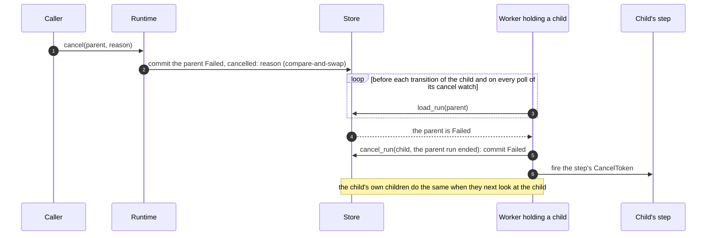

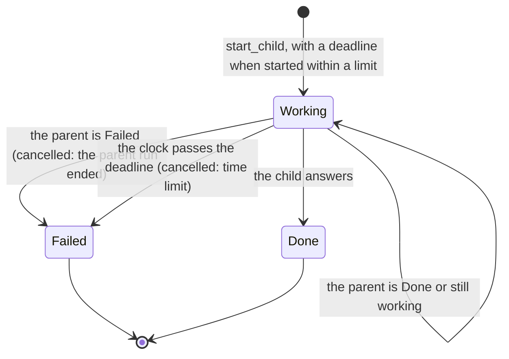

* **The rule.** A run with a `parent_id` is cancelled (`cancelled: the parent run ended`) when its parent is **loaded and
  `Failed`**, for any reason (a cancel included). A `Done` parent changes nothing: it has no working rounds, and a session
  kept open stays usable. A parent that cannot be loaded (the store is down, or retention purged a finished run) is
  unknown, not ended: the child goes on (debug log). This assumes retention is longer than a minute
  (`Store::purge_finished`).
* **Where it is checked** (`crates/adam-runtime/src/worker.rs`). Before a child's transition, with one `run_header(parent)`;
  on the cancel watch of a step in flight, at most once a second per child (`PARENT_CHECK_EVERY`; the watch itself polls
  every `cancel_poll_interval`, 1 s by default, and reads the child's own header each time); and for a **parked** child at its
  look (below). The cancel is `Inner::cancel_run`, the body of `Runtime::cancel`: idempotent, a no-op for a run that is
  already terminal.
* **The look at a parked child.** A parked run that works for a parent, or has a deadline, is committed with a wake no later
  than `CHILD_WAIT_POLL` (a minute) away, and the envelope keeps the agent's own wake (`agent_wake`) and `hb`. When that
  wake claims the run, the runtime reads the parent **before** the agent: the parent ended, the child is cancelled; the
  parent is alive and nothing else is due (no message, the agent's own wake not yet), the run is parked again with the next
  wake **without stepping the agent, without a journal entry and without a model call**. So a child waiting for an
  answer to its own question, or with `max_minutes: 0`, is reached too, and so are its own children one level at a time.
  The cost of a parked child is one read and one commit a minute. `RunView::wake_at` and `waiting` say what the agent asked,
  not the runtime's wake.
* **How fast.** `Runtime::cancel` commits the parent first, unchanged. A running child is told within about a second
  (its token fires, and the coder's `shell.rs` kills its command); a runnable one when it is claimed; a parked one within
  a minute. Grandchildren follow one level at a time. A child that the parent's last step created after the cancel never
  steps. The A2A `CancelTask` path is unchanged and answers `Canceled` at once.
* **A remote A2A task.** A subagent on another agent (`a2a:`) called through its tool is a task there, and the cascade
  does not send it `CancelTask`: it keeps running until the remote end stops it, and cancelling the parent stops the wait
  and nothing else. A **round of a remote session** does: the runtime calls `Agent::on_cancelled` after every cancel it
  commits, and the round agent sends `CancelTask` ([remote sessions](#remote-sessions), [ADR 0045](../decisions/0045-a-subagent-can-run-in-the-background-as-a-session.md) slice 5).
* **Run pods** are keyed by the root's workspace, so the janitor removes the pod with the failed root.
* **Time limit of a child.** `Runtime::start_child_within(parent, id, agent, input, Some(limit))` (also
  `ChildStarter::start_within`, `ToolCtx::start_child_within` and, for a session round,
  `start_child_continuing_within`; the last is the embedder's entry point until the session tools of ADR 0045 arrive)
  stores `deadline` in the run's envelope, set **once** from the runtime's own `Clock`, not from a transition. `wake_at`
  is clamped to it, runnable or parked, so a child wakes at it. **The time a child waits for a person is not counted**: when
  it parks with no timer the deadline is cleared and what is left is kept (`remaining_secs`), and the next step that
  follows a message sets it again; time on a timer, or on a child, still counts. A wake that arrives before the deadline
  (the store's clock and the runtime's disagree) parks the run again to the deadline plus a second, without stepping the
  agent, so a skew cannot make a tight loop. `SubagentTool` passes
  `limits.max_minutes` of the subagent's file: **30 minutes** when it says nothing, `0` for none, at most 1,440
  ([agent files](agent-files.md#the-subagent-tool)). The limit is per run: each round of a session has its own.
* **Time limit of a tool call.** A call that runs past `Tool::time_limit` (300 s when it declares none) is stopped
  inside its journaled step and answered with an error, so a replay never waits ([errors](errors.md#what-the-model-is-told)).

What the design refuses to do, and why:

* **No timer for a child parked until it is woken.** The parent's task is `input-required`, which needs no wake, and
  such a child cannot finish on its own: a timer would only re-read "still parked". The price is that a child woken or
  cancelled from **outside** its parent's step while it waits relies on its notice, and a lost one is not cured by a look;
  every other park of a child keeps a timer, and so does every park of the parent's own except its own until-woken
  model park. For the coder, a lost `adam.child.parked` costs one `wait_poll` look (60 s): the root's timer fires, it
  reads the child's wait, and `commands_end_with` stops the background commands in that same step. The residual is a
  lost *finish* notice after the root has copied an until-woken wait: the root has no timer then, so it never steps
  again, the child's end is never read, and the task stays `input-required` with the child's reason until a message,
  a resume or a cancel.
* **No parallel fan-out of one-shot subagents yet.** An `LlmAgent` runs the calls of one model turn at the same time
  ([ADR 0049](../decisions/0049-the-tool-calls-of-a-turn-run-at-the-same-time.md)), but a call that can park the run (a
  subagent, a remote agent) runs alone, so three subagent calls in one turn run one after the other; background
  sessions ([ADR 0045](../decisions/0045-a-subagent-can-run-in-the-background-as-a-session.md)) are the way to children
  side by side. Starting all the
  children first and waiting for all of them needs `pending_wait` to hold several runs.
* **A child asks the person only in a shown `open` session.** A park with no timer clears the child's deadline,
  so nothing but a cancel ends it: a question nobody can answer would strand the child. Since ADR 0045 slice 8 the
  rule is decided **per run**, not at bind: a round of an `open` session whose client shows it
  (`child-sessions/v1` activated) asks and parks `input-required`; any other child run is told that nobody can
  answer (`adam_llm_agent::NOT_ASKABLE`) and goes on. `adam-assembly` no longer refuses an asking tool on a
  subagent. A tool that returns `NeedsInput` without declaring `Tool::asks_user()` is not refused either: it parks
  its child, and a child can still be cancelled by id (the parent then gets the error result). A **model** park
  until woken is the other exception: the parent shows it and wakes the child through a message or a resume ([a
  park on the model](#a-park-on-the-model)), so it is not stranded, and its deadline is paused while it waits.
  See [a child that asks the person](#a-child-that-asks-the-person).
* **The output travels whole.** The child's output is the payload of the message, then the text of the tool
  result in the parent's history. Long histories are shortened by `max_history_tokens` as for any tool output,
  in the stored conversation too (the journal keeps the whole output), and a history that reaches its budget is
  compacted: each run, a child or a session round included, compacts against its own limits, and a parent whose
  `subagent_start` was cut by a compaction still waits for and cancels its working sessions.
* **No guarantee for a child purged early.** `purge_finished` deletes a finished run with its journal. A
  parent that has not looked yet then reads `None` and reports "the child run no longer exists". Keep the
  retention above the parent's longest wait plus one `wait_poll`.
* **No mixed versions.** The journal entry `AwaitRun` and the `pending_wait` field are not read by a build
  that predates them (it would fail the run as non-deterministic on replay). Roll the workers before the
  tools that start children are enabled. The other direction is safe: journals and states written before
  (`ToolError` without `AwaitRun`, `Conversation` with `pending_question`) load and replay in the new build.

Code that runs inside a step but cannot hold the `Ctx`, such as a tool of an `LlmAgent`, starts a child through
`Ctx::child_starter()`: an owned `ChildStarter` for the runtime that is stepping the run, which can start only
children of that run (`start` is `start_child` with the parent fixed). `LlmAgent` hands it to every tool as
`ToolCtx::start_child(agent, message)` (under `ToolCtx::child_run_id()`), so a tool needs no `Runtime` handle,
and the child starts on the runtime that steps the parent, whichever process that is. The subagent tool of
`adam-assembly` is exactly this call followed by `AwaitRun`; see [subagents](agent-files.md#the-subagent-tool).

A hand-written `Agent` can wait for children too: start them with `start_child`, `Park` with a timer, and on
the next step read `take_inbox()` for messages of kind `adam.run.finished` (`ChildStatus::from_notice`) and
`Ctx::child_status` when there is none. It must take its inbox in the step that parks as well: a message
already in the inbox when a step starts is not "arrived during the step", so an agent that parks without
reading it sleeps until its timer.

## Sessions (ADR 0045, slices 1 to 4)

[ADR 0045](../decisions/0045-a-subagent-can-run-in-the-background-as-a-session.md) lets a subagent run in the
background as a session that is sent more messages. The runtime half (slice 1) is in `crates/adam-runtime`; the six tools
(slice 2, and slice 4's `subagent_edit`) are in `crates/adam-llm-agent` (`sessions.rs`) and are given to a root with subagents by `adam-assembly`, which also ends that root's instructions with a short *Child sessions* section that tells the model what each tool does ([ADR 0054](../decisions/0054-a-child-session-can-be-configured-within-what-its-folder-allows.md) decision 9). A person can start the same sessions over A2A (`child-sessions/v1`, slice 6): the rounds are runs of the same helper agents, started by the front of a `control-plane` process through start-only registrations (`AgentDef::session_starters`) and stepped by a worker; see [the A2A server](a2a-server.md#child-sessions-child-sessionsv1).

**What the runtime has.**

* **A subagent's own tool starts a one-shot session** (ADR 0089, slice C1): `ToolCtx::start_one_shot_session`, which
  `SubagentTool` calls, starts round 1 of a session whose header says it is closed from the start, under
  `child_run_id(parent, call_id)` as before. The parent parks on it as on any child ([a local child](#a-local-child)).
  A remote subagent's own tool is unchanged: it calls the remote from the parent's step and starts no child run
  (slice C2 keeps it so; [remote sessions](#remote-sessions) say why).
* **`mode` and `wait`** (ADR 0089, slice C2): `subagent_start` chooses who may write after the first round and whether the
  call waits for the first report. `SessionMode` is kept in the header (`SessionHeader::mode`):

  | `mode` | After the first round | Who sends the next one | A person's message or steer |
  |---|---|---|---|
  | `one_shot` (default) | the session closes | nobody | refused, unless the person started the session |
  | `sealed` | it stays idle | the parent only | refused, naming the mode (an `edit` too) |
  | `open` | it stays idle | the parent and the person | taken |

  `keep_open` is read for one release (`true` is `open`, `false` `one_shot`; with a `mode` that disagrees, an error result naming
  both). `wait: true` parks the call as `subagent_read` with `wait: true` does (`ToolError::AwaitSession`), and its result is the
  first report with the session's id, counted as read, so it is never told again as a report. A subagent's own tool (slice C1)
  is `one_shot` **closed from its start**, so not even the parent can steer it, and waits with `ToolError::AwaitRun`.
* `Runtime::start_child_continuing` starts a child run **with a conversation id**: the parent's id (with `%` and
  `/` escaped, so a client's context id cannot spell another session's), then `/s/` and the session id
  (`session_conversation_id`). Round 1's run id, `child_run_id(parent, call_id)`, is the session id. From round 2
  on the child starts from the previous round's state (`init_continuing`, ADR 0003). A session has one agent,
  and the store allows one open run per agent and conversation, so a start while a round is open is
  `ConversationBusy` (`is_busy()`): the caller sends a message with `Runtime::deliver`, which the open round reads
  as a steered message. Everything the runtime can check is refused as `InvalidSession`: a `prior` of another
  conversation or of a session with no first round, a run id that exists and is not this round, a conversation id
  that is not a session's or is over 1024 bytes. A repeat with the same ids answers `false`; a round purged
  before its repeat is not recognised (retention must outlast retries).
  A seeded round's state carries the previous round's artifacts, but the store has no reference for them until
  the new run's first commit (schema version 5, part 1); purging the previous round before then can collect a
  file the new round still names. S2a of ADR 0055 writes the references at create (or makes the blob sweep read
  the state), which closes it.
* A child with a conversation reports its end with **`adam.child.reported`** instead of `adam.run.finished`.
  Same id, same payload, same standing: a wake-up, and the parent reads the round with `Ctx::child_status` or
  `ChildStarter::session`, so the lost-notice cases above hold for a round. A child without a conversation is unchanged.
  The loop never shows the notice to the model, and `Ctx::arrived` and the reopen-on-arrival rule do not count it.
* `Runtime::list_sessions` lists a parent's sessions over `list_runs` with the conversation prefix, `Runtime::session_view`
  reads one by its id. Both read **the latest round** and its `SessionHeader` (`session` in the round's agent state): working,
  idle or closed, and how it ended. A run counts only if the session's round 1 exists with a parent, so a top-level run in a
  session-shaped conversation is not listed, and a parent never sees another's.
* A round takes the same time limit as any child (`start_child_continuing_within`, per round), and a cancelled or failed
  parent fails the round that is open (`cancelled: the parent run ended`) while the session stays usable: a later parent
  run continues it from that round.

**What the tools do.** `subagent_start` creates round 1 and returns at once (with `wait: true`, parks until the first report). `subagent_send` steers a working round
(`Runtime::deliver`, the message id is the call id, so a repeat is read once) or starts the next round from the latest one.
`subagent_read` reads the latest round: working, or its report as a numbered page; with `wait: true` and a working round it
returns `ToolError::AwaitSession` and the parent parks on a `PendingWait::Session`. `subagent_edit` changes the session's options within the bounds of that moment (below). `subagent_close` asks a working round to be
the last (`SESSION_CLOSE_KIND` in its inbox: it finishes, then the session takes no more) or, with `cancel`, cancels it; an idle
session is closed by a round that calls no model (`header.closing`) and ends with the last answer again. `delete: true`
closes it with a **tombstone** (`header.deleted`): a deleted session is never listed again and every tool refuses it as `no
session`, while **its runs stay in the store**. It **implies `cancel: true`** (ADR 0054 decision 10): a working round is
stopped as a close with cancel stops it, and the closing round then writes the tombstone.
`subagent_list` pages the sessions of the conversation. The sessions are reached by **the conversation**, not by the task: a
later task finds the sessions an earlier one started, and no run reaches another conversation's (an id that is not one of
this conversation's is "no session"). At most 16 sessions that are not closed and 20 rounds per session (decision 5's
`max_open` and `max_rounds` as constants for now).

**A session's own limits** ([ADR 0054](../decisions/0054-a-child-session-can-be-configured-within-what-its-folder-allows.md),
slice 1). `subagent_start` takes an optional `config` of eleven options: eight numbers, `max_turns`, `max_tool_calls`,
`max_output_tokens`, `context_window`, `max_parallel_tool_calls`, `time_limit` (minutes), `max_rounds` and `token_budget`
(below), two lists of tool names, `tools` and `deny_tools` (below), and `report_schema` (below). An option chooses within what the
subagent's folder allows and **never widens it**: a value above its bound is refused, in words that name the option
(`config.max_turns is 51; at most 50`), and nothing starts; an option that is not one of the eleven is refused too. What was
admitted is kept in the session's header, and the round reads its limits from it. Five of them apply at the next model call
(`max_turns`, `max_tool_calls`, `max_output_tokens`, `context_window`, `max_parallel_tool_calls`, and `token_budget`, below); `time_limit` and
`max_rounds` apply to the next round. A later round copies the config and **clamps it to the bounds of that moment**, so a
deployment that lowered a limit is obeyed and nothing is raised back. `max_output_tokens` is never `0` (that would leave the cap
to the model) and a `context_window` is never so small that no history fits: it is held to the least that leaves room.

**The token budget** (slice 6). `token_budget` caps the whole session's tokens, input and output as `usage/v1` counts them:
1,000 to 2^53 − 1, and no folder bounds it today, so any value narrows. Before each model call, the tokens the session has
spent (`spent`: the earlier rounds' carried by the header, plus this round's own calls) reaching the budget makes that call
the **closing turn**, and the round ends with `limit: "token_budget"` — or, when the closing turn says nothing, with the words
`token budget reached`. `spent` is written into the header at every commit, so `subagent_list`, `subagent_read` and the A2A
session object's listing read it from the round's record, and a **send to a spent session is refused** (`subagent_send` in
words, the A2A front as `UnsupportedOperation`) from the header the send already reads: no round starts and no model is
called. A session with no budget spends and is never refused.

**Editing a session** (slice 4). `subagent_edit { session, config }` changes a session's options, a working one included, and
takes no message: a message is `subagent_send`'s. Its `config` is a **patch**: a member set to `null` returns that option to the
folder's, and a member left out is not touched. The bounds are the ones of the moment of the edit (a deployment that lowered a
limit since is obeyed) and the editor's own grant; a patch that would go past one is refused in words, as a start is, and the
session is left as it was. The whole admitted config travels, so the round that reads it never merges or admits again.

* **A working round** receives `adam.session.edit` in its inbox (not counted as unread input: it does not reopen a round that is
  finishing) and reads it at its next step. The options that apply at the next model call take effect there; the others
  (`time_limit`, `max_rounds`, `report_schema`, and `instructions` when it is settable) are pending in the header and apply from
  the next round. A round that ends before reading it leaves it in its inbox, where a reader of the session applies it, so an
  edit is never lost.
* **An idle session** gets a round that calls no model and has no report (`header.editing`), as a close of an idle session does:
  it counts toward `max_rounds`, and a read still gives the last round that worked.
* **The history**: the header keeps the last 16 edits (`edits`: the round, who — `agent` or `person` — and the members changed),
  and every later round carries it. A person edits with `metadata[URI].edit {config}` on a message to the child context; the
  round event's session object then reports the new `config` and the `edits`.
* Changing `tools`, `max_output_tokens` or a later slice's `reasoning_effort` mid-round changes the request's prefix once, so the
  prompt cache of that session misses once (ADR 0044).

`config` also takes `tools` and `deny_tools` (ADR 0054, slice 3): lists of tool names, in the folder's own syntax (an exact name or
a `*` pattern; `github__*` selects an MCP server). The session is offered only the tools `tools` matches, less the ones `deny_tools`
matches (the deny-list is applied after the allow-list); `read_output` always stays. A hidden tool is not in the model's request,
and a call to it anyway is refused without running; this holds even when an oversized message context was dropped, because the session's header, not the
context, is the truth. A lazy MCP server's tools are loaded by a tool of its own, `load__group__<server>` (ADR 0066), so a
session that names any tool of that server keeps that loader — `tools: ["github__*"]` can load the `github` group — and a
session that names none of its tools keeps no loader, because a loader that can load nothing is not handed out. The rule is exact for a `when` MCP server's group, whose members are `<server>__<tool>`; a group whose members do not share its name is not covered (none ships today). The loader is a
means to the tools the list names, never an extra tool the session may use: once the group is loaded its tools are held to the
same lists, so nothing widens. At most 32 entries, each at most 200 characters, none blank. **Which names are
checked at the start depends on what the starter knows.** The tool names of a subagent are known where the agent is bound (a
worker), not on a control plane that only answers A2A; and a worker knows the whole set only when every source declares what
it can offer. A declaration may name a **shape** (`*__*` for a relayed `<server>__<tool>`): an entry is admitted when it
selects a concrete declared name with its pattern or a declared shape matches it as a string, so `github__*` and
`github__search` are admitted on a complete set. **Both shipped agents have the whole set** (they add the thread-tools
source, which declares the contract's tools and that shape), so there: a `tools` entry or a pattern that selects nothing is
refused with the list, and a concrete `deny_tools` name that is none of the subagent's tools too. A source that cannot name
its tools leaves the set incomplete, and there a `tools` entry or a pattern that selects nothing is admitted and just offers
less. A remote subagent takes neither. They apply from the next model call; a later round carries them on. A pattern weaker than the declared shape (`*_issues`, `github_*`) is refused even though it would select relayed tools: name the family as `github__*`. An entry whose shape half is empty (`github__`, `__`) is refused too, because `*` matches the empty run and it selects nothing at run time.

`report_schema` is a JSON Schema (draft 2020-12, at most 16 KiB, no reference outside itself) that the subagent's final answer
must match, for a helper that runs here (a remote one refuses it). The subagent is not shown the schema unless its first answer
fails it, so describe the shape in `prompt` too. An answer that is not one JSON value, or does not match, is sent back to the
model with the first three problems, twice at most, and each of those turns counts in `max_turns`; after that the round fails
with `report does not match report_schema`. It applies to every round of the session, the first included; a `format`
is only an annotation under draft 2020-12 and is not enforced.

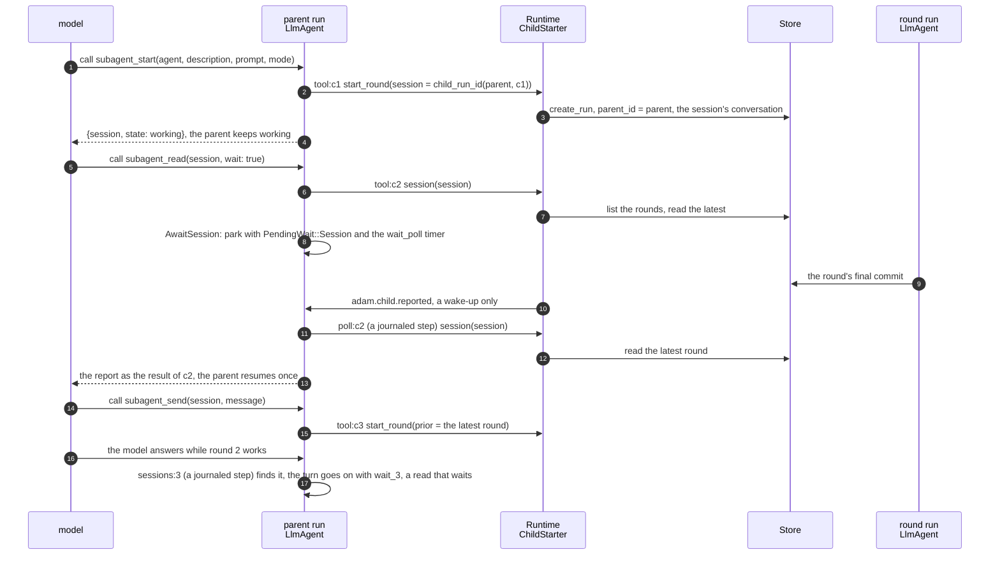

```mermaid
stateDiagram-v2
    [*] --> Working: subagent_start, round 1
    Working --> Working: subagent_send steers the open round
    Working --> Idle: the round ended, mode sealed or open
    Working --> Closed: the round ended, mode one_shot
    Working --> Working: subagent_close without cancel (a request in the inbox; the session takes no more messages)
    Working --> Closed: the round ended after a close request, or was cancelled after one
    Working --> Working: the closing round of an idle session runs (header closing, no model, no report)
    Idle --> Working: subagent_send starts the next round
    Working --> Working: subagent_edit is delivered to the open round (adam.session.edit, no new round)
    Idle --> Idle: subagent_edit starts a round that calls no model (header editing, no report)
    Idle --> Closed: subagent_close starts a round that calls no model
    Idle --> Closed: idle for idle_ttl (read, not written)
    Working --> Deleted: subagent_close with delete (it cancels the round first)
    Idle --> Deleted: subagent_close with delete (a tombstone in the closing round)
    Closed --> Deleted: subagent_close with delete
    Closed --> [*]
    Deleted --> [*]
```

A closed session is **never reopened**, and `Closed` is derived, not stored: the latest round's header says `closed`, or a close
request waits in its inbox, or the round has ended in a `one_shot` session (which is why a round cancelled by its parent
closes such a session, and leaves a `sealed` or `open` one idle). `Deleted` is derived the same way, from the latest
round's header: nothing removes a run.

**The turn-end wait.** A turn whose model answers with no tool call while a session this run started still works, or a round
ended and was not reported, does not end the run: the loop reads the sessions in a journaled step `sessions:<turn>` (skipped when no
call of the history started a session and no listing saw one open) and goes on with a call to `subagent_read` that waits, appended
to the model's own message. For a round that has ended the read answers at once. The report reaches the model before the run ends.
A round that only closes a session is not waited for and not cancelled: it reports nothing new. At a limit turn, or at
`max_tool_calls`, the run ends and the round goes on without anyone to read it.

**Reports during a turn (slice 3).** A round that ends while the parent does something else is told to the model by its next
call, with no read of its own. Inside the step `model:<turn>` (no new step: a committed journal from before replays as it was) the loop lists
the sessions of the conversation and reads the report of each one that is **due**. A session's report is of the latest round that worked, so a
closing round that follows does not hide it, and a round that a later round replaced before the parent looked, or that the close that follows it cancelled, is not reported on its own. It is due
when that round has ended, is not in `Conversation::reported_rounds`, its call id is not in the history already (the cap of 128 can give up a round
that is still due), and this run started it or a person did after the chain of tasks began (`Conversation::chain_started`: a task that does not
continue another does not re-tell a person's old round). A round an earlier task's run started is not due: that run waited for it or cancelled it.
The request is the history, then one assistant message with a `subagent_read` call per report (id `report_` and the round's 32 hex digits) and the
results; the record of the call holds them (`reports`), so a replay tells the model the same words and the prefix of every request is the one before
it. The listing is made at the first model call of a run and, while `Conversation::sessions_open` is set, before every call; it stays set while a due
report was not appended (a failed read, an error, a stale answer). The rounds are counted (`usage:<call>`) whenever a record holds reports, whether or
not the history takes them, so a replay takes the steps the first try took. The notice that a round ended stays a wake-up: a lost one costs at most
one turn (the next call lists again), a duplicate matches nothing, and a round that ends during the final model call is found by the turn-end read of
the store, not by a notice. **No mixed versions**: stop every worker of the old revision before a run uses sessions.

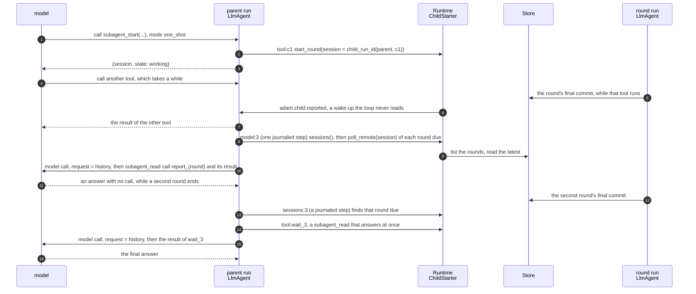

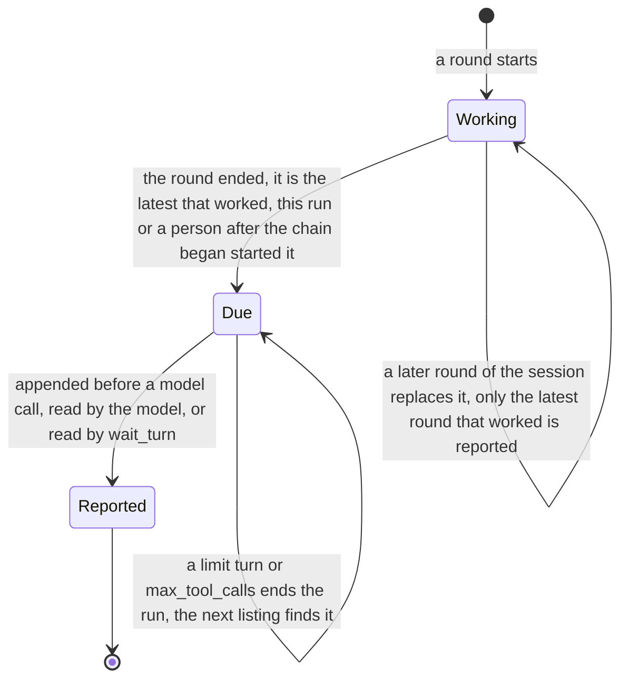

**Unverified risks** of reports during a turn (none was tried against a live model): the synthetic assistant message carries no reasoning, which a model run
with `echo_reasoning` may expect; a history can hold two assistant messages in a row (a report appended after an answer that was not sent back); the
listing runs inside `model:<turn>` before the call and has no time limit of its own; the step events of the appended reads are emitted after the
answer has streamed, not before the call.

### Session interleavings

| # | What happens | What the design does |
|---|---|---|
| S1 | The parent's start call is made again (a replay, a retry after the call acted) | The id of the session is derived from the call: a repeat finds the round, so one child ran, and the tool answers what it answered |
| S2 | A worker takes over between any two steps | Every read of the store or the clock in the loop is a journaled step (`tool:`, `poll:`, `sessions:`): a copy of the journal gives the same history with no child started and no model asked |
| S3 | The round's notice is lost | The parent is parked on its timer, and the step that wakes it reads the session through the tool |
| S4 | The notice arrives again, or a forged one arrives | It wakes the parent, which looks, finds the round still working and parks again with no model call; the report is never taken from a notice |
| S5 | `subagent_read` waits and the round ends | One resume, with the report as the call's result; three reads that do not wait and say "working" are refused on the third |
| S6 | The model answers while a session works | The run waits for it and calls the model again with the report |
| S7 | The parent is cancelled while a session works | The round is failed by the cascade; a kept-open session is idle and a later task of the conversation reads it and sends it a round that continues it |
| S8 | A message reaches a working round, a close request does, or an edit does | The message is read as a steer (the round's next request ends with it); the request makes the round the last and costs no model turn; the edit is read at the next step, its *next model call* options change that call and its others wait for the next round |
| S9 | An id that is unknown, malformed or another conversation's | An error result in words that say what to do; nothing is started |
| S10 | A session on a remote subagent | A round of the agent registered under the subagent's name, which talks to the remote ([below](#remote-sessions)) |
| S11 | A round ends while the parent does other work, and a closing round may follow it | The next model call lists the sessions and is given the round's report as a `subagent_read` call and result, with no read by the model; the request starts with the one before; a closing round does not hide it |
| S12 | A round ends during the parent's final model call | The turn does not end on that answer: `sessions:<turn>` finds the round due and `wait_<turn>` reads it at once |
| S13 | The notice of that end is lost, or comes twice | The next call finds the report in the store; a copy of a notice matches nothing: no second report, no extra model call |
| S14 | A person's round ended | It is reported at the next listing, in this task while a session is open or at the first call of a task that continues this one, once (a task that does not continue another is not told of a round that ended before it began); the header says "started by the person" and the person's words are not in it |
| S15 | The model read the report itself, or the run has no session | A report the model read is not appended again; a run that never opens a session lists once, at its first call |
| S16 | A journal from before slice 3, or one with reports, is replayed, with a message that arrived since | The same history, no model asked, no child run, no disagreement; the rounds are counted once even when the answer is dropped as stale |
| S17 | A session has sat idle for `idle_ttl`, or an edit goes past a bound, or an edit reaches an idle session | It reads closed, frees its place, refuses a send in words; a working round never expires; its unreported report is told once. An edit past a bound is refused in words and changes nothing; an edit of an idle session is a round that calls no model, has no report and counts toward `max_rounds` |
| S18 | A round asks the person, and one that may not asks anyway | A shown kept-open round parks `input-required` and the parent's read says `blocked`; an answer in the child context resumes it; a child that may not ask is told `NOT_ASKABLE` and goes on |
| S19 | A subagent's own tool is called (ADR 0089, slice C1) | The child is a **one-shot session**: round 1 under the call's derived id, closed from its start. It has a session's conversation id, is listed working and then closed, refuses a send from the parent and a message or a steer from a person, and its answer is the call's result once, never a report; a child a journal started before C1 (no conversation) is found by the call |
| S20 | `subagent_start` names a `mode` (ADR 0089, slice C2) | `one_shot` closes after its round and refuses a send; `sealed` and `open` stay idle and take the parent's next round. A person's message to an agent's `sealed` or `one_shot` session, and a steer of its round, are `UnsupportedOperation` naming the mode; a close passes. Only an `open` round may ask the person. `keep_open` maps onto `mode`, and a disagreement is an error result naming both |
| S21 | `subagent_start` with `wait: true` | The call parks on round 1 and its result is the first report, with the session id; the report is not told again; observers see `session.started` at the park and `session.round.ended` at the settle |
| S22 | The subagent's file has `session:` (ADR 0089, slice C3) | A start that names no `mode` gets the file's, and one that names no `wait` the file's; a narrower `mode` (or `keep_open: false`) starts; a wider one (or `keep_open: true`) is an error result naming the mode asked, the ceiling and the subagent, and starts nothing; `wait: false` beats a filed `wait: true`. Only that subagent's roster line in `subagent_start` changes |
| S23 | `subagent_edit` names a `mode` (or `keep_open`), or a person edits an agent's `sealed` session (ADR 0089, amended 2026-11-28) | An error result: past the file's ceiling in `subagent_start`'s words, else what the call wrote, then the mode the session keeps; nothing changes. The person's `edit` is `UnsupportedOperation` naming the mode, as their message is |

**Tokens.** Each round a run started or sent to is counted once in the run's `usage_totals`: a journaled step `usage:<call id>` reads it when a report is given to the model and, at the latest, when the run ends (`sessions_end`), whether or not the report was read; a store error on the read is retried. **Known limit:** the checks scan every round of the conversation, and past 5,000 rounds of one subagent a start **and a send** are refused.

**Limits and idle sessions (slice 4).** Three limits and one time, all settings of the deployment (`docs/reference/environment.md`):

| Limit | Default | Refuses | Words |
|---|---|---|---|
| `max_open` (`SESSION_MAX_OPEN`) | 16 | a start; the card's `maxOpen` | "this conversation already has N open sessions" |
| `max_working` (`SESSION_MAX_WORKING`) | 4 | a start **and a send that would start a round** (a round that only closes a session is not counted) (a steer into a working round is not one); in the A2A front, a person's start or new round too (`UnsupportedOperation`) | "N subagent rounds are already working" |
| `max_rounds` (`SESSION_MAX_ROUNDS`) | 20 | a send, never a close: a session can have `max_rounds + 1` rounds counting the closing one | "has had N rounds" |
| `idle_ttl` (`SESSION_IDLE_DAYS`) | 7 days | nothing is refused by it directly: a session idle that long **reads closed** | "is closed ... sat idle for longer than this deployment keeps a session open" |

The root agent's `limits.max_open_sessions`, `max_working_sessions` and `max_session_rounds` may only lower them (a larger value is lowered with a
warning; a subagent's are ignored with a warning); `idle_ttl` is the deployment's alone and the same for every role. The time limit of one round is
the subagent's `limits.max_minutes` (or a remote round's `remote_timeout`), not a session setting. Each limit is checked before the thing it limits,
so requests that race may exceed it by the number racing.

**`idle_ttl` is read, not written.** `Runtime::list_sessions` and `session_view` say `Closed` (`idle_expired`) for a session whose latest round ended at
least `idle_ttl` ago and that would otherwise stay open, including one with no header; nothing is stored, so a longer TTL reopens what a shorter one
closed. A working round never expires. An expired session frees its place under `max_open` and refuses a send like any closed session.
**Its report is not lost:** whether a report is due depends on the round (it ended, was not told, was started by this run or a person), not on the
session's state, so the report of a round nobody has been told of is **told once**, by the next task's first model call, even if the session has
expired by then (`an_expired_sessions_report_is_still_told_once`), and not again.

**Known limits of slice 4.** An expired session's due report can fall off a listing of more than 100 sessions (the listing is one page of the
newest and the open ones), and then it is not told. A remote session's leftover task is not cancelled when the session expires (expiry is read,
nothing runs). The A2A front's paged listings read the clock once per page, so a session that expires between two pages can be counted twice or
missed once. A person's round that ends **in the same instant as a task's chain starts is told** (`ended >= chain_started`): telling an old
round once to a fresh task, which has no history, is harmless, and losing a new one is not.

**Retention.** `Store::purge_finished(before)` must be older than `idle_ttl` (and longer than a round's time limit plus its retries): a purged latest
round makes the session read as the round before it, or not at all.

**Cancel.** Built by ADR 0044 slice 10 (the cascade: a parent that fails, a cancel included, fails its open rounds) and slice 5 (a remote round sends
`CancelTask`). A cancelled or failed parent frees its working slots for the next task (`a_cancel_frees_the_working_slots_for_the_next_task`,
`a_parent_that_fails_stops_its_rounds`). A person's round is its own parent and is not stopped by a parent's cancel.

**Not built yet** (slice 7): the coder's kept-open helpers.

**A person's round.** The A2A front (`adam-a2a-runtime`, *Child sessions*) lets a person start a session and send rounds with no run
of an agent behind them. Such a round is **its own parent** (`start_child_continuing(id, id, ..)`): `parent_id` is its own id, so
the worker's check of the parent (`parent_has_ended`) reads a run that has not ended, no run's end cancels it and no run waits for it
(the turn-end wait for a working round and `end_sessions` look for rounds started by the run that is ending, `started_by == that run`). `SessionView::started_outside_a_run`
and `SessionSummary::started_outside_a_run` say it. Its end notice goes to the round itself, which is finished by then, and is dropped (`notify_parent`, "nobody to tell"); its park notice is not sent at all (a run that is its own parent is no child, and one delivered to itself would wake it for ever). A parent
learns the round by reading the session, as for any round it did not start (slice 3: the parent's next listing reports it, marked as the person's). `closing_round_payload` builds the first message of a
round that only closes a session, for the tools and for the A2A front.

## A child that asks the person

A **round of an `open` session** may ask the person (ADR 0045 decision 9), and only that: the person sees the
session because their client activated `child-sessions/v1`, and answers in the round's own thread. Anything else in
a child run is told that nobody can answer and goes on: a one-shot child, a round of a `one_shot` or `sealed` session
(ADR 0089: the person cannot write to it), and a round of a session whose client does not show it (`adam_llm_agent::NOT_ASKABLE`). A hook's request to approve a
call (ADR 0050, slice H8) follows the same rule: such a child reads it as a refusal, the call is answered with
`adam_llm_agent::NOT_APPROVABLE` and the hook's question, and nothing waits.

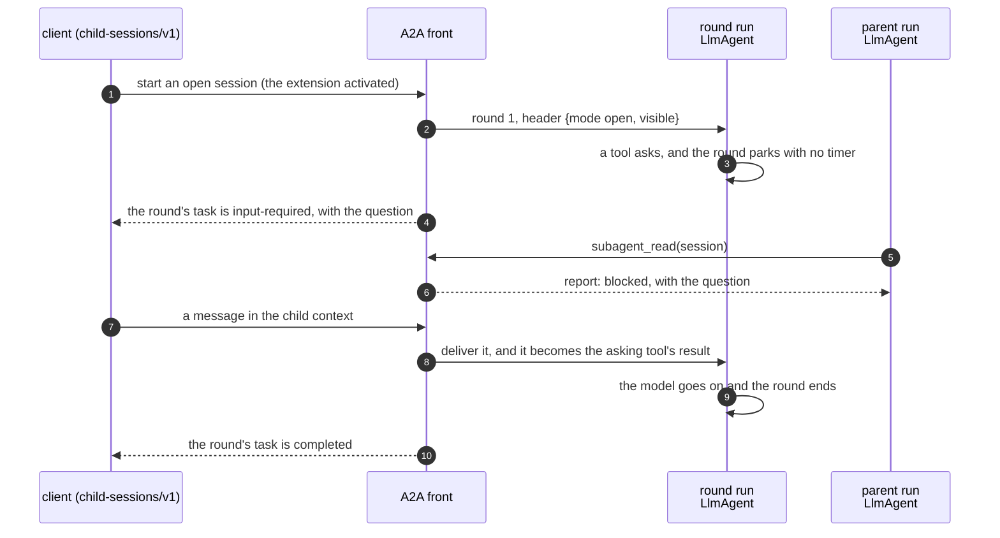

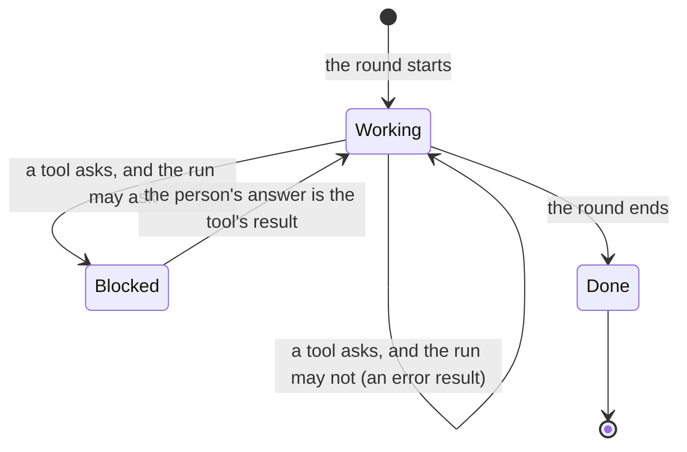

**Where the permission lives.** The session's header carries `visible` (`adam_runtime::SessionHeader::visible`, ADR 0045 decision
9): the A2A front writes it for a round it starts (a request that activated the extension is the only way to a child
context), and the session tools write it for a session they start when the run's context says the client shows child
sessions (`vymalo.childSessions`, written by the front from `Caller::extensions`, cleared by a request that did not
activate). The loop reads it at the call that asks: a round with `mode` `open` and `visible` parks; anything else is told that
nobody can answer.

**What the person sees.** The round's task is `input-required` with the question (the A2A mapping of a run parked
with no timer), the session's round event says `reported: blocked`, and the parent's `subagent_read` on the session
says `report: blocked` with the question, from `SessionView::waiting` and `SessionView::waiting_reason`. A read with
`wait: true` still waits, because the answer ends the round; a parent that waits on such a round waits until the
person answers, as the turn-end rule says for any working round.

**The answer.** A plain message in the child context, or a follow-up to the round's task, is delivered into the
parked round and becomes the asking tool's result: the round resumes where it stopped. A request that did not
activate the extension is `InvalidParams`, as for any request about a child context.

Proof: `crates/adam-a2a-runtime/tests/child_sessions.rs`
(`a_shown_round_asks_the_person_who_answers_it_in_the_child_context`) and `crates/adam-llm-agent/tests/sessions.rs`
(`a_persons_round_that_asks_the_person_is_blocked_and_the_answer_resumes_it`,
`a_child_run_that_is_no_shown_session_cannot_ask`,
`a_model_started_session_asks_only_when_the_client_shows_child_sessions`), on memory, PostgreSQL and MongoDB where the
variables are set.

## Remote sessions

A session on a remote (`a2a:`) subagent works like any other session: the same six tools, listing, notices, closing
round and turn-end wait. Its rounds are runs of `RemoteRoundAgent` (`crates/adam-assembly/src/remote_session.rs`),
registered as `<root>/<subagent>` by `Assembly::register`. The round has no model: it sends the message, looks at the
task and reports. It shares the connection of the subagent's tool (`RemoteEndpoint` in `remote.rs`: card, token,
interface rules), so the token goes only where the tool sends it.

**`mode` and `wait` on a remote session** (ADR 0089, slice C2) are the local ones: the rounds are local runs with the
session's header, so `one_shot` closes, `sealed` refuses the person's message and steer at the A2A front, and `wait: true`
parks the start on round 1. The remote agent is told nothing of the mode: it is ours to enforce, and no A2A field carries it.
**What stays different: the remote subagent's own tool** (`RemoteSubagentTool`). It sends the message from the parent's own
step and waits with `ToolError::AwaitRemote`, so it starts no child run and has no session, no conversation id, no listing
and no export record. C2 leaves it so, for three reasons: it shares the remote's files as artifacts of the parent
(`files: true`), which a round only describes in a line; it exists whether or not the root has session tools, while a
`RemoteRoundAgent` is registered only for a root that has them; and slice C4 removes it, its use then being `subagent_start`
with `mode: one_shot` and `wait: true`, which already works.

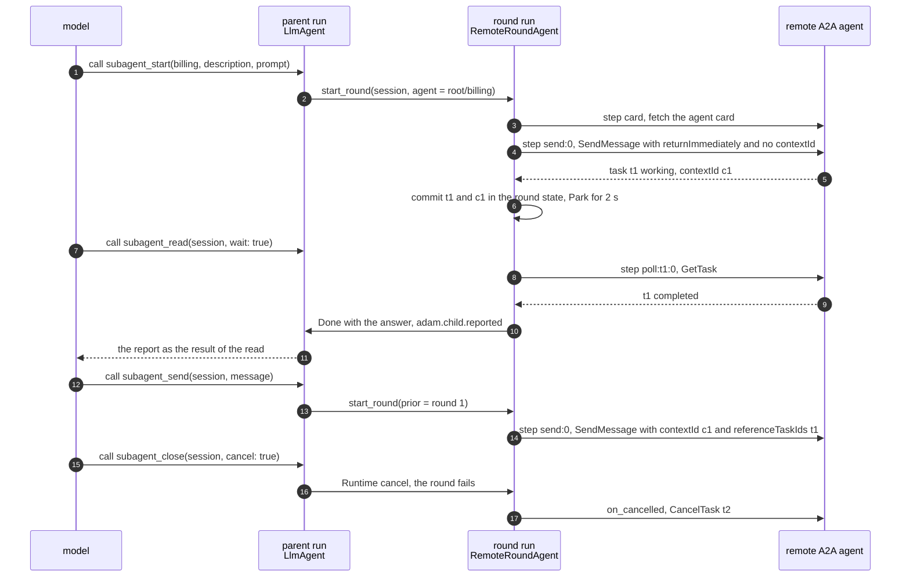

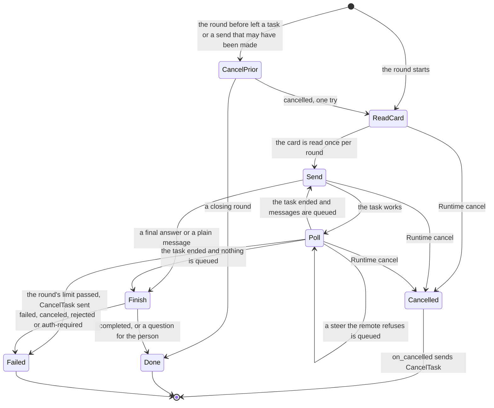

**One transition, one action.** `RoundState::next` picks it from the state alone: read the card, deal with a message, send,
look, or report. Every call to the remote is a journaled step (`card`, `send:<n>`, `steer:<id>`, `poll:<task>:<looks>`,
`cancel-prior`, `cancel-limit`), and the task id is committed with the transition that learns it.

* **Message ids.** Round 1's first send uses the round's run id, a later send of the round `child_run_id(round, "queued:<n>")`,
  a steer `child_run_id(round, message id)`: a replay sends the id again, and a remote that deduplicates (`adam-a2a-runtime`
  does) returns the task it made.
* **Context.** The first answer's `contextId` is kept in the state and carried to the next round (`init_continuing`).
  A later send names it and `referenceTaskIds: [last task]`, or `taskId` when it answers a question.
  `adam-a2a-runtime` ignores `referenceTaskIds` from an anonymous caller, so context continuity needs `auth: bearer:VAR`.
* **A message to a working round.** The round decides when it reads the message. The card lists `steer/v1`: the message goes
  to the working task (`taskId` and the extension named in `message.extensions`). The card does not, or the steer is
  refused: it is queued and sent, with the others that waited, as the next task of the round. `subagent_send` reads
  `queues_messages` from the round's state and says `queued` or `steered`; it is `true` until the card is read, because a
  message that arrives first joins the first send.
* **Window of a message id.** A round remembers the last 64 message ids it read (`read_ids`, what a retried
  `subagent_send` checks). A copy delivered again after 64 newer messages is read as new and sent again.
* **Limit.** `AgentDef::remote_timeout` (`RemoteSettings::max_wait`) is both the wait cap of the one-shot tool and the limit
  of a session round. The tools give it to the runtime as the round's time limit, and the round also records its first step
  and fails at the limit itself (`cancel-limit`), because a round the A2A front starts has no runtime limit.
* **Looks.** The first look is 2 s after the send, then 4 s, 8 s and so on up to `wait_poll`, each a journaled `GetTask`.
  The report waits at most that long.
* **Not carried.** The remote's tokens are not counted in the parent. A file in an answer is described in a line, not
  shared. No step of the remote's work is shown.

### Remote session interleavings

| # | What happens | What the design does |
|---|---|---|
| R1 | A second round | It sends the remote's `contextId` and `referenceTaskIds` of the task before |
| R2 | A message while the task works, the card lists `steer/v1` | Sent to the task as a steer, `delivered: steered`, no new task |
| R3 | The same, the card does not list it | Queued, sent as the next task of the round, `delivered: queued`; the report has both answers |
| R4 | The process restarts while the task works | The task id is in the state: the new process looks at it and sends nothing again |
| R5 | The send's response is lost | The step is retried with the same message id and finds the task |
| R6 | The remote fails | The round fails with the remote's words and the session stays usable |
| R7 | The remote asks a question | It is the report, and the next message answers that task |
| R8 | The session is closed | The closing round calls nothing and repeats the last report |
| R9 | The round is cancelled: `subagent_close` with `cancel`, the parent, or the time limit | `Agent::on_cancelled` sends `CancelTask` (10 s limit, best effort) |
| R10 | The cancel is lost | The next round of the session cancels the task the round before left working (`cancel-prior`) |
| R11 | A remote session started `sealed` with `wait: true` (ADR 0089, slice C2) | The start parks on round 1, its result is the remote's answer with the session id, and the parent's next round continues the remote's context |

**Limits.** The cancel is not durable, and every cancel here (`on_cancelled`, `cancel-prior`, `cancel-limit`) is one try:
a failed `CancelTask` is logged and not repeated. The send's request is committed before the call (`sending`), so a cancel
that lands while the remote answers still leaves what is needed: the hook, or the next round, repeats the send under the same
message id, which a deduplicating remote answers with the task it made, and cancels that. (A remote that does not deduplicate
makes a task and then cancels it.) A closing round cancels what the round before left before it closes. Messages a failed or
cancelled round never sent go first in the next round. The cancel is not durable: it is sent once by the process that commits the cancel, and a process that registered
only the starter sends nothing (the next round recovers it). A reload of `LiveAssembly` does not replace the round agents:
a changed remote needs a restart. A parent that has a remote subagent and no local one now has the six session tools.

## Remote tasks: the same wait without a message

A subagent on another A2A agent (`a2a:` in its file) is the same idea with one thing missing: nothing tells
the parent when the remote task is over. The tool starts the task, returns `ToolError::AwaitRemote { task,
timeout_ms }`, and the parent records `PendingWait::Remote { call_id, tool, task, deadline }` and parks with
the `wait_poll` timer. Each time it fires the agent asks the tool how the task stands, as a journaled step,
until it is over. **The timer is the mechanism.**

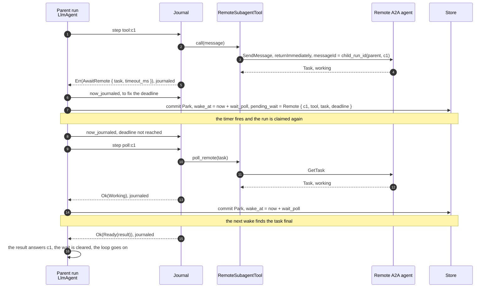

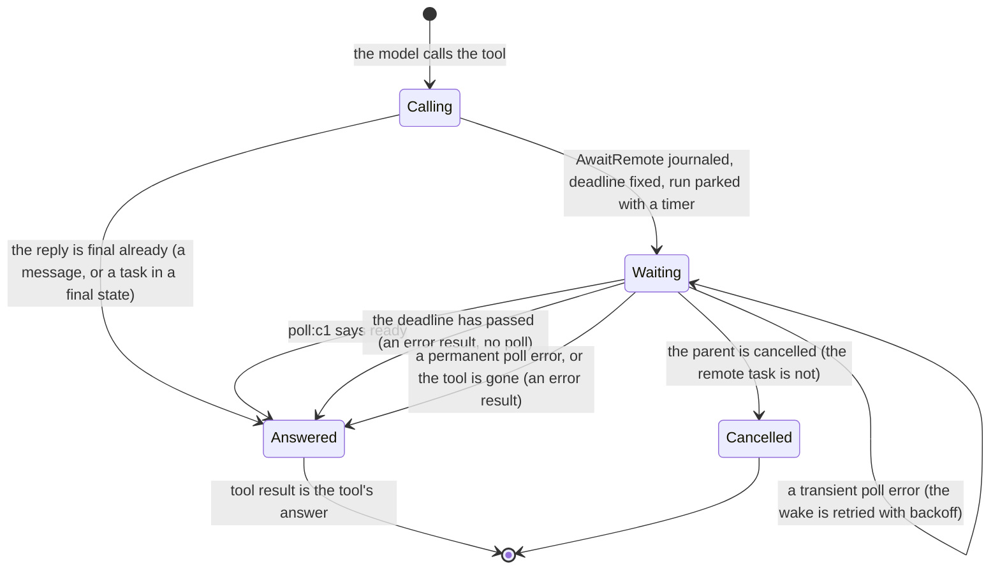

* **Every look is a journal step.** `poll:<call id>` records `Working` or `Ready(result)`, and, when the wait
  has a deadline, `ctx.now` is read through the journal (`Ctx::now_journaled`) so that a replay takes the
  same branch (a replay that skipped a recorded `poll:` step because the clock had moved would meet the
  wrong step name at the next `seq` and fail as non-deterministic). A transient poll error fails the wake as
  `AgentError::Transient`, and the retry looks again from a fresh `seq`.
* **The start is idempotent by message id, not by run id.** A child run is started under an id the runtime
  refuses to create twice; a remote task is started by a `SendMessage` whose `messageId` is
  `child_run_id(parent run, call id)`. The guarantee is only as good as the remote's memory of that id
  (`adam-a2a-runtime` starts the task under `task_id_for(agent, caller, context, messageId)`, so a repeat reaches
  the same task). The journal makes the call once per recorded outcome regardless.
* **Failure interleavings.**

| # | What happens | What the design does |
|---|---|---|
| 1 | The process dies while the parent waits | The wait is in the run's committed state. A new process claims the run at the timer and polls the recorded task: no second send |
| 2 | The send reaches the remote and its response is lost | The step fails transiently and is retried; the retry sends the same `messageId`, and a deduplicating remote returns the task it made |
| 3 | The remote finishes while nobody polls | The next timer wake finds it final and answers |
| 4 | The task never ends | At the deadline (default one hour, `AgentDef::remote_timeout`) the call is answered with an error result; the remote task keeps running |
| 5 | The remote fails, cancels, rejects, or wants input | An error result naming the state and the remote's message; the run goes on |
| 6 | The remote answers 401 or the card points the token elsewhere | An error result; nothing is sent to the other origin |

* **What it refuses to do.** No streaming yet (`SubscribeToTask` would end the wait sooner; the poll stays as
  the fallback); no cancel of the remote task when the parent is cancelled or the wait times out (the tool has no
  hook for it; a [remote session](#remote-sessions) round does); no `contextId` continuity between calls of the tool
  (a session keeps it). And, as with child runs, **no mixed
  versions**: a build that predates `AwaitRemote` cannot read a journal that contains it.

