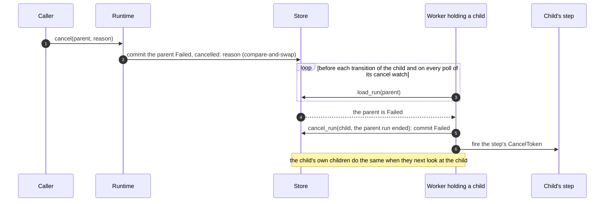
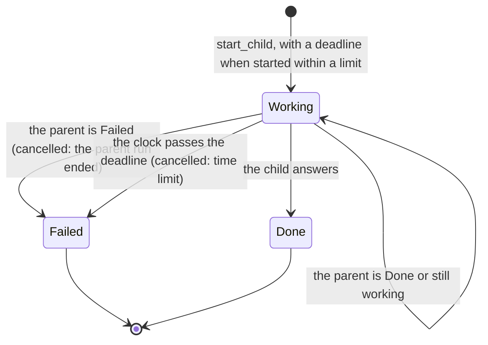
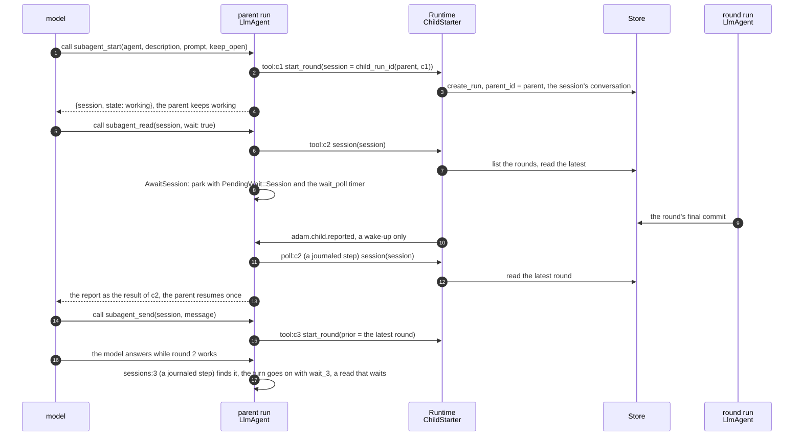
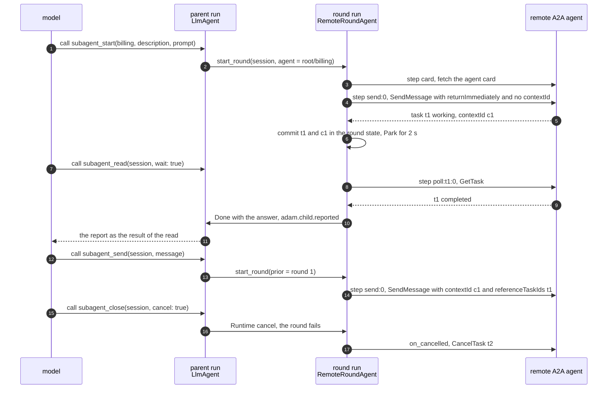
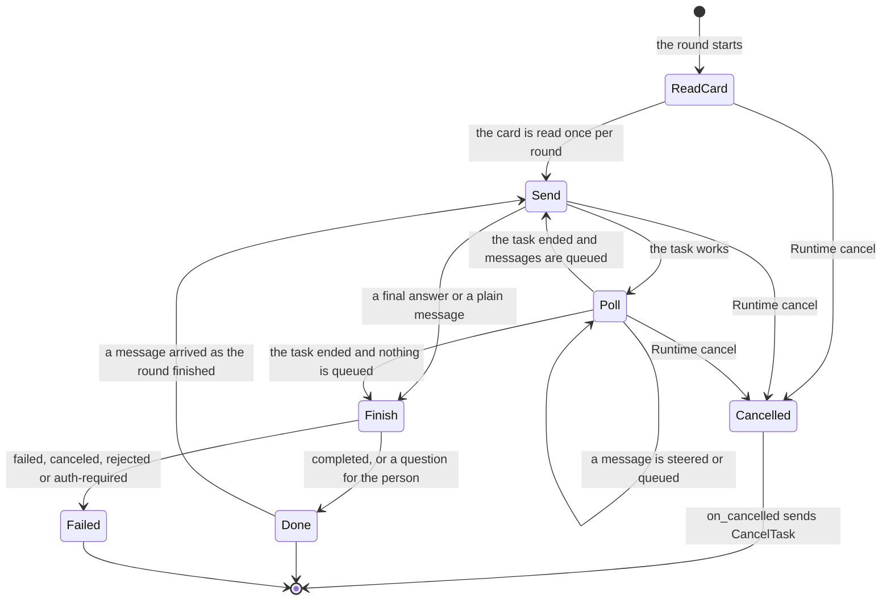
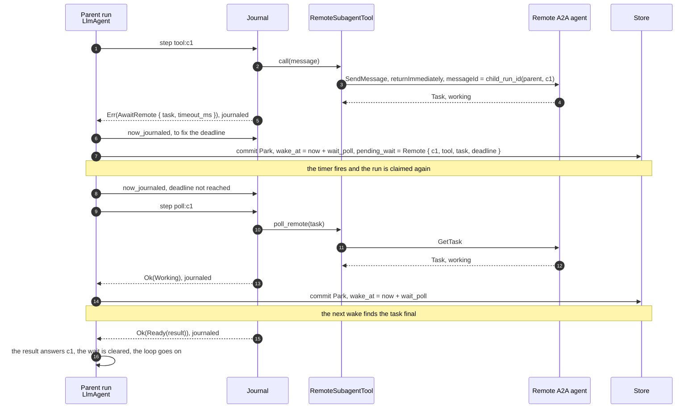
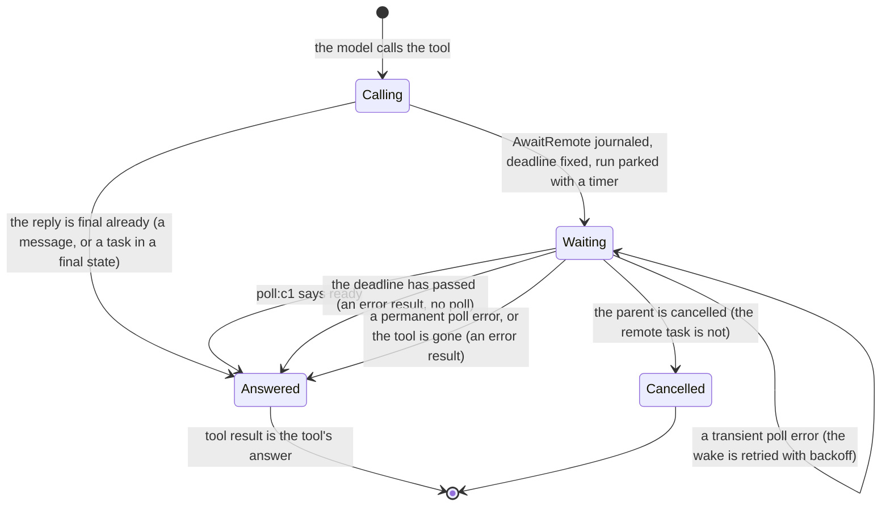

# Child runs and remote tasks

A subagent is a run started by a tool of another run. This page is the full design of the runtime half:
the local case, the remote (A2A) case, every failure interleaving with the test that makes it happen,
and what the design refuses. The picture is in [Architecture](../architecture.md#child-runs); how a
folder declares subagents is in [Agent files](agent-files.md#subagents-at-run-time).

Code: `crates/adam-runtime` (`start_child`, `child_status`, the notice), `crates/adam-llm-agent`
(`pending_wait`, `AwaitRun`, `AwaitRemote`), `crates/adam-assembly` (`SubagentTool`, `RemoteSubagentTool`).

## A local child

* **The child id is derived.** `child_run_id(parent, key)` is a UUID (version 8) from a SHA-256 over the
  parent id and the key, the same way the A2A adapter derives task ids. `ToolCtx::child_run_id()` is that
  for the current tool call. A tool that runs again, after a crash, a lost lease or a transient retry, asks
  for the same child, and `start_child` (which is `start_with_id` plus the parent) answers `false` and
  leaves the first one alone. The only side effects of the tool are that creation and reads.
* **The message is a hint, the timer is the guarantee.** The runtime sends the message after the child's
  commit, in the worker that made it. It cannot be part of that commit (the store commits one run at a
  time), so a crash or a store error in between loses it, and so does a commit whose acknowledgement is lost
  (the worker then believes the commit failed and sends nothing). The parent therefore never waits without a
  timer: `LlmAgentBuilder::wait_poll` (60 s by default) bounds how late it can be, and each wake without the
  message is one `load_run`. A failed send is logged at `warn`; a parent that is finished or gone is logged
  at `debug` and is not an error.
* **The message is deduplicated by its id.** `Inbound::id` is the child's run id. The `LlmAgent` matches it
  to the run it waits for, uses it once (the wait is cleared in the same commit that consumes it) and drops
  every other: copies of a message already used, a message for a run it does not wait for, one that does not
  parse, one whose status is not final. Such messages are never read as user text.
* **The answer.** A finished child's `output.text` (what an `LlmAgent` child ends with), else its output as
  JSON, is the tool result. A `Failed` child, a cancelled one (`cancelled: <reason>`), one whose state cannot
  be read and one that was purged are an error result (`the run failed: <why>`): the model sees it and the
  run goes on. Nothing in the parent fails because a child did.
* **Who may be asked about.** `Ctx::child_status` answers only for children of the calling run. An id that
  belongs to a run of another parent (or to none) is a permanent error, so an agent cannot read the results
  of unrelated runs, and a derived id that collided with a stranger's run would fail loudly and not answer
  with the stranger's output.
* **`Conversation::pending_wait`** is what the parent is parked on: a `Question` for the user (this field was
  `pending_question`, and state stored under that name still loads) or a `Run` for a child. A2A reads a run
  parked on a timer as `working` and only a run parked with no timer as `input-required`, so a parent
  waiting for a child is `working`.

## Failure interleavings

Each one has a test that makes it happen without sleeping: steps are held at gates, the 60 s timer is
moved with a `ManualClock`, and a fault is scripted on one run of the `FaultyStore` (`fail_run`,
`fail_run_after_apply`). Names are in `crates/adam-runtime/tests/runtime.rs` (memory, PostgreSQL and
MongoDB) and `crates/adam-llm-agent/tests/child_runs.rs`.

| # | What happens | What the design does | Test |
|---|---|---|---|
| 1 | The child's terminal commit lands, then its process dies, or delivering to the parent fails | The parent stays parked on its timer. At the timer it reads the child, finds it terminal and answers. Nothing else knows anything is missing | `a_lost_notice_is_recovered_by_the_timer`, `a_lost_notice_is_recovered_when_the_timer_fires` |
| 2 | The child's terminal commit is applied but its acknowledgement is lost | The worker treats the commit as failed and sends nothing (the run is `Done` in the store and nobody claims it again). Same recovery as 1 | `a_lost_terminal_ack_sends_no_notice_and_the_timer_recovers`, `a_lost_terminal_ack_is_recovered_when_the_timer_fires` |
| 3 | The message is delivered twice, or three times, or again after the answer is in, or after the run is over | The first match answers the call and clears the wait. Later copies match no wait and are dropped. On a finished parent `deliver` answers `Finished`, which the sender ignores. The model is not asked again | `a_duplicate_notice_is_ignored`, `only_the_awaited_childs_notice_answers` |
| 4 | The parent is cancelled while it waits | **The child is cancelled too** ([below](#cancel-cascades-and-time-limits)): its worker sees the parent is `Failed` within one poll, fails the child with `cancelled: the parent run ended` and fires its step's token. What the child would have answered is dropped, and the parent stays `Failed` with `cancelled: <reason>`, untouched | `cancelling_a_waiting_parent_cancels_its_child`, `cancelling_the_parent_cancels_the_child_too`, `a_running_child_and_its_child_are_told_within_one_poll`, `cancel_task_reaches_the_subagent_run` |
| 5 | The child fails, is cancelled, or was purged | The parent gets `status: failed` and the reason (or, for a purged child, finds it gone) and the tool result is an error result. The run continues | `a_failed_or_cancelled_child_tells_its_parent_why`, `a_failing_child_is_an_error_result`, `a_cancelled_child_is_an_error_result`, `a_child_that_is_gone_is_an_error_result`, `a_purged_child_reads_as_gone` |
| 6 | The parent's lease is lost while it waits, or while it starts the child | Fencing is the version compare-and-swap, not the lease. The worker that took over replays the step: the journal has the start, and `start_child` would answer `false` anyway, so there is one child. The first worker's late commit is refused. The message is delivered with the same compare-and-swap, so it lands on whichever version is current. The parent resumes once. The same holds for the step that answers the call: its consumption of the message commits with it, so a worker that takes over sees the message again and answers the same way | `a_parent_that_loses_its_lease_does_not_start_or_resume_twice`, `a_worker_that_loses_its_lease_while_answering_changes_nothing` |
| 7 | The message arrives before the parent has parked | While the tool step runs: the message waits in the inbox, and the commit turns the park into a wake-up (the rule that already keeps a parked agent from sleeping through a message that arrived during its step). In a replay or a retry of that step: the snapshot the step starts from already holds the message but the wait is not recorded yet, so the agent matches it *after* the tool has returned `AwaitRun`, in the same transition, and never parks | `a_notice_that_beats_the_park_is_not_lost`, `a_notice_that_beats_the_park_is_used`, `a_retry_finds_the_notice_before_the_wait_is_recorded` |
| 8 | The timer fires and the child is still working | One `child_status` read, no answer, a new timer one interval later. No second child, no model call | `a_parent_woken_early_parks_again`, `the_parent_looks_at_the_child_when_the_timer_fires` |
| 9 | A user message arrives while the parent waits | It wakes the parent, which finds nothing to answer with and parks again. The message is kept and appended after the tool result, as for any owed result | `a_message_while_waiting_queues_behind_the_result` |
| 10 | A forged, stray or malformed `adam.run.finished` | Matched by the child's run id only, and only a final status counts. Otherwise it is dropped without becoming user text. `child_status` refuses runs that are not the caller's children | `only_the_awaited_childs_notice_answers`, `child_status_reads_only_the_callers_children` |
| 11 | Two workers start the same child | `create_run` refuses the second (`AlreadyExists`), `start_child` returns `false`. One row | `start_child_records_the_parent_and_is_idempotent` |
| 12 | The process that finishes the child has never heard of the parent's agent | Delivering needs only the parent's run id: it does not have to register the parent's agent. The parent's own worker steps it | the split `front` and `back` runtimes of cases 1, 2, 5 and 6 |
| 13 | The message races the timer: the parent reads the finished child at its timer, and the message lands while that step finishes (during the final model call, or before its commit) | The message answers nothing: the wait is settled. `Ctx::arrived` and the commit's reopen rule do not count a child's notice, so the parent finishes with its answer, as it would if the message came after the commit (then `deliver` answers `Finished`). The model is not asked again | `a_childs_notice_that_lands_while_a_run_finishes_does_not_reopen_it`, `a_notice_that_lands_while_the_parent_finishes_costs_no_model_turn` |

| 14 | A child runs past its time limit | The runtime fails it with `cancelled: time limit: the run did not finish within 30 min`: before a step, within one poll for a step in flight (its token fires), and at the wake it set at the deadline for a parked one. The parent gets "the run failed: cancelled: time limit: ..." as the tool result and goes on | `a_child_past_its_deadline_fails_and_wakes_at_it`, `a_child_past_its_limit_is_an_error_result_for_its_parent` |
| 15 | A child is created after its parent was cancelled | It is cancelled when it is claimed, before it steps. A `Done` parent changes nothing, and a parent that is not in the store is unknown and cancels nothing | `a_child_created_after_the_cancel_never_steps`, `a_child_follows_a_parent_that_failed_but_not_one_that_is_done`, `a_done_parent_that_was_purged_leaves_its_open_child_running`, `a_child_parked_on_a_question_is_cancelled_when_its_parent_is`, `a_grandchild_under_a_parked_child_follows`, `a_healthy_parked_child_is_woken_without_stepping_the_agent` |
| 16 | The same cancel arrives twice | The second is a no-op: a terminal run is left as it is | `a_child_created_after_the_cancel_never_steps` |

## Cancel cascades and time limits

[ADR 0044](../decisions/0044-paged-tools-a-stable-prompt-prefix-a-plan-skills-commands-and-project-context.md) slice 10,
[ADR 0037](../decisions/0037-parallel-subagent-calls-and-an-editing-worker.md) decision 7. **No `Store` method was added**
(a cascade over `list_runs` would scan every run, and a `Store::children` would be a new required method): each child looks
at its **parent**, which it already knows (`RunRecord::parent_id`).

* **The rule.** A run with a `parent_id` is cancelled (`cancelled: the parent run ended`) when its parent is **loaded and
  `Failed`**, for any reason (a cancel included). A `Done` parent changes nothing: it has no working rounds, and a session
  kept open stays usable. A parent that cannot be loaded (the store is down, or retention purged a finished run) is
  unknown, not ended: the child goes on (debug log). This assumes retention is longer than a minute
  (`Store::purge_finished`).
* **Where it is checked** (`crates/adam-runtime/src/worker.rs`). Before a child's transition, with one `load_run(parent)`;
  on the cancel watch of a step in flight, at most once a second per child (`PARENT_CHECK_EVERY`; the watch itself polls
  every `poll_interval`, 250 ms by default, and reads the child's own run each time); and for a **parked** child at its
  look (below). The cancel is `Inner::cancel_run`, the body of `Runtime::cancel`: idempotent, a no-op for a run that is
  already terminal.
* **The look at a parked child.** A parked run that works for a parent, or has a deadline, is committed with a wake no later
  than `CHILD_WAIT_POLL` (a minute) away, and the envelope keeps the agent's own wake (`agent_wake`) and `hb`. When that
  wake claims the run, the runtime reads the parent **before** the agent: the parent ended, the child is cancelled; the
  parent is alive and nothing else is due (no message, the agent's own wake not yet), the run is parked again with the next
  wake **without stepping the agent, without a journal entry and without a model call**. So a child waiting for an
  answer to its own question, or with `max_minutes: 0`, is reached too, and so are its own children one level at a time.
  The cost of a parked child is one read and one commit a minute. `RunView::wake_at` and `waiting` say what the agent asked,
  not the runtime's wake.
* **How fast.** `Runtime::cancel` commits the parent first, unchanged. A running child is told within about a second
  (its token fires, and the coder's `shell.rs` kills its command); a runnable one when it is claimed; a parked one within
  a minute. Grandchildren follow one level at a time. A child that the parent's last step created after the cancel never
  steps. The A2A `CancelTask` path is unchanged and answers `Canceled` at once.
* **A remote A2A task.** A subagent on another agent (`a2a:`) called through its tool is a task there, and the cascade
  does not send it `CancelTask`: it keeps running until the remote end stops it, and cancelling the parent stops the wait
  and nothing else. A **round of a remote session** does: the runtime calls `Agent::on_cancelled` after every cancel it
  commits, and the round agent sends `CancelTask` ([remote sessions](#remote-sessions), [ADR 0045](../decisions/0045-a-subagent-can-run-in-the-background-as-a-session.md) slice 5).
* **Run pods** are keyed by the root's workspace, so the janitor removes the pod with the failed root.
* **Time limit of a child.** `Runtime::start_child_within(parent, id, agent, input, Some(limit))` (also
  `ChildStarter::start_within`, `ToolCtx::start_child_within` and, for a session round,
  `start_child_continuing_within`; the last is the embedder's entry point until the session tools of ADR 0045 arrive)
  stores `deadline` in the run's envelope, set **once** from the runtime's own `Clock`, not from a transition. `wake_at`
  is clamped to it, runnable or parked, so a child wakes at it. **The time a child waits for a person is not counted**: when
  it parks with no timer the deadline is cleared and what is left is kept (`remaining_secs`), and the next step that
  follows a message sets it again; time on a timer, or on a child, still counts. A wake that arrives before the deadline
  (the store's clock and the runtime's disagree) parks the run again to the deadline plus a second, without stepping the
  agent, so a skew cannot make a tight loop. `SubagentTool` passes
  `limits.max_minutes` of the subagent's file: **30 minutes** when it says nothing, `0` for none, at most 1,440
  ([agent files](agent-files.md#the-subagent-tool)). The limit is per run: each round of a session has its own.
* **Time limit of a tool call.** A call that runs past `Tool::time_limit` (300 s when it declares none) is stopped
  inside its journaled step and answered with an error, so a replay never waits ([errors](errors.md#what-the-model-is-told)).

What the design refuses to do, and why:

* **No parallel fan-out of one-shot subagents yet.** An `LlmAgent` runs the calls of one model turn at the same time
  ([ADR 0049](../decisions/0049-the-tool-calls-of-a-turn-run-at-the-same-time.md)), but a call that can park the run (a
  subagent, a remote agent) runs alone, so three subagent calls in one turn run one after the other; background
  sessions ([ADR 0045](../decisions/0045-a-subagent-can-run-in-the-background-as-a-session.md)) are the way to children
  side by side. Starting all the
  children first and waiting for all of them needs `pending_wait` to hold several runs.
* **No asking tools in a subagent.** A child that parks with no timer, for instance because one of its tools asked the
  user something, waits for an answer nobody is placed to give; the time limit above now ends it at its deadline
  (30 minutes by default), and a cancel of the parent does not wake it. The subagent binding
  (`adam-assembly`) closes this at startup instead of at run time: a tool that can ask says so
  (`Tool::asks_user()`), and `bind` refuses a subagent that has one, so the situation cannot arise from an
  agent directory. A tool that returns `NeedsInput` without declaring it still parks its child, and a child
  can still be cancelled by id: the parent then gets the error result.
* **The output travels whole.** The child's output is the payload of the message, then the text of the tool
  result in the parent's history. Long histories are shortened by `max_history_tokens` as for any tool output,
  in the stored conversation too (the journal keeps the whole output), and a history that reaches its budget is
  compacted: each run, a child or a session round included, compacts against its own limits, and a parent whose
  `subagent_start` was cut by a compaction still waits for and cancels its working sessions.
* **No guarantee for a child purged early.** `purge_finished` deletes a finished run with its journal. A
  parent that has not looked yet then reads `None` and reports "the child run no longer exists". Keep the
  retention above the parent's longest wait plus one `wait_poll`.
* **No mixed versions.** The journal entry `AwaitRun` and the `pending_wait` field are not read by a build
  that predates them (it would fail the run as non-deterministic on replay). Roll the workers before the
  tools that start children are enabled. The other direction is safe: journals and states written before
  (`ToolError` without `AwaitRun`, `Conversation` with `pending_question`) load and replay in the new build.

Code that runs inside a step but cannot hold the `Ctx`, such as a tool of an `LlmAgent`, starts a child through
`Ctx::child_starter()`: an owned `ChildStarter` for the runtime that is stepping the run, which can start only
children of that run (`start` is `start_child` with the parent fixed). `LlmAgent` hands it to every tool as
`ToolCtx::start_child(agent, message)` (under `ToolCtx::child_run_id()`), so a tool needs no `Runtime` handle,
and the child starts on the runtime that steps the parent, whichever process that is. The subagent tool of
`adam-assembly` is exactly this call followed by `AwaitRun`; see [subagents](agent-files.md#the-subagent-tool).

A hand-written `Agent` can wait for children too: start them with `start_child`, `Park` with a timer, and on
the next step read `take_inbox()` for messages of kind `adam.run.finished` (`ChildStatus::from_notice`) and
`Ctx::child_status` when there is none. It must take its inbox in the step that parks as well: a message
already in the inbox when a step starts is not "arrived during the step", so an agent that parks without
reading it sleeps until its timer.

## Sessions (ADR 0045, slices 1 and 2)

[ADR 0045](../decisions/0045-a-subagent-can-run-in-the-background-as-a-session.md) lets a subagent run in the
background as a session that is sent more messages. The runtime half (slice 1) is in `crates/adam-runtime`; the five tools
(slice 2) are in `crates/adam-llm-agent` (`sessions.rs`) and are given to a root with subagents by `adam-assembly`.

**What the runtime has.**

* `Runtime::start_child_continuing` starts a child run **with a conversation id**: the parent's id (with `%` and
  `/` escaped, so a client's context id cannot spell another session's), then `/s/` and the session id
  (`session_conversation_id`). Round 1's run id, `child_run_id(parent, call_id)`, is the session id. From round 2
  on the child starts from the previous round's state (`init_continuing`, ADR 0003). A session has one agent,
  and the store allows one open run per agent and conversation, so a start while a round is open is
  `ConversationBusy` (`is_busy()`): the caller sends a message with `Runtime::deliver`, which the open round reads
  as a steered message. Everything the runtime can check is refused as `InvalidSession`: a `prior` of another
  conversation or of a session with no first round, a run id that exists and is not this round, a conversation id
  that is not a session's or is over 1024 bytes. A repeat with the same ids answers `false`; a round purged
  before its repeat is not recognised (retention must outlast retries).
* A child with a conversation reports its end with **`adam.child.reported`** instead of `adam.run.finished`.
  Same id, same payload, same standing: a wake-up, and the parent reads the round with `Ctx::child_status` or
  `ChildStarter::session`, so the lost-notice cases above hold for a round. A child without a conversation is unchanged.
  The loop never shows the notice to the model, and `Ctx::arrived` and the reopen-on-arrival rule do not count it.
* `Runtime::list_sessions` lists a parent's sessions over `list_runs` with the conversation prefix, `Runtime::session_view`
  reads one by its id. Both read **the latest round** and its `SessionHeader` (`session` in the round's agent state): working,
  idle or closed, and how it ended. A run counts only if the session's round 1 exists with a parent, so a top-level run in a
  session-shaped conversation is not listed, and a parent never sees another's.
* A round takes the same time limit as any child (`start_child_continuing_within`, per round), and a cancelled or failed
  parent fails the round that is open (`cancelled: the parent run ended`) while the session stays usable: a later parent
  run continues it from that round.

**What the tools do.** `subagent_start` creates round 1 and returns at once. `subagent_send` steers a working round
(`Runtime::deliver`, the message id is the call id, so a repeat is read once) or starts the next round from the latest one.
`subagent_read` reads the latest round: working, or its report as a numbered page; with `wait: true` and a working round it
returns `ToolError::AwaitSession` and the parent parks on a `PendingWait::Session`. `subagent_close` asks a working round to be
the last (`SESSION_CLOSE_KIND` in its inbox: it finishes, then the session takes no more) or, with `cancel`, cancels it; an idle
session is closed by a round that calls no model (`header.closing`) and ends with the last answer again.
`subagent_list` pages the sessions of the conversation. The sessions are reached by **the conversation**, not by the task: a
later task finds the sessions an earlier one started, and no run reaches another conversation's (an id that is not one of
this conversation's is "no session"). At most 16 sessions that are not closed and 20 rounds per session (decision 5's
`max_open` and `max_rounds` as constants for now).

```mermaid
stateDiagram-v2
    [*] --> Working: subagent_start, round 1
    Working --> Working: subagent_send steers the open round
    Working --> Idle: the round ended and keep_open
    Working --> Closed: the round ended and not keep_open
    Working --> Working: subagent_close without cancel (a request in the inbox; the session takes no more messages)
    Working --> Closed: the round ended after a close request, or was cancelled after one
    Working --> Working: the closing round of an idle session runs (header closing, no model, no report)
    Idle --> Working: subagent_send starts the next round
    Idle --> Closed: subagent_close starts a round that calls no model
    Closed --> [*]
```

A closed session is **never reopened**, and `Closed` is derived, not stored: the latest round's header says `closed`, or a close
request waits in its inbox, or the round has ended in a session that is not kept open (which is why a round cancelled by its
parent closes such a session, and leaves a kept-open one idle).

**The turn-end wait.** A turn whose model answers with no tool call while a session this run started still works does not end
the run: the loop reads the sessions in a journaled step `sessions:<turn>` (skipped when no call of the history started a
session) and goes on with a call to `subagent_read` that waits, appended to the model's own message. The report reaches the model
before the run ends. A round that only closes a session is not waited for and not cancelled: it reports nothing new. At a
limit turn, or at `max_tool_calls`, the run ends and the round goes on without anyone to read it.

### Session interleavings

Each has a test in `crates/adam-llm-agent/tests/sessions.rs` (memory, PostgreSQL and MongoDB, with no fixed sleeps; the report
is read from the store, the notice is only a wake-up).

| # | What happens | What the design does | Test |
|---|---|---|---|
| S1 | The parent's start call is made again (a replay, a retry after the call acted) | The id of the session is derived from the call: a repeat finds the round, so one child ran, and the tool answers what it answered | `a_retried_try_starts_nothing_twice` |
| S2 | A worker takes over between any two steps | Every read of the store or the clock in the loop is a journaled step (`tool:`, `poll:`, `sessions:`): a copy of the journal gives the same history with no child started and no model asked | `every_step_replays_from_the_journal_to_the_same_history` |
| S3 | The round's notice is lost | The parent is parked on its timer, and the step that wakes it reads the session through the tool | `a_lost_notice_is_recovered_by_the_timer` |
| S4 | The notice arrives again, or a forged one arrives | It wakes the parent, which looks, finds the round still working and parks again with no model call; the report is never taken from a notice | `a_duplicate_notice_is_ignored` |
| S5 | `subagent_read` waits and the round ends | One resume, with the report as the call's result; three reads that do not wait and say "working" are refused on the third | `a_read_with_wait_parks_and_resumes_once_with_the_report`, `polling_is_refused_and_waiting_is_not` |
| S6 | The model answers while a session works | The run waits for it and calls the model again with the report | `a_start_returns_at_once_and_the_turn_end_waits_for_the_report` |
| S7 | The parent is cancelled while a session works | The round is failed by the cascade; a kept-open session is idle and a later task of the conversation reads it and sends it a round that continues it | `cancelling_the_parent_leaves_a_kept_open_session_idle` |
| S8 | A message reaches a working round, or a close request does | The message is read as a steer (the round's next request ends with it); the request makes the round the last and costs no model turn | `a_message_to_a_working_round_is_steered`, `closing_a_working_session_lets_the_round_finish` |
| S9 | An id that is unknown, malformed or another conversation's | An error result in words that say what to do; nothing is started | `a_session_that_is_not_ours_is_refused_in_words` |
| S10 | A session on a remote subagent | A round of the agent registered under the subagent's name, which talks to the remote ([below](#remote-sessions)) | `a_remote_subagent_starts_a_round_of_its_registered_agent` |

**Tokens.** Each round a run started or sent to is counted once in the run's `usage_totals`: a journaled step `usage:<call id>` reads it when a report is given to the model and, at the latest, when the run ends (`sessions_end`), whether or not the report was read; a store error on the read is retried. **Known limit:** the checks scan every round of the conversation, and past 5,000 rounds of one subagent a start is refused.

**Not built yet** (slices 3 to 8): reports that reach the model in the middle of a turn without a read, the limits as settings
(`idle_ttl`, `max_working`), the coder's kept-open helpers, a child that asks the person.

**A person's round.** The A2A front (`adam-a2a-runtime`, *Child sessions*) lets a person start a session and send rounds with no run
of an agent behind them. Such a round is **its own parent** (`start_child_continuing(id, id, ..)`): `parent_id` is its own id, so
the worker's check of the parent (`parent_has_ended`) reads a run that has not ended, no run's end cancels it and no run waits for it
(the turn-end wait and `end_sessions` look for rounds started by the run that is ending, `started_by == that run`). `SessionView::started_outside_a_run`
and `SessionSummary::started_outside_a_run` say it. Its end notice goes to the round itself, which is finished by then, and is dropped (`notify_parent`, "nobody to tell"); a parent
learns the round by reading the session, as for any round it did not start. `closing_round_payload` builds the first message of a
round that only closes a session, for the tools and for the A2A front.

## Remote sessions

A session on a remote (`a2a:`) subagent works like any other session: the same five tools, listing, notices, closing
round and turn-end wait. Its rounds are runs of `RemoteRoundAgent` (`crates/adam-assembly/src/remote_session.rs`),
registered as `<root>/<subagent>` by `Assembly::register`. The round has no model: it sends the message, looks at the
task and reports. It shares the connection of the subagent's tool (`RemoteEndpoint` in `remote.rs`: card, token,
interface rules), so the token goes only where the tool sends it.

**One transition, one action.** `RoundState::next` picks it from the state alone: read the card, deal with a message, send,
look, or report. Every call to the remote is a journaled step (`card`, `send:<n>`, `steer:<id>`, `poll:<task>:<looks>`,
`cancel-prior`, `cancel-now`), and the task id is committed with the transition that learns it.

* **Message ids.** Round 1's first send uses the round's run id, a later send of the round `child_run_id(round, "queued:<n>")`,
  a steer `child_run_id(round, message id)`: a replay sends the id again, and a remote that deduplicates (`adam-a2a-runtime`
  does) returns the task it made.
* **Context.** The first answer's `contextId` is kept in the state and carried to the next round (`init_continuing`).
  A later send names it and `referenceTaskIds: [last task]`, or `taskId` when it answers a question.
  `adam-a2a-runtime` ignores `referenceTaskIds` from an anonymous caller, so context continuity needs `auth: bearer:VAR`.
* **A message to a working round.** The round decides when it reads the message. The card lists `steer/v1`: the message goes
  to the working task (`taskId` and the extension named in `message.extensions`). The card does not, or the steer is
  refused: it is queued and sent, with the others that waited, as the next task of the round. `subagent_send` reads
  `queues_messages` from the round's state and says `queued` or `steered`; it is `true` until the card is read, because a
  message that arrives first joins the first send.
* **Looks.** The first look is 2 s after the send, then 4 s, 8 s and so on up to `wait_poll`, each a journaled `GetTask`.
  The report waits at most that long.
* **Not carried.** The remote's tokens are not counted in the parent. A file in an answer is described in a line, not
  shared. No step of the remote's work is shown.

### Remote session interleavings

Each has a test in `crates/adam-assembly/tests/remote_sessions.rs` (memory, and PostgreSQL when set).

| # | What happens | What the design does | Test |
|---|---|---|---|
| R1 | A second round | It sends the remote's `contextId` and `referenceTaskIds` of the task before | `a_remote_session_keeps_its_context_across_rounds` |
| R2 | A message while the task works, the card lists `steer/v1` | Sent to the task as a steer, `delivered: steered`, no new task | `a_message_to_a_working_remote_session_is_steered_when_the_card_lists_steer` |
| R3 | The same, the card does not list it | Queued, sent as the next task of the round, `delivered: queued`; the report has both answers | `a_message_is_queued_and_sent_as_the_next_task_when_the_card_does_not` |
| R4 | The process restarts while the task works | The task id is in the state: the new process looks at it and sends nothing again | `a_restart_mid_round_resumes_polling_without_sending_again` |
| R5 | The send's response is lost | The step is retried with the same message id and finds the task | `a_lost_send_response_is_retried_under_the_same_message_id` |
| R6 | The remote fails | The round fails with the remote's words and the session stays usable | `a_remote_round_that_fails_reads_failed_and_the_session_stays_usable` |
| R7 | The remote asks a question | It is the report, and the next message answers that task | `a_question_is_reported_and_the_next_round_answers_by_task_id` |
| R8 | The session is closed | The closing round calls nothing and repeats the last report | `closing_a_remote_session_is_local` |
| R9 | The round is cancelled: `subagent_close` with `cancel`, the parent, or the time limit | `Agent::on_cancelled` sends `CancelTask` (10 s limit, best effort) | `cancelling_a_remote_session_sends_cancel_task`, `cancelling_the_parent_sends_cancel_task`, `a_round_past_its_limit_cancels_the_remote_task` |
| R10 | The cancel is lost | The next round of the session cancels the task the round before left working (`cancel-prior`) | `a_lost_cancel_is_sent_by_the_next_round` |

**Limits.** The cancel is not durable: it is sent once by the process that commits the cancel, and a process that registered
only the starter sends nothing (the next round recovers it). A cancel that lands while the send is in flight is sent from
the round's own step (`cancel-now`) once it knows the task. A reload of `LiveAssembly` does not replace the round agents:
a changed remote needs a restart. A parent that has a remote subagent and no local one now has the five session tools.

## Remote tasks: the same wait without a message

A subagent on another A2A agent (`a2a:` in its file) is the same idea with one thing missing: nothing tells
the parent when the remote task is over. The tool starts the task, returns `ToolError::AwaitRemote { task,
timeout_ms }`, and the parent records `PendingWait::Remote { call_id, tool, task, deadline }` and parks with
the `wait_poll` timer. Each time it fires the agent asks the tool how the task stands, as a journaled step,
until it is over. **The timer is the mechanism.**

* **Every look is a journal step.** `poll:<call id>` records `Working` or `Ready(result)`, and, when the wait
  has a deadline, `ctx.now` is read through the journal (`Ctx::now_journaled`) so that a replay takes the
  same branch (a replay that skipped a recorded `poll:` step because the clock had moved would meet the
  wrong step name at the next `seq` and fail as non-deterministic). A transient poll error fails the wake as
  `AgentError::Transient`, and the retry looks again from a fresh `seq`.
* **The start is idempotent by message id, not by run id.** A child run is started under an id the runtime
  refuses to create twice; a remote task is started by a `SendMessage` whose `messageId` is
  `child_run_id(parent run, call id)`. The guarantee is only as good as the remote's memory of that id
  (`adam-a2a-runtime` starts the task under `task_id_for(agent, caller, context, messageId)`, so a repeat reaches
  the same task). The journal makes the call once per recorded outcome regardless.
* **Failure interleavings.**

| # | What happens | What the design does | Test |
|---|---|---|---|
| 1 | The process dies while the parent waits | The wait is in the run's committed state. A new process claims the run at the timer and polls the recorded task: no second send | `a_restart_mid_wait_resumes_polling_without_sending_again` (`adam-assembly`), `a_new_process_keeps_polling_without_starting_the_task_again` (`adam-llm-agent`) |
| 2 | The send reaches the remote and its response is lost | The step fails transiently and is retried; the retry sends the same `messageId`, and a deduplicating remote returns the task it made | `a_send_whose_response_is_lost_is_retried_under_the_same_message_id` |
| 3 | The remote finishes while nobody polls | The next timer wake finds it final and answers | the restart case above |
| 4 | The task never ends | At the deadline (default one hour, `AgentDef::remote_timeout`) the call is answered with an error result; the remote task keeps running | `a_task_that_never_ends_is_given_up_on_after_the_limit`, `a_task_that_outlives_its_timeout_is_an_error_result_without_another_look` |
| 5 | The remote fails, cancels, rejects, or wants input | An error result naming the state and the remote's message; the run goes on | `a_remote_task_that_fails_is_an_error_result_and_the_parent_goes_on`, `a_remote_task_that_is_canceled_is_an_error_result`, `a_remote_that_needs_input_is_an_error_result_because_nobody_can_answer` |
| 6 | The remote answers 401 or the card points the token elsewhere | An error result; nothing is sent to the other origin | `a_wrong_token_is_an_error_result_not_a_failed_run_and_the_token_stays_out_of_it`, `a_card_that_points_the_token_at_another_origin_is_refused_before_anything_is_sent` |

* **What it refuses to do.** No streaming yet (`SubscribeToTask` would end the wait sooner; the poll stays as
  the fallback); no cancel of the remote task when the parent is cancelled or the wait times out (the tool has no
  hook for it; a [remote session](#remote-sessions) round does); no `contextId` continuity between calls of the tool
  (a session keeps it). And, as with child runs, **no mixed
  versions**: a build that predates `AwaitRemote` cannot read a journal that contains it.

