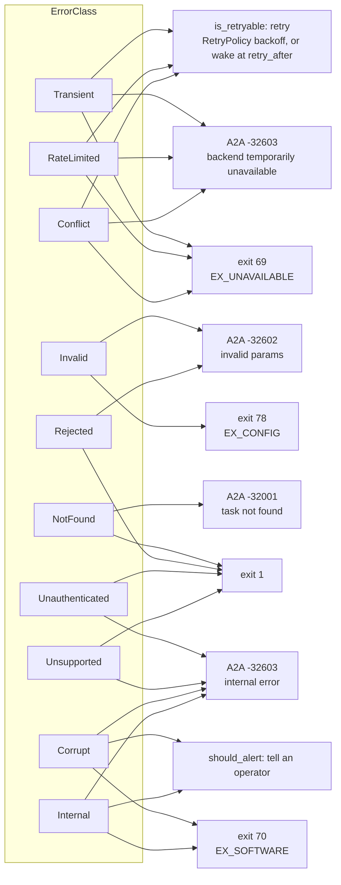

# Errors

Each library defines its own error enum with `thiserror`. A variant says **what happened**; its
`ErrorClass` (from [`adam-error`](../../crates/adam-error/README.md)) says **what to do**. Retry loops,
the A2A error a client sees and the process exit code decide from the class, never from a variant.
Every enum implements `Classify` and its test matches every variant exhaustively, so a new variant
forces a class decision.

## On this page

* [Classes](#classes)
* [Which variant maps to which class](#which-variant-maps-to-which-class)
* [What each class decides](#what-each-class-decides)
* [What the model is told](#what-the-model-is-told)
* [Retry](#retry)
* [Admission refusals](#admission-refusals)
* [Exit codes](#exit-codes)
* [Rules for an error enum](#rules-for-an-error-enum)

## Classes

| Class | Meaning | Retry | Alert | A2A error (`adam-a2a`) | Exit code |
|---|---|---|---|---|---|
| `Transient` | may succeed later: network, 5xx, timeout, pool, crashed child | yes, with backoff | no | `-32603` "backend temporarily unavailable" | 69 |
| `RateLimited` | slow down; honour `retry_after()` | yes, after `max(backoff, retry_after)` | no | `-32603` "backend temporarily unavailable" | 69 |
| `Conflict` | lost an optimistic-concurrency race | yes, at once (bounded) | no | `-32603` "backend temporarily unavailable" | 69 |
| `Invalid` | the input is wrong; it never succeeds | no | no | `-32602` invalid params | 78 |
| `NotFound` | absent, or invisible to this caller | no | no | `-32001` task not found | 1 |
| `Rejected` | valid, but the target's state forbids it (finished, busy, exists) | no | no | `-32602` invalid params (`-32002` for a cancel) | 1 |
| `Unauthenticated` | credentials missing or refused | no | no | `-32603` "internal error" | 1 |
| `Unsupported` | the peer does not offer this (no enum maps here today) | no | no | `-32603` "internal error" | 1 |
| `Corrupt` | stored or received data breaks an invariant | no | **yes** | `-32603` "internal error" | 70 |
| `Internal` | a bug, or unclassified | no | **yes** | `-32603` "internal error" | 70 |

The A2A server answers every JSON-RPC error with HTTP 200 and an error object. A body that is not JSON
gets `-32700`, JSON that is not a request `-32600`, both with a null id. Over HTTP+JSON the same error is the HTTP status of
the A2A error (`-32001` is 404, `-32002`, `-32004` and `-32602` are 400, `-32603` is 500) with a `google.rpc.Status` body
whose `ErrorInfo` names it (`TASK_NOT_FOUND`, ...); a body that is not JSON is `PARSE_ERROR`, a query string that does not
parse `INVALID_PARAMS` ([the two bindings](a2a-server.md#two-bindings-one-handler)).

## Which variant maps to which class

A dotted arrow means the enum wraps another and takes its class.

```mermaid
flowchart LR
    subgraph enums["Library error enums"]
        direction TB
        subgraph core_e["adam-core"]
            StoreError
        end
        subgraph rt_e["adam-runtime"]
            AgentError
            RuntimeError
        end
        subgraph model_e["adam-model and adam-model-openai"]
            ModelError
            OpenAiConfigError
        end
        subgraph ws_e["adam-workspace"]
            WorkspaceError
        end
        subgraph acp_e["adam-acp"]
            AcpError
        end
        subgraph a2a_e["adam-a2a"]
            BackendError
            PushStoreError
        end
        subgraph llm_e["adam-llm-agent"]
            ToolError
        end
        subgraph memory_e["adam-memory"]
            MemoryError
        end
        subgraph coder_e["adam-coder"]
            ConfigError
            StoppedUnexpectedly
            RpcError["RpcError (a language server)"]
        end
        subgraph egress_e["adam-egress"]
            EgressError
            Refusal
            EgressNames["ConfigError, NameError, AllowError, CidrError"]
        end
        subgraph sandbox_e["adam-git-sandbox"]
            SandboxError
            SandboxConfigError["ConfigError"]
            ClientError
            SandboxRefusal["protocol::Refusal"]
            ProtocolError
        end
    end

    subgraph classes["adam_error::ErrorClass"]
        direction TB
        Transient
        RateLimited
        Conflict
        Invalid
        NotFound
        Rejected
        Unauthenticated
        Unsupported["Unsupported (none map here)"]
        Corrupt
        Internal
    end

    StoreError -->|"Backend chosen by adapter: unavailable"| Transient
    StoreError -->|Conflict| Conflict
    StoreError -->|InvalidInput| Invalid
    StoreError -->|NotFound| NotFound
    StoreError -->|"AlreadyExists, ConversationBusy"| Rejected
    StoreError -->|"Corrupt, NonDeterminism, Backend corrupt_source"| Corrupt
    StoreError -->|"Backend internal"| Internal

    AgentError -->|"Transient of class Transient, no retry_after"| Transient
    AgentError -->|"Transient of class Transient with retry_after, or kept from from_classified"| RateLimited
    AgentError -->|"Transient of class Conflict, kept from from_classified"| Conflict
    AgentError -->|Permanent| Invalid
    AgentError -->|Rejected| Rejected
    AgentError -->|NonDeterminism| Corrupt
    StoreError -.->|"Store(e)"| AgentError

    RuntimeError -->|"UnknownAgent, WrongAgent, InvalidSession, ForeignConversation"| Invalid
    RuntimeError -->|NotFound| NotFound
    RuntimeError -->|"Finished, ConversationBusy"| Rejected
    RuntimeError -->|Corrupt| Corrupt
    RuntimeError -->|Contended| Conflict
    AgentError -.->|"Agent(e)"| RuntimeError
    StoreError -.->|"Store(e)"| RuntimeError

    ModelError -->|"RateLimited, Refused 429"| RateLimited
    ModelError -->|"Transient, Unreachable, Refused 503"| Transient
    ModelError -->|"ContextLength, InvalidRequest"| Invalid
    ModelError -->|"Auth, Refused 401 or 403"| Unauthenticated
    ModelError -->|"ModelLocked, Refused 402 or another status"| Rejected
    ModelError -->|Protocol| Corrupt
    OpenAiConfigError -->|"InvalidBaseUrl, InvalidHeader, InvalidApiKey"| Invalid
    OpenAiConfigError -->|Client| Internal

    WorkspaceError -->|Auth| Unauthenticated
    WorkspaceError -->|NotFound| NotFound
    WorkspaceError -->|Invalid| Invalid
    WorkspaceError -->|Transient| Transient
    WorkspaceError -->|RateLimited| RateLimited
    WorkspaceError -->|Conflict| Rejected
    WorkspaceError -->|Corrupt| Corrupt
    WorkspaceError -->|"Git, Http, Io"| Internal

    AcpError -->|"Exited, Timeout"| Transient
    AcpError -->|AuthRequired| Unauthenticated
    AcpError -->|"Config, Rpc -32602"| Invalid
    AcpError -->|Protocol| Corrupt
    AcpError -->|"TurnInProgress, Closed"| Rejected
    AcpError -->|"Spawn, other Rpc"| Internal

    BackendError -->|TaskNotFound| NotFound
    BackendError -->|NotCancelable| Rejected
    BackendError -->|InvalidParams| Invalid
    BackendError -->|Unavailable| Transient
    BackendError -->|Internal| Internal
    PushStoreError -->|NotFound| NotFound
    PushStoreError -->|Conflict| Conflict
    PushStoreError -->|Unavailable| Transient
    PushStoreError -->|Internal| Internal

    ToolError -->|Transient| Transient
    ToolError -->|"Retryable, a rate limit"| RateLimited
    ToolError -->|"Retryable, a conflict"| Conflict
    ToolError -->|Permanent| Invalid
    ToolError -->|NeedsInput| Rejected

    MemoryError -->|"Redacted, TooManyBytes, TooManyChars, NamesAddress, EmptyScope, EmptyField, TooManyAnchors, TooManySources"| Invalid
    MemoryError -->|"ScopeFull, ProblemFull, AudienceFull"| Rejected
    MemoryError -->|"ProblemNotFound, AttemptNotFound, LessonNotFound"| NotFound
    MemoryError -->|Corrupt| Corrupt
    MemoryError -->|Backend| Transient

    ConfigError --> Invalid
    StoppedUnexpectedly --> Internal
    RpcError -->|"Timeout, Closed"| Transient
    RpcError -->|Server| Invalid

    EgressError -->|Config| Invalid
    EgressError -->|Bind| Transient
    EgressNames --> Invalid
    Refusal -->|"Malformed, HeadTooLarge, PlainHttp, IpLiteral, PortNotAllowed, HostNotAllowed, NoPublicAddress"| Invalid
    Refusal -->|"HeadTimeout, ResolutionFailed, ResolutionTimeout, ConnectFailed, ConnectTimeout, AtCapacity"| Transient

    SandboxError -->|Config| Invalid
    SandboxError -->|Bind| Transient
    SandboxConfigError --> Invalid
    ClientError -->|"Unreachable, Disconnected, Output"| Transient
    ClientError -->|Refused| SandboxRefusal
    SandboxRefusal -->|"BadRequest, UnsupportedVersion, NoArguments, BadDirectory"| Invalid
    SandboxRefusal -->|ShuttingDown| Transient
    SandboxRefusal -->|SpawnFailed| Internal
    ClientError -->|Protocol| ProtocolError
    ProtocolError -->|"Io, Truncated"| Transient
    ProtocolError -->|"TooLarge, UnexpectedKind, Malformed"| Corrupt
```

`ContextLength` is `Invalid`, as the same request never succeeds, and it is the one `Invalid` the agent loop
retries: `ModelError::is_context_overflow()` is true for it, so the loop compacts its history once and asks again
([Compaction](../architecture.md#compaction-a-long-history-is-summarised-once)). A second rejection of the same
turn fails the run, naming both. A summary request that fails for another reason after a rejection fails the
run with that error's class and message; one that is itself too long drops the turns without a summary. Only the two shapes `adam-model-openai` maps (the code `context_length_exceeded`
and "maximum context length") are recognised.

Three model errors come from [ADR 0067](../decisions/0067-a-model-call-through-an-injector-names-its-run-and-a-refusal-parks-the-run.md)
decision 3:

| Variant | When | Class |
|---|---|---|
| `Refused { status, slug, retry_after, park }` | an answer of status 400 or above that the credential provider parks on (`ModelCredentials::parks`, today `InjectedRun` alone: the gateway's `unauthenticated`, `run_not_bound`, `lease_expired`, `over_limit`, `rate_limited`, `unavailable`, a `402` whatever its problem type (as `over_limit`), or a 401 or 403 with no problem type; never one whose `type` cannot be read) | by its status: `401`, `403` `Unauthenticated`; `402` `Rejected`; `429` `RateLimited` (`retry_after()` is its `Retry-After`); `503` `Transient`; any other `Rejected` |
| `ModelLocked { model }` | the problem type `model_locked` on a status other than `402`, for every provider: the model is not allowed at all | `Rejected` |
| `Unreachable` | a connection to the model endpoint could not be made (refused, no route, a name that does not resolve); a timeout, a cut stream and a failed TLS handshake stay `Transient` | `Transient` |

`Refused` holds no body and no header: its message is `the model endpoint refused the call: HTTP <status>[ <slug>]`.
A provider that does not park (a key of one's own, the device grant) keeps the errors above, so a wrong key fails as
before. A refusal the provider parks parks the run on the model (the LLM agent's `ModelParking`); a `402`
first takes the agent's one switch to its fallback, and parks as `over_limit` (`Park::UntilWoken`) only when no model is
left — the event a person reads as the limit reached, not a failed run (ADR 0067 decision 3, amended 2026-11-25).

A model call that must be signed ([turn signing](environment.md#turn-signing), [ADR 0068](../decisions/0068-adam-signs-its-own-history.md)
amended 2026-11-25) and cannot be is never sent:

| Cause | Error | Class |
|---|---|---|
| the call names no run, its URL has no request target, or the run's prompt statement has no readable `jti` (an envelope alone, no `nonce`) | `InvalidRequest` | `Invalid` |
| the turn keys cannot be reached (`TurnKeyError::Unavailable`), or name a key they no longer sign with, twice | `Transient` | `Transient` |
| the turn keys refuse to sign (`TurnKeyError::Refused`) | `Auth` | `Unauthenticated` |

None of the messages holds a key, a signature or the request.

## What each class decides

Where each decision is made:

* **Retry** is in `adam-runtime` (`worker.rs`). The model, workspace and ACP
  errors reach it through the agent: a retryable one becomes
  `AgentError::Transient` (directly in `LlmAgent` for a model error, or through
  `ToolError::Transient` or `ToolError::Retryable` for a tool), carrying its class and its `retry_after`, and,
  for a tool with a policy, that policy under the key `tool:<name>`. Anything else
  fails the call. In the coder, a permanent tool failure is an error result
  the model sees, and the run goes on.
* **Conflict** retries at once and is bounded: the runtime's commit, deliver,
  cancel and start loops try up to 16 times (`MAX_COMMIT_RETRIES`). Then
  `deliver`, `cancel` and `start` report `Contended`, and a worker drops its
  result with a warning.
* **The A2A code** is chosen at the trust boundary in two steps. First
  `adam-a2a-runtime` maps a `RuntimeError` **by class** to a `BackendError`
  (`map_err` in `crates/adam-a2a-runtime/src/backend.rs`): `NotFound` to
  `TaskNotFound`, `Invalid` and `Rejected` to `InvalidParams`, the three
  retryable classes to `Unavailable`, the rest to `Internal`. Then `adam-a2a`
  maps each `BackendError` to a code (`crates/adam-a2a/src/backend.rs`). The
  client gets a fixed sentence. The cause chain goes to the log, never to the
  client. A `PushStoreError` (the push-notification configs) takes the same road in
  `crates/adam-a2a/src/handler.rs` (`push_error`): `NotFound` is `TaskNotFound`, the rest a `BackendError`
  `Unavailable` or `Internal`; the deliverer decides from the class and never tells a client.
  `-32002` (task cannot be canceled) comes from
  `BackendError::NotCancelable`, which the backend raises when `CancelTask`
  targets a task that is finished and not already canceled.
* **The exit code** is chosen by `adam_coder::exit_code`
  (`bin/adam-coder/src/exit.rs`), which is `adam_service::exit_code_with`
  (`crates/adam-service/src/exit.rs`) plus the coder's own errors (a workspace, the agent
  files). It walks the `anyhow` chain from the
  outside in and takes the first match. A `ConfigError` is 78. A typed error
  (`StoreError`, `OpenAiConfigError`, `WorkspaceError`, `RuntimeError`,
  `StoppedUnexpectedly`) is decided by its class, as in the diagram. A panicked
  task is 70. A plain `std::io::Error` (a port that cannot bind, a directory
  that cannot be created) is 71. Anything else is 1. The process logs one
  structured line, `adam-coder failed`, with the whole cause chain and none of
  the process's secrets. The values are BSD `sysexits.h` numbers (*unverified*,
  see [Verified and unverified](../../.agents/docs/architecture.md#verified-and-unverified)).

## What the model is told

Three results the loop writes itself, as error results the run goes on from (`adam-llm-agent`, `agent.rs`):

| When | Text |
|---|---|
| The third call in a row of a tool with the same arguments when the two before gave the same result, or both were errors (`doom_loop`) | `Not run: this is the third call in a row of `{tool}` with the same arguments, and the last two gave the same result. Calling it again will not change it. Change your approach: other arguments, another tool, or answer with what you know.` |
| A call runs past its tool's time limit (300 s unless declared). The call's token fires, the tool has 5 s to stop, and the text is journaled, so a replay never waits | `` `{tool}` did not finish within {N} s and was stopped. What it had done is not undone: look at the state again before relying on it, and try a smaller step. `` (`{N} ms` under a second) |
| A child run is past its `limits.max_minutes` | the parent reads `the run failed: cancelled: time limit: the run did not finish within 30 min` |
| A call to a tool of a group the run has not loaded | `` `{tool}` is not loaded for this run: it belongs to the group `{group}`, which the task loads when it mentions one of its keywords ({keywords}). Call `load__group__{group}` to load the group, and its tools are available from your next call. `` (the keywords are left out when the group has none) |
| A call to a loaded tool the run no longer holds (the group shrank, or a task-loaded member the tier hid) | `` `{tool}` was loaded earlier and is not available in this conversation now: the request that followed left it out. Do not call it again; use what you have. `` |

A child whose parent ended is `cancelled: the parent run ended`. A `when` server whose name is not a group name
(lowercase letters and digits, single underscores, at most 40), a server named `load`, a registered or selected
tool or a subagent named `load__…`, a searchable group, a tool in two groups and a group name or keyword outside
its bounds are **exit 78** — the `when`-name and `load`-server refusals at **load**, the rest at **bind** — each with its own message naming the file and what to change.

Two refusals of a repeated call end the run with its closing turn and `limit: "repeated_call"`; a closing turn with no words fails it with `the same tool call was repeated with the same
result and the run was stopped (doom_loop)`.

A model turn that stops at the output limit with only reasoning (no words, no call) is continued with a short message, at
most twice in a row; the third fails the run with `output limit reached while thinking: 3 turns in a row ended at the output
limit with no words and no tool call; raise max_output_tokens or lower the reasoning effort`. It is never the run's answer, so
the coder never asks the person about it. A cut turn that has words is still an answer marked `truncated`. A closing turn
that is cut with no words fails with `turn limit exceeded`.

### A language server that cannot answer

The three tools of [the coder's language servers](coder-agent.md#language-servers) answer in words, and none of these is a failure of the run:

| When | Text (the first words) | Server |
|---|---|---|
| the program is not on `PATH` (or `--version` does not run) | `No language server for Rust in this environment (`rust-analyzer` is not on PATH in ...). Use `run_checks` or `run_command` with `cargo check` instead.` (a result, not an error) | nothing was started |
| the file is of no language the servers know | `No language server serves `notes.txt`: they serve .rs (Rust), ...` (a result) | nothing was started |
| the server is working through its index at the end of `wait` | a first line `[still indexing after 30 s (server up 34 s): the result may be incomplete; call again, the server is kept]` | kept |
| the symbol is not on the line, or fewer times than `occurrence` | `` `second` is not on line 1 of `src/lib.rs`. The line reads: ... `` (an error result) | not asked |
| the symbol is on the line only inside longer words | `` `id` is not on line 1 of `src/v.rs` as a word (it is there only inside longer words). The line reads: ... `` (an error result) | not asked |
| the server published nothing for the file in the time given (not an empty set: that is `(no errors or warnings)`) | `No diagnostics received for `src/lib.rs` within 3 s: the server published none for it (it may not have looked at the file yet, or it publishes only when there is something to say). Call again, ...` (a result) | kept |
| a pull for diagnostics was answered `ServerCancelled` or `ContentModified` | `No diagnostics yet for `src/lib.rs`: the server is still indexing.` (a result) | kept |
| the server ended, or sent framing that is not framing, or a message over 16 MiB | `The language server `rust-analyzer` stopped: the server sent malformed framing: ... (the process was stopped: ...)`, the end of its stderr (scrubbed, 16 KiB at most) and `The next call starts it again.` | stopped |
| a request got no answer inside `wait` and the server was not indexing | `The language server `x` stopped: it did not answer `textDocument/definition` within N s.` | stopped |
| it did not answer `initialize` in 60 s, or exited | `The language server `x` did not start: the server did not answer `initialize` within 60 s` and the end of its stderr | stopped |
| a reference was written to | `The language server changed files of `lib`, which is a reference (read, never changed). The files are as they were. ...` | stopped |
| a writable slot was written to by a server of a run at tier `plan` | `The language server changed files of `repo`, and this run is at the `plan` tier, where nothing is changed. The files are as they were. ...` | stopped |
| the run's servers were stopped while this one started | `The language servers of this run were stopped while this one was starting (the run parked, or its environment was made again): call again.` | stopped |
| `LANGUAGE_SERVERS_MAX` servers are held and all are working | `This worker holds 4 language servers (LANGUAGE_SERVERS_MAX) and every one is working for a call: try again shortly.` | a call waits |
| no seat of `MAX_PROCESSES` frees for a language server within a minute | `The language server `rust-analyzer` was not started: the processes pool is full (MAX_PROCESSES): try again shortly.` | a call waits |
| the call is past its budget (`wait` + 120 s) | `The language server call did not finish within N s. A server that was started is kept: call again, or use run_checks or run_command.` | kept |

### An image the model is not sent

The lines name a type as a word (`png`), never as `image/png`: they stand in the person's own message, and a reader of the person's words (the coder's rule about the repositories a task named) would take `image/png` for the repository `image/png`.

An image does not fail a task by itself: it is one line of text in the image's place, in the message that carried it (a person's) or in the text of the tool result that returned it, recorded once when it enters the history. What a provider says about a request that carries one is its own answer: a request refused for itself (`Invalid`, not for length or credentials) that carried images no earlier request carried is sent again with them as lines, and with none new it fails as any refusal does (below). `adam_llm_agent::ImageGate::check` writes it, in this order of causes:

| Cause | Text |
|---|---|
| The model is not declared to see (`MODEL_INPUT_MODALITIES`), or runs on another alias than `MODEL` | `[image not shown: this model cannot see images; shot.png (png, 120.0 KiB, 800×600). Ask the person to describe it if it matters]` |
| The source is not in `MODEL_IMAGE_SOURCES` | `[image not shown: shot.png (…) comes from an MCP server and this deployment does not send that source to the model]` |
| An SVG, or not a PNG, JPEG, GIF or WebP | `[image not shown: a.svg is an SVG, which is text: read it as a file]`, `[image not shown: x is not a PNG, JPEG, GIF or WebP image]` |
| Over `MODEL_IMAGE_MAX_BYTES`, or no size in its header, or a side over `MODEL_IMAGE_MAX_SIDE` | `[image not shown: shot.png (png, 1.4 MiB, 800×600) is over the 1.0 MiB this deployment sends to the model]` |
| The history already holds `MODEL_IMAGE_MAX_COUNT` images | `[image not shown: … is past the 8 images this run sends to the model]` |
| The run keeps no more in its state (an agent folder: 4 MiB with its long outputs), or the keeper refused | `[image not shown: … does not fit: a run keeps at most 4 MiB of images and long results here]`, `[image not shown: … could not be kept for the model: …]` |
| The run's tool steps have journaled as many image bytes as a run may (a folder agent) | `[image not shown: … is not kept: this run has kept as many image bytes as it may]` |
| The bytes cannot be read back when a request is built (**not kept, or changed before the first read of this process: the hash is checked then**; nothing else) | `[image not shown: shot.png (…) could not be loaded; read it again if it matters]` (the client's line, `ImageRef::missing_line`; the history still names the image) |
| The settings changed since the image was admitted (said in every request, recorded nowhere) | `[image not shown: shot.png (…): this deployment no longer sends images from mcp]`, `[… : it is over the 1.0 MiB this deployment sends]`, `[… : this model cannot see images]` |
| The provider refused a request that carried the image | `[image not shown: shot.png (…): the model's service refused the request that carried it]` (recorded) |
| A shortening of the history took an old tool result's images out | `[image removed from the history: shot.png; read it again to see it]` |

A message part that is not an image has its own line, from the A2A front: `[attached: report.pdf (pdf, 84.0 KiB); only images are read]`, `[linked: <url>]` (never fetched), and `[image not shown: … is over what one message may carry (4 images and 2 MiB)]`. A name in a line is a file name (`_` for every other character, at most 64 characters), and an MCP server's declared type is cut to the characters of a media type (at most 64). All of these lines are built by `adam_runtime::SystemLine`, and the coder never reads them as the person's words.

The **first read of an image in a process** (one `(scope, SHA-256)` of the history) reads the bytes and checks the hash; the checked bytes are kept in memory for the life of the process (64 MiB in all, oldest entry first) and later requests of the same scope send them without reading the file again. A file changed after that first read is not re-read: its checked bytes are what is sent, and the changed bytes are never sent.

## Retry

The runtime retries a transition that fails with a `Transient` `AgentError` (its class `Transient`,
`RateLimited` or `Conflict`) with exponential backoff (`RetryPolicy`), waiting at least the error's
`retry_after()` (a provider's `Retry-After`, capped at 24 hours). The policy is the step's own when the
error carries one (`AgentError::with_retry`, `Ctx::step_retrying`; ADR 0061), else the runtime's; a policy
retries only the classes it lists (`retry_on`, all three by default), so an error of another class fails
the run at once. Failures are counted per step's key, under a ceiling of 100 consecutive failures, and
the messages name the key (``gave up after 3 attempts of `fetch` ``); see the
[adam-runtime README](../../crates/adam-runtime/README.md#retries-per-step). Any other class fails the run. A store error while stepping is decided by class: `Corrupt` and
`Invalid` fail the run; everything else leaves the run to its lease and is logged with its class.

## Admission refusals

A resource budget ([ADR 0065](../decisions/0065-resource-governance-admission-pools-and-os-limits.md))
refuses an ask with `adam_budget::Refused`, which implements `Classify` and adds **no class**:

| Refusal | Class | What happens |
|---|---|---|
| `Busy { pool, retry_after }`, `TokensPerMinute { retry_after }` | `RateLimited` | the run waits a short queue and then parks until `retry_after`, as it does at `max(backoff, retry_after)` (ADR 0061); never a failed run |
| `DiskFull { used, limit }` | `Rejected` | the person is asked to free space or raise the limit |
| `TooLarge { what, asked, limit }` | `Invalid` | refused, naming the limit and its value: the same ask never fits |

A model call whose seat is refused is a `ModelError::RateLimited` with the refusal's `retry_after`, so
the loop's existing park handles it; a request over the whole token rate is `ModelError::InvalidRequest`.
A tool call is never refused: it waits up to a minute and then runs anyway with a warning, because a run
never fails because a slot was busy (ADR 0065 decision 4).

A command's seat of `Pool::Processes` is refused as `Busy` after a minute: `commands::run_error` makes it a
retryable `RateLimited` tool error, which the step's retry policy handles. A command the operating system stops
for its memory, CPU time or file size is **not an error**: `ShellOutcome::stopped` is set and the result says
`stopped: memory limit 2 GB`. `adam_workspace::ConfineError` (`Unsupported`, `Invalid`) is a command that could not be
limited and was not started.

## Exit codes

Values are BSD `sysexits.h` numbers (*unverified*: from memory). The code is found by walking the
`anyhow` chain from the outside in (`adam_service::exit_code_with`, `crates/adam-service/src/exit.rs`, plus
the coder's own errors in `bin/adam-coder/src/exit.rs`):

| Code | Meaning |
|---|---|
| 0 | clean shutdown after SIGTERM |
| 78 | configuration (`ConfigError`, an invalid `OpenAiConfigError`, `ServeError::Push`: push notifications are on and cannot be set up, `ServeError::ChildSessions`: the agent serves `child-sessions/v1` for a helper the process did not register (a fault of the binary, found at start; the message names the helper), `ServeError::UnsupportedScheme` / `ServeError::StoreNotBuilt` / `ServeError::SqliteWithoutPath` / `ServeError::SplitRoleOnSqlite`: `DATABASE_URL` names a store this process cannot serve (see below), a `LANGUAGE_SERVERS` that is not `on` or `off`, a `LANGUAGE_SERVER_IDLE_SECS` outside 30 to 86400 or a `LANGUAGE_SERVERS_MAX` outside 1 to 32, or a `MAX_PARALLEL_TOOL_CALLS` outside 1 to 32, or a `SESSION_MAX_OPEN` outside 1 to 100, a `SESSION_MAX_WORKING` outside 1 to 32 or, when set, above `SESSION_MAX_OPEN` (an unset one is cut down to it), a `SESSION_MAX_ROUNDS` outside 2 to 200 or a `SESSION_IDLE_DAYS` outside 1 to 365, on every role (the line names the variable), any other `Invalid` error, such as a `ReferencesError`: `ADAM_REFERENCES_FILE` that cannot be read, is not a file of references, repeats a name the agent declares, or names an address the workspaces' policy refuses). A `MODEL_ALIASES_FILE` that cannot be read, is not JSON, or breaks a rule of the per-model profiles (an unknown reasoning level or wire, a duplicate, a budget or a cap, `none` with the `thinking_budget` wire, which has no disabled form, a preset reference, a reserved `extraBody` member) is a `ConfigError` naming the file and the key. A bad `A2A_PUSH_*`, `A2A_CARD_SIGNING_*`, `MODEL_CONTEXT_WINDOW`, `MODEL_INPUT_MODALITIES`, `MODEL_OUTPUT_MODALITIES` (`image` is not built for any provider) or `MODEL_IMAGE_*` or `A2A_ALLOW_INSECURE_REMOTES` value is a `ConfigError`, and so is a `MODEL_IMAGE_*` variable set while `MODEL_INPUT_MODALITIES` lacks `image` (the line names the variable), and so is `MODEL_IMAGE_MAX_BYTES` times `MODEL_IMAGE_MAX_COUNT` over 32 MiB (the line names both: a request resends every admitted image), and so is a `BACKGROUND_COMMANDS_MAX`, `BACKGROUND_COMMAND_MAX_SECS` or `BACKGROUND_SWEEP_SECS` outside its range (`0` included: none of the three turns the bound off, because the sweep is what a cancel depends on), the message names the variable; so is `adam-coder` with a **GitHub App key file while the commands run in its own container** (a command could read the key and act as the App at any access tier; the message names the settings that change it) unless `ALLOW_COMMANDS_NEXT_TO_SECRETS=true` accepts it, and so is a value of that variable that is no boolean, and so is `DEVCONTAINER_RUNTIME=podman` (ADR 0052 removed that path; the message names the variable and the decision, and every other removed variable is only warned about); a remote subagent at plain `http` on another machine without `A2A_ALLOW_INSECURE_REMOTES`, or whose `auth` variable is unset, is an `Invalid` error of the assembly; so is an agent folder that sets a `reasoning_effort` (or names a `model_preset` whose effort) that the model's profile does not declare, or names a `model_preset` the profiles do not declare (the message names the agent, the value and the levels the model takes), or whose `limits.max_output_tokens` is `0` (the message names the key and says to leave it out), or that names a `model_preset` whose `maxOutputTokens` is above the model's `maxOutputTokensLimit` (the message names the preset, the cap and the limit) |
| 69 | a dependency unreachable at boot (Postgres, MongoDB or SQLite) |
| 71 | an OS error (a port that cannot bind, a directory that cannot be created) |
| 70 | a half of the process stopped, a panic or an internal error |
| 1 | anything else |

The failure is one structured JSON log line (`adam-coder failed`, `adam-agent failed`) with the whole
cause chain and none of the process's secrets.

### The store's exit-78 reasons

`DATABASE_URL` is read once at start ([store adapters](store-adapters.md#sqlite)). Each of these is a
`ServeError`, exit 78, and its message says which rule it broke:

| Reason | Message says |
|---|---|
| the scheme is not `postgres`, `postgresql`, `mongodb`, `mongodb+srv` or `sqlite` | the scheme as written, and the five accepted ones |
| the binary was built without that adapter (a library build with the feature off) | the scheme and the `store-<scheme>` feature to rebuild with |
| `sqlite://` with no path | the shape of a URL that has one |
| `sqlite://` with `ROLE=worker` or `ROLE=control-plane` | the role, that a SQLite file is opened by one process, and the stores a split deployment uses |
| the SQLite file is held by another process | the file and its `<path>.lock` |
| the SQLite file's `schema_version` is newer than the binary's | both versions, and to start the release that migrated the file |

`adam-egress` (the egress proxy, [its README](../../bin/adam-egress/README.md)) ends with 0 after SIGTERM, 78 for its
configuration and 71 when it cannot bind `EGRESS_LISTEN` (`bin/adam-egress/src/error.rs`); it logs `adam-egress failed`
in the same way. What it refuses per request is an HTTP status, not an exit: the `Refusal` enum maps each reason to
its status and class.

`run-signer` (the sidecar that signs a run's model requests, [its README](../../bin/run-signer/README.md)) ends with 0
after SIGTERM, 78 for its configuration — a listen address that is not loopback, a missing `RUN_SIGNER_UPSTREAM`, an
unusable `RUN_SIGNER_UPSTREAM_CA_FILE`, or `RUN_CERT_*` that are unset or half-set — and 71 when it cannot bind
`RUN_SIGNER_LISTEN`
(`bin/run-signer/src/error.rs`); it logs `run-signer failed` in the same way. What it refuses per request is an HTTP
status, not an exit: see [the environment page](environment.md#the-run-signer-run-signer).

`adam-git-sandbox` (the git sandbox, [its README](../../crates/adam-git-sandbox/README.md)) ends with 0 after SIGTERM, 78 for
its configuration and 71 when it cannot make its socket (`crates/adam-git-sandbox/src/error.rs`). The relay `adam-git`
ends with **git's own exit code** (128 plus the signal for a command a signal killed), and with these when the command did
not run or its conversation failed: 78 `GIT_SANDBOX_SOCKET` is unset or not an absolute path, 69 nobody answers at the socket,
77 the sandbox refused the command (a directory outside its root), 74 the connection ended before the command did or broke
the protocol, 141 its output could not be written. A command that could not go through the sandbox is a
`WorkspaceError` of the coder, never a command run in its own container instead: `Transient` when the sandbox cannot be
reached (the step is retried), `Corrupt` when it refuses the directory, and `Corrupt` for a command that carries a credential.
A mirror whose configuration holds keys the workspace did not write is not an error: they are removed before the next
command that carries a credential, and one warning names the keys and not their values ([the repair](../../crates/adam-workspace/README.md#the-mirrors-configuration-is-put-back-not-trusted)).
A mirror whose `config`, `HEAD` or `packed-refs` is not a regular file (or whose `config` is over 1 MiB), or that has a `commondir`, is
a `WorkspaceError::Corrupt` that names the file; git never makes any of them, so nothing is put back and no credential is sent.

## Rules for an error enum

The rules a new or changed error enum must keep, the checks a reviewer makes: [errors, for agents](../../.agents/docs/reference/errors.md#rules-for-an-error-enum).
