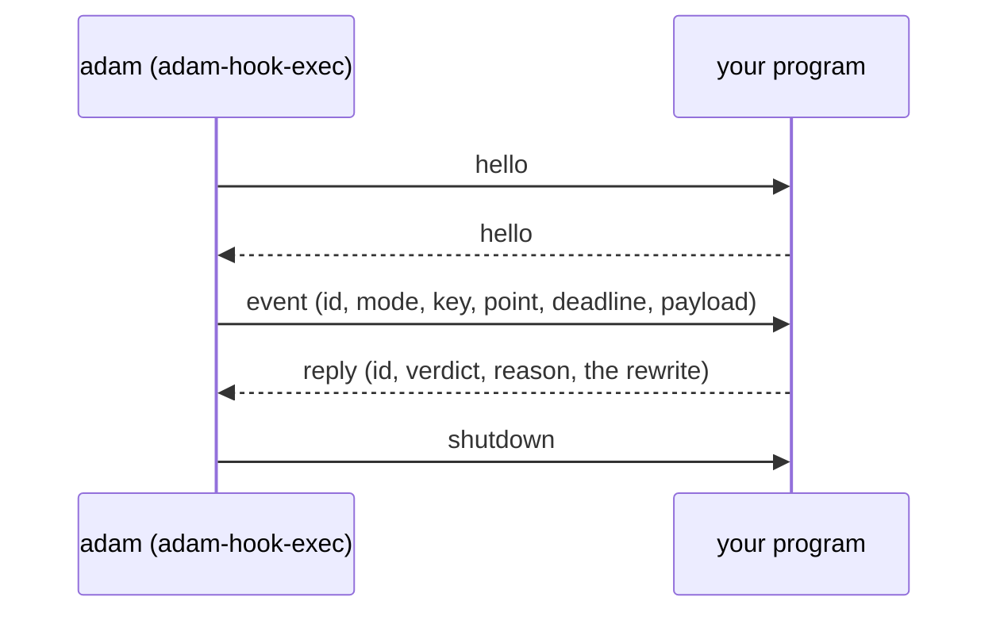

# The `adam-hooks/1` protocol

A **hook program** is a process that decides what an adam agent may do, in a language you choose: a
policy in Python, a check in Go, a shell script. It speaks one JSON object per line on its stdin and
stdout, and adam runs it behind the same `Plugin` trait a compiled hook uses
([ADR 0050](../decisions/0050-hooks-around-the-agent-loop-compiled-first-and-programs-second.md),
slice P1). This page is the contract; the Rust implementation is the `adam-hook-exec` crate.

A program never sees a run's context, a secret, or the environment of the process that started it. A
program that cannot answer in time never lets an action through: adam refuses the call.

## The exchange



1. adam starts the program, clears its environment, and writes `hello`.
2. The program answers `hello` within **5 seconds**, naming `adam-hooks/1`. No answer, or another
   protocol, and adam refuses to start: a binary exits with code 78.
3. For each hook call, adam writes one `event` and waits for its `reply` — **2 seconds** by default,
   at most 30. Replies may come in any order; each names the `id` it answers.
4. At the end, adam writes `shutdown`. A program that does not exit is killed.

One JSON object per line, at most **256 KiB**. A member adam does not know is ignored, so a program
may add its own; a line that is not JSON is a broken program (see *When it fails*).

## The messages

**hello**, from adam:

```json
{"type":"hello","protocol":"adam-hooks/1","name":"policy","version":1,
 "points":{"decide":["tool.before"],"observe":["tool.completed"]}}
```

**hello**, from the program (the `name` and `version` are yours; only `protocol` is checked):

```json
{"type":"hello","protocol":"adam-hooks/1","name":"my-policy","version":3}
```

**event**, from adam:

```json
{"type":"event","id":"7","mode":"decide","key":"policy/tool.before/7",
 "point":"tool.before","deadline_ms":2000,
 "payload":{"tool":"run_command","arguments":{"command":"git push"}}}
```

`mode` is `decide` (your answer is the verdict) or `observe` (you may only say `continue`). `key` is
`<plugin>/<point>/<id>`: unique for the life of the process, and **not** the journal's key — a replay
sends no request at all, so a program has nothing to deduplicate on.

**reply**, from the program:

```json
{"type":"reply","id":"7","verdict":"deny","reason":"pushing is not allowed here"}
```

A `rewrite` carries the member its point rewrites: `arguments` for `tool.before`, `text` for
`tool.after` and `message.received`, `context` for `compaction.before`, and `temperature`, `top_p`,
`max_output_tokens`, `metadata`, `headers` or `extra_body` for `model.request`.

**shutdown**, from adam: `{"type":"shutdown"}`.

## The points

| Point | Payload | Your verdicts | A `rewrite` carries |
|---|---|---|---|
| `message.received` | `text`, `files` (name, media type, size, reference — never the bytes) | allow, deny, rewrite | `text` |
| `tool.before` | `tool`, `arguments` | allow, deny, ask, stop, rewrite | `arguments` |
| `tool.after` | `tool`, `text` | allow, deny, stop, rewrite | `text` |
| `model.request` | `kind` (`turn` or `compaction`), `temperature`, `top_p`, `max_output_tokens`, `metadata`, `headers`, `extra_body` | allow, stop, rewrite | the member to change |
| `compaction.before` | `context` | allow, deny, stop, rewrite | `context` |
| `run.ending` | `text`, `continuations` | allow, deny (keep going), stop | nothing |

`deny` refuses the action and the run goes on with your reason. `ask` parks the run for a person's
approval (`tool.before` only). `stop` fails the run with your reason. `deny` at `run.ending` keeps
the run going, and your reason is what the model reads next.

An **observer** point is an event of the catalogue (`run.started`, `tool.completed`, `model.failed`,
…), an exact name, `ns.*`, or `*`. Its payload is the event: `kind`, `name`, `header` (`key`, `run`,
`root_run`, `agent`, `at`), `fields` and `cut` (the fields that were shortened). An observer that
answers anything but `continue` is refused and counted as a failure.

## What a program sees, and what it does not

- **The environment is empty**, then `PATH`, `HOME`, `LANG`, `TMPDIR` (and `SystemRoot`, `TEMP`,
  `USERPROFILE` on Windows), then the variables the deployment configures. Never a model key, a
  database URL or an A2A token.
- **Payloads are scrubbed** with the deployment's redactor. A rewrite that would touch a scrubbed
  span is refused, so a program cannot put a redaction marker back into a real call.
- **stderr is logged**, scrubbed, at debug level.
- **No run context**: no store, no history, no model, no secret.
- **Actions are not built yet.** A reply with a non-empty `actions` is refused (`Unsupported`)
  rather than silently ignored ([ADR 0050](../decisions/0050-hooks-around-the-agent-loop-compiled-first-and-programs-second.md),
  slice H1d).

## When it fails

| What happened | What adam does |
|---|---|
| No reply before the deadline | the call is refused transiently: the transition is retried, then the run fails |
| Three deadlines in a row | the program is killed and restarted with a backoff of 1 s, doubling to 30 s |
| A line that is not JSON, an unreadable reply | the program is killed at once and restarted with the same backoff; the call is refused |
| The program exits | its deciding points are transient until it is back; then it is restarted |
| A verdict the point does not allow | the call is refused (`Invalid`), and a person's reason says which |

While a program is down, every deciding point is `Transient`: a policy that cannot decide stops
calls, it never lets them through.

## A first program

This one refuses `git push` and lets everything else through:

```python
import json, sys

for line in sys.stdin:
    message = json.loads(line)
    if message.get("type") == "hello":
        print(json.dumps({"type": "hello", "protocol": "adam-hooks/1", "name": "no-push"}), flush=True)
    elif message.get("type") == "event":
        command = message["payload"].get("arguments", {}).get("command", "")
        verdict = {"verdict": "deny", "reason": "pushing is not allowed here"} if "git push" in command \
            else {"verdict": "continue"}
        print(json.dumps({"type": "reply", "id": message["id"], **verdict}), flush=True)
    elif message.get("type") == "shutdown":
        break
```

It is started with `Config` in an embedding host. The deployment's file and switch that read a
program from a configuration file are the next slice, P2; nothing is read from an agent's folder or a
repository.
