# Workspace, placement and environments

Where a run's files live and where its processes run. This is the coder's side of the platform; the
overview is in [Architecture](../architecture.md#where-a-runs-files-and-processes-live). Code:
`crates/adam-workspace` (workspaces, `Environment`, credentials), `crates/adam-env-kubernetes`,
`crates/adam-host` (`Placement`), `bin/adam-coder`.

## Placement: which worker holds a run's files

A run moves between workers at every step: a `Continue` is committed, the lease is released, and the next
claim may go to any worker. The coder keeps a workspace per run under a local root, so with two workers on
two disks a run can land on a worker that has no workspace for it. Nothing fails: `prepare_workspace`
clones again, a longer branch name is taken, the run notes are gone, and a **second pull request** is
opened. The deployer therefore chooses a placement ([ADR 0002](../decisions/0002-workspace-placement.md)),
the closed enum `adam_host::Placement`, read from `WORKSPACE_PLACEMENT`:

| `WORKSPACE_PLACEMENT` | Worker root | Claims | Needs `WORKER_ID` |
|---|---|---|---|
| `shared` (default) | `WORKSPACE_ROOT`, one volume for all workers | `ClaimScope::Any` | no |
| `affinity` | `WORKSPACE_ROOT/<WORKER_ID>` | `ClaimScope::Pinned` | yes |
| `isolated` | `WORKSPACE_ROOT`, a volume of this worker only | `ClaimScope::Pinned` | yes |
| `a2a-only` | none | `Any` | refused by `adam-coder` (its tools need a workspace) |

`serve` maps `Placement::pins_runs()` to `RuntimeOptions::claim_scope`. The store keeps the **owner** of a
run beside its lease (`runs.owner`), set by the first pinned claim and never cleared by a release or a commit.

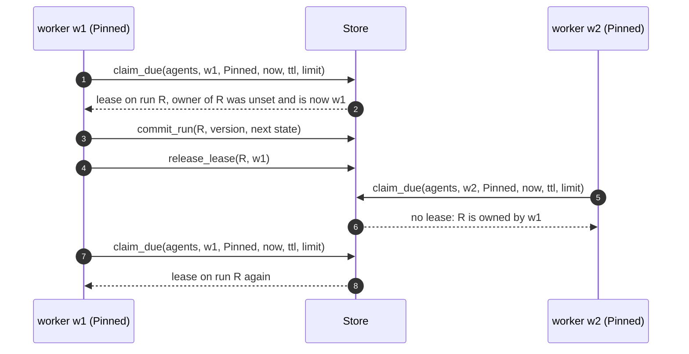

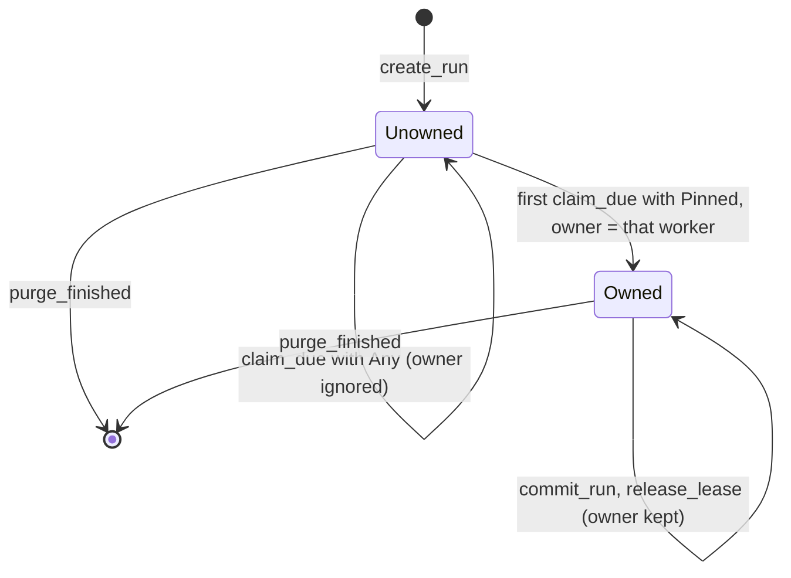

* **A pinned run whose owner is gone is stranded.** A claim cannot tell "busy" from "gone", so nothing
  adopts the run and nothing reports it. Keep worker ids stable and do not scale pinned workers in.
* **`shared` needs the mirror lock.** Several worker processes on one volume would otherwise fail in git
  with "could not lock". `adam-workspace` holds an exclusive `flock` on `<mirror>.lock`
  (`crates/adam-workspace/src/workspace.rs`, `lock_mirror`). *Unverified:* `flock` on NFS and Longhorn RWX.
* **`a2a-only`** is for hosts whose agents only call remote agents, such as the orchestrator.

## A run's workspace

A run's files are `<root>/workspaces/<run>/`, a directory of **slots**
([ADR 0008](../decisions/0008-a-workspace-holds-several-repositories.md)). A slot is a worktree of one
repository on the run's branch `agent/<run-short-id>`, a **scratch project**: a local git repository
with an empty root commit, where work can start before anyone names a repository, or a **reference**: a
repository to read beside the one the run works on, checked out detached with no branch of its own and never
written. A run has at most one slot per repository it works on (and may also hold a reference of it: the address
reaches the working copy, the reference's own name reaches the reference); slots keep the order they joined.

* The workspace lives as long as the run and is deleted when it ends (the janitor), **except when it holds unpushed
  work**: a worktree with uncommitted changes or commits no `origin` ref has, and every scratch project (a project has
  no remote, so all of its work is unpushed), keeps the workspace whole ([ADR 0065](../decisions/0065-resource-governance-admission-pools-and-os-limits.md)
  decision 7). A scratch project lives for the conversation: the next task of the same A2A context takes it over (its
  first step moves the project into its own workspace), after which the finished run's workspace holds nothing unpushed
  and goes. `SCRATCH_IDLE_DAYS` is the idle time of a conversation, and it decides when the conversation's **images**
  go; it never removes a project. The run's notes and the `agent/*` branches in the mirrors stay: they are the only copy
  of an unpushed commit.
* `copy_into` is the only way a scratch project's files reach a repository, all or nothing.
  `initialize_empty` gives an empty repository its first commit, the only push outside `agent/*`.
* A workspace made before slots existed (`<root>/worktrees/<run>`) is read as a slot and removed with the rest.
* API, layout and locks: the
  [`adam-workspace` README](../../crates/adam-workspace/README.md#a-runs-workspace-slots-scratch-projects-and-the-copy-between-them).

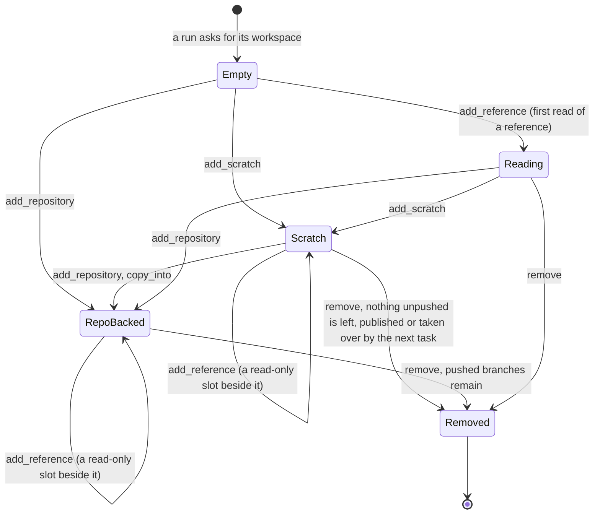

`Reading` is a workspace that holds references and nothing to work in: a read tool works in a reference, and a tool
that writes says there is nothing to write to. `run_command` needs a repository or a project; a run pod
works there, and mounts the reference read-only.

### References

A reference is a repository the coder **reads** beside the one it works on (a design system, an API's source, a sibling
service) and can never write to
([ADR 0044](../decisions/0044-paged-tools-a-stable-prompt-prefix-a-plan-skills-commands-and-project-context.md),
decision 10). It is a read-only slot: `Slot::writable()` is false, the checkout is detached at `origin/<branch>` with no
branch of its own, and nothing is pushed from it.

| Declared in | Consent | Notes |
|---|---|---|
| the agent's folder: `references:` in the frontmatter of `instructions.md` ([Agent files](agent-files.md#references-references)) | none | the agent's files are the deployment's |
| the deployment: the file `ADAM_REFERENCES_FILE` names ([Environment](environment.md)) | none | added to the agent's; a name both declare is exit 78 |
| a repository the run works on: its `.agents/references.json` | **the person's yes** to `request_repository` with `reference` | listed in the result of `prepare_workspace` as the repository's text; nothing is fetched before the yes |

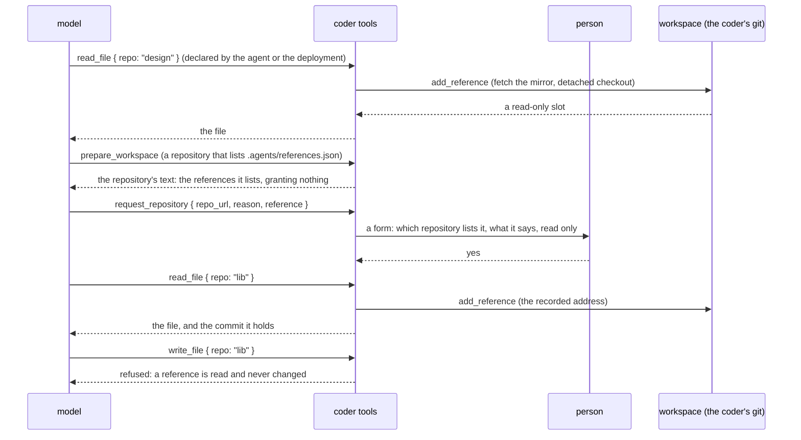

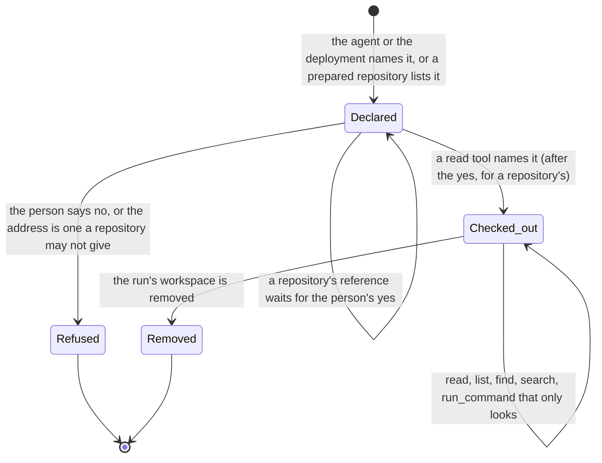

* **Reading.** `read_file`, `read_files`, `list_files`, `find_files`, `search_files` and `share_file` take the reference's name as
  `repo`; the first read checks it out, under the lowest access tier (`plan`), through the coder's own git (its
  sandbox, when there is one) and never in a run pod. A run with one repository and one reference still defaults to the
  repository for a write and for a read that names no slot. The repository's address reaches the reference too, until
  the run works in that repository: then the address is the working copy's, and the reference keeps its name.
* **The commit.** The first read says which commit the reference holds, and the run's notes keep it. A reference
  made again (its directory was lost) is checked out at that commit and says so; a commit that is gone from the
  repository is said and nothing is moved to another. The reference never follows the branch within a run.
* **A pod that already runs.** The slot is told to the run's pod when the reference is made, and a pod with a command
  running cannot take it: the result of that first read says the pod does not mount it yet, and the next command makes
  the pod again. Until then a command already running there sees the directory as writable.
* **Names.** A name that is also the directory of another slot is never answered with that slot. A repository's own
  declaration of such a name is not offered (the listing says why); for a reference the agent or the deployment
  declares, the lookup says that the name is both and reads neither.
* **What the model is told.** The names and descriptions of the references the process knows at start are part of the
  system prompt, the same words on every turn and before anything that changes with a message, so the stable prefix
  holds. A repository's own references reach the model only in the result of the `prepare_workspace` that found them.
* **Writing is refused at three places.** The tools: every tool that acts in a slot asks one function,
  `ToolEnv::slot_to_write`, which refuses a slot that is not writable; a test calls each tool that writes with a
  reference. Git: the worktree refuses a commit, a push, a publication, a base checkout and a copy into it, and a
  reference has no branch and no credential to push with. The mount: a run pod gets the reference and its directory in
  the mirror **read-only**.
* **With no run pods only the first two hold.** A `run_command` in a reference runs in the coder's own container: its guard undoes and refuses what changed a tracked or untracked file, `HEAD` or the git state, and
  **cannot see a file that `.gitignore` excludes**, nor a write outside the slot. `run` and `run_checks` are refused in a
  reference. Use run pods when a reference must be unchangeable by a command.
* **What a reference holds is somebody else's text.** Reading grants no repository, tier or consent, and its own
  `AGENTS.md` is not shown as the repository's instructions are. A repository's declaration is its text too: it is
  listed under a header that says so, its address is checked like a repository's (allowed hosts, the owners a GitHub App
  acts for, no credentials) and must be http(s), never a path, a `file://` address, a query string or a fragment, and the
  address fetched is the one recorded when the repository was prepared, never one the model gives.
* **What the person's yes is.** A yes to `request_repository` with `reference` is a yes to reading **that address at
  that branch**, shown in the question, and to nothing else: another branch of one repository is another question, and
  the yes names no repository to work on, whether it came as a click or as typed words (`Yes, read acme/lib`):
  `prepare_workspace` of it is still refused. A no is final for the run.
* **The bound on a repository's reference.** A reference a repository declares is fetched with the same credentials as
  a repository (a GitHub App's installation token for the address's owner). Three things bound it: the person's yes to
  the exact address and branch the question shows, the workspaces' policy for the address (allowed hosts, the owners a
  GitHub App acts for), and an http(s) address with no credentials. Nothing ties the reference's owner or its
  visibility to the repository that declared it, and what the agent reads there can end up in what it writes (a commit,
  a pull request): the question says so. A declaration of the agent's or the deployment's files is not asked about at
  all, and is checked against the same policy at startup (exit 78 naming the reference).

The janitor (`bin/adam-coder/src/janitor.rs`, a worker component) sweeps at startup and every
`WORKSPACE_SWEEP_SECS` (default 300; `0` is off): it removes the workspace of a run that is `done`,
`failed` (a cancel included) or unknown to the store, after releasing what the run's environment holds. A
run that is `runnable` or `parked` keeps its workspace however long the person takes to answer. A store
that does not answer leaves it alone. A finished run's workspace is removed only when it holds no unpushed work
(`RunWorkspace::remove_if_pushed`, ADR 0065 decision 7): a worktree with an uncommitted change or a commit no `origin`
ref has, and every scratch project, keep it whole, which the sweep logs and reports in `Sweep::kept_unpushed`.

The janitor also stops the commands that keep running of a run that is over, **before** it releases the environment
([Commands that keep running](coder-agent.md#commands-that-keep-running)).

## Environments: where a run's processes run

The project's checks, a command to look around and a command that makes something are started through the `Environment` port.
A tool asks the run's session to **prepare** a command from a description (program or shell line, working
directory, variables, the names of this process's secrets to hide) and spawns what comes back. Files and
paths are the same in every environment, so the file tools and all git work stay in the coder.

| Environment | Where | Chosen by |
|---|---|---|
| `Local` | the coder's own container: on a desktop, the person's own work sandbox | the default |
| `KubeEnvironment` | a Kubernetes pod of the run's own, made from a template the deployment mounts; the run container's image may be the repository's own ([below](#a-repositorys-own-image-adr-0052)) | `RUN_ENVIRONMENT=kubernetes` |

It is chosen when the binary is composed, not by a plugin. A failure to make the environment is a result
for the model (no check cycle is used); a secret is never in a description, only the names to hide.
ADR 0052 removed the third one (a repository's devcontainer on a rootless container service): a
deployment that still asks for it stops with exit 78, and a repository that brings its own environment
names an image its run pod runs ([below](#a-repositorys-own-image-adr-0052)).

### The environment of a run

The coder brings `adam-exec` into a run pod only (through the chart's init container), read-only: no
agent binary and no secret ([ADR 0038](../decisions/0038-the-coder-drops-opencode-and-adam-acp-stays-a-library.md)).
Its janitor releases a run's environment before it removes the workspace.

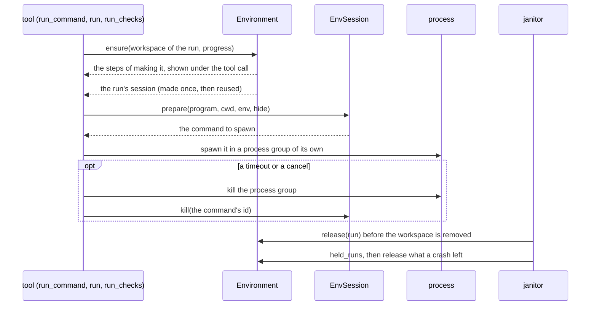

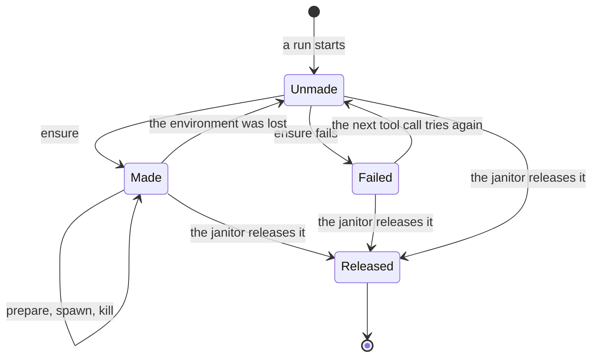

### Commands that keep running, by placement

`start_command` ([ADR 0044](../decisions/0044-paged-tools-a-stable-prompt-prefix-a-plan-skills-commands-and-project-context.md)
decision 13) starts a process that outlives the call, in the same environment as `run`, with `ExecSpec::background`. The coder holds
the process it spawned (its `Child`), and the environment holds what it started elsewhere. A run moves between workers at every
step, so a command is **one worker's** (its owner, which writes a beat into the command's record at start and at every sweep) and
the others see it through the record: [Several workers](coder-agent.md#several-workers).

| Placement | The process | Id | Stopped by | After the coder restarts |
|---|---|---|---|---|
| local | `sh -lc` in its own process group, a child of the coder | `bg-local-<n>` | the group is killed (`kill_group`), and what the leader left in the group, whatever ended the leader | it dies with the container (`tini`); a coder outside a container finds the record, and kills the pid only when its start time still matches, and what is left of its group (Linux); a registry that is dropped kills the groups it holds; the janitor kills what the records of a finished run name before it removes them |
| run pod | `adam-exec shell` in the pod; the `adam-kube-exec` client is the coder's child | `bg-kp-<epoch>-<n>` | the client is killed, then `adam-exec kill <id>` in the pod, when the client ends by itself too (`cmd &` outlives the client); another worker's `stop_command` kills the exec id at once and asks the owner to settle it | the pod's process may live on: once the record's beat is stale (the larger of three sweeps and 60 s) the next `start_command`, `stop_command` or `list_commands` kills it by exec id, and says `gone`; the janitor's `release` deletes the pod anyway |

* **A pod made again** (a new slot, a reference, or another image chosen) ends the client of a command in it. The coder cannot tell why
  the client ended, so a command in a run pod that a signal ended, and that nobody asked to stop, is `stopped` with the reason
  *its environment was made again ... or something outside ended it; start it again if it is still needed*. `use_repository_environment`
  stops the run's commands first and says so.
* **`adam-exec active-fg`** counts the live records whose id does not start with `bg-`. A pod made again for a new slot asks
  `active-fg` (`free_for_new_mount`, `seal`), so a development server never holds the pod from a new repository: the pod is
  deleted with the server in it, and the client of the command ends. The idle sweep asks `active`, which counts every command,
  so a pod with a server in it is never idle. A pod whose `adam-exec` has no `active-fg` (an older image) answers its usage line, and
  the pod is asked `active` instead, as before: every command holds it, a background one too (it fails safe). A newer `adam-exec`
  with an older coder is harmless: nothing asks `active-fg`, and an older coder starts no background command.
* **Ports.** In a pod a port is reachable from the run's other commands on `localhost` and not through the egress proxy
  (`NO_PROXY` has `localhost`), and by nothing outside the pod: the pod's ingress is empty and no port is published. In the
  coder's own container all runs of the worker share one network, so ports collide and runs reach each other's ports: the local
  mode's known limit.
* A process that leaves its process group and its parent (`setsid` and a double fork) escapes `adam-exec kill`. In a pod the
  pod's deletion is the backstop; locally there is none.

### A pod for each run

A build is bounded by the pod's memory (2Gi in the chart), and the coder shrinks to about 1Gi
([ADR 0019](../decisions/0019-a-runs-processes-in-a-pod-of-their-own.md)). The pod is made from a template
that holds the image, resources, priority class, security context and volumes; the code adds a name, labels and
annotations, and narrows the template's one mount of the workspace volume to the run: its own directory, and for
each worktree its mirror read-only and the worktree's own directory in it (with `HEAD`, `commondir`, `gitdir` and `logs` read-only on
top), each at the same path as in the coder, so a pod sees no other run ([ADR 0041](../decisions/0041-a-run-pod-sees-only-its-own-run.md)).
A reference is mounted **read-only** (`ro <path>` in the pod's mounts annotation), and so is its directory in the
mirror, whole: a write from the pod is `EROFS`. A repository added to a
run later, or a slot made again under the same name, makes the pod again, when no command runs in it (a command that keeps
running does not count: it ends with the pod). A command is
`adam-kube-exec`, which runs `adam-exec` in the pod over `pods/exec`. No GitHub credential ever enters a
pod. The chart's `runPods` block renders what surrounds it
([deploy guide](../guides/deploy-the-coder.md#run-pods)).

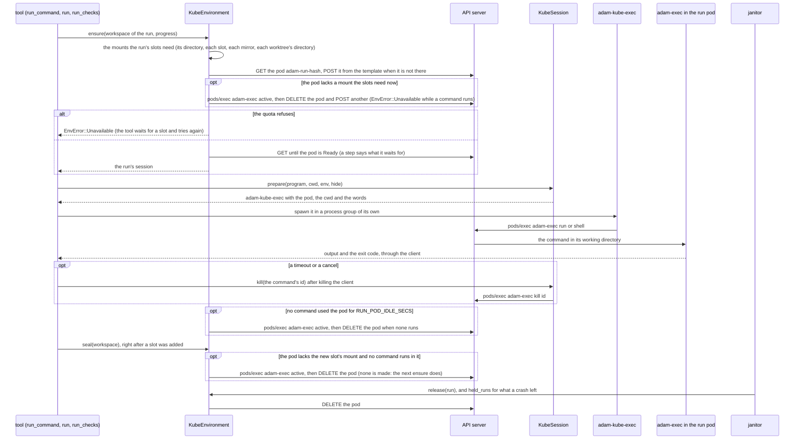

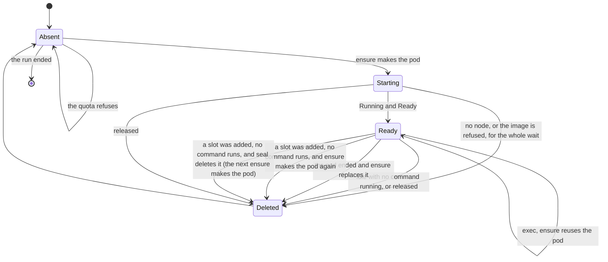

See also the [`adam-workspace` README](../../crates/adam-workspace/README.md#where-a-runs-processes-run-the-environment-port)
and [the coder README](../../bin/adam-coder/README.md#where-the-processes-of-a-run-run).

### A repository's own image (ADR 0052)

A repository may bring a `devcontainer.json` that names an image, and a deployment may allow its registry. The tool
`use_repository_environment { repo?, config?, off? }` is a **source's**, not one of the coder's fixed tools: it is offered
only when the commands run in run pods, `RUN_POD_REPOSITORY_IMAGES` names at least one prefix, and a **writable** slot of the
run holds a configuration. Otherwise it is withheld, and a call to it is refused with the reason. A reference is never the
slot: it is read-only and the pod mounts it read-only.

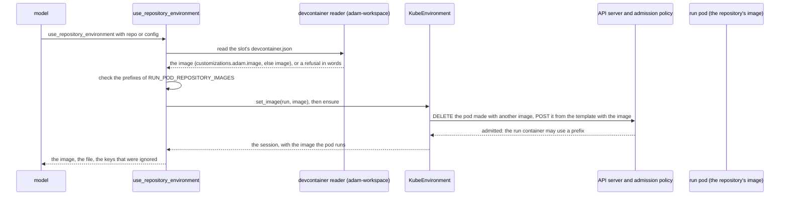

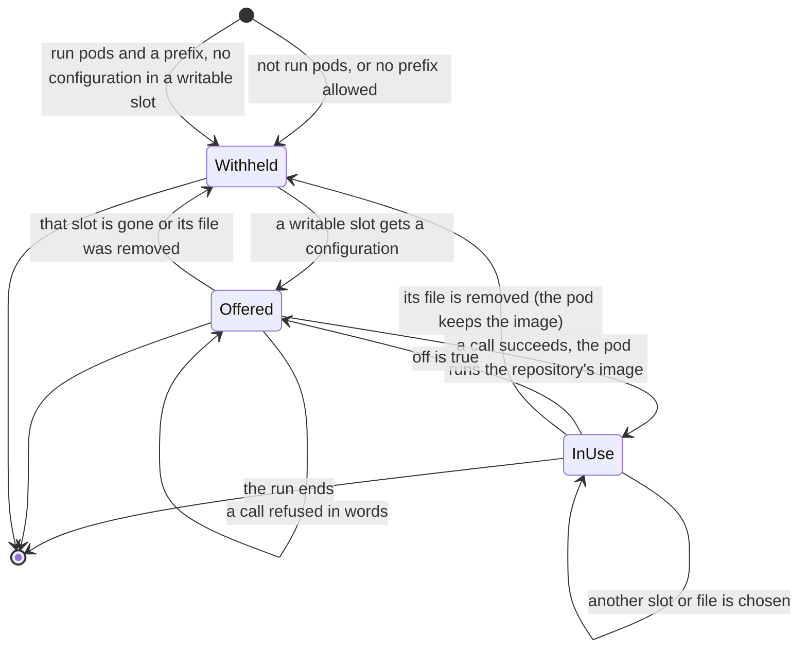

| The configuration has | The image of the run pod |
|---|---|
| `customizations.adam.image` | that image, whatever else the file says |
| `image`, and no `build` and no `features` | `image` |
| `build.dockerfile` or `features` | refused: this coder runs no container engine; publish one image in the repository's CI and name it in `customizations.adam.image`, or replace the build by `image` |
| `dockerComposeFile` | refused: name one image |
| an image outside the prefixes (naming them), a path (`./x`, `../x`, `/x`) or a `${...}` variable | refused in words |

The pod is the deployment's: its user, mounts, resources, network and runtime class do not move. The result lists the keys
that ask for them (`privileged`, `capAdd`, `securityOpt`, `runArgs`, `mounts`, `init`, `forwardPorts`, `appPort`,
`workspaceMount`, `workspaceFolder`, `remoteUser`, `containerUser`, `updateRemoteUserUID`, `hostRequirements`) as ignored.
**This slice runs no lifecycle command** (`onCreateCommand`, `postCreateCommand` and the others) and sets no `containerEnv` or
`remoteEnv`: they are listed as ignored too. It also does not report the digest the node pulled, does not reset the run when
the file changes, and does not add the one step ADR 0052 decision 4 gives a run whose slot has a configuration where the tool
cannot work. An image without `/bin/sh` is not recognised before its first command fails.

The choice is recorded in the pod's `adam.vymalo.com/repository-image` annotation and in the coder's memory, **not in the
run's metadata**: a coder that restarts keeps it while the pod exists, and the idle sweep keeps it in the same process, but a
pod the sweep deleted before a restart, or a new run of the conversation, starts again on the deployment's image. `off: true`
puts the run back on the deployment's image, and a pod with a command running is not replaced until it ends. If the slot's
file is gone the tool is withheld, so `off` is not available then: the run keeps its image until it ends. The admission policy
is the control: the `run` container may use an image that starts with an allowed prefix, and the init containers keep the
exact list. The deployment's value and its refusals: [the chart README](../../deploy/coder/README.md#run-pods).
